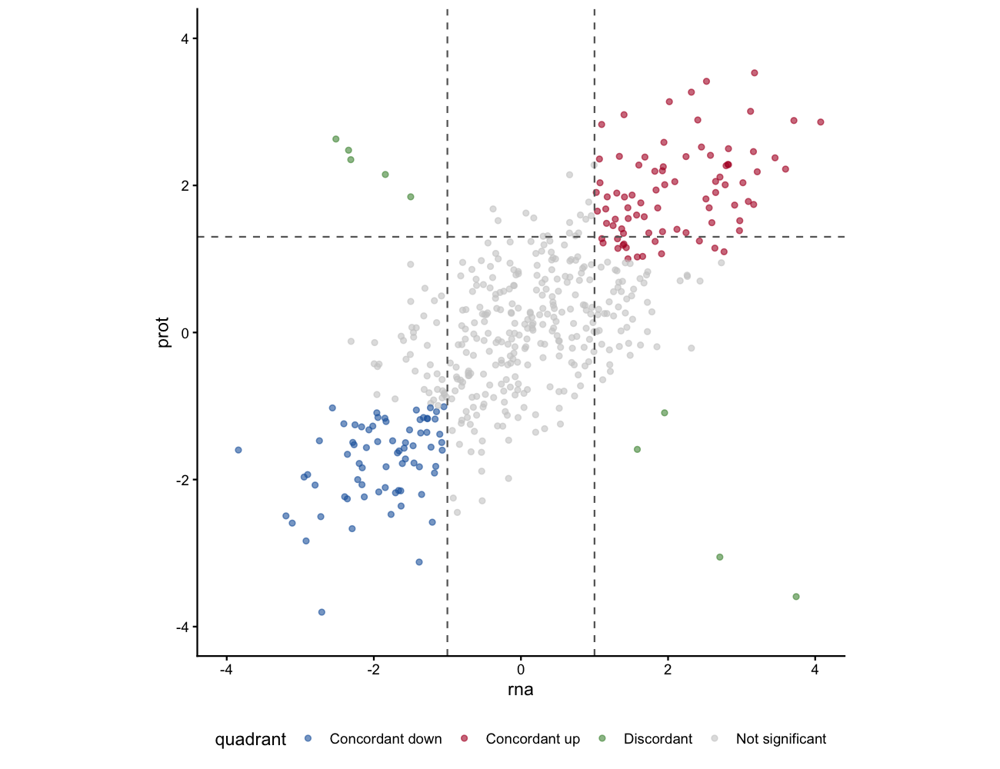

象限（或九宫格）散点图展示同一组特征的两种测量值，叠加象限阈值线，并用 `ggrepel` 标签突出显示感兴趣的命名特征 \[1\]。它是多组学一致性（RNA vs 蛋白、RNA vs ATAC）或展示基因处于生物学有意义区域（上调/上调、上调/下调等）的标准图。

## Example

{fig-alt="QuadrantPlot DEMO" fig-align="center" width="60%"}

## Setup

-   系统要求：跨平台（Linux/MacOS/Windows）

-   编程语言：R

-   依赖包： `ggplot2`; `ggrepel`; `dplyr`

```{r packages setup, message=FALSE, warning=FALSE, output=FALSE}
if (!requireNamespace("ggplot2", quietly = TRUE)) install.packages("ggplot2")
if (!requireNamespace("ggrepel", quietly = TRUE)) install.packages("ggrepel")
if (!requireNamespace("dplyr", quietly = TRUE)) install.packages("dplyr")

library(ggplot2)
library(ggrepel)
library(dplyr)
```

```{r}
sessioninfo::session_info("attached")
```

## Data Preparation

模拟 500 个基因的 RNA-seq 和蛋白质组学 log2 倍数变化，包含一致和不一致的基因子集，以及命名的高亮基因。

```{r load data, message=FALSE, warning=FALSE}
set.seed(2101)
n <- 500
genes <- paste0("Gene", sprintf("%04d", 1:n))
rna <- rnorm(n, sd = 1.5)
prot <- rna * 0.7 + rnorm(n, sd = 0.8)
# make a few discordant genes
disc <- sample(1:n, 15)
prot[disc] <- -rna[disc] + rnorm(15, sd = 0.3)
df_q <- data.frame(gene = genes, rna = rna, prot = prot)

# genes to label
label_genes <- c("Gene0001", "Gene0002", "Gene0015", "Gene0020",
                 "Gene0005", "Gene0008", "Gene0003")
```

## Visualization

### 1. 九宫格象限散点图 + 标签

```{r}
#| label: fig-1.1Quadrant
#| fig-cap: "象限散点：RNA-seq vs 蛋白质组 log2FC。竖线和横线标记倍数变化阈值（±1）。命名基因用 ggrepel 标注。"
#| out.width: "85%"
#| warning: false
#| message: false
#| fig-width: 7.5
#| fig-height: 6.5

threshold <- 1
ggplot(df_q, aes(rna, prot)) +
  geom_point(alpha = 0.4, size = 1.5, colour = "grey50") +
  geom_vline(xintercept = c(-threshold, threshold), linetype = "dashed", colour = "grey40") +
  geom_hline(yintercept = c(-threshold, threshold), linetype = "dashed", colour = "grey40") +
  geom_point(data = subset(df_q, gene %in% label_genes),
             colour = "#B2182B", size = 2.5) +
  ggrepel::geom_text_repel(
    data = subset(df_q, gene %in% label_genes),
    aes(label = gene), size = 3, colour = "#B2182B",
    box.padding = 0.4, max.overlaps = 20) +
  coord_equal(xlim = c(-4, 4), ylim = c(-4, 4)) +
  labs(x = "RNA-seq log2FC", y = "Proteomics log2FC",
       title = "RNA vs protein concordance") +
  theme_classic(base_size = 11)
```

### 2. 着色象限区域

```{r}
#| label: fig-1.2ColouredQuadrant
#| fig-cap: "基因按象限着色：一致上调（红）、一致下调（蓝）、不一致（绿）、不显著（灰）。"
#| out.width: "85%"
#| warning: false
#| message: false
#| fig-width: 7.5
#| fig-height: 6.5

df_q <- df_q |>
  mutate(quadrant = case_when(
    rna > threshold & prot > threshold ~ "Concordant up",
    rna < -threshold & prot < -threshold ~ "Concordant down",
    abs(rna) > threshold & abs(prot) > threshold ~ "Discordant",
    TRUE ~ "Not significant"))

quad_cols <- c("Concordant up" = "#B2182B", "Concordant down" = "#2166AC",
               "Discordant" = "#4D9342", "Not significant" = "grey80")

ggplot(df_q, aes(rna, prot, colour = quadrant)) +
  geom_point(size = 1.5, alpha = 0.6) +
  geom_vline(xintercept = c(-threshold, threshold), linetype = "dashed", colour = "grey40") +
  geom_hline(yintercept = c(-threshold, threshold), linetype = "dashed", colour = "grey40") +
  scale_colour_manual(values = quad_cols) +
  geom_point(data = subset(df_q, gene %in% label_genes),
             colour = "black", size = 2.5, shape = 21, fill = "gold") +
  ggrepel::geom_text_repel(
    data = subset(df_q, gene %in% label_genes),
    aes(label = gene), size = 3, colour = "black",
    box.padding = 0.4, max.overlaps = 20) +
  coord_equal(xlim = c(-4, 4), ylim = c(-4, 4)) +
  labs(x = "RNA-seq log2FC", y = "Proteomics log2FC", colour = "Quadrant") +
  theme_classic(base_size = 11) +
  theme(legend.position = "bottom")
```

::: callout-tip
**Practice tips**

-   调整 `threshold` 以匹配数据的倍数变化截断值；默认 ±1 对应 |log2FC| > 1。
-   用 `geom_text_repel()` 的 `max.overlaps = 20` 确保即使高亮基因很多标签也可读。
-   `case_when()` 的象限分配可通过添加更多条件适配任意数量的区域。
:::

## Application

象限散点图是多组学一致性、药物反应筛选和 CRISPR 筛选比较的标准图。

## Reference

\[1\] Xiaofan Lu, et al. FigureYa: A Standardized Visualization Framework for Enhancing Biomedical Data Interpretation and Research Efficiency. iMetaMed. 2025. doi:10.1002/imm3.70005
