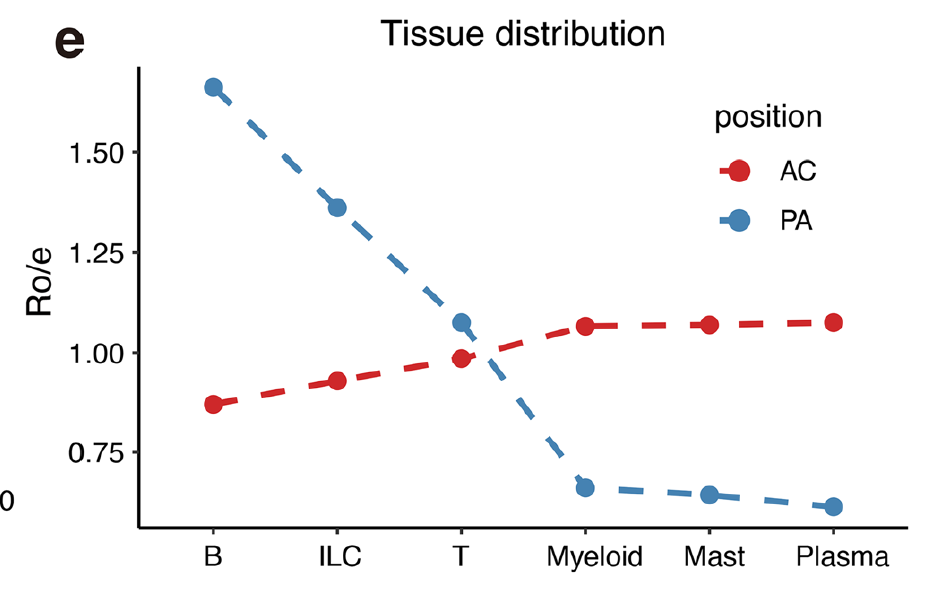

The companion to the Ro/e tile map: instead of a grid, each cell cluster is drawn as a **line across tissues** whose height is its Ro/e value, so a cluster's tissue trajectory reads as a single profile and several clusters can be compared on one axis \[1\]. The contingency-table computation is the same as the tile version; the rendering differs:

## Example

{fig-alt="Tissue-Enrichment Line Profile DEMO" fig-align="center" width="70%"}

## Setup

-   System Requirements: Cross-platform (Linux/MacOS/Windows)

-   Programming language: R

-   Dependent packages: `ggplot2`; `patchwork`

```{r packages setup, message=FALSE, warning=FALSE, output=FALSE}
suppressPackageStartupMessages({
  library(ggplot2); library(patchwork)
})
```

```{r}
sessioninfo::session_info("attached")
```

## Data Preparation

9 cell clusters × 4 tissue regions (core, shoulder, adjacent, distal), 9,000 simulated cells. Planted structure: myeloid and mast clusters peak in the core, lymphocytes in adjacent/distal — the reference's atherosclerosis pattern — with each cluster's profile having a different shape rather than a single spike:

```{r load data}
suppressPackageStartupMessages({library(ggplot2); library(patchwork)})
set.seed(51317)
clusters <- c("Mast", "Myeloid_M1", "Myeloid_M2", "DC", "SMC",
              "Endothelial", "T_cell", "B_cell", "NK")
regions <- c("Core", "Shoulder", "Adjacent", "Distal")
n <- c(420, 1500, 1300, 700, 900, 1100, 2000, 800, 500)
peak <- c(1, 1, 1, 2, 1, 1, 3, 3, 3)      # index of preferred region
spread <- c(0.5, 0.9, 0.8, 0.7, 0.6, 0.5, 1.1, 1.0, 0.9)
weights <- sapply(seq_along(clusters), function(i)
  exp(-abs(seq_along(regions) - peak[i]) * spread[i]))
obs <- t(sapply(seq_along(clusters), function(i)
  as.vector(rmultinom(1, n[i], weights[, i] / sum(weights[, i])))))
dimnames(obs) <- list(clusters, regions)

expected <- outer(rowSums(obs), colSums(obs)) / sum(obs)
roe <- obs / expected
roe_df <- as.data.frame(as.table(roe))
names(roe_df) <- c("cluster", "region", "roe")
roe_df$region <- factor(roe_df$region, levels = regions)
```

## Visualization

### 1. Ro/e Line Profiles, All Clusters

The reference's line rendering: one line per cluster across the four regions (x ordered from core outward), horizontal reference at Ro/e = 1, clusters split into myeloid and lymphoid panels so each panel's lines stay readable:

```{r}
#| label: fig-1.1RoeLine
#| fig-cap: "Tissue-enrichment line profiles: Ro/e of each cluster plotted across the four regions (core to distal), with the Ro/e = 1 null line; myeloid/mast clusters peak in the core and decline outward, lymphoid clusters do the opposite."
#| out.width: "100%"
#| fig-width: 10
#| fig-height: 4.6

myeloid <- c("Mast", "Myeloid_M1", "Myeloid_M2", "DC", "SMC", "Endothelial")
lymph <- c("T_cell", "B_cell", "NK")
mdf <- roe_df[roe_df$cluster %in% myeloid, ]
ldf <- roe_df[roe_df$cluster %in% lymph, ]

p1 <- ggplot(mdf, aes(region, roe, colour = cluster, group = cluster)) +
  geom_hline(yintercept = 1, linetype = "dashed", colour = "grey50") +
  geom_line(linewidth = 0.9) + geom_point(size = 2) +
  scale_colour_brewer(palette = "Set2", name = NULL) +
  labs(title = "myeloid / stromal", x = NULL, y = "Ro/e") +
  theme_bw(base_size = 10.5) +
  theme(panel.grid.minor = element_blank(),
        legend.position = "right", legend.key.size = unit(0.35, "cm"))

p2 <- ggplot(ldf, aes(region, roe, colour = cluster, group = cluster)) +
  geom_hline(yintercept = 1, linetype = "dashed", colour = "grey50") +
  geom_line(linewidth = 0.9) + geom_point(size = 2) +
  scale_colour_manual(values = c(T_cell = "#E41A1C", B_cell = "#377EB8",
                                 NK = "#4DAF4A"), name = NULL) +
  labs(title = "lymphoid", x = NULL, y = "Ro/e") +
  theme_bw(base_size = 10.5) +
  theme(panel.grid.minor = element_blank(),
        legend.position = "right", legend.key.size = unit(0.35, "cm"))

p1 + p2
```

### 2. Region Totals as the Denominator

A line profile is ratios; the denominators matter. The region-level cell totals show how much data each point rests on — a Ro/e spike in a region with 40 cells is not the same claim as in one with 4000:

```{r}
#| label: fig-2.1RoeRegionTotals
#| fig-cap: "Cells per region (the denominator behind every Ro/e point): the distal region carries the fewest cells, so its Ro/e values are the least stable — the caveat the ratio panel cannot show."
#| out.width: "70%"
#| fig-width: 6.4
#| fig-height: 4.4

reg_tot <- data.frame(region = factor(regions, levels = regions),
                      cells = colSums(obs))
ggplot(reg_tot, aes(region, cells)) +
  geom_col(fill = "#4472C4", width = 0.62) +
  geom_text(aes(label = cells), vjust = -0.4, size = 3.2) +
  scale_y_continuous(expand = expansion(mult = c(0, 0.14))) +
  labs(x = NULL, y = "number of cells") +
  theme_bw(base_size = 11) +
  theme(panel.grid.minor = element_blank())
```

::: callout-tip
**Practice tips**

-   Order the tissue axis along a biological gradient (core → shoulder → adjacent → distal), not alphabetically: the line's slope is the message.
-   Split the clusters into panels when more than ~6 lines share an axis; overplotted lines turn into a single grey mass.
-   Always draw the Ro/e = 1 null line — a line profile without the reference makes "above" and "below" invisible.
-   Pair the ratios with the region totals: Ro/e amplifies noise in sparse regions, and the totals panel is the honest caveat.
-   Use the line profile for trajectory-like reading (a cluster's tissue gradient) and the tile map for a full table — the two views answer different questions.
:::

## Application

::: {#fig-RoeDotApplications1}
{fig-alt="Tissue-Enrichment Line Profile" fig-align="center" width="70%"}

Tissue-enrichment line profile
:::

Ro/e line profiles apply wherever a cluster's spatial gradient is the story: plaque core vs periphery, tumour centre vs invasive margin, or proximal vs distal colon — anywhere the tissue axis is ordered.

## Reference

\[1\] Xiaofan Lu, et al. FigureYa: A Standardized Visualization Framework for Enhancing Biomedical Data Interpretation and Research Efficiency. iMetaMed. 2025. doi:10.1002/imm3.70005
