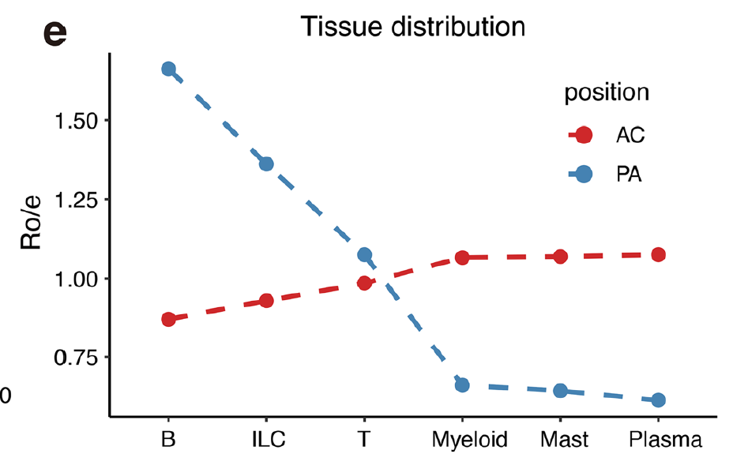

Ro/e 瓦片图的伴随图：不是网格，而是每个细胞簇画成一条**跨组织的线**、高度为其 Ro/e 值——于是簇的组织轨迹读作单一 profile、多个簇可在同一轴上比较 \[\1\]。列联表计算与瓦片版相同；渲染不同：

## Example

{fig-alt="组织富集折线剖面（按组的 Ro/e） DEMO" fig-align="center" width="60%"}

## Setup

-   系统要求：跨平台（Linux/MacOS/Windows）

-   编程语言：R

-   依赖包：`ggplot2`; `patchwork`

```{r packages setup, message=FALSE, warning=FALSE, output=FALSE}
suppressPackageStartupMessages({
  library(ggplot2); library(patchwork)
})
```

```{r}
sessioninfo::session_info("attached")
```

## 数据准备

9 个细胞簇 × 4 个组织区域（核心、肩部、邻近、远端）、9,000 个模拟细胞。植入结构：髓系与肥大簇在核心达峰、淋巴细胞在邻近/远端达峰——即参考的动脉粥样硬化模式——且每簇 profile 形状不同而非单一尖峰：

```{r load data}
suppressPackageStartupMessages({library(ggplot2); library(patchwork)})
set.seed(51317)
clusters <- c("Mast", "Myeloid_M1", "Myeloid_M2", "DC", "SMC",
              "Endothelial", "T_cell", "B_cell", "NK")
regions <- c("Core", "Shoulder", "Adjacent", "Distal")
n <- c(420, 1500, 1300, 700, 900, 1100, 2000, 800, 500)
peak <- c(1, 1, 1, 2, 1, 1, 3, 3, 3)      # index of preferred region
spread <- c(0.5, 0.9, 0.8, 0.7, 0.6, 0.5, 1.1, 1.0, 0.9)
weights <- sapply(seq_along(clusters), function(i)
  exp(-abs(seq_along(regions) - peak[i]) * spread[i]))
obs <- t(sapply(seq_along(clusters), function(i)
  as.vector(rmultinom(1, n[i], weights[, i] / sum(weights[, i])))))
dimnames(obs) <- list(clusters, regions)

expected <- outer(rowSums(obs), colSums(obs)) / sum(obs)
roe <- obs / expected
roe_df <- as.data.frame(as.table(roe))
names(roe_df) <- c("cluster", "region", "roe")
roe_df$region <- factor(roe_df$region, levels = regions)
```

## Visualization

### 全部簇的 Ro/e 折线剖面

参考的折线渲染：每簇一条跨四个区域的线（x 从核心向外）、Ro/e = 1 的水平参考线、簇按髓系与淋巴分面板以保证每面板的线可读：

```{r}
#| label: fig-1.1RoeLine
#| fig-cap: "组织富集折线剖面：每簇的 Ro/e 绘制于四个区域（核心到远端），Ro/e = 1 虚线参考；髓系/肥大簇在核心达峰并沿组织梯度下降、淋巴细胞相反。"
#| out.width: "100%"
#| fig-width: 10
#| fig-height: 4.6

myeloid <- c("Mast", "Myeloid_M1", "Myeloid_M2", "DC", "SMC", "Endothelial")
lymph <- c("T_cell", "B_cell", "NK")
mdf <- roe_df[roe_df$cluster %in% myeloid, ]
ldf <- roe_df[roe_df$cluster %in% lymph, ]

p1 <- ggplot(mdf, aes(region, roe, colour = cluster, group = cluster)) +
  geom_hline(yintercept = 1, linetype = "dashed", colour = "grey50") +
  geom_line(linewidth = 0.9) + geom_point(size = 2) +
  scale_colour_brewer(palette = "Set2", name = NULL) +
  labs(title = "myeloid / stromal", x = NULL, y = "Ro/e") +
  theme_bw(base_size = 10.5) +
  theme(panel.grid.minor = element_blank(),
        legend.position = "right", legend.key.size = unit(0.35, "cm"))

p2 <- ggplot(ldf, aes(region, roe, colour = cluster, group = cluster)) +
  geom_hline(yintercept = 1, linetype = "dashed", colour = "grey50") +
  geom_line(linewidth = 0.9) + geom_point(size = 2) +
  scale_colour_manual(values = c(T_cell = "#E41A1C", B_cell = "#377EB8",
                                 NK = "#4DAF4A"), name = NULL) +
  labs(title = "lymphoid", x = NULL, y = "Ro/e") +
  theme_bw(base_size = 10.5) +
  theme(panel.grid.minor = element_blank(),
        legend.position = "right", legend.key.size = unit(0.35, "cm"))

p1 + p2
```

### 区域总数作为分母

折线是比值；分母同样重要。区域级细胞总数展示每个点依托的数据量——40 个细胞区域的 Ro/e 尖峰与 4000 个细胞区域不是同等的声明：

```{r}
#| label: fig-2.1RoeRegionTotals
#| fig-cap: "每区域的细胞数（每个 Ro/e 点的分母）：远端区域携带的细胞最少，其 Ro/e 值最不稳定——比值面板无法展示的警示。"
#| out.width: "70%"
#| fig-width: 6.4
#| fig-height: 4.4

reg_tot <- data.frame(region = factor(regions, levels = regions),
                      cells = colSums(obs))
ggplot(reg_tot, aes(region, cells)) +
  geom_col(fill = "#4472C4", width = 0.62) +
  geom_text(aes(label = cells), vjust = -0.4, size = 3.2) +
  scale_y_continuous(expand = expansion(mult = c(0, 0.14))) +
  labs(x = NULL, y = "number of cells") +
  theme_bw(base_size = 11) +
  theme(panel.grid.minor = element_blank())
```


## 应用场景

::: {{#fig-RoeDotApplications1}}
{fig-alt="组织富集折线剖面（按组的 Ro/e）" fig-align="center" width="60%"}

组织富集折线剖面（按组的 Ro/e）
:::

Ro/e 折线剖面适用于任何以簇的空间梯度为故事的组织比较：斑块核心 vs 外周、肿瘤中心 vs 侵袭边缘、或近端 vs 远端结肠——凡组织轴有序处。

## 参考文献

\[1\] Xiaofan Lu, et al. FigureYa: A Standardized Visualization Framework for Enhancing Biomedical Data Interpretation and Research Efficiency. iMetaMed. 2025. doi:10.1002/imm3.70005
