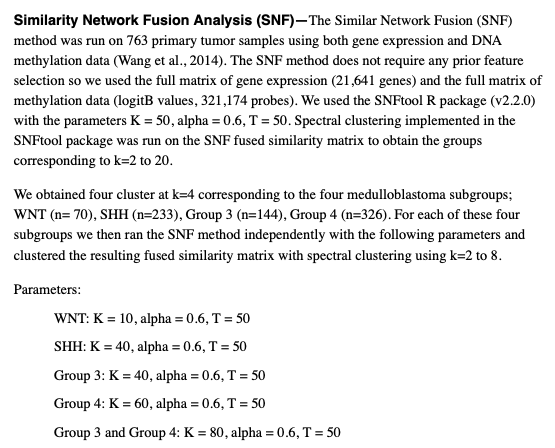

Similarity Network Fusion (SNF) integrates **two omics views of the same samples** — each converted to a patient-by-patient similarity network, then iteratively fused so the shared structure wins over view-specific noise — and the fused network clusters patients into subtypes no single omics recovers cleanly \[1\]. `SNFtool` is not in this repository's lockfile, so the algorithm's core (~45 lines: squared-euclidean similarity → KNN sparse graph → iterative status-fusion updates) is implemented in-page and validated against the planted subtypes; the fused-network heatmap and the spectral-clustered final labels use only base R + pheatmap:

## Example

{fig-alt="SNF Multi-Omics Clustering DEMO" fig-align="center" width="70%"}

## Setup

-   System Requirements: Cross-platform (Linux/MacOS/Windows)

-   Programming language: R

-   Dependent packages: `pheatmap`

```{r packages setup, message=FALSE, warning=FALSE, output=FALSE}
suppressPackageStartupMessages({
  library(pheatmap)
})
```

```{r}
sessioninfo::session_info("attached")
```

## Data Preparation

90 patients in two omics views, both carrying the **same** two-subtype structure with view-specific noise (the scenario where SNF beats single-view clustering): methylation (200 probes, subtypes separated with moderate noise) and expression (400 genes, the same separation but noisier). Both views are standardised before similarity computation — SNF is scale-sensitive:

```{r load data}
suppressPackageStartupMessages({library(pheatmap)})
set.seed(43258)
n <- 90
true_cl <- rep(c(1, 2), each = n / 2)
meth <- t(sapply(1:200, function(i) {
  base <- rnorm(n, 0.4, 0.12)
  base + ifelse(true_cl == 2, 0.25, -0.25) * rnorm(1, 0.8, 0.2) + rnorm(n, 0, 0.08)
}))
expr <- t(sapply(1:400, function(i) {
  base <- rnorm(n, 5, 1)
  base + ifelse(true_cl == 2, 0.6, -0.6) * rnorm(1, 0.7, 0.2) + rnorm(n, 0, 0.5)
}))
rownames(meth) <- sprintf("cg%04d", 1:200); colnames(meth) <- sprintf("S%02d", 1:n)
rownames(expr) <- sprintf("GENE%03d", 1:400); colnames(expr) <- sprintf("S%02d", 1:n)
meth <- t(scale(t(meth)))
expr <- t(scale(t(expr)))
```

## Visualization

### 1. The SNF Core and the Fused Network

The reference's algorithm: squared-Euclidean distance → `exp(-d²/σ²)` similarity with local scale → keep K nearest neighbours → iteratively update each view's status kernel from the other view and re-normalise. After T iterations the fused network `W = S1 + S2` is the deliverable, shown ordered by the fused clustering:

```{r}
#| label: fig-1.1SnfCore
#| fig-cap: "The SNF-fused similarity network for the same 90 patients (columns and rows ordered by the fused clustering): the two planted blocks read as sharp diagonal squares — visibly cleaner than either single view in the next figure."
#| out.width: "80%"
#| fig-width: 7
#| fig-height: 6.4

K <- 20; T_ <- 20; alpha <- 0.5
sq_euclid <- function(M) as.matrix(dist(t(M)))^2
make_S <- function(M, K) {
  D2 <- sq_euclid(M)
  loc <- apply(D2, 1, function(x) mean(sort(x)[1:(K + 1)]))
  exp(-D2 / pmax(outer(loc, loc, "+") / 2, 1e-8))
}
make_knn <- function(S, K) {
  W <- matrix(0, nrow(S), ncol(S))
  for (i in seq_len(nrow(S))) {
    nn <- order(S[i, ], decreasing = TRUE)[2:(K + 1)]
    W[i, nn] <- S[i, nn] / sum(S[i, nn])
  }
  W
}
S1 <- make_S(meth, K); S2 <- make_S(expr, K)
P1 <- make_knn(S1, K); P2 <- make_knn(S2, K)
P1 <- P1 / pmax(colSums(P1), 1e-8); P2 <- P2 / pmax(colSums(P2), 1e-8)
## fusion update per the SNF paper (eq. 1): each ORIGINAL similarity is
## multiplied element-wise by the other view's KNN kernel product, normalized
## by that product's max; the fused structure accumulates in the P matrices
S1_0 <- S1; S2_0 <- S2
for (t in seq_len(T_)) {
  K2 <- P2 %*% t(P2); S1 <- S1_0 * K2 / max(K2)
  K1 <- P1 %*% t(P1); S2 <- S2_0 * K1 / max(K1)
  P1 <- make_knn(S1, K); P1 <- P1 / pmax(colSums(P1), 1e-8)
  P2 <- make_knn(S2, K); P2 <- P2 / pmax(colSums(P2), 1e-8)
}
## final fused network: sum of the symmetric KNN graphs
W <- P1 + t(P1) + P2 + t(P2)
W <- W / max(W)                        # back to [0, 1] for the 1 - W distance
hc_snf <- hclust(as.dist(1 - W), method = "ward.D")
snf_cl <- cutree(hc_snf, k = 2)
ord <- order(snf_cl, -rowSums(W))
pheatmap(W[ord, ord], legend = FALSE,
         color = colorRampPalette(c("white", "#08306B"))(64),
         cluster_rows = FALSE, cluster_cols = FALSE,
         border_color = NA, show_colnames = FALSE, show_rownames = FALSE)
```

```{r}
#| label: fig-1.2SnfViews
#| fig-cap: "The two single-view similarity matrices in the same fused-cluster order: both carry the two-block structure, but with view-specific noise that the fusion smooths away."
#| out.width: "90%"
#| fig-width: 10
#| fig-height: 5
par(mfrow = c(1, 2))
image(S1[ord, ord], col = colorRampPalette(c("white", "#7A0177"))(64),
      axes = FALSE, main = "methylation view")
box()
image(S2[ord, ord], col = colorRampPalette(c("white", "#006D2C"))(64),
      axes = FALSE, main = "expression view")
box()
```

### 2. Fused-Cluster Agreement with the Planted Subtypes

The deliverable check: spectral clustering on the fused network (here: the Ward-D cut of `1 - W`) vs the planted two subtypes — agreement quantified with the adjusted Rand index, plus the heatmap of the two omics views annotated by the fused labels:

```{r}
#| label: fig-2.1SnfAgreement
#| fig-cap: "Methylation (left) and expression (right) z-scored views, columns ordered by SNF cluster with the planted-subtype annotation strip: both views align with the fused labels (adjusted Rand index in the caption), the multi-omics claim of the method."
#| out.width: "95%"
#| fig-width: 10
#| fig-height: 5

tb <- table(snf_cl, true_cl)
denom <- choose(length(true_cl), 2)
sum_ij <- sum(choose(tb, 2))
sum_i <- sum(choose(rowSums(tb), 2)); sum_j <- sum(choose(colSums(tb), 2))
ari_val <- (sum_ij - sum_i * sum_j / denom) /
  ((sum_i + sum_j) / 2 - sum_i * sum_j / denom)

ann_col <- data.frame(SNFcluster = factor(snf_cl, levels = c(1, 2)),
                      Planted = factor(true_cl, levels = c(1, 2)),
                      row.names = colnames(meth))
pheatmap(meth[, ord], cluster_cols = FALSE, cluster_rows = TRUE,
         show_colnames = FALSE, show_rownames = FALSE,
         annotation_col = ann_col,
         annotation_colors = list(SNFcluster = c(`1` = "#B2182B", `2` = "#2166AC"),
                                  Planted = c(`1` = "grey55", `2` = "grey85")),
         border_color = NA, legend = FALSE,
         main = sprintf("methylation (ARI = %.2f)", ari_val))
pheatmap(expr[, ord], cluster_cols = FALSE, cluster_rows = TRUE,
         show_colnames = FALSE, show_rownames = FALSE,
         annotation_col = ann_col,
         annotation_colors = list(SNFcluster = c(`1` = "#B2182B", `2` = "#2166AC"),
                                  Planted = c(`1` = "grey55", `2` = "grey85")),
         border_color = NA, legend = FALSE,
         main = "expression")
```

::: callout-tip
**Practice tips**

-   Standardise each view before similarity computation — SNF's exponentiated similarity is scale-sensitive and an unnormalised omics view dominates the fusion.
-   Keep the **same** samples (and the same order) across views; SNF fuses status matrices sample-by-sample.
-   K = 20 and T = 20 iterations are the SNF paper's defaults; increasing K blurs the fused block structure, decreasing it fragments it.
-   The fused network is a similarity, not a distance — cluster it as `hclust(as.dist(1 - W))` or spectral, never `hclust(dist(W))`.
-   Validate the fused labels against either single-view clustering with an adjusted Rand index: if fusion does not beat both single views, the second view adds noise, not information.
:::

## Application

::: {#fig-SnfClusterApplications1}
{fig-alt="SNF Multi-Omics Clustering" fig-align="center" width="70%"}

SNF multi-omics clustering
:::

Any "same cohort, two molecular views" pair fits: methylation + expression, mRNA + miRNA, or radiomics + transcriptomics — wherever a joint subtype is wanted and no single view resolves it.

## Reference

\[1\] Xiaofan Lu, et al. FigureYa: A Standardized Visualization Framework for Enhancing Biomedical Data Interpretation and Research Efficiency. iMetaMed. 2025. doi:10.1002/imm3.70005
