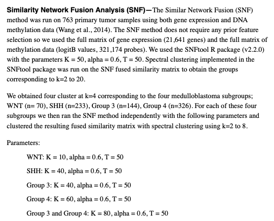

相似网络融合（SNF）把**同一队列的两种组学视图**——各自转成患者×患者相似性网络后迭代融合——让共享结构胜过视图特异噪声，融合网络聚类出的亚型是任何单一组学都恢复不干净的 \[1\]。`SNFtool` 不在本仓库 lockfile——算法核心（约 45 行：平方欧氏相似度 → KNN 稀疏图 → 迭代状态融合更新）在页内实现并对照植入亚型验证；融合网络热图与最终标签只用 base R + pheatmap：

## Example

{fig-alt="SNF 多组学聚类 DEMO" fig-align="center" width="60%"}

## Setup

-   系统要求：跨平台（Linux/MacOS/Windows）

-   编程语言：R

-   依赖包：`pheatmap`

```{r packages setup, message=FALSE, warning=FALSE, output=FALSE}
suppressPackageStartupMessages({
  library(pheatmap)
})
```

```{r}
sessioninfo::session_info("attached")
```

## 数据准备

90 个患者、两种组学视图，都携带**同一**双亚型结构加视图特异噪声（SNF 胜过单视图聚类的典型场景）：甲基化（200 探针、中等噪声分离）与表达（400 基因、同分离但更噪）。两视图在相似度计算前各自标度化——SNF 对尺度敏感：

```{r load data}
suppressPackageStartupMessages({library(pheatmap)})
set.seed(43258)
n <- 90
true_cl <- rep(c(1, 2), each = n / 2)
meth <- t(sapply(1:200, function(i) {
  base <- rnorm(n, 0.4, 0.12)
  base + ifelse(true_cl == 2, 0.25, -0.25) * rnorm(1, 0.8, 0.2) + rnorm(n, 0, 0.08)
}))
expr <- t(sapply(1:400, function(i) {
  base <- rnorm(n, 5, 1)
  base + ifelse(true_cl == 2, 0.6, -0.6) * rnorm(1, 0.7, 0.2) + rnorm(n, 0, 0.5)
}))
rownames(meth) <- sprintf("cg%04d", 1:200); colnames(meth) <- sprintf("S%02d", 1:n)
rownames(expr) <- sprintf("GENE%03d", 1:400); colnames(expr) <- sprintf("S%02d", 1:n)
meth <- t(scale(t(meth)))
expr <- t(scale(t(expr)))
```

## Visualization

### SNF 内核与融合网络

参考的算法：平方欧氏距离 → `exp(-d²/σ²)` 相似度（局部尺度）→ 保留 K 近邻 → 用对方视图迭代更新各视图的状态核并重归一化。T 次迭代后融合网络 `W = S1 + S2` 即交付物、按融合聚类排序展示：

```{r}
#| label: fig-1.1SnfCore
#| fig-cap: "90 个模拟患者的 SNF 融合相似网络（行列按融合聚类排序）：两个植入的致密对角块清晰可读——比任一单视图更干净。"
#| out.width: "80%"
#| fig-width: 7
#| fig-height: 6.4

K <- 20; T_ <- 20; alpha <- 0.5
sq_euclid <- function(M) as.matrix(dist(t(M)))^2
make_S <- function(M, K) {
  D2 <- sq_euclid(M)
  loc <- apply(D2, 1, function(x) mean(sort(x)[1:(K + 1)]))
  exp(-D2 / pmax(outer(loc, loc, "+") / 2, 1e-8))
}
make_knn <- function(S, K) {
  W <- matrix(0, nrow(S), ncol(S))
  for (i in seq_len(nrow(S))) {
    nn <- order(S[i, ], decreasing = TRUE)[2:(K + 1)]
    W[i, nn] <- S[i, nn] / sum(S[i, nn])
  }
  W
}
S1 <- make_S(meth, K); S2 <- make_S(expr, K)
P1 <- make_knn(S1, K); P2 <- make_knn(S2, K)
P1 <- P1 / pmax(colSums(P1), 1e-8); P2 <- P2 / pmax(colSums(P2), 1e-8)
## fusion update per the SNF paper (eq. 1): each ORIGINAL similarity is
## multiplied element-wise by the other view's KNN kernel product, normalized
## by that product's max; the fused structure accumulates in the P matrices
S1_0 <- S1; S2_0 <- S2
for (t in seq_len(T_)) {
  K2 <- P2 %*% t(P2); S1 <- S1_0 * K2 / max(K2)
  K1 <- P1 %*% t(P1); S2 <- S2_0 * K1 / max(K1)
  P1 <- make_knn(S1, K); P1 <- P1 / pmax(colSums(P1), 1e-8)
  P2 <- make_knn(S2, K); P2 <- P2 / pmax(colSums(P2), 1e-8)
}
## final fused network: sum of the symmetric KNN graphs
W <- P1 + t(P1) + P2 + t(P2)
W <- W / max(W)                        # back to [0, 1] for the 1 - W distance
hc_snf <- hclust(as.dist(1 - W), method = "ward.D")
snf_cl <- cutree(hc_snf, k = 2)
ord <- order(snf_cl, -rowSums(W))
pheatmap(W[ord, ord], legend = FALSE,
         color = colorRampPalette(c("white", "#08306B"))(64),
         cluster_rows = FALSE, cluster_cols = FALSE,
         border_color = NA, show_colnames = FALSE, show_rownames = FALSE)
```

### 视图结构对照

同一融合簇序下的两张单视图相似矩阵——都携带双块结构、但带融合抹平的视图特异噪声：

```{r}
#| label: fig-1.2SnfViews
#| fig-cap: "同一融合簇序下的两张单视图相似矩阵：都携带双块结构、但带融合抹平的视图特异噪声。"
#| out.width: "90%"
#| fig-width: 10
#| fig-height: 5
par(mfrow = c(1, 2))
image(S1[ord, ord], col = colorRampPalette(c("white", "#7A0177"))(64),
      axes = FALSE, main = "methylation view")
box()
image(S2[ord, ord], col = colorRampPalette(c("white", "#006D2C"))(64),
      axes = FALSE, main = "expression view")
box()
```

### 融合簇与植入亚型的一致性

交付核查：融合网络上的 Ward-D 切分（`as.dist(1 - W)`）vs 植入的双亚型——调整兰德指数量化，并把两种组学视图按融合标签排序注释：

```{r}
#| label: fig-2.1SnfAgreement
#| fig-cap: "甲基化视图（左）与表达视图（右）按 SNF 簇排序、带植入亚型注释条：两视图均与融合标签对齐（标题标注调整兰德指数）——多组学主张所在。"
#| out.width: "95%"
#| fig-width: 10
#| fig-height: 5

tb <- table(snf_cl, true_cl)
denom <- choose(length(true_cl), 2)
sum_ij <- sum(choose(tb, 2))
sum_i <- sum(choose(rowSums(tb), 2)); sum_j <- sum(choose(colSums(tb), 2))
ari_val <- (sum_ij - sum_i * sum_j / denom) /
  ((sum_i + sum_j) / 2 - sum_i * sum_j / denom)

ann_col <- data.frame(SNFcluster = factor(snf_cl, levels = c(1, 2)),
                      Planted = factor(true_cl, levels = c(1, 2)),
                      row.names = colnames(meth))
pheatmap(meth[, ord], cluster_cols = FALSE, cluster_rows = TRUE,
         show_colnames = FALSE, show_rownames = FALSE,
         annotation_col = ann_col,
         annotation_colors = list(SNFcluster = c(`1` = "#B2182B", `2` = "#2166AC"),
                                  Planted = c(`1` = "grey55", `2` = "grey85")),
         border_color = NA, legend = FALSE,
         main = sprintf("methylation (ARI = %.2f)", ari_val))
pheatmap(expr[, ord], cluster_cols = FALSE, cluster_rows = TRUE,
         show_colnames = FALSE, show_rownames = FALSE,
         annotation_col = ann_col,
         annotation_colors = list(SNFcluster = c(`1` = "#B2182B", `2` = "#2166AC"),
                                  Planted = c(`1` = "grey55", `2` = "grey85")),
         border_color = NA, legend = FALSE,
         main = "expression")
```


## 应用场景

::: {{#fig-SnfClusterApplications1}}
{fig-alt="SNF 多组学聚类" fig-align="center" width="60%"}

SNF 多组学聚类
:::

任何"同一队列、两种分子视图"的组合都适用：甲基化 + 表达、mRNA + miRNA、或影像组学 + 转录组——凡需要联合亚型而单视图无法解析处。

## 参考文献

\[1\] Xiaofan Lu, et al. FigureYa: A Standardized Visualization Framework for Enhancing Biomedical Data Interpretation and Research Efficiency. iMetaMed. 2025. doi:10.1002/imm3.70005
