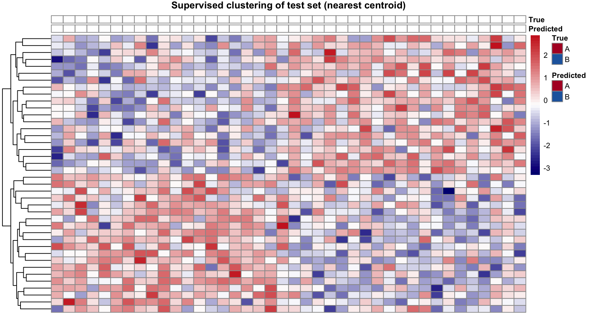

监督聚类在标记样本上训练最近质心分类器、投影到留出测试集；按**预测类别**排序的测试集热图——同时标注真实与预测标签——即参考图 \[1\]。本教程在模拟 40 基因两类面板上跑完整闭环：

## Example

{fig-alt="监督聚类 DEMO" fig-align="center" width="60%"}

## Setup

-   系统要求：跨平台（Linux/MacOS/Windows）

-   编程语言：R

-   依赖包：`pheatmap`; `ggplot2`

```{r packages setup, message=FALSE, warning=FALSE, output=FALSE}
suppressPackageStartupMessages({
  library(pheatmap)
  library(ggplot2)
})
```

```{r}
sessioninfo::session_info("attached")
```

## 数据准备

训练集与测试集矩阵覆盖 40 个 marker 基因、两类（A/B），每类植入一个 20 基因类别特异块：

```{r load data}
set.seed(11601)
n_tr <- 60; n_te <- 40
genes_sc <- paste0("SG", 1:40)
lab_tr <- factor(rep(c("A", "B"), each = n_tr / 2))
expr_tr <- matrix(rnorm(n_tr * 40, 6, 1), n_tr, 40, dimnames = list(NULL, genes_sc))
expr_tr[lab_tr == "A", 1:20] <- expr_tr[lab_tr == "A", 1:20] + 1.2
expr_tr[lab_tr == "B", 21:40] <- expr_tr[lab_tr == "B", 21:40] + 1.2
lab_te <- factor(rep(c("A", "B"), each = n_te / 2))
expr_te <- matrix(rnorm(n_te * 40, 6, 1), n_te, 40, dimnames = list(NULL, genes_sc))
expr_te[lab_te == "A", 1:20] <- expr_te[lab_te == "A", 1:20] + 1.2
expr_te[lab_te == "B", 21:40] <- expr_te[lab_te == "B", 21:40] + 1.2
```

## Visualization

### 最近质心预测

最近质心分类器将测试集每个样本与 A/B 类质心做相关，取最大者为预测类别（准确率打印）：

```{r}
#| label: fig-1.1CentroidPred
#| fig-cap: "Nearest-centroid classification of the test set: each sample's correlation to the class-A vs class-B centroid decides its predicted class (accuracy printed)."
#| out.width: "60%"
#| warning: false
#| message: false
#| fig-width: 5.5
#| fig-height: 4.5

cent <- cbind(A = colMeans(expr_tr[lab_tr == "A", ]),
              B = colMeans(expr_tr[lab_tr == "B", ]))
pred_sc <- factor(apply(expr_te, 1, function(x) {
  cs <- apply(cent, 2, function(cen) cor(x, cen))
  names(which.max(cs))
}), levels = c("A", "B"))
cat("held-out accuracy:", round(mean(pred_sc == lab_te), 2), "\n")

pred_df <- data.frame(True = lab_te, Predicted = pred_sc)
pred_df$correct <- pred_df$True == pred_df$Predicted
ggplot(pred_df, aes(True, fill = correct)) +
  geom_bar(position = "dodge", width = 0.6) +
  scale_fill_manual(values = c(`TRUE` = "#4D9342", `FALSE` = "#B2182B"),
                    name = "Correct", labels = c("No", "Yes")) +
  labs(y = "Test samples", title = "Nearest-centroid prediction accuracy") +
  theme_bw(base_size = 11) + theme(panel.grid = element_blank())
```

### 按预测类别排序的测试集热图

测试集热图（基因 × 样本、行标准化）按预测类别排序：注释条展示 True 和 Predicted 标签——两注之间的吻合度即视觉化的准确率读数。

```{r}
#| label: fig-2.1SupClustHeat
#| fig-cap: "Test-set heatmap (genes x samples, row-scaled) ordered by predicted class: annotation bars show True and Predicted labels; concordance between the two bars is the visual accuracy read."
#| out.width: "100%"
#| warning: false
#| message: false
#| fig-width: 9.5
#| fig-height: 5.5

ann <- data.frame(True = lab_te, Predicted = pred_sc)
rownames(ann) <- paste0("T", 1:n_te)
ord_sc <- order(pred_sc, lab_te)
pheatmap(t(scale(t(expr_te[ord_sc, genes_sc]))), cluster_cols = FALSE,
         annotation_col = ann[ord_sc, ],
         annotation_colors = list(Predicted = c(A = "#B2182B", B = "#2166AC"),
                                  True = c(A = "#B2182B", B = "#2166AC")),
         show_colnames = FALSE, fontsize = 8,
         color = colorRampPalette(c("navy", "white", "firebrick3"))(50),
         main = "Supervised clustering of test set (nearest centroid)")
```


## 应用场景

::: {#fig-SupervisedClusterPlotApplications1}
{fig-alt="SupervisedClusterPlot Application" fig-align="center" width="60%"}

测试集监督聚类
:::

训练-预测-热图循环适用于任何二元分子分类器：PAM50 分型、MSI 预测或药物响应类别分配。

## 参考文献

\[1\] Xiaofan Lu, et al. FigureYa: A Standardized Visualization Framework for Enhancing Biomedical Data Interpretation and Research Efficiency. iMetaMed. 2025. doi:10.1002/imm3.70005
