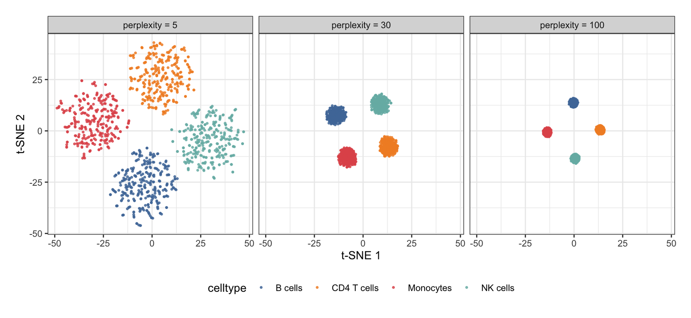
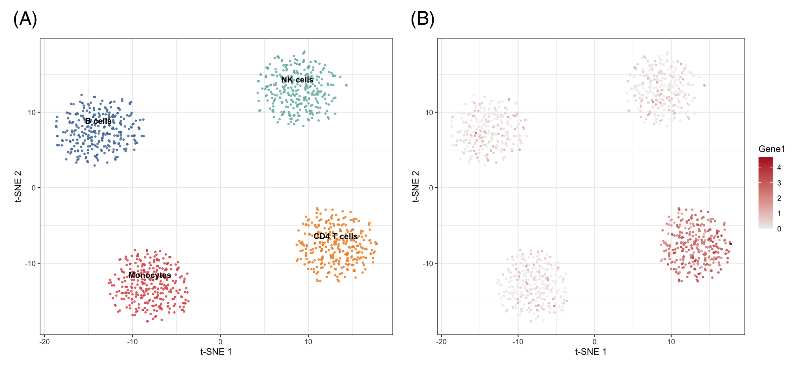

t-distributed stochastic neighbor embedding (t-SNE) projects high-dimensional data — thousands of genes per cell, hundreds of features per sample — onto a 2-D map that keeps *neighboring observations close* \[1\]. It is the workhorse embedding of single-cell genomics: cell types that separate in 20,000-dimensional expression space separate into visual islands in t-SNE space, making population structure visible at a glance.

t-SNE answers a *structure* question ("how many populations are there, and who is next to whom"), not a *distance* question: inter-cluster distances and cluster sizes on the map carry no global meaning, and the map changes with the `perplexity` hyperparameter and the random seed. PCA, by contrast, keeps global geometry but only linear structure — the two are complementary, and the standard practice is to run t-SNE on the top principal components rather than on raw features \[2\].

This tutorial covers four practical workflows with `Rtsne` \[3\]:

1. A basic t-SNE map of a simulated single-cell expression matrix;
2. How `perplexity` reshapes the map (the one parameter to always check);
3. t-SNE versus PCA on the same data;
4. Overlaying a marker gene's expression onto the map.

## Example

{fig-alt="TSNEplot DEMO" fig-align="center" width="60%"}

## Setup

-   System Requirements: Cross-platform (Linux/MacOS/Windows)

-   Programming language: R

-   Dependent packages: `Rtsne`; `ggplot2`; `dplyr`; `patchwork`

```{r packages setup, message=FALSE, warning=FALSE, output=FALSE}
# Installing necessary packages
if (!requireNamespace("Rtsne", quietly = TRUE)) {
  install.packages("Rtsne")
}
if (!requireNamespace("patchwork", quietly = TRUE)) {
  install.packages("patchwork")
}

# Load packages
library(Rtsne)
library(ggplot2)
library(dplyr)
library(patchwork)
```

```{r}
sessioninfo::session_info("attached")
```

## Data Preparation

We simulate a scRNA-seq-like log-expression matrix: 1,200 cells from four populations (CD4 T cells, B cells, NK cells, monocytes) × 200 genes, where each population expresses a private block of 20 marker genes. The four populations differ in marker blocks only — a structure t-SNE should recover as four islands.

```{r load data, message=FALSE, warning=FALSE}
set.seed(251)

n_per   <- 300
types   <- c("CD4 T cells", "B cells", "NK cells", "Monocytes")
n_genes <- 200

base <- matrix(rnorm(n_per * length(types) * n_genes, 0, 0.6),
               nrow = n_per * length(types), ncol = n_genes,
               dimnames = list(NULL, paste0("Gene", 1:n_genes)))
ct <- rep(types, each = n_per)
markers <- list("CD4 T cells" = 1:20, "B cells" = 21:40,
                "NK cells" = 41:60, "Monocytes" = 61:80)
for (t in types) {
  idx <- which(ct == t)
  base[idx, markers[[t]]] <- base[idx, markers[[t]]] + 2.5
}
expr <- pmax(base + rnorm(length(base), 0, 0.3), 0)

# Standard practice: run t-SNE on the top principal components, not raw genes
pcs <- prcomp(expr, rank. = 30)$x[, 1:30]
```

## Visualization

### 1. Basic t-SNE Map

```{r}
#| label: fig-1.1TSNE
#| fig-cap: "t-SNE map of the simulated cohort (perplexity 30): the four populations separate into islands; labels sit at cluster centroids."
#| out.width: "70%"
#| fig-width: 6.5
#| fig-height: 5.5
#| warning: false
#| message: false

set.seed(251)                       # t-SNE is stochastic: fix the seed
tsne30 <- Rtsne(pcs, dims = 2, perplexity = 30, pca = FALSE, verbose = FALSE)

d30 <- data.frame(tSNE1 = tsne30$Y[, 1], tSNE2 = tsne30$Y[, 2], celltype = ct)
cent <- d30 |>
  group_by(celltype) |>
  summarise(tSNE1 = mean(tSNE1), tSNE2 = mean(tSNE2))

pal <- c("#4E79A7", "#F28E2B", "#E15759", "#76B7B2")
p1 <- ggplot(d30, aes(tSNE1, tSNE2, color = celltype)) +
  geom_point(size = 0.7, alpha = 0.8) +
  geom_text(data = cent, aes(tSNE1, tSNE2, label = celltype),
            inherit.aes = FALSE, color = "black",
            fontface = "bold", size = 3.5, vjust = -1.2) +
  scale_color_manual(values = pal) +
  labs(x = "t-SNE 1", y = "t-SNE 2") +
  theme_bw(base_size = 11) +
  theme(legend.position = "none")
p1
```

Four islands, one per population. Note the axes: t-SNE dimensions have no units and no fixed orientation — rerunning with a different seed rotates and mirrors the map while preserving the neighborhood structure.

### 2. The Perplexity Trade-off

`perplexity` (roughly, the effective number of neighbors each point considers) is the single most consequential parameter. Low values resolve local detail; high values merge populations; typical choices are 5–50 for thousands of cells, and the honest report shows the map is stable across a range.

```{r}
#| label: fig-2.1Perplexity
#| fig-cap: "The same data embedded at perplexity 5, 30 and 100: low values fragment clusters into substructure, high values compress them into blobs."
#| out.width: "95%"
#| fig-width: 9
#| fig-height: 4
#| warning: false
#| message: false

mk <- function(ppl) {
  set.seed(251)
  ts <- Rtsne(pcs, dims = 2, perplexity = ppl, pca = FALSE, verbose = FALSE)
  data.frame(tSNE1 = ts$Y[, 1], tSNE2 = ts$Y[, 2], celltype = ct, perplexity = ppl)
}
dfp <- bind_rows(mk(5), mk(30), mk(100))

ggplot(dfp, aes(tSNE1, tSNE2, color = celltype)) +
  geom_point(size = 0.6, alpha = 0.8) +
  facet_wrap(~perplexity, labeller = labeller(
    perplexity = function(x) paste0("perplexity = ", x))) +
  scale_color_manual(values = pal) +
  labs(x = "t-SNE 1", y = "t-SNE 2") +
  theme_bw(base_size = 11) +
  theme(legend.position = "bottom")
```

At perplexity 5 the marker-block noise fragments each population into sub-clusters; at 100 the four populations compress into featureless blobs. Interpret every t-SNE figure *with its perplexity in the caption*.

### 3. t-SNE versus PCA

```{r}
#| label: fig-3.1VSPCA
#| fig-cap: "PCA (top) preserves global geometry and relative sizes; t-SNE (bottom) isolates populations but discards global distance."
#| out.width: "70%"
#| fig-width: 6.5
#| fig-height: 7
#| warning: false
#| message: false

pdf <- data.frame(PC1 = pcs[, 1], PC2 = pcs[, 2], celltype = ct)
p3a <- ggplot(pdf, aes(PC1, PC2, color = celltype)) +
  geom_point(size = 0.6, alpha = 0.8) +
  scale_color_manual(values = pal) +
  labs(x = "PC 1", y = "PC 2", title = "PCA (linear)") +
  theme_bw(base_size = 11) + theme(legend.position = "none")
p3b <- p1 + labs(title = "t-SNE (nonlinear)")

p3a / p3b
```

PCA keeps the populations at their true relative sizes and positions; t-SNE equalizes cluster areas and stretches the space so neighbors touch. Use PCA when magnitudes and gradients matter (trajectory endpoints, batch shifts), t-SNE when population discovery matters.

### 4. Overlaying Marker Expression

```{r}
#| label: fig-4.1Marker
#| fig-cap: "Expression of a CD4 T cell marker gene (Gene1) painted onto the t-SNE map: the gradient confirms the island's identity."
#| out.width: "70%"
#| fig-width: 6.5
#| fig-height: 5.5
#| warning: false
#| message: false

dfm <- d30
dfm$marker <- expr[, "Gene1"]          # CD4 T cell marker block member

ggplot(dfm, aes(tSNE1, tSNE2, color = marker)) +
  geom_point(size = 0.7, alpha = 0.9) +
  scale_color_gradient(low = "#EEEEEE", high = "#B2182B", name = "Gene1") +
  labs(x = "t-SNE 1", y = "t-SNE 2") +
  theme_bw(base_size = 11)
```

Painting per-cell values (gene expression, cluster score, QC metrics) onto the map is how t-SNE figures earn their interpretation.

::: callout-tip
## Practice tips

-   Always `set.seed()` before `Rtsne()` — the optimization is stochastic, and unseeded maps are unreproducible.
-   Feed the top 20–50 PCs, not raw features: denoising first is the difference between structure and noise (and it is much faster).
-   Report the perplexity; check at least two values before trusting a cluster boundary.
-   Never read global distances: two islands far apart on the map are not necessarily "more different" than two nearby islands.
-   t-SNE cannot embed new samples into an existing map — use UMAP for that, or refit.
:::

## Application

t-SNE maps are the front-page figure of single-cell papers (cell-type atlases, tumor immune infiltrates) and appear whenever many features must be reduced to a population map: cytometry panels, methylation profiles, and drug-screen morphology. The panel below mirrors a typical publication layout: (A) the perplexity check and (B) the population map with marker overlay.

{fig-alt="TSNEplot Application" fig-align="center" width="60%"}

## Reference

\[1\] van der Maaten L, Hinton G. Visualizing data using t-SNE. J Mach Learn Res. 2008;9:2579-2605.

\[2\] Kobak D, Berens P. The art of using t-SNE for single-cell transcriptomics. Nat Commun. 2019;10:5416. doi:10.1038/s41467-019-13056-x

\[3\] Krijthe JH. Rtsne: t-Distributed Stochastic Neighbor Embedding using Barnes-Hut implementation. R package version 0.17. 2015. https://github.com/jkrijthe/Rtsne
