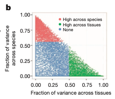

To measure how **conserved** a gene's expression is between species, the reference fits one linear mixed model per orthologous human–mouse gene pair — `logFPKM ~ 1 + (1|Tissue) + (1|Species)` with REML — normalizes the tissue, species and residual variance components by their sum, and plots each pair as a dot in the tissue-fraction × species-fraction plane: green dots vary more across tissues (mouse is a good model), red dots more across species \[1\]. `lme4::lmer()` runs unchanged from the lockfile; the parallel `foreach` machinery is replaced by a serial loop over a tractable number of pairs:

## Example

{fig-alt="Expression Variance Decomposition DEMO" fig-align="center" width="60%"}

## Setup

-   System Requirements: Cross-platform (Linux/MacOS/Windows)

-   Programming language: R

-   Dependent packages: `lme4`; `ggplot2`; `ggrepel`

```{r packages setup, message=FALSE, warning=FALSE, output=FALSE}
suppressPackageStartupMessages({
  library(lme4); library(ggplot2)
})
```

```{r}
sessioninfo::session_info("attached")
```

## Data Preparation

Simulated log2 FPKM for 180 one-to-one ortholog pairs across 2 species × 10 tissues (3 replicates each), with planted structure: a third of the pairs are **tissue-dominated** (tissue SD 1.8, species SD 0.25), a third **species-dominated** (the reverse), and the rest mixed — so the decomposition lands where the reference's Fig. 2b does:

```{r load data}
suppressPackageStartupMessages({library(lme4); library(ggplot2)})
set.seed(41245)
n_pairs <- 180; tissues <- sprintf("T%02d", 1:10); species <- c("human", "mouse")
pair_class <- rep(c("tissue", "species", "mixed"), each = n_pairs / 3)
pair_class <- sample(pair_class)
data <- do.call(rbind, lapply(seq_len(n_pairs), function(k) {
  sd_t <- if (pair_class[k] == "tissue") 1.8 else if (pair_class[k] == "species") 0.25 else 0.9
  sd_s <- if (pair_class[k] == "species") 1.6 else if (pair_class[k] == "tissue") 0.25 else 0.8
  t_eff <- rnorm(length(tissues), 0, sd_t)
  s_eff <- rnorm(length(species), 0, sd_s)
  do.call(rbind, lapply(species, function(sp) {
    do.call(rbind, lapply(tissues, function(tt) {
      data.frame(GenePairs = sprintf("ORTHO%03d", k), Species = sp, Tissue = tt,
                 lgFPKM = 5 + s_eff[species == sp] + t_eff[tissues == tt] +
                   rnorm(3, 0, 0.4))
    }))
  }))
}))
head(data, 3)
```

## Visualization

### 1. Variance Decomposition per Gene Pair

The serial version of the reference's model — one `lmer()` per pair, `VarCorr` components normalized by their sum. 180 pairs run in well under a minute; the reference's `foreach`/`doParallel` block is worth it only above a few thousand pairs:

```{r}
#| label: fig-1.1VarDecomp
#| fig-cap: "Variance decomposition per ortholog pair: fraction of expression variance from tissue (x) vs species (y); green = tissue-dominated above its 75th percentile, red = species-dominated above its 75th percentile, grey = mixed. The planted classes separate as designed."
#| out.width: "80%"
#| fig-width: 6.5
#| fig-height: 6

gene.pairs <- unique(data$GenePairs)
lmm.var.dcp <- do.call(rbind, lapply(gene.pairs, function(xx) {
  model <- lmer(lgFPKM ~ 1 + (1 | Tissue) + (1 | Species),
                data = subset(data, GenePairs == xx), REML = TRUE)
  results <- as.data.frame(VarCorr(model))
  res <- results$vcov / sum(results$vcov)
  data.frame(GenePairs = xx,
             frac.of.var.tissue = res[1],
             frac.of.var.species = res[2],
             frac.of.var.residual = res[3])
}))

q75t <- quantile(lmm.var.dcp$frac.of.var.tissue)[4]
q75s <- quantile(lmm.var.dcp$frac.of.var.species)[4]
lmm.var.dcp$group <- ifelse(
  lmm.var.dcp$frac.of.var.tissue > q75t &
    lmm.var.dcp$frac.of.var.tissue > lmm.var.dcp$frac.of.var.species,
  "High across tissues",
  ifelse(lmm.var.dcp$frac.of.var.species > q75s &
           lmm.var.dcp$frac.of.var.species > lmm.var.dcp$frac.of.var.tissue,
         "High across species", "None"))

ggplot(lmm.var.dcp, aes(frac.of.var.tissue, frac.of.var.species, colour = group)) +
  geom_point(size = 1.4, alpha = 0.85) +
  scale_colour_manual(values = c("High across tissues" = "#1B7837",
                                 "High across species" = "#B2182B",
                                 None = "grey62")) +
  guides(colour = guide_legend(override.aes = list(size = 3))) +
  theme_bw(base_size = 12) +
  labs(x = "Fraction of variance across tissues",
       y = "Fraction of variance\nacross species", colour = NULL) +
  theme(panel.grid = element_blank(),
        legend.position = c(0.7, 0.85),
        legend.background = element_blank())
```

### 2. Naming the Genes That Matter

The reference highlights genes of interest (its example greps a keyword) with `geom_text_repel()`: here the four most extreme pairs per class are labelled, so the decomposition connects back to gene names:

```{r}
#| label: fig-2.1VarDecompHighlight
#| fig-cap: "The same decomposition with the most extreme gene pairs of each class labelled: the tissue-dominated pair (top-left corner) is a mouse-model-safe gene; the species-dominated pair (bottom-right) generalizes from mouse to human only with caution."
#| out.width: "80%"
#| fig-width: 6.5
#| fig-height: 6

hl <- rbind(
  head(lmm.var.dcp[order(-lmm.var.dcp$frac.of.var.tissue), ], 3),
  head(lmm.var.dcp[order(-lmm.var.dcp$frac.of.var.species), ], 3))
hl <- hl[!duplicated(hl$GenePairs), ]
hl$is_highlight <- TRUE

plot_df2 <- merge(lmm.var.dcp, hl[, c("GenePairs", "is_highlight")],
                  by = "GenePairs", all.x = TRUE)
plot_df2$is_highlight[is.na(plot_df2$is_highlight)] <- FALSE
ggplot(plot_df2, aes(frac.of.var.tissue, frac.of.var.species, colour = group)) +
  geom_point(size = 1.4, alpha = 0.85) +
  scale_colour_manual(values = c("High across tissues" = "#1B7837",
                                 "High across species" = "#B2182B",
                                 None = "grey62")) +
  ggrepel::geom_text_repel(
    data = function(d) subset(d, is_highlight == TRUE),
    aes(label = GenePairs), size = 2.6, seed = 1,
    box.padding = 0.5, show.legend = FALSE) +
  theme_bw(base_size = 12) +
  labs(x = "Fraction of variance across tissues",
       y = "Fraction of variance\nacross species", colour = NULL) +
  theme(panel.grid = element_blank(),
        legend.position = c(0.7, 0.85),
        legend.background = element_blank())
```

::: callout-tip
**Practice tips**

-   One model **per gene pair**, not one global model: the decomposition answers "for this gene, what dominates" — pooling genes destroys exactly the per-gene variation the figure shows.
-   Normalize `VarCorr` components by their **sum** so the three fractions add to 1; the raw variances are on different scales across genes and cannot be compared directly.
-   Both fractions share the same residual term, so they are negatively coupled — interpret corners, not slopes: top-left = tissue-dominated, bottom-right = species-dominated.
-   Define the green/red classes by a quantile **and** the cross-comparison (`tissue > species`), as the reference does; a quantile alone puts near-tie genes in both classes.
-   Above a few thousand pairs, move the loop into `foreach`/`doParallel` with `.packages = "lme4"`; below that, serial `lapply` is simpler and fast enough.
:::

## Application

::: {#fig-VarDecomposeApplications1}
{fig-alt="Expression Variance Decomposition" fig-align="center" width="60%"}

Expression variance decomposition
:::

The same two-random-effect decomposition works on any crossed design: patients vs sequencing batch, individuals vs collection sites, or cell lines vs culture conditions — wherever "which factor dominates this gene" decides whether a model organism or cohort generalizes.

## Reference

\[1\] Xiaofan Lu, et al. FigureYa: A Standardized Visualization Framework for Enhancing Biomedical Data Interpretation and Research Efficiency. iMetaMed. 2025. doi:10.1002/imm3.70005
