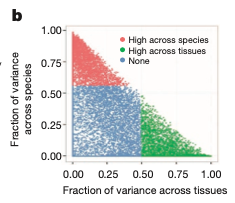

衡量基因表达在物种间的**保守性**：参考对每个直系同源人鼠基因对拟合一个线性混合模型——`logFPKM ~ 1 + (1|Tissue) + (1|Species)`（REML）——把组织、物种与残差方差分量除以总和归一化，再把每个基因对画成 组织占比 × 物种占比 平面上的一点：绿点跨组织变化更大（小鼠是好模型）、红点跨物种变化更大 \[1\]。`lme4::lmer()` 在 lockfile 中原样运行；并行 `foreach` 机器被可处理基因对数的串行循环替代：

## Example

{fig-alt="表达方差分解 DEMO" fig-align="center" width="60%"}

## Setup

-   系统要求：跨平台（Linux/MacOS/Windows）

-   编程语言：R

-   依赖包：`lme4`; `ggplot2`; `ggrepel`

```{r packages setup, message=FALSE, warning=FALSE, output=FALSE}
suppressPackageStartupMessages({
  library(lme4); library(ggplot2)
})
```

```{r}
sessioninfo::session_info("attached")
```

## 数据准备

180 个一对一 ortholog 对在 2 物种 × 10 组织（各 3 个重复）下的模拟 log2 FPKM，带植入结构：三分之一的对**组织主导**（组织 SD 1.8、物种 SD 0.25）、三分之一**物种主导**（反过来）、其余混合——分解结果正落在参考 Fig. 2b 的位置：

```{r load data}
suppressPackageStartupMessages({library(lme4); library(ggplot2)})
set.seed(41245)
n_pairs <- 180; tissues <- sprintf("T%02d", 1:10); species <- c("human", "mouse")
pair_class <- rep(c("tissue", "species", "mixed"), each = n_pairs / 3)
pair_class <- sample(pair_class)
data <- do.call(rbind, lapply(seq_len(n_pairs), function(k) {
  sd_t <- if (pair_class[k] == "tissue") 1.8 else if (pair_class[k] == "species") 0.25 else 0.9
  sd_s <- if (pair_class[k] == "species") 1.6 else if (pair_class[k] == "tissue") 0.25 else 0.8
  t_eff <- rnorm(length(tissues), 0, sd_t)
  s_eff <- rnorm(length(species), 0, sd_s)
  do.call(rbind, lapply(species, function(sp) {
    do.call(rbind, lapply(tissues, function(tt) {
      data.frame(GenePairs = sprintf("ORTHO%03d", k), Species = sp, Tissue = tt,
                 lgFPKM = 5 + s_eff[species == sp] + t_eff[tissues == tt] +
                   rnorm(3, 0, 0.4))
    }))
  }))
}))
head(data, 3)
```

## Visualization

### 逐基因对的方差分解

参考模型的串行版——每对一次 `lmer()`、`VarCorr` 分量按和归一化。180 对在一分钟内跑完；超过几千对时参考的 `foreach`/`doParallel` 块才值得：

```{r}
#| label: fig-1.1VarDecomp
#| fig-cap: "逐 ortholog 对的方差分解：表达方差中来自组织（x）vs 物种（y）的占比；绿 = 超过自身 75 分位的组织主导、红 = 物种主导、灰 = 混合。植入的类别按设计分离。"
#| out.width: "80%"
#| fig-width: 6.5
#| fig-height: 6

gene.pairs <- unique(data$GenePairs)
lmm.var.dcp <- do.call(rbind, lapply(gene.pairs, function(xx) {
  model <- lmer(lgFPKM ~ 1 + (1 | Tissue) + (1 | Species),
                data = subset(data, GenePairs == xx), REML = TRUE)
  results <- as.data.frame(VarCorr(model))
  res <- results$vcov / sum(results$vcov)
  data.frame(GenePairs = xx,
             frac.of.var.tissue = res[1],
             frac.of.var.species = res[2],
             frac.of.var.residual = res[3])
}))

q75t <- quantile(lmm.var.dcp$frac.of.var.tissue)[4]
q75s <- quantile(lmm.var.dcp$frac.of.var.species)[4]
lmm.var.dcp$group <- ifelse(
  lmm.var.dcp$frac.of.var.tissue > q75t &
    lmm.var.dcp$frac.of.var.tissue > lmm.var.dcp$frac.of.var.species,
  "High across tissues",
  ifelse(lmm.var.dcp$frac.of.var.species > q75s &
           lmm.var.dcp$frac.of.var.species > lmm.var.dcp$frac.of.var.tissue,
         "High across species", "None"))

ggplot(lmm.var.dcp, aes(frac.of.var.tissue, frac.of.var.species, colour = group)) +
  geom_point(size = 1.4, alpha = 0.85) +
  scale_colour_manual(values = c("High across tissues" = "#1B7837",
                                 "High across species" = "#B2182B",
                                 None = "grey62")) +
  guides(colour = guide_legend(override.aes = list(size = 3))) +
  theme_bw(base_size = 12) +
  labs(x = "Fraction of variance across tissues",
       y = "Fraction of variance\nacross species", colour = NULL) +
  theme(panel.grid = element_blank(),
        legend.position = c(0.7, 0.85),
        legend.background = element_blank())
```

### 给重要的基因命名

参考用 `geom_text_repel()` 高亮感兴趣的基因（其示例按关键词 grep）：此处标出每个类最极端的四对，让分解连回基因名：

```{r}
#| label: fig-2.1VarDecompHighlight
#| fig-cap: "同一分解并标注每类最极端的基因对：组织主导对（左上角）是小鼠模型安全的基因；物种主导对（右下）从小鼠推广到人需要谨慎。"
#| out.width: "80%"
#| fig-width: 6.5
#| fig-height: 6

hl <- rbind(
  head(lmm.var.dcp[order(-lmm.var.dcp$frac.of.var.tissue), ], 3),
  head(lmm.var.dcp[order(-lmm.var.dcp$frac.of.var.species), ], 3))
hl <- hl[!duplicated(hl$GenePairs), ]
hl$is_highlight <- TRUE

plot_df2 <- merge(lmm.var.dcp, hl[, c("GenePairs", "is_highlight")],
                  by = "GenePairs", all.x = TRUE)
plot_df2$is_highlight[is.na(plot_df2$is_highlight)] <- FALSE
ggplot(plot_df2, aes(frac.of.var.tissue, frac.of.var.species, colour = group)) +
  geom_point(size = 1.4, alpha = 0.85) +
  scale_colour_manual(values = c("High across tissues" = "#1B7837",
                                 "High across species" = "#B2182B",
                                 None = "grey62")) +
  ggrepel::geom_text_repel(
    data = function(d) subset(d, is_highlight == TRUE),
    aes(label = GenePairs), size = 2.6, seed = 1,
    box.padding = 0.5, show.legend = FALSE) +
  theme_bw(base_size = 12) +
  labs(x = "Fraction of variance across tissues",
       y = "Fraction of variance\nacross species", colour = NULL) +
  theme(panel.grid = element_blank(),
        legend.position = c(0.7, 0.85),
        legend.background = element_blank())
```


## 应用场景

::: {{#fig-VarDecomposeApplications1}}
{fig-alt="表达方差分解" fig-align="center" width="60%"}

表达方差分解
:::

同样的双随机效应分解适用于任何交叉设计：病人 vs 测序批次、个体 vs 采集点、或细胞系 vs 培养条件——凡"哪个因子主导这个基因"决定模式生物或队列能否推广处。

## 参考文献

\[1\] Xiaofan Lu, et al. FigureYa: A Standardized Visualization Framework for Enhancing Biomedical Data Interpretation and Research Efficiency. iMetaMed. 2025. doi:10.1002/imm3.70005
