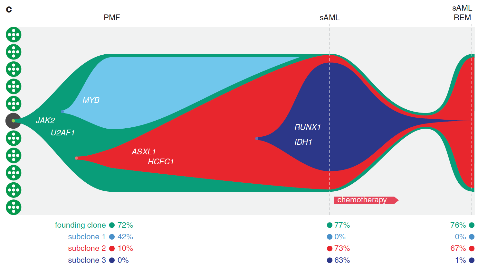

The fish plot draws a tumour's **clonal architecture over time**: each clone is a filled polygon whose vertical thickness is its cancer-cell fraction at each sequencing time point, clones are nested inside their parents, and the whole shape narrows toward the "head" (treatment) and widens toward the "tail" (relapse) \[1\]. The `fishplot` package (GitHub-only, not in this repository's lockfile) is re-implemented in-page: spline-smoothed clone boundaries from the time-fraction table plus the parent nesting rule, drawn as layered polygons on base graphics:

## Example

{fig-alt="Clonal Evolution Fish Plot DEMO" fig-align="center" width="70%"}

## Setup

-   System Requirements: Cross-platform (Linux/MacOS/Windows)

-   Programming language: R

-   Dependent packages: none (base graphics)

```{r packages setup, message=FALSE, warning=FALSE, output=FALSE}
# base graphics only — the fishplot algorithm is re-implemented in-page
```

```{r}
sessioninfo::session_info("attached")
```

## Data Preparation

Four sequencing time points (diagnosis, mid-chemotherapy, remission, relapse) and four clones: the root clone (always present), two parallel sub-clones emerging from it, and a relapse clone descending from sub-clone 2. The fraction table gives each clone's share at each time point; `parents = c(0, 1, 1, 3)` encodes the ancestry (fishplot convention):

```{r load data}
set.seed(52338)
timepoints <- c(0, 75, 110, 120)
parents <- c(0, 1, 1, 3)
## clone fractions per time point (rows sum to 100 at each column)
frac <- matrix(c(
  100,  85,  45,  25,
    0,  15,  20,  10,
    0,   0,  35,  15,
    0,   0,   0,  50
), nrow = 4, byrow = TRUE,
   dimnames = list(paste0("Clone", 1:4), timepoints))
print(frac)
clone_cols <- c("#099D79", "#70C7EC", "#E8262D", "#2C3789")
```

## Visualization

### 1. The Fish Plot

The reference's fish shape: each clone's polygon spans the time axis, thickness = its fraction, children nest inside their parent's band, and a spline smooths the boundaries — the relapse clone 4 opens like a tail at the last time point:

```{r}
#| label: fig-1.1FishPlot
#| fig-cap: "Clonal evolution fish plot over four time points (vertical lines): the root clone (green) carries the tumour through chemotherapy, two sub-clones (blue/red) emerge from it at the mid-treatment node, and the relapse clone (dark blue, nested inside Clone 3) expands at relapse; polygon thickness encodes each clone's fraction (polygon-style, linearly interpolated); dashed lines mark diagnosis, mid-chemotherapy and relapse."
#| out.width: "100%"
#| fig-width: 10
#| fig-height: 6

## fish geometry (fishplot convention): the root's polygon spans its whole
## subtree, children stack INSIDE the parent band, siblings side by side;
## draw order is root first, children on top
n_t <- length(timepoints)
xs <- seq(min(timepoints), max(timepoints), length.out = 200)
## linear interpolation (fishplot's shape="polygon" mode): cubic splines
## overshoot between time points — linear keeps every band inside [0, 100]
smooth <- function(y) approx(timepoints, y, xout = xs)$y
## apply(frac, 1, smooth) -> rows are the 200 x points, columns the clones
frac_sm <- pmax(apply(frac, 1, smooth), 0)
f1 <- frac_sm[, 1]; f2 <- frac_sm[, 2]
f3 <- frac_sm[, 3]; f4 <- frac_sm[, 4]

edges <- matrix(0, length(xs), 8)   # lower/upper per clone
## clone 1 (root): polygon spans the whole subtree (sum of all clones),
## painted first — children stack inside it
edges[, 1] <- 0
edges[, 2] <- f1 + f2 + f3 + f4
## siblings stack inside the root band: clone 2 at the bottom [0, f2],
## clone 3 above it [f2, f2 + f3 + f4] (clone 3 carries clone 4)
edges[, 3] <- 0
edges[, 4] <- f2
edges[, 5] <- f2
edges[, 6] <- f2 + f3 + f4
## clone 4 nests inside clone 3's band, top-aligned
edges[, 7] <- f2 + f3
edges[, 8] <- f2 + f3 + f4

op <- par(mar = c(4, 4, 3, 1), xpd = TRUE)
plot(NA, xlim = c(min(xs), max(xs) + 2), ylim = c(0, 102),
     xlab = "Days from diagnosis", ylab = "Cancer cell fraction (%)",
     main = "Clonal evolution")
for (k in 1:4) {
  polygon(c(xs, rev(xs)), c(edges[, 2 * k], rev(edges[, 2 * k - 1])),
          col = clone_cols[k], border = "white", lwd = 1.5)
}
for (tp in timepoints[c(1, 2, 4)]) {
  abline(v = tp, lty = 2, col = "grey45")
  text(tp, 104, tp, cex = 0.85, col = "grey25")
}
legend("bottomleft", bty = "n", pch = 15, pt.cex = 2, cex = 0.9,
       col = clone_cols, legend = paste0("Clone ", 1:4))
par(op)
```

::: callout-tip
**Practice tips**
-   The `parents` vector is the whole grammar: `0` = root, `k` = this clone emerges from clone k at its first non-zero time point — an ancestry that contradicts the fractions silently distorts the fish.
-   Fractions must **sum to 100 per time point** (or normalise) — the fish's total height is the tumour purity proxy, so gaps read as missing clones.
-   Draw children **inside** the parent band and siblings side by side within it — the nesting, not the colours, is what carries the ancestry.
-   Spline smoothing (`shape = "spline"` in fishplot) is cosmetic; keep the raw time-point values exact at the vertical lines.
-   Pair the fish with a phylogeny (ClonEvol style) when ancestry is inferred — the fish shows the fractions, the tree shows the relationships.
:::

## Application

::: {#fig-FishApplications1}
{fig-alt="Clonal Evolution Fish Plot" fig-align="center" width="70%"}

Clonal evolution fish plot
:::

Fish plots apply to any multi-time-point tumour sequencing series: chemotherapy response studies, relapse biopsies, or longitudinal liquid-biopsy CCF tracking.

## Reference

\[1\] Xiaofan Lu, et al. FigureYa: A Standardized Visualization Framework for Enhancing Biomedical Data Interpretation and Research Efficiency. iMetaMed. 2025. doi:10.1002/imm3.70005
