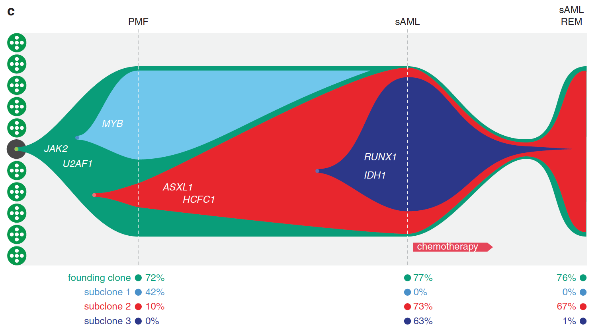

鱼形图展示肿瘤的**随时间克隆架构**：每个克隆是一个填充多边形，垂直厚度为其在各测序时间点的癌细胞分数，克隆嵌套于其父克隆内部，整体形态在"鱼头"（治疗）收窄、向"鱼尾"（复发）展开 \[1\]。`fishplot` 包（GitHub-only，不在本仓库 lockfile）在页内重实现：时间-分数表的样条平滑克隆边界加上父代嵌套规则，以 base graphics 分层多边形绘制：

## Example

{fig-alt="克隆演化鱼形图 DEMO" fig-align="center" width="70%"}

## Setup

-   系统要求：跨平台（Linux/MacOS/Windows）

-   编程语言：R

-   依赖包：无（base graphics）

```{r packages setup, message=FALSE, warning=FALSE, output=FALSE}
# base graphics only — the fishplot algorithm is re-implemented in-page
```

```{r}
sessioninfo::session_info("attached")
```

## 数据准备

四个测序时间点（诊断、化疗中、缓解、复发）与四个克隆：根克隆（始终存在）、两个平行亚克隆、以及一个源自亚克隆 2 的复发克隆。分数表给出每克隆在各时间点的占比；`parents = c(0, 1, 1, 3)` 编码祖先关系（fishplot 约定）：

```{r load data}
set.seed(52338)
timepoints <- c(0, 75, 110, 120)
parents <- c(0, 1, 1, 3)
## clone fractions per time point (rows sum to 100 at each column)
frac <- matrix(c(
  100,  85,  45,  25,
    0,  15,  20,  10,
    0,   0,  35,  15,
    0,   0,   0,  50
), nrow = 4, byrow = TRUE,
   dimnames = list(paste0("Clone", 1:4), timepoints))
print(frac)
clone_cols <- c("#099D79", "#70C7EC", "#E8262D", "#2C3789")
```

## Visualization

### 1. 鱼形图

参考的鱼形：每个克隆的多边形沿时间轴展开、厚度 = 其分数、子克隆嵌套于父代带内、边界经样条平滑——复发克隆 4 在最后一个时间点如鱼尾般张开：

```{r}
#| label: fig-1.1FishPlot
#| fig-cap: "四个时间点的克隆演化鱼形图（竖线）：根克隆（绿）带着肿瘤穿过化疗，两个亚克隆（蓝/红）在中途治疗节点从它内部出现，复发克隆（深蓝，嵌套于克隆 3 内）在复发时扩张；多边形厚度编码各克隆的分数（polygon 式、线性插值）。"
#| out.width: "100%"
#| fig-width: 10
#| fig-height: 6

## linear interpolation (fishplot's shape="polygon" mode): cubic splines
## overshoot between time points — linear keeps every band inside [0, 100]
xs <- seq(min(timepoints), max(timepoints), length.out = 200)
smooth <- function(y) approx(timepoints, y, xout = xs)$y
## apply(frac, 1, smooth) -> rows are the 200 x points, columns the clones
frac_sm <- pmax(apply(frac, 1, smooth), 0)
f1 <- frac_sm[, 1]; f2 <- frac_sm[, 2]
f3 <- frac_sm[, 3]; f4 <- frac_sm[, 4]

edges <- matrix(0, length(xs), 8)   # lower/upper per clone
## clone 1 (root): polygon spans the whole subtree (sum of all clones),
## painted first — children stack inside it
edges[, 1] <- 0
edges[, 2] <- f1 + f2 + f3 + f4
## siblings stack inside the root band: clone 2 at the bottom [0, f2],
## clone 3 above it [f2, f2 + f3 + f4] (clone 3 carries clone 4)
edges[, 3] <- 0
edges[, 4] <- f2
edges[, 5] <- f2
edges[, 6] <- f2 + f3 + f4
## clone 4 nests inside clone 3's band, top-aligned
edges[, 7] <- f2 + f3
edges[, 8] <- f2 + f3 + f4

op <- par(mar = c(4, 4, 3, 1), xpd = TRUE)
plot(NA, xlim = c(min(xs), max(xs) + 2), ylim = c(0, 102),
     xlab = "Days from diagnosis", ylab = "Cancer cell fraction (%)",
     main = "Clonal evolution")
for (k in 1:4) {
  polygon(c(xs, rev(xs)), c(edges[, 2 * k], rev(edges[, 2 * k - 1])),
          col = clone_cols[k], border = "white", lwd = 1.5)
}
for (tp in timepoints[c(1, 2, 4)]) {
  abline(v = tp, lty = 2, col = "grey45")
  text(tp, 104, tp, cex = 0.85, col = "grey25")
}
legend("bottomleft", bty = "n", pch = 15, pt.cex = 2, cex = 0.9,
       col = clone_cols, legend = paste0("Clone ", 1:4))
par(op)
```

::: callout-tip
**实践要点**
-   `parents` 向量是全部语法：`0` = 根、`k` = 该克隆在其首个非零时间点从克隆 k 出现——与分数矛盾的祖先关系会静默扭曲鱼形。
-   各时间点的分数必须**加和为 100**（或先归一）——鱼的整体高度是肿瘤纯度的代理，空隙读作缺失克隆。
-   子克隆画在**父代带内**、兄弟在带内并排——承载祖先关系的是嵌套而非颜色。
-   样条平滑（fishplot 的 `shape = "spline"`）只是外观；垂直线处的原始时间点数值必须精确。三次样条会过冲——线性插值（polygon 模式）保证带不越界。
-   推断祖先关系时把鱼形图与系统发育（ClonEvol 风格）配对——鱼展示分数，树展示关系。
:::

## 应用场景

::: {#fig-FishApplications1}
{fig-alt="克隆演化鱼形图" fig-align="center" width="70%"}

克隆演化鱼形图
:::

鱼形图适用于任何多时间点肿瘤测序系列：化疗应答研究、复发活检、或纵向液体活检 CCF 追踪。

## 参考文献

\[1\] Xiaofan Lu, et al. FigureYa: A Standardized Visualization Framework for Enhancing Biomedical Data Interpretation and Research Efficiency. iMetaMed. 2025. doi:10.1002/imm3.70005
