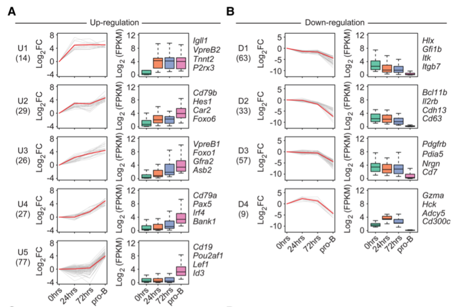

STEM (Short Time-series Expression Miner) clusters time-series genes into **profiles**; the reference displays each cluster twice side by side — line plots of fold change (one line per gene, representative gene highlighted red) and box plots of absolute expression with **pairwise significance stars between time points** \[1\]. The STEM Java tool runs outside R; its output tables (cluster membership + expression matrix) are simulated here with three planted profiles, and the paired panels run on ggplot2/ggpubr:

## Example

{fig-alt="STEM Profile Panels DEMO" fig-align="center" width="70%"}

## Setup

-   System Requirements: Cross-platform (Linux/MacOS/Windows)

-   Programming language: R

-   Dependent packages: `ggplot2`; `ggpubr`; `dplyr`; `tidyr`; `patchwork`

```{r packages setup, message=FALSE, warning=FALSE, output=FALSE}
suppressPackageStartupMessages({
  library(ggplot2); library(ggpubr); library(dplyr); library(tidyr); library(patchwork)
})
```

```{r}
sessioninfo::session_info("attached")
```

## Data Preparation

Simulated STEM output: 300 genes over 4 time points (0 h, 6 h, 24 h, 72 h after stimulation) in three profiles — rising (peak at 72 h), transient (peak at 6 h) and falling. Each gene carries log2 fold-change values (line panel) and absolute log2 expression per replicate (box panel):

```{r load data}
suppressPackageStartupMessages({
  library(ggplot2); library(ggpubr); library(dplyr); library(tidyr); library(patchwork)
})
set.seed(52342)
tps <- c(0, 6, 24, 72)
profiles <- c("Rising", "Transient", "Falling")
n_per <- c(120, 90, 90)
gene_prof <- rep(profiles, n_per)
genes <- sprintf("GENE%04d", seq_len(n_gene <- sum(n_per)))

## fold-change shapes per profile (plus gene-level noise)
shapes <- list(Rising = c(0, 0.5, 1.6, 2.4),
               Transient = c(0, 2.2, 0.8, 0.1),
               Falling = c(0, -1.2, -2.0, -2.5))
fc <- t(sapply(seq_len(n_gene), function(i) {
  shapes[[gene_prof[i]]] + rnorm(4, 0, 0.28)
}))
rownames(fc) <- genes
colnames(fc) <- tps

## absolute expression = 4 + fc/2 + replicate noise (2 replicates)
abs_expr <- do.call(rbind, lapply(seq_len(n_gene), function(i) {
  base <- 4 + fc[i, ] / 2
  r1 <- base + rnorm(4, 0, 0.35)
  r2 <- base + rnorm(4, 0, 0.35)
  data.frame(gene = genes[i], profile = gene_prof[i],
             tp = rep(tps, 2), expr = c(r1, r2),
             rep = rep(c("rep1", "rep2"), each = 4))
}))
## representative gene per profile: highest final amplitude
rep_gene <- sapply(profiles, function(p) {
  ix <- gene_prof == p
  genes[ix][which.max(abs(fc[ix, 4]))]
})
line_df <- as.data.frame(fc) %>%
  mutate(gene = genes, profile = gene_prof) %>%
  pivot_longer(-c(gene, profile), names_to = "tp", values_to = "fc") %>%
  mutate(tp = as.numeric(tp))
```

## Visualization

### 1. Paired Panels: Fold-Change Lines and Expression Boxes

The reference's dual display for each profile: line plot of fold change (grey genes, red representative) beside a box plot of absolute expression with pairwise Wilcoxon stars — one facet pair per STEM profile:

```{r}
#| label: fig-1.1StemPanels
#| fig-cap: "STEM profile panels (one column pair per profile): line plots of log2 fold change (grey genes, red representative) and box plots of absolute expression with adjacent-time-point Wilcoxon brackets and stars — the Rising profile climbs to 72 h, the Transient profile peaks at 6 h, and the Falling profile declines."
#| out.width: "100%"
#| fig-width: 11
#| fig-height: 7

box_stats <- abs_expr %>%
  group_by(profile, tp) %>%
  summarise(med = median(expr), .groups = "drop")

p_pairs <- lapply(profiles, function(p) {
  ld <- subset(line_df, profile == p)
  bd <- subset(abs_expr, profile == p)
  p_line <- ggplot(ld, aes(tp, fc, group = gene)) +
    geom_line(colour = "grey72", linewidth = 0.35) +
    geom_line(data = subset(ld, gene == rep_gene[p]), colour = "#B2182B",
              linewidth = 1) +
    scale_x_continuous(breaks = tps) +
    labs(x = NULL, y = expression(log[2]~fold~change),
         title = paste0(p, "  (n = ", sum(gene_prof == p), ")")) +
    theme_bw(base_size = 10) +
    theme(panel.grid.minor = element_blank())
  ## pairwise Wilcoxon between ADJACENT time points, brackets + stars
  pv <- do.call(rbind, lapply(seq_len(length(tps) - 1), function(i) {
    a <- bd$expr[bd$tp == tps[i]]
    b <- bd$expr[bd$tp == tps[i + 1]]
    pv <- wilcox.test(a, b)$p.value
    data.frame(group1 = as.character(tps[i]), group2 = as.character(tps[i + 1]),
               p = pv, y.position = max(bd$expr) * 1.02 + i * 0.1,
               p.signif = ifelse(pv < 0.001, "***",
                                 ifelse(pv < 0.01, "**", ifelse(pv < 0.05, "*", "ns"))))
  }))
  p_box <- ggplot(bd, aes(factor(tp), expr)) +
    geom_boxplot(outlier.size = 0.4, fill = "#DEEBF7", colour = "grey35") +
    stat_pvalue_manual(pv, label = "p.signif", size = 3,
                       bracket.size = 0.3, tip.length = 0.015) +
    scale_y_continuous(expand = expansion(mult = c(0.05, 0.14))) +
    scale_x_discrete(labels = tps) +
    labs(x = NULL, y = "log2 expression") +
    theme_bw(base_size = 10) +
    theme(panel.grid.minor = element_blank(),
          axis.text.x = element_text(size = 8))
  p_line | p_box
})
p1 <- p_pairs[[1]] / p_pairs[[2]] / p_pairs[[3]]
p1
```

::: callout-tip
**Practice tips**
-   STEM does the **clustering outside R** — feed its cluster-membership table into ggplot; reimplementing the clustering inside the page would silently produce different profiles.
-   The two panels answer different questions: lines show **relative dynamics** (fold change), boxes show **absolute levels with per-replicate spread** — keep both, as the reference does.
-   Highlight one **representative gene** per profile in red so readers can anchor the abstract shape to a concrete gene.
-   `stat_compare_means` between adjacent time points tests all genes pooled — per-gene tests need a different figure (volcano/heatmap).
-   Keep the profile n in the facet title — a profile with 8 genes is anecdotal, one with 120 is a program.
:::

## Application

::: {#fig-StemBoxApplications1}
{fig-alt="STEM Profile Panels" fig-align="center" width="70%"}

STEM profile panels with pairwise-significance box plots
:::

STEM-style paired panels apply to any short time-series clustering: developmental stages, stimulation time courses, or multi-dose treatment responses.

## Reference

\[1\] Xiaofan Lu, et al. FigureYa: A Standardized Visualization Framework for Enhancing Biomedical Data Interpretation and Research Efficiency. iMetaMed. 2025. doi:10.1002/imm3.70005
