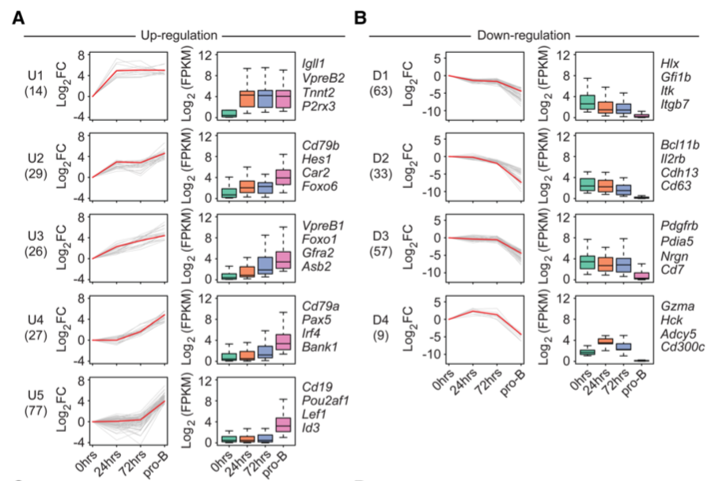

STEM（短时间序列表达挖掘器）把时间序列基因聚成**轮廓**；参考展示对每个轮廓并排两幅图——倍数变化的折线图（每基因一条、代表基因红色高亮）与绝对表达量的箱线图（**时间点两两之间标注显著性星号**）\[1\]。STEM 的 Java 工具在 R 之外运行；其输出表（聚类归属 + 表达矩阵）在此以三个植入轮廓模拟，配对面板在 ggplot2/ggpubr 上运行：

## Example

{fig-alt="STEM 轮廓面板 DEMO" fig-align="center" width="70%"}

## Setup

-   系统要求：跨平台（Linux/MacOS/Windows）

-   编程语言：R

-   依赖包：`ggplot2`; `ggpubr`; `dplyr`; `tidyr`; `patchwork`

```{r packages setup, message=FALSE, warning=FALSE, output=FALSE}
suppressPackageStartupMessages({
  library(ggplot2); library(ggpubr); library(dplyr); library(tidyr); library(patchwork)
})
```

```{r}
sessioninfo::session_info("attached")
```

## 数据准备

模拟 STEM 输出：300 个基因 × 4 个时间点（刺激后 0 h、6 h、24 h、72 h）、三个轮廓——上升（72 h 达峰）、瞬态（6 h 达峰）与下降。每个基因带 log2 倍数变化（折线面板）与逐重复的绝对 log2 表达（箱线面板）：

```{r load data}
suppressPackageStartupMessages({
  library(ggplot2); library(ggpubr); library(dplyr); library(tidyr); library(patchwork)
})
set.seed(52342)
tps <- c(0, 6, 24, 72)
profiles <- c("Rising", "Transient", "Falling")
n_per <- c(120, 90, 90)
gene_prof <- rep(profiles, n_per)
genes <- sprintf("GENE%04d", seq_len(n_gene <- sum(n_per)))

## fold-change shapes per profile (plus gene-level noise)
shapes <- list(Rising = c(0, 0.5, 1.6, 2.4),
               Transient = c(0, 2.2, 0.8, 0.1),
               Falling = c(0, -1.2, -2.0, -2.5))
fc <- t(sapply(seq_len(n_gene), function(i) {
  shapes[[gene_prof[i]]] + rnorm(4, 0, 0.28)
}))
rownames(fc) <- genes
colnames(fc) <- tps

## absolute expression = 4 + fc/2 + replicate noise (2 replicates)
abs_expr <- do.call(rbind, lapply(seq_len(n_gene), function(i) {
  base <- 4 + fc[i, ] / 2
  r1 <- base + rnorm(4, 0, 0.35)
  r2 <- base + rnorm(4, 0, 0.35)
  data.frame(gene = genes[i], profile = gene_prof[i],
             tp = rep(tps, 2), expr = c(r1, r2),
             rep = rep(c("rep1", "rep2"), each = 4))
}))
## representative gene per profile: highest final amplitude
rep_gene <- sapply(profiles, function(p) {
  ix <- gene_prof == p
  genes[ix][which.max(abs(fc[ix, 4]))]
})
line_df <- as.data.frame(fc) %>%
  mutate(gene = genes, profile = gene_prof) %>%
  pivot_longer(-c(gene, profile), names_to = "tp", values_to = "fc") %>%
  mutate(tp = as.numeric(tp))
```

## Visualization

### 1. 配对面板：倍数变化折线与表达箱线

每个轮廓的参考式双重展示：倍数变化的折线图（灰色基因、红色代表基因）与带相邻时间点 Wilcoxon 括号星号的绝对表达箱线图——每个 STEM 轮廓一对面板：

```{r}
#| label: fig-1.1StemPanels
#| fig-cap: "STEM 轮廓面板（每轮廓一对列）：log2 倍数变化折线图（灰基因、红代表）与带相邻时间点 Wilcoxon 括号与星号的绝对表达箱线图——Rising 轮廓爬升至 72 h、Transient 轮廓在 6 h 达峰、Falling 轮廓持续下降。"
#| out.width: "100%"
#| fig-width: 11
#| fig-height: 7

box_stats <- abs_expr %>%
  group_by(profile, tp) %>%
  summarise(med = median(expr), .groups = "drop")

p_pairs <- lapply(profiles, function(p) {
  ld <- subset(line_df, profile == p)
  bd <- subset(abs_expr, profile == p)
  p_line <- ggplot(ld, aes(tp, fc, group = gene)) +
    geom_line(colour = "grey72", linewidth = 0.35) +
    geom_line(data = subset(ld, gene == rep_gene[p]), colour = "#B2182B",
              linewidth = 1) +
    scale_x_continuous(breaks = tps) +
    labs(x = NULL, y = expression(log[2]~fold~change),
         title = paste0(p, "  (n = ", sum(gene_prof == p), ")")) +
    theme_bw(base_size = 10) +
    theme(panel.grid.minor = element_blank())
  ## pairwise Wilcoxon between ADJACENT time points, brackets + stars
  pv <- do.call(rbind, lapply(seq_len(length(tps) - 1), function(i) {
    a <- bd$expr[bd$tp == tps[i]]
    b <- bd$expr[bd$tp == tps[i + 1]]
    pv <- wilcox.test(a, b)$p.value
    data.frame(group1 = as.character(tps[i]), group2 = as.character(tps[i + 1]),
               p = pv, y.position = max(bd$expr) * 1.02 + i * 0.1,
               p.signif = ifelse(pv < 0.001, "***",
                                 ifelse(pv < 0.01, "**", ifelse(pv < 0.05, "*", "ns"))))
  }))
  p_box <- ggplot(bd, aes(factor(tp), expr)) +
    geom_boxplot(outlier.size = 0.4, fill = "#DEEBF7", colour = "grey35") +
    stat_pvalue_manual(pv, label = "p.signif", size = 3,
                       bracket.size = 0.3, tip.length = 0.015) +
    scale_y_continuous(expand = expansion(mult = c(0.05, 0.14))) +
    scale_x_discrete(labels = tps) +
    labs(x = NULL, y = "log2 expression") +
    theme_bw(base_size = 10) +
    theme(panel.grid.minor = element_blank(),
          axis.text.x = element_text(size = 8))
  p_line | p_box
})
p1 <- p_pairs[[1]] / p_pairs[[2]] / p_pairs[[3]]
p1
```

::: callout-tip
**实践要点**
-   STEM 在 **R 之外完成聚类**——把它的聚类归属表喂给 ggplot；在页面内重实现聚类会悄悄产生不同的轮廓。
-   两个面板回答不同的问题：折线展示**相对动态**（倍数变化），箱线展示**绝对水平与重复间离散**——如参考一样两者都保留。
-   每个轮廓用红色高亮一个**代表基因**，让读者把抽象形状锚定到具体基因。
-   `stat_pvalue_manual` 的括号只连**相邻**时间点——全对全的括号在 4 个时间点就会糊成蛛网。
-   把轮廓的 n 写进分面标题——8 个基因的轮廓是轶事，120 个基因的轮廓才是一个程序。
:::

## 应用场景

::: {#fig-StemBoxApplications1}
{fig-alt="STEM 轮廓面板" fig-align="center" width="70%"}

STEM 轮廓面板与逐对显著性箱线图
:::

STEM 式配对面板适用于任何短时间序列聚类：发育阶段、刺激时间课程、或多剂量处理应答。

## 参考文献

\[1\] Xiaofan Lu, et al. FigureYa: A Standardized Visualization Framework for Enhancing Biomedical Data Interpretation and Research Efficiency. iMetaMed. 2025. doi:10.1002/imm3.70005
