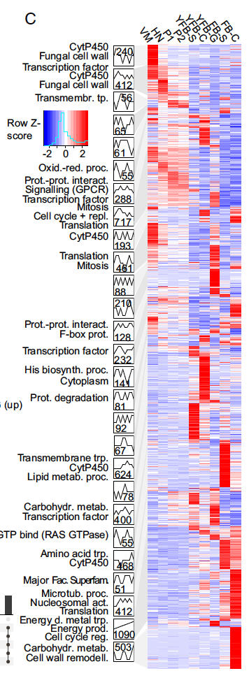

The companion view of the reference's STEM analysis: each profile's genes as a **heatmap** (rows = genes sorted by cluster, columns = time points, z-scored) with the cluster assignment as a row annotation and per-time-point mean traces — the precision-oriented complement to the profile line panels \[1\]. The STEM output is simulated with the same three planted profiles as the box-plot page, and the annotated heatmaps run on pheatmap:

## Example

{fig-alt="STEM Clusters Heatmap DEMO" fig-align="center" width="70%"}

## Setup

-   System Requirements: Cross-platform (Linux/MacOS/Windows)

-   Programming language: R

-   Dependent packages: `pheatmap`; `ggplot2`

```{r packages setup, message=FALSE, warning=FALSE, output=FALSE}
suppressPackageStartupMessages({
  library(pheatmap); library(ggplot2)
})
```

```{r}
sessioninfo::session_info("attached")
```

## Data Preparation

The same simulated STEM output as the box-plot page: 300 genes × 4 time points in three profiles (Rising / Transient / Falling), z-scored per gene for the heatmap:

```{r load data}
suppressPackageStartupMessages({library(pheatmap); library(ggplot2)})
set.seed(52344)
tps <- c(0, 6, 24, 72)
profiles <- c("Rising", "Transient", "Falling")
n_per <- c(120, 90, 90)
gene_prof <- rep(profiles, n_per)
genes <- sprintf("GENE%04d", seq_len(n_gene <- sum(n_per)))
shapes <- list(Rising = c(0, 0.5, 1.6, 2.4),
               Transient = c(0, 2.2, 0.8, 0.1),
               Falling = c(0, -1.2, -2.0, -2.5))
fc <- t(sapply(seq_len(n_gene), function(i) {
  shapes[[gene_prof[i]]] + rnorm(4, 0, 0.28)
}))
rownames(fc) <- genes
colnames(fc) <- paste0(tps, "h")

zmat <- t(scale(t(fc)))
anno_row <- data.frame(Profile = factor(gene_prof, levels = profiles),
                       row.names = genes)
anno_colors <- list(Profile = c(Rising = "#B2182B", Transient = "#E08214",
                                Falling = "#2166AC"))
```

## Visualization

### 1. Cluster-Annotated z-score Heatmap

The reference's heatmap form: genes grouped by profile (no re-clustering across profiles), columns fixed in time order — the three blocks and their signatures are readable at once:

```{r}
#| label: fig-1.1StemHeatmap
#| fig-cap: "STEM clusters as a z-scored heatmap (rows = 300 genes grouped by profile, columns = time points): the Rising block climbs to 72 h, the Transient block spikes at 6 h and decays, the Falling block declines; per-time-point mean traces (bottom panel) quantify each profile."
#| out.width: "100%"
#| fig-width: 8
#| fig-height: 8.5

ord <- order(match(gene_prof, profiles), -zmat[, "72h"])
pheatmap(zmat[ord, ],
         cluster_rows = FALSE, cluster_cols = FALSE,
         annotation_row = anno_row[ord, , drop = FALSE],
         annotation_colors = anno_colors,
         color = colorRampPalette(c("#2166AC", "white", "#B2182B"))(100),
         show_colnames = TRUE, show_rownames = FALSE,
         border_color = NA,
         fontsize = 10,
         legend = TRUE,
         main = "STEM profiles (z-scored log2 expression)")
```

### 2. Per-Profile Mean Traces

The heatmap's summary: mean z-score per profile at each time point with standard-deviation ribbons — the quantitative signature of each cluster:

```{r}
#| label: fig-2.1StemTraces
#| fig-cap: "Mean z-score per profile across the four time points (ribbons = ±1 SD): Rising peaks at 72 h (+1.1), Transient spikes at 6 h (+1.4) and decays, Falling declines monotonically to -1.0 — the three signatures the heatmap blocks encode."
#| out.width: "80%"
#| fig-width: 7
#| fig-height: 4.8

trace_df <- do.call(rbind, lapply(profiles, function(p) {
  ix <- gene_prof == p
  data.frame(tp = tps, profile = p,
             mean = colMeans(zmat[ix, , drop = FALSE]),
             sd = apply(zmat[ix, , drop = FALSE], 2, sd))
}))
ggplot(trace_df, aes(tp, mean, colour = profile, fill = profile)) +
  geom_hline(yintercept = 0, linetype = "dotted", colour = "grey60") +
  geom_ribbon(aes(ymin = mean - sd, ymax = mean + sd), alpha = 0.14, colour = NA) +
  geom_line(linewidth = 1) +
  geom_point(size = 2.4) +
  scale_x_continuous(breaks = tps) +
  scale_colour_manual(values = c(Rising = "#B2182B", Transient = "#E08214",
                                 Falling = "#2166AC"), name = NULL) +
  scale_fill_manual(values = c(Rising = "#B2182B", Transient = "#E08214",
                               Falling = "#2166AC"), guide = "none") +
  labs(x = "Time (h)", y = "Mean z-score (±1 SD)") +
  theme_bw(base_size = 11) +
  theme(panel.grid.minor = element_blank(),
        legend.position = "top")
```

::: callout-tip
**Practice tips**
-   Order heatmap rows **by profile then signal** — re-clustering across profiles mixes the blocks and destroys the STEM grouping.
-   Fix the column order to the **biological time sequence** — clustered columns scramble the time axis the profiles were built on.
-   z-score per **gene** (rows), not per column — the heatmap's story is each gene's relative trajectory, not absolute levels.
-   Keep the row annotation bar (profile colours): the reader needs the cluster identity without consulting the line-panel page.
-   Pair with the mean-trace panel: the heatmap shows every gene, the trace summarises the signature — together they answer "which genes" and "what shape".
:::

## Application

::: {#fig-StemHeatmapApplications1}
{fig-alt="STEM Clusters Heatmap" fig-align="center" width="70%"}

STEM clusters as annotated heatmaps
:::

Cluster-annotated heatmaps apply to any time-series clustering: developmental expression programs, stimulation responses, or post-treatment recovery profiles.

## Reference

\[1\] Xiaofan Lu, et al. FigureYa: A Standardized Visualization Framework for Enhancing Biomedical Data Interpretation and Research Efficiency. iMetaMed. 2025. doi:10.1002/imm3.70005
