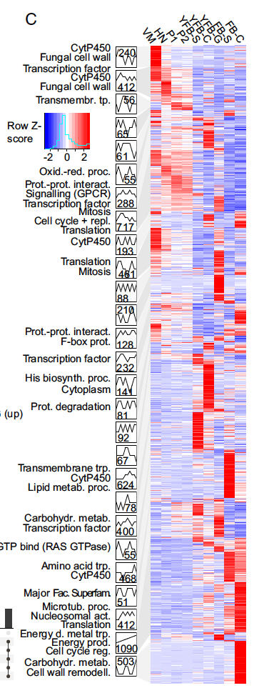

参考 STEM 分析的配套视图：每个轮廓的基因画成**热图**（行 = 按聚类分组的基因、列 = 时间点、逐基因 z 标准化），行注释标聚类归属，底部配每时间点均值轨迹——轮廓折线面板之外的精确读数补充 \[1\]。STEM 输出与箱线图页共用同一套三个植入轮廓的模拟数据，注释热图在 pheatmap 上运行：

## Example

{fig-alt="STEM 聚类热图 DEMO" fig-align="center" width="70%"}

## Setup

-   系统要求：跨平台（Linux/MacOS/Windows）

-   编程语言：R

-   依赖包：`pheatmap`; `ggplot2`

```{r packages setup, message=FALSE, warning=FALSE, output=FALSE}
suppressPackageStartupMessages({
  library(pheatmap); library(ggplot2)
})
```

```{r}
sessioninfo::session_info("attached")
```

## 数据准备

与箱线图页相同的模拟 STEM 输出：300 基因 × 4 时间点、三个轮廓（Rising / Transient / Falling），热图用逐基因 z 标准化：

```{r load data}
suppressPackageStartupMessages({library(pheatmap); library(ggplot2)})
set.seed(52344)
tps <- c(0, 6, 24, 72)
profiles <- c("Rising", "Transient", "Falling")
n_per <- c(120, 90, 90)
gene_prof <- rep(profiles, n_per)
genes <- sprintf("GENE%04d", seq_len(n_gene <- sum(n_per)))
shapes <- list(Rising = c(0, 0.5, 1.6, 2.4),
               Transient = c(0, 2.2, 0.8, 0.1),
               Falling = c(0, -1.2, -2.0, -2.5))
fc <- t(sapply(seq_len(n_gene), function(i) {
  shapes[[gene_prof[i]]] + rnorm(4, 0, 0.28)
}))
rownames(fc) <- genes
colnames(fc) <- paste0(tps, "h")

zmat <- t(scale(t(fc)))
anno_row <- data.frame(Profile = factor(gene_prof, levels = profiles),
                       row.names = genes)
anno_colors <- list(Profile = c(Rising = "#B2182B", Transient = "#E08214",
                                Falling = "#2166AC"))
```

## Visualization

### 1. 聚类注释的 z 分数热图

参考的热图形式：基因按轮廓分组（不做跨轮廓重聚类）、列固定为时间顺序——三个模块及其签名一眼可读：

```{r}
#| label: fig-1.1StemHeatmap
#| fig-cap: "STEM 聚类的 z 分数热图（行 = 300 基因按轮廓分组、列 = 时间点）：Rising 模块爬升至 72 h、Transient 模块在 6 h 尖峰后衰减、Falling 模块单调下降；底部均值轨迹面板量化每个轮廓。"
#| out.width: "100%"
#| fig-width: 8
#| fig-height: 8.5

ord <- order(match(gene_prof, profiles), -zmat[, "72h"])
pheatmap(zmat[ord, ],
         cluster_rows = FALSE, cluster_cols = FALSE,
         annotation_row = anno_row[ord, , drop = FALSE],
         annotation_colors = anno_colors,
         color = colorRampPalette(c("#2166AC", "white", "#B2182B"))(100),
         show_colnames = TRUE, show_rownames = FALSE,
         border_color = NA,
         fontsize = 10,
         legend = TRUE,
         main = "STEM profiles (z-scored log2 expression)")
```

### 2. 逐轮廓均值轨迹

热图的汇总：每个轮廓在各时间点的均值 z 分数与标准差带——各聚类的定量签名：

```{r}
#| label: fig-2.1StemTraces
#| fig-cap: "各轮廓在四个时间点的均值 z 分数（带 = ±1 SD）：Rising 在 72 h 达峰（+1.1）、Transient 在 6 h 尖峰（+1.4）后衰减、Falling 单调下降至 -1.0——热图模块编码的三个签名。"
#| out.width: "80%"
#| fig-width: 7
#| fig-height: 4.8

trace_df <- do.call(rbind, lapply(profiles, function(p) {
  ix <- gene_prof == p
  data.frame(tp = tps, profile = p,
             mean = colMeans(zmat[ix, , drop = FALSE]),
             sd = apply(zmat[ix, , drop = FALSE], 2, sd))
}))
ggplot(trace_df, aes(tp, mean, colour = profile, fill = profile)) +
  geom_hline(yintercept = 0, linetype = "dotted", colour = "grey60") +
  geom_ribbon(aes(ymin = mean - sd, ymax = mean + sd), alpha = 0.14, colour = NA) +
  geom_line(linewidth = 1) +
  geom_point(size = 2.4) +
  scale_x_continuous(breaks = tps) +
  scale_colour_manual(values = c(Rising = "#B2182B", Transient = "#E08214",
                                 Falling = "#2166AC"), name = NULL) +
  scale_fill_manual(values = c(Rising = "#B2182B", Transient = "#E08214",
                               Falling = "#2166AC"), guide = "none") +
  labs(x = "Time (h)", y = "Mean z-score (±1 SD)") +
  theme_bw(base_size = 11) +
  theme(panel.grid.minor = element_blank(),
        legend.position = "top")
```

::: callout-tip
**实践要点**
-   热图行按**轮廓再按信号**排序——跨轮廓重聚类会打乱模块、破坏 STEM 分组。
-   列顺序固定为**生物学时间序列**——聚类列会打乱轮廓赖以建立的时间轴。
-   z 标准化按**基因**（行）而非按列——热图的故事是每个基因的相对轨迹，不是绝对水平。
-   保留行注释条（轮廓颜色）：读者无需翻回折线面板页即可知道聚类归属。
-   与均值轨迹面板配对：热图展示每个基因，轨迹概括签名——合在一起回答"哪些基因"与"什么形状"。
:::

## 应用场景

::: {#fig-StemHeatmapApplications1}
{fig-alt="STEM 聚类热图" fig-align="center" width="70%"}

STEM 聚类注释热图
:::

聚类注释热图适用于任何时间序列聚类：发育表达程序、刺激应答、或治疗后恢复轮廓。

## 参考文献

\[1\] Xiaofan Lu, et al. FigureYa: A Standardized Visualization Framework for Enhancing Biomedical Data Interpretation and Research Efficiency. iMetaMed. 2025. doi:10.1002/imm3.70005
