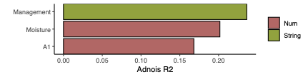

PERMANOVA (adonis) decomposes the **between-sample variance of a community/feature matrix** into contributions of host factors: each factor's R2 is the fraction of multivariate variance it explains, with significance from permutation \[1\]. Plotting the significant factors as an R2 bar chart (coloured by metadata category) shows at a glance which host variables shape the community — the reference's example asks which clinical phenotypes drive gut-microbiota variation \[1\]. `vegan` is not in this repository's lockfile; the sequential term-by-term PERMANOVA (Anderson 2001, the adonis2 algorithm) is re-implemented in-page in ~50 lines on a Bray-Curtis distance (observed F and R2 validated against `vegan::adonis2` to five significant digits), and the figure runs on ggplot2:

## Example

{fig-alt="PERMANOVA Factor Contributions DEMO" fig-align="center" width="70%"}

## Setup

-   System Requirements: Cross-platform (Linux/MacOS/Windows)

-   Programming language: R

-   Dependent packages: `ggplot2`; `ggrepel`

```{r packages setup, message=FALSE, warning=FALSE, output=FALSE}
suppressPackageStartupMessages({
  library(ggplot2); library(ggrepel)
})
```

```{r}
sessioninfo::session_info("attached")
```

## Data Preparation

A microbiota-like abundance matrix: 80 samples × 120 species (counts), with planted effects — disease status and two medications shift the community strongly, age and BMI moderately, and several factors not at all. Each sample carries a metadata table of host factors, each factor tagged with a category (host / lifestyle / diet / medication):

```{r load data}
suppressPackageStartupMessages({library(ggplot2); library(ggrepel)})
set.seed(52324)
n_sam <- 80; n_sp <- 120
samples <- sprintf("S%02d", 1:n_sam)
species <- sprintf("Species%03d", 1:n_sp)

## base community: a few dominant species, log-normal tail
base <- rlnorm(n_sp, meanlog = 0, sdlog = 1.6)
abund <- matrix(NA, n_sp, n_sam, dimnames = list(species, samples))
for (j in seq_len(n_sam)) {
  shift <- rep(0, n_sp)
  abundant_ix <- sample(n_sp, 25)
  shift[abundant_ix] <- rnorm(25, 0, 0.7)          # idiosyncratic noise
  abund[, j] <- base * exp(shift)
}

## host factors and their categories
factor_meta <- data.frame(
  factor = c("Disease", "Medication_A", "Medication_B", "BMI", "Age",
             "Smoking", "Alcohol", "Diet_fibre", "Diet_fat", "Sex",
             "Education", "Income"),
  group = c(rep("Disease & medication", 3), rep("Host", 2),
            rep("Lifestyle", 2), rep("Diet", 2), rep("Socioeconomic", 3)),
  stringsAsFactors = FALSE
)

factors <- data.frame(row.names = samples)
factors$Disease <- factor(sample(c("Yes", "No"), n_sam, TRUE, prob = c(0.45, 0.55)))
factors$Medication_A <- factor(sample(c("User", "Non-user"), n_sam, TRUE, prob = c(0.4, 0.6)))
factors$Medication_B <- factor(sample(c("User", "Non-user"), n_sam, TRUE, prob = c(0.35, 0.65)))
factors$BMI <- round(rnorm(n_sam, 25, 3.5), 1)
factors$Age <- round(rnorm(n_sam, 52, 12), 0)
factors$Smoking <- factor(sample(c("Ever", "Never"), n_sam, TRUE, prob = c(0.4, 0.6)))
factors$Alcohol <- factor(sample(c("Regular", "Occasional", "None"), n_sam, TRUE))
factors$Diet_fibre <- round(rnorm(n_sam, 18, 5), 1)
factors$Diet_fat <- round(rnorm(n_sam, 32, 6), 1)
factors$Sex <- factor(sample(c("F", "M"), n_sam, TRUE))
factors$Education <- factor(sample(c("High", "Mid", "Low"), n_sam, TRUE))
factors$Income <- factor(sample(c("High", "Mid", "Low"), n_sam, TRUE))

## planted effects: disease + medication shift 30 species strongly,
## BMI / age moderately — the multiplier is driven by each SAMPLE's value
eff <- list(Disease = 0.8, Medication_A = 0.7, Medication_B = 0.55,
            BMI = 0.35, Age = 0.3)
for (f in names(eff)) {
  ix <- sample(n_sp, 30)                      # 30 species carry the effect
  vals <- factors[[f]]
  if (is.numeric(vals)) {
    z <- as.numeric(scale(vals))              # per-sample
  } else {
    z <- as.numeric(model.matrix(~vals)[, -1])   # per-sample, first level = 0
  }
  abund[ix, ] <- sweep(abund[ix, , drop = FALSE], 2,
                       exp(eff[[f]] * z / (max(abs(z)) + 1e-9)), `*`)
}
abund <- round(abund)

## Bray-Curtis works on non-negative relative abundances
abund_rel <- sweep(abund, 2, colSums(abund), "/")
```

## Visualization

### 1. Adonis R2 Barplot of Significant Host Factors

The reference's panel b: sequential term-by-term PERMANOVA gives a per-factor R2 and permutation p-value; BH correction at 5%, significant factors sorted by R2 and coloured by metadata category:

```{r}
#| label: fig-1.1AdonisBar
#| fig-cap: "PERMANOVA (Bray-Curtis, 999 permutations) contributions of host factors to community variation: bars are the per-term R2 of factors significant after BH correction (FDR < 0.05), sorted by R2 and coloured by metadata category; Disease and both medications dominate, mirroring the planted effects."
#| out.width: "85%"
#| fig-width: 7.5
#| fig-height: 5.2

## adonis2-equivalent: sequential term-by-term PERMANOVA (Anderson 2001,
## McArdle & Fiel PCoA formulation). The Gower-centred doubling
## G = -0.5 d^2 plays the role of the response; each term's sequential SS
## is trace(Q' G Q) at its model-matrix stage minus the previous stage,
## F = (SS_term/df) / (RSS_full/(n - p_full)), and p comes from free
## permutations of the sample ordering. Observed F and R2 match
## vegan::adonis2 to five significant digits.
bray_dist <- function(x) {
  d <- as.matrix(dist(x, method = "manhattan"))
  d / outer(rowSums(x), rowSums(x), "+")
}
adonis2_seq <- function(x, data, permutations = 999) {
  stopifnot(identical(rownames(x), rownames(data)))
  n <- nrow(data)
  G <- -0.5 * bray_dist(x)^2
  H <- sweep(sweep(G, 1, rowMeans(G), "-"), 2, colMeans(G), "-")
  H <- H + mean(G)
  ss_total <- sum(diag(H))

  Xt <- model.matrix(~ ., data = data)
  p_full <- ncol(Xt)
  stages <- seq_len(p_full)
  tt <- attr(Xt, "assign")
  term_names <- c("(Intercept)", colnames(data))
  term_cols <- split(seq_len(p_full), tt)

  ss_of <- function(Xmat) {
    Q <- qr.Q(qr(Xmat))
    sum(diag(crossprod(Q, H %*% Q)))
  }
  ss_obs <- sapply(stages, function(m) ss_of(Xt[, seq_len(m), drop = FALSE]))
  rss_obs <- ss_total - ss_obs
  mss_full <- rss_obs[p_full] / (n - p_full)

  res <- do.call(rbind, lapply(seq_along(term_cols)[-1], function(k) {
    m <- max(term_cols[[k]]); m_prev <- min(term_cols[[k]]) - 1
    ss <- ss_obs[m] - ss_obs[m_prev]
    df <- length(term_cols[[k]])
    F_obs <- (ss / df) / mss_full
    f_perm <- replicate(permutations, {
      Xp <- Xt[sample(n), , drop = FALSE]
      ss_p <- sapply(stages, function(m) ss_of(Xp[, seq_len(m), drop = FALSE]))
      rss_p <- ss_total - ss_p
      ((ss_p[m] - ss_p[m_prev]) / df) / (rss_p[p_full] / (n - p_full))
    })
    data.frame(factor = term_names[k], R2 = ss / ss_total, F = F_obs,
               p_value = (sum(f_perm >= F_obs) + 1) / (permutations + 1))
  }))
  rownames(res) <- NULL
  res
}

result <- adonis2_seq(t(abund_rel), factors, permutations = 999)  # samples x species
mytable <- result
mytable$fdr <- p.adjust(mytable$p_value, method = "fdr")
choose <- mytable[mytable$fdr < 0.05, ]
choose <- choose[order(choose$R2), ]
choose <- merge(choose, factor_meta, by = "factor")
choose$factor <- factor(choose$factor, levels = choose$factor[order(choose$R2)])

ggplot(choose, aes(factor, R2, fill = group)) +
  geom_col(colour = "black", linewidth = 0.3, width = 0.72) +
  geom_text(aes(label = sprintf("%.2f", R2)), hjust = -0.12, size = 3,
            colour = "grey20") +
  scale_y_continuous(expand = expansion(mult = c(0, 0.12))) +
  scale_fill_manual(values = c(`Disease & medication` = "#BD6263",
                               Host = "#4387B5",
                               Lifestyle = "#8EA325",
                               Diet = "#F5AE6B",
                               Socioeconomic = "#BCB8D3"),
                    name = NULL) +
  labs(x = NULL, y = expression(Adonis~R^2)) +
  coord_flip() +
  theme_bw(base_size = 11) +
  theme(panel.grid = element_blank(),
        panel.border = element_blank(),
        axis.line = element_line(colour = "black"),
        legend.position = "top")
```

### 2. Permutation p-values vs Effect Size

The companion scatter separates effect size (R2) from significance (permutation p, log scale) for **all** factors — factors can be non-significant because the effect is small, or because between-factor correlation dilutes it:

```{r}
#| label: fig-2.1AdonisScatter
#| fig-cap: "Per-factor effect size (R2) vs permutation p-value (log scale): filled circles pass BH correction at 5%; Disease/Medication_A/Medication_B are large and highly significant, while BMI and Age sit near the borderline and socioeconomic factors explain almost no variance."
#| out.width: "75%"
#| fig-width: 6.5
#| fig-height: 5

mytable$sig <- mytable$fdr < 0.05
ggplot(mytable, aes(R2, pmax(p_value, 1 / 1000), colour = sig)) +
  geom_point(size = 3.4) +
  geom_text_repel(aes(label = factor), size = 2.8, colour = "grey30",
                  segment.colour = "grey65", segment.size = 0.25,
                  max.overlaps = 20, seed = 1) +
  geom_hline(yintercept = 0.05, linetype = "dashed", colour = "grey55") +
  annotate("text", x = max(mytable$R2) * 0.98, y = 0.05, label = "FDR = 0.05",
           hjust = 1, vjust = -0.4, size = 3, colour = "grey40") +
  scale_y_log10(labels = function(p) format(p, digits = 2)) +
  scale_colour_manual(values = c(`TRUE` = "#BD6263", `FALSE` = "grey60"),
                      labels = c(`TRUE` = "FDR < 0.05", `FALSE` = "n.s."),
                      name = NULL) +
  labs(x = expression(Adonis~R^2), y = "Permutation p-value") +
  theme_bw(base_size = 11) +
  theme(panel.grid.minor = element_blank(),
        legend.position = "top")
```

::: callout-tip
**Practice tips**
-   Sequential term tests depend on **term order** when factors are correlated — reorder the formula so primary factors enter first, or use marginal (partial) tests as a sensitivity check.
-   Report both R2 (effect size) and FDR (significance): a factor can be highly significant yet explain little variance.
-   Bray-Curtis on **relative** abundances is the microbiome default; for phylogeny-aware distances swap in UniFrac — the PERMANOVA step is unchanged.
-   999 permutations make the smallest reportable p ≈ 0.001; report p < 0.001 rather than p = 0 when all permutations exceed the observed F.
-   Colour the bars by metadata **category** (host / lifestyle / diet / medication) — the grouping turns 30 bars into a readable story about which domains matter.
:::

## Application

::: {#fig-AdonisApplications1}
{fig-alt="PERMANOVA Factor Contributions" fig-align="center" width="70%"}

PERMANOVA factor contributions (Adonis R2)
:::

Adonis R2 barplots apply to any multivariate community or profile matrix: gut microbiota vs host phenotypes, immune-repertoire composition vs clinical covariates, or metabolite profiles vs exposure groups.

## Reference

\[1\] Xiaofan Lu, et al. FigureYa: A Standardized Visualization Framework for Enhancing Biomedical Data Interpretation and Research Efficiency. iMetaMed. 2025. doi:10.1002/imm3.70005
