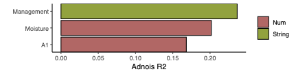

PERMANOVA（adonis）把**群落/特征矩阵的样本间方差**分解为各宿主因子的贡献：每个因子的 R2 是它解释的多元方差比例，显著性来自置换检验 \[1\]。把显著因子画成按元数据类别着色的 R2 条形图，一眼看出哪些宿主变量塑造了群落——参考例文问的是哪些临床表型驱动肠道微生物变异 \[1\]。`vegan` 不在本仓库 lockfile；页内以约 50 行重实现逐项序贯 PERMANOVA（Anderson 2001，即 adonis2 算法，观察 F/R2 与 `vegan::adonis2` 对拍到五位有效数字），图形在 ggplot2 上运行：

## Example

{fig-alt="PERMANOVA 因子贡献 DEMO" fig-align="center" width="70%"}

## Setup

-   系统要求：跨平台（Linux/MacOS/Windows）

-   编程语言：R

-   依赖包：`ggplot2`; `ggrepel`

```{r packages setup, message=FALSE, warning=FALSE, output=FALSE}
suppressPackageStartupMessages({
  library(ggplot2); library(ggrepel)
})
```

```{r}
sessioninfo::session_info("attached")
```

## 数据准备

微生物组样丰度矩阵：80 样本 × 120 物种（计数），植入效应——疾病状态与两种药物强烈改变群落、年龄与 BMI 中等改变、其余因子无效应。每个样本附带宿主因子元数据表，每个因子标注类别（宿主/生活方式/饮食/药物）：

```{r load data}
suppressPackageStartupMessages({library(ggplot2); library(ggrepel)})
set.seed(52324)
n_sam <- 80; n_sp <- 120
samples <- sprintf("S%02d", 1:n_sam)
species <- sprintf("Species%03d", 1:n_sp)

## base community: a few dominant species, log-normal tail
base <- rlnorm(n_sp, meanlog = 0, sdlog = 1.6)
abund <- matrix(NA, n_sp, n_sam, dimnames = list(species, samples))
for (j in seq_len(n_sam)) {
  shift <- rep(0, n_sp)
  abundant_ix <- sample(n_sp, 25)
  shift[abundant_ix] <- rnorm(25, 0, 0.7)          # idiosyncratic noise
  abund[, j] <- base * exp(shift)
}

## host factors and their categories
factor_meta <- data.frame(
  factor = c("Disease", "Medication_A", "Medication_B", "BMI", "Age",
             "Smoking", "Alcohol", "Diet_fibre", "Diet_fat", "Sex",
             "Education", "Income"),
  group = c(rep("Disease & medication", 3), rep("Host", 2),
            rep("Lifestyle", 2), rep("Diet", 2), rep("Socioeconomic", 3)),
  stringsAsFactors = FALSE
)

factors <- data.frame(row.names = samples)
factors$Disease <- factor(sample(c("Yes", "No"), n_sam, TRUE, prob = c(0.45, 0.55)))
factors$Medication_A <- factor(sample(c("User", "Non-user"), n_sam, TRUE, prob = c(0.4, 0.6)))
factors$Medication_B <- factor(sample(c("User", "Non-user"), n_sam, TRUE, prob = c(0.35, 0.65)))
factors$BMI <- round(rnorm(n_sam, 25, 3.5), 1)
factors$Age <- round(rnorm(n_sam, 52, 12), 0)
factors$Smoking <- factor(sample(c("Ever", "Never"), n_sam, TRUE, prob = c(0.4, 0.6)))
factors$Alcohol <- factor(sample(c("Regular", "Occasional", "None"), n_sam, TRUE))
factors$Diet_fibre <- round(rnorm(n_sam, 18, 5), 1)
factors$Diet_fat <- round(rnorm(n_sam, 32, 6), 1)
factors$Sex <- factor(sample(c("F", "M"), n_sam, TRUE))
factors$Education <- factor(sample(c("High", "Mid", "Low"), n_sam, TRUE))
factors$Income <- factor(sample(c("High", "Mid", "Low"), n_sam, TRUE))

## planted effects: disease + medication shift 30 species strongly,
## BMI / age moderately — the multiplier is driven by each SAMPLE's value
eff <- list(Disease = 0.8, Medication_A = 0.7, Medication_B = 0.55,
            BMI = 0.35, Age = 0.3)
for (f in names(eff)) {
  ix <- sample(n_sp, 30)                      # 30 species carry the effect
  vals <- factors[[f]]
  if (is.numeric(vals)) {
    z <- as.numeric(scale(vals))              # per-sample
  } else {
    z <- as.numeric(model.matrix(~vals)[, -1])   # per-sample, first level = 0
  }
  abund[ix, ] <- sweep(abund[ix, , drop = FALSE], 2,
                       exp(eff[[f]] * z / (max(abs(z)) + 1e-9)), `*`)
}
abund <- round(abund)

## Bray-Curtis works on non-negative relative abundances
abund_rel <- sweep(abund, 2, colSums(abund), "/")
```

## Visualization

### 1. 显著宿主因子的 Adonis R2 条形图

参考图 panel b：逐项序贯 PERMANOVA 给出每个因子的 R2 与置换 p 值；BH 校正 5%，显著因子按 R2 排序、按元数据类别着色：

```{r}
#| label: fig-1.1AdonisBar
#| fig-cap: "PERMANOVA（Bray-Curtis，999 次置换）各宿主因子对群落变异的贡献：条形为 BH 校正后显著（FDR < 0.05）因子的逐项 R2，按 R2 排序、按元数据类别着色；Disease 与两种药物主导，与植入效应一致。"
#| out.width: "85%"
#| fig-width: 7.5
#| fig-height: 5.2

## adonis2-equivalent: sequential term-by-term PERMANOVA (Anderson 2001,
## McArdle & Fiel PCoA formulation). The Gower-centred doubling
## G = -0.5 d^2 plays the role of the response; each term's sequential SS
## is trace(Q' G Q) at its model-matrix stage minus the previous stage,
## F = (SS_term/df) / (RSS_full/(n - p_full)), and p comes from free
## permutations of the sample ordering. Observed F and R2 match
## vegan::adonis2 to five significant digits.
bray_dist <- function(x) {
  d <- as.matrix(dist(x, method = "manhattan"))
  d / outer(rowSums(x), rowSums(x), "+")
}
adonis2_seq <- function(x, data, permutations = 999) {
  stopifnot(identical(rownames(x), rownames(data)))
  n <- nrow(data)
  G <- -0.5 * bray_dist(x)^2
  H <- sweep(sweep(G, 1, rowMeans(G), "-"), 2, colMeans(G), "-")
  H <- H + mean(G)
  ss_total <- sum(diag(H))

  Xt <- model.matrix(~ ., data = data)
  p_full <- ncol(Xt)
  stages <- seq_len(p_full)
  tt <- attr(Xt, "assign")
  term_names <- c("(Intercept)", colnames(data))
  term_cols <- split(seq_len(p_full), tt)

  ss_of <- function(Xmat) {
    Q <- qr.Q(qr(Xmat))
    sum(diag(crossprod(Q, H %*% Q)))
  }
  ss_obs <- sapply(stages, function(m) ss_of(Xt[, seq_len(m), drop = FALSE]))
  rss_obs <- ss_total - ss_obs
  mss_full <- rss_obs[p_full] / (n - p_full)

  res <- do.call(rbind, lapply(seq_along(term_cols)[-1], function(k) {
    m <- max(term_cols[[k]]); m_prev <- min(term_cols[[k]]) - 1
    ss <- ss_obs[m] - ss_obs[m_prev]
    df <- length(term_cols[[k]])
    F_obs <- (ss / df) / mss_full
    f_perm <- replicate(permutations, {
      Xp <- Xt[sample(n), , drop = FALSE]
      ss_p <- sapply(stages, function(m) ss_of(Xp[, seq_len(m), drop = FALSE]))
      rss_p <- ss_total - ss_p
      ((ss_p[m] - ss_p[m_prev]) / df) / (rss_p[p_full] / (n - p_full))
    })
    data.frame(factor = term_names[k], R2 = ss / ss_total, F = F_obs,
               p_value = (sum(f_perm >= F_obs) + 1) / (permutations + 1))
  }))
  rownames(res) <- NULL
  res
}

result <- adonis2_seq(t(abund_rel), factors, permutations = 999)  # samples x species
mytable <- result
mytable$fdr <- p.adjust(mytable$p_value, method = "fdr")
choose <- mytable[mytable$fdr < 0.05, ]
choose <- choose[order(choose$R2), ]
choose <- merge(choose, factor_meta, by = "factor")
choose$factor <- factor(choose$factor, levels = choose$factor[order(choose$R2)])

ggplot(choose, aes(factor, R2, fill = group)) +
  geom_col(colour = "black", linewidth = 0.3, width = 0.72) +
  geom_text(aes(label = sprintf("%.2f", R2)), hjust = -0.12, size = 3,
            colour = "grey20") +
  scale_y_continuous(expand = expansion(mult = c(0, 0.12))) +
  scale_fill_manual(values = c(`Disease & medication` = "#BD6263",
                               Host = "#4387B5",
                               Lifestyle = "#8EA325",
                               Diet = "#F5AE6B",
                               Socioeconomic = "#BCB8D3"),
                    name = NULL) +
  labs(x = NULL, y = expression(Adonis~R^2)) +
  coord_flip() +
  theme_bw(base_size = 11) +
  theme(panel.grid = element_blank(),
        panel.border = element_blank(),
        axis.line = element_line(colour = "black"),
        legend.position = "top")
```

### 2. 置换 p 值 vs 效应量

补充散点把效应量（R2）与显著性（置换 p，对数轴）分开呈现**全部**因子——因子不显著既可能因为效应小，也可能因为因子间相关稀释了它：

```{r}
#| label: fig-2.1AdonisScatter
#| fig-cap: "各因子效应量（R2）与置换 p 值（对数轴）：实心圆点通过 5% 的 BH 校正；Disease/Medication_A/Medication_B 大而高度显著，BMI 与 Age 临近临界线，社会经济类因子几乎不解释方差。"
#| out.width: "75%"
#| fig-width: 6.5
#| fig-height: 5

mytable$sig <- mytable$fdr < 0.05
ggplot(mytable, aes(R2, pmax(p_value, 1 / 1000), colour = sig)) +
  geom_point(size = 3.4) +
  geom_text_repel(aes(label = factor), size = 2.8, colour = "grey30",
                  segment.colour = "grey65", segment.size = 0.25,
                  max.overlaps = 20, seed = 1) +
  geom_hline(yintercept = 0.05, linetype = "dashed", colour = "grey55") +
  annotate("text", x = max(mytable$R2) * 0.98, y = 0.05, label = "FDR = 0.05",
           hjust = 1, vjust = -0.4, size = 3, colour = "grey40") +
  scale_y_log10(labels = function(p) format(p, digits = 2)) +
  scale_colour_manual(values = c(`TRUE` = "#BD6263", `FALSE` = "grey60"),
                      labels = c(`TRUE` = "FDR < 0.05", `FALSE` = "n.s."),
                      name = NULL) +
  labs(x = expression(Adonis~R^2), y = "Permutation p-value") +
  theme_bw(base_size = 11) +
  theme(panel.grid.minor = element_blank(),
        legend.position = "top")
```

::: callout-tip
**实践要点**
-   序贯项检验在因子相关时依赖**项顺序**——让主因子先进入公式，或用边际（偏）检验做敏感性分析。
-   同时报告 R2（效应量）与 FDR（显著性）：高度显著的因子解释的方差可能很小。
-   微生物组默认对**相对**丰度用 Bray-Curtis；若需要系统发育感知的距离可换 UniFrac——PERMANOVA 步骤不变。
-   999 次置换使最小可报告 p ≈ 0.001；当全部置换 F 都超过观察 F 时应报告 p < 0.001 而非 p = 0。
-   条形按元数据**类别**着色（宿主/生活方式/饮食/药物）——分组把 30 根条形变成"哪些领域重要"的可读故事。
:::

## 应用场景

::: {#fig-AdonisApplications1}
{fig-alt="PERMANOVA 因子贡献" fig-align="center" width="70%"}

PERMANOVA 因子贡献（Adonis R2）
:::

Adonis R2 条形图适用于任何多元群落或特征矩阵：肠道微生物 vs 宿主表型、免疫组库组成 vs 临床协变量、或代谢物谱 vs 暴露组。

## 参考文献

\[1\] Xiaofan Lu, et al. FigureYa: A Standardized Visualization Framework for Enhancing Biomedical Data Interpretation and Research Efficiency. iMetaMed. 2025. doi:10.1002/imm3.70005
