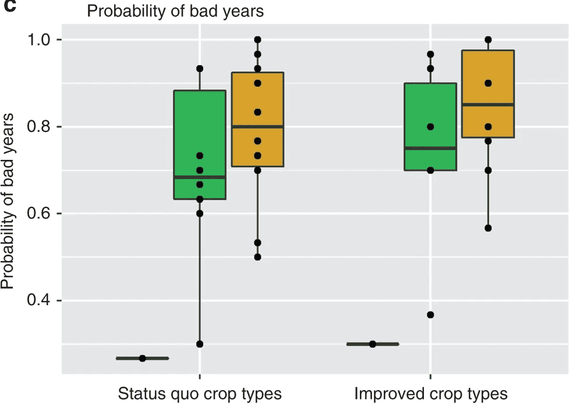
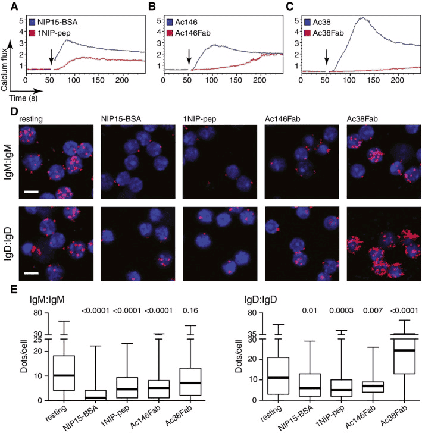
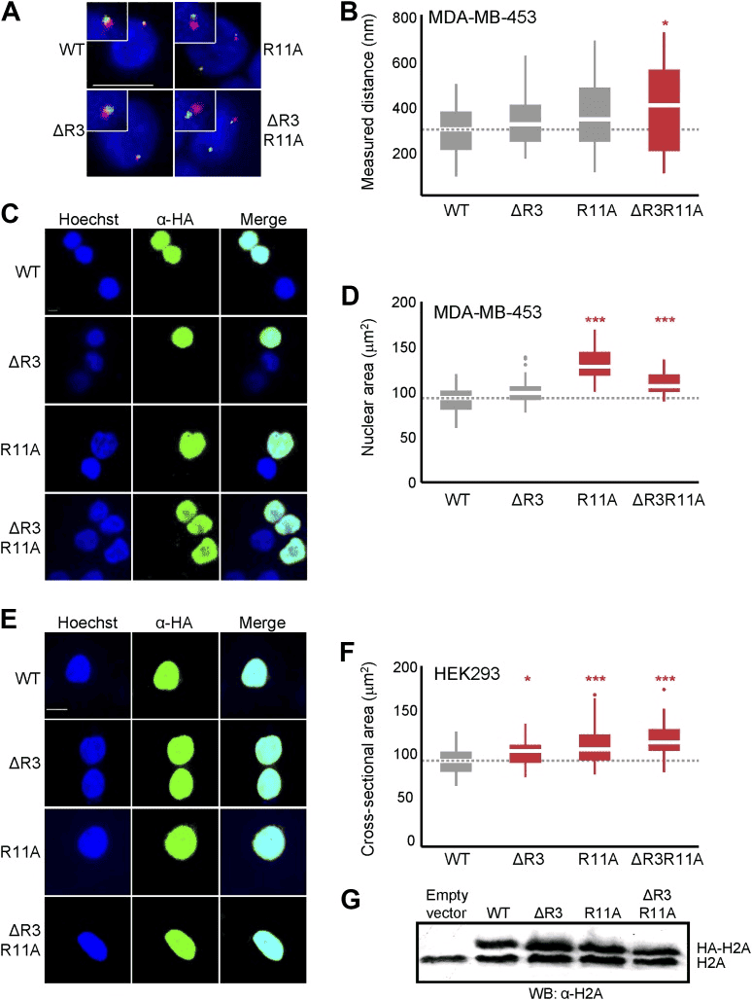
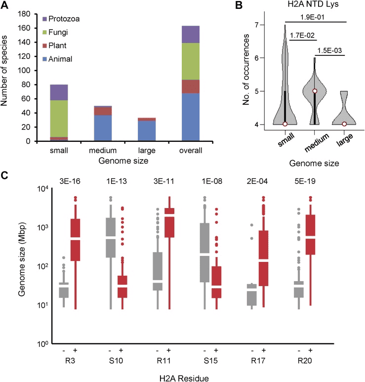

Boxplots visualize the central tendency and dispersion of one or more sets of continuous quantitative data. They incorporate statistical measures that not only compare differences across categories but also reveal dispersion, outliers, and distribution patterns.

A boxplot is defined by five key lines: the upper boundary, upper quartile, median, lower quartile, and lower boundary. Points beyond the upper or lower boundary are considered outliers.

## Example

{fig-alt="BoxPlot DEMO" fig-align="center" width="60%"}

## Setup

-   System Requirements: Cross-platform (Linux/MacOS/Windows)

-   Programming Language: R

-   Packages: `ggplot2`, `dplyr`, `hrbrthemes`, `viridis`, `ggExtra`, `ggpubr`, `rstatix`, `ggtext`, `ggpmisc`, `ggsignif`, `tidyr`

```{r packages setup, message=FALSE, warning=FALSE, output=FALSE}
# Installing necessary packages
if (!requireNamespace("readr", quietly = TRUE)) {
  install.packages("readr")
}
if (!requireNamespace("ggplot2", quietly = TRUE)) {
  install.packages("ggplot2")
}
if (!requireNamespace("dplyr", quietly = TRUE)) {
  install.packages("dplyr")
}
if (!requireNamespace("hrbrthemes", quietly = TRUE)) {
  remotes::install_github("hrbrmstr/hrbrthemes")
}
if (!requireNamespace("viridis", quietly = TRUE)) {
  install.packages("viridis")
}
if (!requireNamespace("ggExtra", quietly = TRUE)) {
  install.packages("ggExtra")
}
if (!requireNamespace("ggpubr", quietly = TRUE)) {
  install.packages("ggpubr")
}
if (!requireNamespace("rstatix", quietly = TRUE)) {
  install.packages("rstatix")
}
if (!requireNamespace("ggtext", quietly = TRUE)) {
  install.packages("ggtext")
}
if (!requireNamespace("ggpmisc", quietly = TRUE)) {
  install.packages("ggpmisc")
}
if (!requireNamespace("ggsignif", quietly = TRUE)) {
  install.packages("ggsignif")
}

# Loading the libraries
library(readr)
library(ggplot2)
library(dplyr)
library(hrbrthemes)
library(viridis)
library(ggpubr)
library(rstatix)
library(ggtext)
library(ggpmisc)
library(ggExtra)
library(ggsignif)
library(tidyr)
```

```{r}
sessioninfo::session_info("attached")
```

## Data Preparation

We used the built-in R datasets (`mtcars`), data from ggplot2 package (`mpg`, `diamonds`) and the `TCGA-BRCA.htseq_counts.tsv` dataset from [UCSC Xena DATASETS](https://xenabrowser.net/datapages/?hub=https://gdcv18.xenahubs.net:443). Selected genes were chosen for demonstration purposes.

```{r load data, message=FALSE, warning=FALSE}
# Load mtcars dataset
data("mtcars")
data_mtcars <- mtcars

# Load mpg dataset from ggplot2 package
data_mpg <- ggplot2::mpg

# Load diamonds dataset from ggplot2 package
data_diamonds <- ggplot2::diamonds

# Load the TCGA-BRCA gene expression dataset from a processed CSV file  
data_TCGA <- readr::read_csv("https://bizard-1301043367.cos.ap-guangzhou.myqcloud.com/TCGA-BRCA.htseq_counts_processed.csv")
data_TCGA1 <- data_TCGA[1:5,] %>%
  gather(key = "sample",value = "gene_expression",3:1219)
```

## Visualization

### 1. Basic Plotting

#### **Basic Plotting**

The `ggplot2` package allows the use of `geom_boxplot()` to create a basic boxplot.

Taking the `TCGA-BRCA.htseq_counts.tsv` dataset as an example:

```{r, message=FALSE, warning=FALSE}
ggplot(data_TCGA1, aes(x=as.factor(gene_name), y=gene_expression)) + 
  geom_boxplot(fill="slateblue", alpha=0.2) + # color fill and font size
  xlab("gene_name") # x-axis label
```

#### **Parameter Adjustment**

Taking the `mtcars` dataset as an example:

```{r, message=FALSE, warning=FALSE}
ggplot(data_mtcars, aes(x=as.factor(cyl), y=mpg)) + 
  geom_boxplot(
    # box
    color="blue",
    fill="blue",
    alpha=0.2,
    # notch
    notch=TRUE,
    notchwidth = 0.8,
    # outliers
    outlier.colour="red",
    outlier.fill="red",
    outlier.size=3
  ) + 
  xlab("cyl")
```

#### **Color Settings**

Taking the `mpg` dataset as an example, several common color scales for boxplots are demonstrated:

```{r, message=FALSE, warning=FALSE}
ggplot(data_mpg, aes(x=class, y=hwy)) + 
  geom_boxplot(color="red", fill="orange", alpha=0.2)
```

------------------------------------------------------------------------

```{r, message=FALSE, warning=FALSE}
ggplot(data_mpg, aes(x=class, y=hwy, fill=class)) + 
  geom_boxplot(alpha=0.3) +
  theme(legend.position="none")
```

------------------------------------------------------------------------

```{r, message=FALSE, warning=FALSE}
ggplot(data_mpg, aes(x=class, y=hwy, fill=class)) + 
  geom_boxplot(alpha=0.3) +
  theme(legend.position="none") +
  scale_fill_brewer(palette="Dark2")
```

#### **Group Highlighting**

Taking the `mpg` dataset as an example, different colors are set for groups that need to be highlighted:

```{r, message=FALSE, warning=FALSE}
data_mpg %>% 
  # add highlighted group, create color vector
  mutate(type=ifelse(class=="subcompact","Highlighted","Normal")) %>%
  # fill=type, map the color vector to the boxplot
  ggplot(aes(x=class, y=hwy, fill=type, alpha=type)) + 
  geom_boxplot() +
  scale_fill_manual(values=c("#69b3a2", "grey")) +
  scale_alpha_manual(values=c(1,0.1)) +
  theme_ipsum() +
  theme(legend.position = "none") +
  xlab("")
```

### 2. Variable Width Boxplot

The basic boxplot does not display the sample size information of categories. We can draw a variable width boxplot where the box width is proportional to the sample size by using the `varwidth` parameter.

```{r, message=FALSE, warning=FALSE}
names <- c(rep("A", 20) , rep("B", 5) , rep("C", 30), rep("D", 100))
value <- c(sample(2:5, 20 , replace=T) , sample(4:10, 5 , replace=T), sample(1:7, 30 , replace=T), sample(3:8, 100 , replace=T))
data <- data.frame(names,value)
# create corresponding x-axis labels
my_xlab <- paste(levels(data$names),"\n(N=",table(data$names),")",sep="")

# plotting
ggplot(data, aes(x=names, y=value, fill=names)) +
  geom_boxplot(varwidth = TRUE, alpha=0.2) + # varwidth = TRUE achieves width proportional to sample size
  theme(legend.position="none") +
  scale_x_discrete(labels=my_xlab)
```

Taking the `mpg` dataset as an example again:

```{r, message=FALSE, warning=FALSE}
ggplot(data_mpg, aes(x=class, y=hwy, fill=class)) + 
  geom_boxplot(varwidth = TRUE,alpha=0.3) +
  theme(legend.position="none") +
  scale_fill_brewer(palette="Dark2")
```

### 3. Boxplot for Continuous Variables

For continuous variables, we can use the `cut_width()` function to divide the continuous variable into intervals and then draw the boxplot.

Taking the `diamonds` dataset as an example:

```{r, message=FALSE, warning=FALSE}
data_diamonds %>%
  # create a new variable, divide the continuous variable into intervals (0.5 as one interval)
  mutate(bin=cut_width(carat, width=0.5, boundary=0)) %>%
  # plotting, use the divided intervals as x
  ggplot(aes(x=bin, y=price)) +
  geom_boxplot(fill="#69b3a2") +
  theme_ipsum() +
  xlab("Carat")
```

### 4. Boxplot with Mean Values

The basic boxplot displays the median for each group. We can also use the `stat_summary()` function to add the mean value for each group to the boxplot.

```{r, message=FALSE, warning=FALSE}
names=c(rep("A", 20) , rep("B", 8) , rep("C", 30), rep("D", 80))
value=c( sample(2:5, 20 , replace=T) , sample(4:10, 8 , replace=T), sample(1:7, 30 , replace=T), sample(3:8, 80 , replace=T) )
data=data.frame(names,value)
# Plotting
p <- ggplot(data, aes(x=names, y=value, fill=names)) +
  geom_boxplot(alpha=0.7) +
  stat_summary(fun.y=mean, geom="point", shape=20, size=14, color="white", fill="white") +
  theme(legend.position="none") +
  scale_fill_brewer(palette="Set1")
p
```

Using the `mpg` dataset as an example again

```{r, message=FALSE, warning=FALSE}
ggplot(data_mpg, aes(x=class, y=hwy, fill=class)) + 
  geom_boxplot(varwidth = TRUE,alpha=0.3) +
  stat_summary(fun.y=mean, geom="point", shape=10, size=5, color="black", fill="black") +
  # fun.y specifies the type of statistic to add, geom specifies the type of geometric object, shape specifies the shape of the point, and size specifies the size

  theme(legend.position="none") +
  scale_fill_brewer(palette="Dark2")
```

### 5. Scatter Boxplot & Violin Plot

#### **Scatter Boxplot**

Boxplots are often used to compare the distributions of multiple groups, but they do not show the specific distribution of the data (for example, it is impossible to determine whether the distribution is normal or bimodal from a boxplot). We can use the `geom_jitter()` function to add individual observations, allowing us to see the specific distribution of each group.

```{r, message=FALSE, warning=FALSE}
data <- data.frame(
  name=c( rep("A",500), rep("B",500), rep("B",500), rep("C",20), rep('D', 100)  ),
  value=c( rnorm(500, 10, 5), rnorm(500, 13, 1), rnorm(500, 18, 1), rnorm(20, 25, 4), rnorm(100, 12, 1) )
)


data %>%
  ggplot( aes(x=name, y=value, fill=name)) +
  geom_boxplot() +
  scale_fill_viridis(discrete = TRUE, alpha=0.6) +
  geom_jitter(color="black", size=0.4, alpha=0.9) + # Plotting scatter points
  theme_ipsum() +
  theme(
    legend.position="none",
    plot.title = element_text(size=11)
  ) +
  ggtitle("A boxplot with jitter") +
  xlab("")
```

------------------------------------------------------------------------

#### **Violin Plot**

Violin plots combine the features of boxplots and density distribution plots, also showing the specific distribution of observations within groups.

```{r, message=FALSE, warning=FALSE}
data <- data.frame(
  name=c( rep("A",500), rep("B",500), rep("B",500), rep("C",20), rep('D', 100)  ),
  value=c( rnorm(500, 10, 5), rnorm(500, 13, 1), rnorm(500, 18, 1), rnorm(20, 25, 4), rnorm(100, 12, 1) )
)

data %>%
  ggplot( aes(x=name, y=value, fill=name)) +
  geom_violin() +
  scale_fill_viridis(discrete = TRUE, alpha=0.6, option="A") +
  theme_ipsum() +
  theme(
    legend.position="none",
    plot.title = element_text(size=11)
  ) +
  ggtitle("Violin chart") +
  xlab("")
```

### 6. Grouped Boxplot

On the basis of single-group comparison, we can use the `fill` parameter to draw grouped boxplots, which facilitates comparisons both between and within groups.

```{r, message=FALSE, warning=FALSE}
variety=rep(LETTERS[1:4], each=40)
treatment=rep(c("high","low"),each=20)
note=seq(1:160)+sample(1:150, 160, replace=T)
data=data.frame(variety, treatment ,  note)

# Plotting
ggplot(data, aes(x=variety, y=note, fill=treatment)) + # The fill parameter adds grouping
  geom_boxplot()
```

Adding statistics analysis:

```{r, message=FALSE, warning=FALSE}
variety=rep(LETTERS[1:4], each=40)
treatment=rep(c("high","low"),each=20)
note=seq(1:160)+sample(1:150, 160, replace=T)
data=data.frame(variety, treatment ,  note)

# Difference test
# Within groups
df <- data
df$variety <- factor(df$variety)
df_p_val1 <- df %>% 
  group_by(variety) %>% 
  wilcox_test(formula = note~treatment) %>% 
  add_significance(p.col = 'p',cutpoints = c(0,0.001,0.01,0.05,1),symbols = c('***','**','*','ns')) %>% 
  add_xy_position(x='variety')
# Between groups
df_p_val2 <- df %>% 
  wilcox_test(formula = note~variety) %>% 
  add_significance(p.col = 'p',cutpoints = c(0,0.001,0.01,0.05,1),symbols = c('***','**','*','ns')) %>% 
  add_xy_position()


# Plotting
ggplot()+
  geom_boxplot(data = df,mapping = aes(x=variety, y=note, fill=treatment),width=0.5)+
  stat_pvalue_manual(df_p_val1,label = '{p.signif}',
                     tip.length = 0)+
  stat_pvalue_manual(df_p_val2,label = '{p.signif}',
                     tip.length = 0.01,
                     y.position = df_p_val2$y.position+0.5)+
  labs(x='variety',y='note')+
  guides(fill=guide_legend(title = 'treatment'))+
  theme_test()+
  theme(axis.text = element_text(color = 'black'),
        plot.caption = element_markdown(face = 'bold'),
        legend.position = c(0.7,0.1),
        legend.direction = 'horizontal')
```

------------------------------------------------------------------------

In addition to grouped boxplots, we can also draw boxplots for each subgroup separately for comparison.

```{r, message=FALSE, warning=FALSE}
variety=rep(LETTERS[1:7], each=40)
treatment=rep(c("high","low"),each=20)
note=seq(1:280)+sample(1:150, 280, replace=T)
data1=data.frame(variety, treatment ,  note)
# treatment as the basis
p1 <- ggplot(data1, aes(x=variety, y=note, fill=treatment)) + 
  geom_boxplot() +
    facet_wrap(~treatment, scale="free")+
  labs(x='variety',y='note')+
  guides(fill=guide_legend(title = 'treatment'))+
  theme_test()+
  theme(axis.text = element_text(color = 'black'),
        plot.caption = element_markdown(face = 'bold'),
        legend.position = c(0.9,0.1),
        legend.direction = 'horizontal')
p1
```

```{r, message=FALSE, warning=FALSE}
# variety as the basis
p2 <- ggplot(data1, aes(x=variety, y=note, fill=treatment)) + 
  geom_boxplot() +
  facet_wrap(~variety, scale="free")+
  labs(x='variety',y='note')+
  guides(fill=guide_legend(title = 'treatment'))+
  theme_test()+
  theme(axis.text = element_text(color = 'black'),
        plot.caption = element_markdown(face = 'bold'),
        legend.position = c(0.9,-0.05),
        legend.direction = 'horizontal')
p2
```

### 7. Adding Marginal Distributions to Boxplots

Adding marginal distributions on the X and Y axes is a common visualization method. We can achieve this using the `ggExtra` package. Here, we mainly introduce the addition of marginal distributions to boxplots.

Taking the `mtcars` dataset as an example:

```{r, message=FALSE, warning=FALSE}
# Original scatter plot
p1<-ggplot(data_mtcars, aes(x=wt, y=mpg, color=cyl, size=cyl))+
  geom_point()+
  theme_bw()+ 
  geom_smooth(method = 'lm', formula = y~x, se = TRUE, show.legend = FALSE) + 
  stat_poly_eq(aes(label = paste(..eq.label.., ..rr.label.., stat(p.value.label), sep = '~`,`~')),
               formula = y~x, parse = TRUE, npcx= 'left', npcy= 'bottom', size = 4)

p1
```
```{r, message=FALSE, warning=FALSE}
# Adding marginal boxplot distributions
p1 <- ggMarginal(p1, type="boxplot")
p1
```

::: callout-tip
The main customizable parameters of `ggMarginal()` are:

-   `size` to change the size of the marginal plot
-   All common appearance customization parameters
-   `margins = 'x'` or `margins = 'y'` to display only one marginal plot
::: 

### 8. Faceted Grouped Boxplot with Significance Tests

A common clinical-question layout: does the expression of one gene separate two molecular groups **within each tumor stage**? \[9\] The design is group × grade, drawn as one boxplot panel per grade with a significance marker per panel. We simulate a glioma-like cohort (IDH mutation status × WHO grade):

```{r}
#| label: fig-8.1FacetSignif
#| fig-cap: "Gene expression by mutation status, faceted by WHO grade; one Wilcoxon significance marker per panel."
#| out.width: "95%"
#| warning: false
#| message: false
#| fig-width: 10
#| fig-height: 5

set.seed(123)
grades <- c("Grade I", "Grade II", "Grade III", "Grade IV")
df8 <- data.frame(
  grade = factor(rep(grades, times = c(60, 55, 50, 45)), levels = grades),
  mut   = sample(c("Mut", "WT"), 210, replace = TRUE, prob = c(0.4, 0.6))
)
# Expression increases with grade and with the mutation
df8$expr <- 2 +
  as.numeric(df8$grade) * 0.5 +
  ifelse(df8$mut == "Mut", 0.8, 0) +
  rnorm(210, sd = 1)

ggplot(df8, aes(x = mut, y = expr)) +
  geom_boxplot(aes(color = mut), alpha = 0, width = 0.6, outlier.shape = NA) +
  geom_jitter(aes(color = mut), width = 0.2, size = 0.7, alpha = 0.5) +
  geom_signif(comparisons = list(c("Mut", "WT")),
              map_signif_level = TRUE, test = "wilcox.test") +
  facet_grid(. ~ grade) +
  scale_color_manual(values = c("Mut" = "#B2182B", "WT" = "#2166AC")) +
  labs(title = "Expression by mutation status within each grade",
       x = "IDH mutation status", y = "Expression (log2)") +
  theme_bw(base_size = 12) +
  theme(legend.position = "none",
        strip.text = element_text(face = "bold"))
```

`geom_signif()` runs its test **per facet panel** automatically, which is exactly the per-grade comparison the reference figure reports. When you need a custom significance table (e.g. adjusted P values), compute them with `rstatix` first and feed them to `stat_pvalue_manual()` instead.

### 9. Batch Boxplots for Many Genes with Significance Stars

 Screening a shortlist of genes means repeating the same boxplot per gene \[9\]. Instead of one plot per gene, pivot the expression matrix to long format, compute the per-gene test, and facet:

```{r}
#| label: fig-9.1BatchStars
#| fig-cap: "Eight genes in one faceted figure, each panel annotated with its one-way ANOVA P value and significance stars."
#| out.width: "95%"
#| warning: false
#| message: false
#| fig-width: 11
#| fig-height: 7

set.seed(42)
genes9 <- paste0("Gene", 1:8)
stage  <- factor(rep(paste0("stage", 1:3), each = 10))

expr9 <- sapply(seq_along(genes9), function(g) {
  eff <- if (g %in% c(2, 5)) c(0, 1.5, 3) else c(0, 0, 0)  # stage-dependent genes
  rnorm(30, mean = 3 + eff[stage], sd = 0.8)
})
colnames(expr9) <- genes9

long9 <- data.frame(stage = stage, expr9) |>
  pivot_longer(-stage, names_to = "gene", values_to = "expr")

# One-way ANOVA per gene + significance stars
sig9 <- do.call(rbind, lapply(genes9, function(g) {
  p <- summary(aov(expr ~ stage, data = subset(long9, gene == g)))[[1]]$"Pr(>F)"[1]
  data.frame(gene = g,
             label = paste0("ANOVA p ",
                            ifelse(p < 0.001, "< 0.001", sprintf("= %.3f", p)), " ",
                            cut(p, c(0, 0.001, 0.01, 0.05, 1),
                                labels = c("***", "**", "*", ""))))
}))

ymax9 <- tapply(long9$expr, long9$gene, max)

ggplot(long9, aes(x = stage, y = expr, fill = stage)) +
  geom_boxplot(outlier.shape = NA, width = 0.6) +
  geom_jitter(width = 0.15, size = 0.6, alpha = 0.5, show.legend = FALSE) +
  geom_text(data = sig9,
            aes(x = 2, y = ymax9[gene] + 0.5, label = label),
            inherit.aes = FALSE, size = 3) +
  facet_wrap(~gene, scales = "free_y", ncol = 4) +
  scale_fill_manual(values = c("#BDD7E7", "#6BAED6", "#2171B5")) +
  labs(x = NULL, y = "Relative expression (log2)") +
  theme_bw(base_size = 11) +
  theme(legend.position = "none", strip.text = element_text(face = "italic"))
```

::: callout-tip
**Practice tips**

- `pivot_longer()` + `facet_wrap()` replaces the per-gene plotting loop; `scales = "free_y"` keeps each gene on its own scale.
- `cut()` converts continuous P values into the conventional star codes (`***` < 0.001, `**` < 0.01, `*` < 0.05) in one line.
- For a paired design (e.g. stage III vs stage I only), switch to `t.test(..., paired = TRUE)` and annotate that P instead.
:::

### 10. Signature-Score Boxplots Across Cell Clusters

TME (tumour-microenvironment) studies compare **gene-set scores** — not raw genes — between sample groups \[9\]: each signature's score is the sign-corrected first principal component of its genes, scores are standardised so the panels share a scale, and a Kruskal-Wallis test per signature flags cluster differences with stars.

```{r}
#| label: fig-10.1TMEscoreBox
#| fig-cap: "Three TME signature scores across three simulated cell clusters; stars mark per-signature Kruskal-Wallis significance."
#| out.width: "95%"
#| warning: false
#| message: false
#| fig-width: 9
#| fig-height: 5

set.seed(404)
clusters <- c("C1", "C2", "C3")
n_per <- 30
sig_sets <- list(
  `Immune checkpoint` = paste0("ICG", 1:15),
  `Antigen processing` = paste0("APM", 1:15),
  `TGF-beta response` = paste0("TGF", 1:15)
)
all_genes <- unlist(sig_sets)
meta <- data.frame(sample = paste0("S", 1:90),
                   cluster = rep(clusters, each = n_per))

expr10 <- matrix(rnorm(45 * 90, sd = 1), nrow = 45, dimnames = list(all_genes, meta$sample))
shift <- c(0, 0.7, 1.6)[match(meta$cluster, clusters)]      # C3 strongest
for (gs in c("Immune checkpoint", "Antigen processing")) {
  expr10[sig_sets[[gs]], ] <- sweep(expr10[sig_sets[[gs]], ], 2, shift, "+")  # shift applies per sample (column)
}
expr10[sig_sets[["TGF-beta response"]], meta$cluster == "C3"] <-
  expr10[sig_sets[["TGF-beta response"]], meta$cluster == "C3"] - 1.2

## sign-corrected PC1 score per signature (the reference workflow's core step)
score_of <- function(gs) {
  m <- expr10[sig_sets[[gs]], , drop = FALSE]
  pc <- prcomp(t(m), retx = TRUE)
  pc$x[, 1] * sign(cor(pc$x[, 1], colMeans(m)))
}
scores <- sapply(names(sig_sets), score_of)

long10 <- data.frame(sample = meta$sample, cluster = meta$cluster, scores) |>
  pivot_longer(-c(sample, cluster), names_to = "Signature", values_to = "Score") |>
  mutate(Score = as.numeric(scale(Score)))

ggplot(long10, aes(Signature, Score, fill = cluster)) +
  geom_boxplot(outlier.shape = NA, width = 0.65) +
  stat_compare_means(label = "p.signif", method = "kruskal.test") +
  scale_fill_manual(values = c("#E31A1C", "#E7B800", "#2E9FDF")) +
  labs(y = "Signature score (scaled)", fill = "TME cluster") +
  theme_classic(base_size = 11) +
  theme(legend.position = "top")
```

::: callout-tip
**Practice tips**

-   `pc$x[, 1] * sign(cor(pc$x[, 1], colMeans(m)))` flips the PC1 sign so that higher always means stronger signature activity — without it the direction flips randomly per run.
-   `stat_compare_means()` placed on a categorical x runs its test **per signature** across the fill groups and writes stars at an automatic height.
-   With real data the input is a samples × signatures score table (e.g. ssGSEA/GSVA output); everything from `pivot_longer()` onward stays identical.
:::

## Application

### 1. Basic Boxplot

::: {#fig-BoxPlotApplications1}
{fig-alt="BoxPlotApp1" fig-align="center" width="60%"}

Applications of Basic Boxplot
:::

Figure E: Fab-PLA results quantified using BlobFinder software and presented in the form of a boxplot. The median is highlighted with a thick line, and the whiskers represent the minimum and maximum values. It shows the distribution of PLA signal quantification data for each group of cells.\[1\]

### 2. Highlighted Boxplot

::: {#fig-BoxPlotApplications2}
{fig-alt="BoxPlotApp2" fig-align="center" width="60%"}

Applications of Highlighted Boxplot
:::

Figure B: Boxplot of probe distance distribution.

Figure D & Figure F: Boxplots of the maximum nuclear cross-sectional area distribution in H2A-overexpressing cells in MDA-MB-453 (D) or HEK293 (F). Groups with significant differences are highlighted.\[2\]

### 3. Grouped Boxplot

::: {#fig-BoxPlotApplications3}
{fig-alt="BoxPlotApp3" fig-align="center" width="60%"}

Applications of Grouped Boxplot
:::

Figure C: Boxplot of genome size for organisms with H2A that does or does not contain the shown residues.\[2\]

### 4. Pan-Cancer Boxplot with Per-Tissue Significance (FigureYa55plus)

The boxplot companion of the pan-cancer violin (FigureYa55plus_pancancer_boxplot \[14\]): same TOIL TCGA-vs-normal matrix, `ggpubr::ggboxplot()` with jittered points, tumour/normal fills, and a significance star above every tissue from a per-tissue Wilcoxon test. ggpubr's `stat_compare_means(comparisons = ...)` cannot fan out over 10 tissues at once, so the stars are computed and placed manually — the same trick as ggpubr's own multi-panel examples:

```{r}
#| label: fig-4.1PanCancerBox
#| fig-cap: "Pan-cancer boxplot of the simulated TP53-like matrix: jittered points over tumour/normal boxes per tissue; stars above each tissue are per-tissue Wilcoxon tests."
#| out.width: "100%"
#| warning: false
#| message: false
#| fig-width: 10
#| fig-height: 5

set.seed(5501)
tissues <- c("BRCA", "COAD", "HNSC", "KIRC", "LUAD", "LUSC", "PRAD", "STAD", "THCA", "UCEC")
n_per <- 120
tp53_base <- c(BRCA = 2.6, COAD = 2.2, HNSC = 2.8, KIRC = 2.4, LUAD = 2.5,
               LUSC = 2.9, PRAD = 2.3, STAD = 2.7, THCA = 2.2, UCEC = 2.5)
pan <- do.call(rbind, lapply(tissues, function(t) {
  rbind(data.frame(tissue = t, type2 = "tumor", tpm = rnorm(n_per, tp53_base[t] + 0.9, 0.75)),
        data.frame(tissue = t, type2 = "normal", tpm = rnorm(n_per, tp53_base[t] - 0.4, 0.6)))
}))
pan$type2 <- factor(pan$type2, levels = c("tumor", "normal"))
pan$tissue <- factor(pan$tissue, levels = tissues)
wt <- do.call(rbind, lapply(tissues, function(t) {
  d1 <- pan$tpm[pan$tissue == t & pan$type2 == "tumor"]
  d0 <- pan$tpm[pan$tissue == t & pan$type2 == "normal"]
  data.frame(tissue = t, p = wilcox.test(d1, d0)$p.value)
}))
star_df <- data.frame(tissue = factor(wt$tissue, levels = tissues),
                      y = max(pan$tpm) + 0.55,
                      lab = ifelse(wt$p < 0.001, "***",
                                   ifelse(wt$p < 0.01, "**",
                                          ifelse(wt$p < 0.05, "*", ""))))
ggpubr::ggboxplot(pan, x = "tissue", y = "tpm", fill = "type2",
                  color = "black", palette = c("#DF2020", "#DDDF21"),
                  ylab = "TP53 expression (log2 TPM, simulated)", xlab = NULL,
                  add = "jitter", jitter = 0.18,
                  add.params = list(size = 0.5, alpha = 0.35, color = "type2"),
                  outlier.shape = NA) +
  geom_text(data = star_df, aes(tissue, y, label = lab),
            inherit.aes = FALSE, size = 4.2, colour = "grey10") +
  scale_y_continuous(limits = c(min(pan$tpm) - 0.5, max(pan$tpm) + 1.1)) +
  theme(legend.position = "top")
```

::: callout-tip
**Practice tips**

-   `outlier.shape = NA` plus `add = "jitter"` shows every sample exactly once — boxplot outliers and jittered points double-draw the same samples otherwise.
-   Place the stars **after** fixing the y range (`limits`), not before: the star row must sit above the tallest whisker without rescaling the boxes.
-   Per-tissue tests on one gene are 10 independent tests — if you annotate stars, say which correction (none / BH) the stars reflect.
:::

## Reference

\[1\] Volkmann C, Brings N, Becker M, Hobeika E, Yang J, Reth M. Molecular requirements of the B-cell antigen receptor for sensing monovalent antigens. EMBO J. 2016 Nov 2;35(21):2371-2381. doi: 10.15252/embj.201694177. Epub 2016 Sep 15. PMID: 27634959; PMCID: PMC5090217.

\[2\] Macadangdang BR, Oberai A, Spektor T, Campos OA, Sheng F, Carey MF, Vogelauer M, Kurdistani SK. Evolution of histone 2A for chromatin compaction in eukaryotes. Elife. 2014 Jun 17;3:e02792. doi: 10.7554/eLife.02792. PMID: 24939988; PMCID: PMC4098067.

\[3\] H. Wickham. ggplot2: Elegant Graphics for Data Analysis. Springer-Verlag New York, 2016.

\[4\] Wickham H, François R, Henry L, Müller K, Vaughan D (2023). *dplyr: A Grammar of Data Manipulation*. R package version 1.1.4, <https://CRAN.R-project.org/package=dplyr>.

\[5\] Rudis B (2024). *hrbrthemes: Additional Themes, Theme Components and Utilities for 'ggplot2'*. R package version 0.8.7, <https://CRAN.R-project.org/package=hrbrthemes>.

\[6\] Wickham H, Averick M, Bryan J, Chang W, McGowan LD, François R, Grolemund G, Hayes A, Henry L, Hester J, Kuhn M, Pedersen TL, Miller E, Bache SM, Müller K, Ooms J, Robinson D, Seidel DP, Spinu V, Takahashi K, Vaughan D, Wilke C, Woo K, Yutani H (2019). "Welcome to the tidyverse." *Journal of Open Source Software*, *4*(43), 1686. doi:10.21105/joss.01686 <https://doi.org/10.21105/joss.01686>.

\[7\] Simon Garnier, Noam Ross, Robert Rudis, Antônio P. Camargo, Marco Sciaini, and Cédric Scherer (2024). viridis(Lite) - Colorblind-Friendly Color Maps for R. viridis package version 0.6.5.

\[8\] Attali D, Baker C (2023). *ggExtra: Add Marginal Histograms to 'ggplot2', and More 'ggplot2' Enhancements*. R package version 0.10.1, <https://CRAN.R-project.org/package=ggExtra>.

\[9\] Xiaofan Lu, et al. FigureYa: A Standardized Visualization Framework for Enhancing Biomedical Data Interpretation and Research Efficiency. iMetaMed. 2025. doi:10.1002/imm3.70005

\[14\] Xiaofan Lu, et al. FigureYa: A Standardized Visualization Framework for Enhancing Biomedical Data Interpretation and Research Efficiency. iMetaMed. 2025. doi:10.1002/imm3.70005