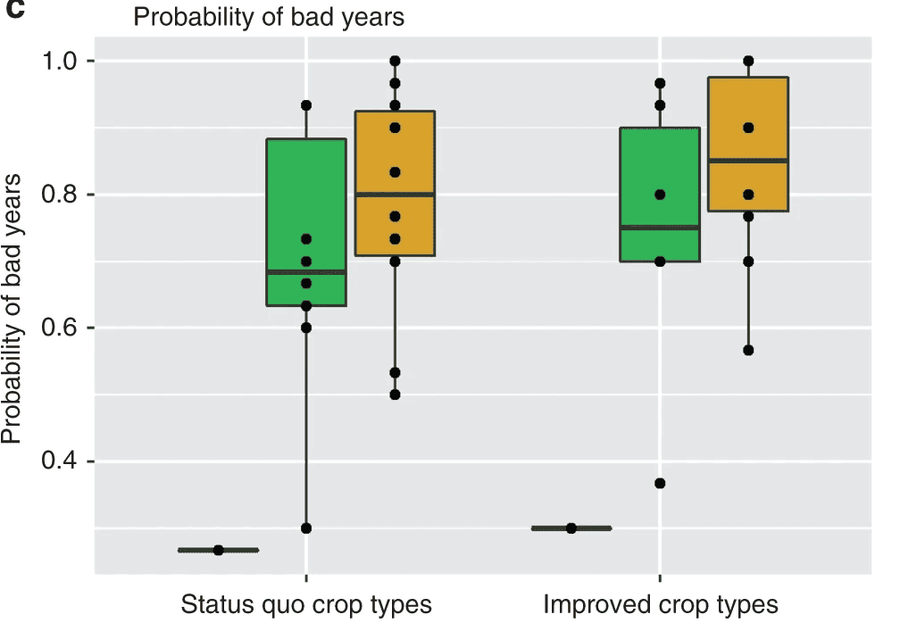
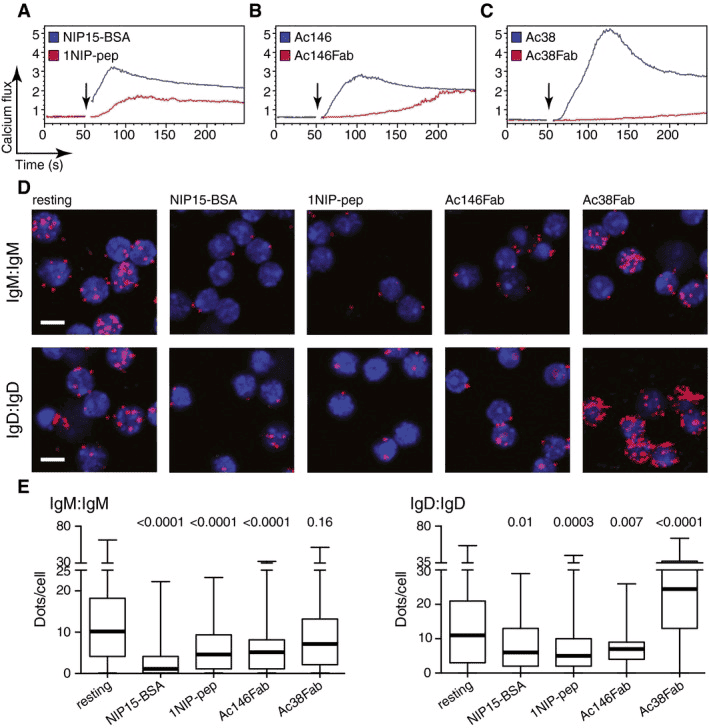
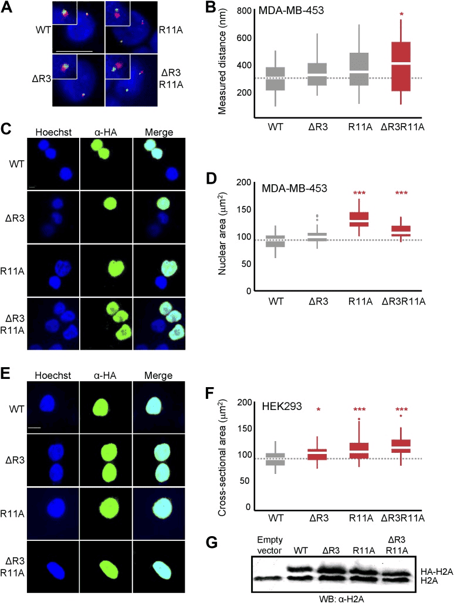
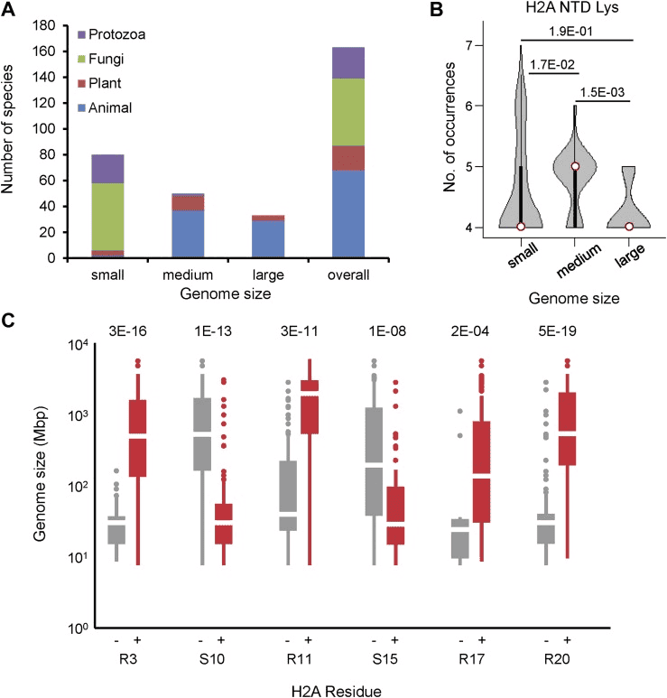

箱线图可以用来反映一组或多组连续型定量数据分布的中心位置和散布范围。箱形图包含数学统计量，不仅能够分析不同类别数据各层次水平差异，还能揭示数据间离散程度、异常值、分布差异等等。

箱线图主要需要关注5条线，即上图中的上界线、上四分位线、中位数线、下四分位线、下界线，其中高于上界或低于下界的点为离群点。

## 示例

{fig-alt="BoxPlot DEMO" fig-align="center" width="60%"}

## 环境配置

-   系统要求： 跨平台（Linux/MacOS/Windows）

-   编程语言：R

-   依赖包：`ggplot2`, `dplyr`, `hrbrthemes`, `viridis`, `ggExtra`, `ggpubr`, `rstatix`, `ggtext`, `ggpmisc`, `ggsignif`, `tidyr`

```{r packages setup, message=FALSE, warning=FALSE, output=FALSE}
# 安装包
if (!requireNamespace("readr", quietly = TRUE)) {
  install.packages("readr")
}
if (!requireNamespace("ggplot2", quietly = TRUE)) {
  install.packages("ggplot2")
}
if (!requireNamespace("dplyr", quietly = TRUE)) {
  install.packages("dplyr")
}
if (!requireNamespace("hrbrthemes", quietly = TRUE)) {
  install.packages("hrbrthemes")
}
if (!requireNamespace("viridis", quietly = TRUE)) {
  install.packages("viridis")
}
if (!requireNamespace("ggExtra", quietly = TRUE)) {
  install.packages("ggExtra")
}
if (!requireNamespace("ggpubr", quietly = TRUE)) {
  install.packages("ggpubr")
}
if (!requireNamespace("rstatix", quietly = TRUE)) {
  install.packages("rstatix")
}
if (!requireNamespace("ggtext", quietly = TRUE)) {
  install.packages("ggtext")
}
if (!requireNamespace("ggpmisc", quietly = TRUE)) {
  install.packages("ggpmisc")
}
if (!requireNamespace("ggsignif", quietly = TRUE)) {
  install.packages("ggsignif")
}

# 加载包
library(readr)
library(ggplot2)
library(dplyr)
library(hrbrthemes)
library(viridis)
library(ggpubr)
library(rstatix)
library(ggtext)
library(ggpmisc)
library(ggExtra)
library(ggsignif)
library(tidyr)
```

```{r}
sessioninfo::session_info("attached")
```

## 数据准备

我们使用内置的 R 数据集（`mtcars`）、ggplot2 包中的数据（`mpg`、`diamonds`）以及来自[UCSC Xena DATASETS](https://xenabrowser.net/datapages/?hub=https://gdcv18.xenahubs.net:443)的`TCGA-BRCA.htseq_counts.tsv`数据集。所选基因仅用于演示目的。

```{r load data, message=FALSE, warning=FALSE}
# 加载 mtcars 数据集
data("mtcars")
data_mtcars <- mtcars

# 加载 ggplot2 包中的 mpg 数据集
data_mpg <- ggplot2::mpg

# 加载 ggplot2 包中的 diamonds 数据集
data_diamonds <- ggplot2::diamonds

# 从处理过的 CSV 文件加载 TCGA-BRCA 基因表达数据集
data_TCGA <- readr::read_csv("https://bizard-1301043367.cos.ap-guangzhou.myqcloud.com/TCGA-BRCA.htseq_counts_processed.csv")
data_TCGA1 <- data_TCGA[1:5,] %>%
  gather(key = "sample",value = "gene_expression",3:1219)
```

## 可视化

### 1. 基础箱线图

#### **基础绘图**

`ggplot2` 包允许运用 `geom_boxplot()` 进行基础箱线图的绘制。

以 `TCGA-BRCA.htseq_counts.tsv` 数据集为例：

```{r, message=FALSE, warning=FALSE}
ggplot(data_TCGA1, aes(x=as.factor(gene_name), y=gene_expression)) + 
  geom_boxplot(fill="slateblue", alpha=0.2) + # 颜色填充及字体大小
  xlab("gene_name") # x轴标签
```

#### **参数调整**

以 `mtcars` 数据集为例:

```{r, message=FALSE, warning=FALSE}
ggplot(data_mtcars, aes(x=as.factor(cyl), y=mpg)) + 
  geom_boxplot(
    # 箱体
    color="blue",
    fill="blue",
    alpha=0.2,
    # 缺口
    notch=TRUE,
    notchwidth = 0.8,
    # 离群点
    outlier.colour="red",
    outlier.fill="red",
    outlier.size=3
  ) + 
  xlab("cyl")
```

#### **颜色设置**

以 `mpg` 数据集为例，展示几种箱线图常用的色标:

```{r, message=FALSE, warning=FALSE}
ggplot(data_mpg, aes(x=class, y=hwy)) + 
  geom_boxplot(color="red", fill="orange", alpha=0.2)
```

------------------------------------------------------------------------

```{r, message=FALSE, warning=FALSE}
ggplot(data_mpg, aes(x=class, y=hwy, fill=class)) + 
  geom_boxplot(alpha=0.3) +
  theme(legend.position="none")
```

------------------------------------------------------------------------

```{r, message=FALSE, warning=FALSE}
ggplot(data_mpg, aes(x=class, y=hwy, fill=class)) + 
  geom_boxplot(alpha=0.3) +
  theme(legend.position="none") +
  scale_fill_brewer(palette="Dark2")
```

#### **组间高亮**

以 `mpg` 数据集为例，为需要突出显示的组设置不同的颜色:

```{r, message=FALSE, warning=FALSE}
data_mpg %>% 
  # 添加高亮组，创建颜色向量
  mutate(type=ifelse(class=="subcompact","Highlighted","Normal")) %>%
  # fill=type，将颜色向量对应到箱图
  ggplot(aes(x=class, y=hwy, fill=type, alpha=type)) + 
  geom_boxplot() +
  scale_fill_manual(values=c("#69b3a2", "grey")) +
  scale_alpha_manual(values=c(1,0.1)) +
  theme_ipsum() +
  theme(legend.position = "none") +
  xlab("")
```

### 2. 可变宽度箱线图

基础箱线图无法展示类别样本的数量信息，我们可以通过`varwidth`参数绘制箱体宽度与样本数量成正比的可变宽度箱线图

```{r, message=FALSE, warning=FALSE}
names <- c(rep("A", 20) , rep("B", 5) , rep("C", 30), rep("D", 100))
value <- c(sample(2:5, 20 , replace=T) , sample(4:10, 5 , replace=T), sample(1:7, 30 , replace=T), sample(3:8, 100 , replace=T))
data <- data.frame(names,value)
# 创建对应的横坐标标签
my_xlab <- paste(levels(data$names),"\n(N=",table(data$names),")",sep="")

# 绘图
ggplot(data, aes(x=names, y=value, fill=names)) +
  geom_boxplot(varwidth = TRUE, alpha=0.2) + # varwidth = TRUE达成宽度与样本数量成正比
  theme(legend.position="none") +
  scale_x_discrete(labels=my_xlab)
```

再以上述 `mpg` 数据集为例:

```{r, message=FALSE, warning=FALSE}
ggplot(data_mpg, aes(x=class, y=hwy, fill=class)) + 
  geom_boxplot(varwidth = TRUE,alpha=0.3) +
  theme(legend.position="none") +
  scale_fill_brewer(palette="Dark2")
```

### 3. 连续变量的箱线图

对于连续变量，我们可以利用`cut_width( )`函数将连续变量进行区间分割再进行箱线图的绘制。

以 `diamonds` 数据集为例:

```{r, message=FALSE, warning=FALSE}
data_diamonds %>%
  # 创建新变量，分割连续变量区间（0.5为一个区间）
  mutate(bin=cut_width(carat, width=0.5, boundary=0)) %>%
  # 绘图，以分割的区间作为x
  ggplot(aes(x=bin, y=price)) +
  geom_boxplot(fill="#69b3a2") +
  theme_ipsum() +
  xlab("Carat")
```

### 4. 添加平均值的箱线图

基础的箱线图显示每组都中位数，同时我们可以利用`stat_summary()`函数为箱线图添加每组的平均值

```{r, message=FALSE, warning=FALSE}
names=c(rep("A", 20) , rep("B", 8) , rep("C", 30), rep("D", 80))
value=c( sample(2:5, 20 , replace=T) , sample(4:10, 8 , replace=T), sample(1:7, 30 , replace=T), sample(3:8, 80 , replace=T) )
data=data.frame(names,value)
# 绘图
p <- ggplot(data, aes(x=names, y=value, fill=names)) +
  geom_boxplot(alpha=0.7) +
  stat_summary(fun.y=mean, geom="point", shape=20, size=14, color="white", fill="white") +
  theme(legend.position="none") +
  scale_fill_brewer(palette="Set1")
p
```

再以上述`mpg`数据集为例：

```{r, message=FALSE, warning=FALSE}
ggplot(data_mpg, aes(x=class, y=hwy, fill=class)) + 
  geom_boxplot(varwidth = TRUE,alpha=0.3) +
  stat_summary(fun.y=mean, geom="point", shape=10, size=5, color="black", fill="black") +
  # fun.y为添加参数的类型，geom为显示的类型，shape为点类型，size为大小

  theme(legend.position="none") +
  scale_fill_brewer(palette="Dark2")
```

### 5. 散点箱线图/小提琴图

#### **散点箱线图**

箱线图常用来比较多个组的分布，但具体数据的分布则无法表示（例如正态分布与双峰分布无法通过箱线图判断）。我们可以通过`geom_jitter()`函数添加独立观察，看到各组具体分布情况。

```{r, message=FALSE, warning=FALSE}
data <- data.frame(
  name=c( rep("A",500), rep("B",500), rep("B",500), rep("C",20), rep('D', 100)  ),
  value=c( rnorm(500, 10, 5), rnorm(500, 13, 1), rnorm(500, 18, 1), rnorm(20, 25, 4), rnorm(100, 12, 1) )
)


data %>%
  ggplot( aes(x=name, y=value, fill=name)) +
  geom_boxplot() +
  scale_fill_viridis(discrete = TRUE, alpha=0.6) +
  geom_jitter(color="black", size=0.4, alpha=0.9) + # Plotting scatter points
  theme_ipsum() +
  theme(
    legend.position="none",
    plot.title = element_text(size=11)
  ) +
  ggtitle("A boxplot with jitter") +
  xlab("")
```

------------------------------------------------------------------------

#### **小提琴图**

小提琴图结合了和箱线图和密度分布图，也能体现组内观察到具体分布。

```{r, message=FALSE, warning=FALSE}
data <- data.frame(
  name=c( rep("A",500), rep("B",500), rep("B",500), rep("C",20), rep('D', 100)  ),
  value=c( rnorm(500, 10, 5), rnorm(500, 13, 1), rnorm(500, 18, 1), rnorm(20, 25, 4), rnorm(100, 12, 1) )
)

data %>%
  ggplot( aes(x=name, y=value, fill=name)) +
  geom_violin() +
  scale_fill_viridis(discrete = TRUE, alpha=0.6, option="A") +
  theme_ipsum() +
  theme(
    legend.position="none",
    plot.title = element_text(size=11)
  ) +
  ggtitle("Violin chart") +
  xlab("")
```

### 6. 分组箱线图

在单组比较的基础上，我们可以通过`fill`参数来绘制分组箱线图，便于组间与组内的比较

```{r, message=FALSE, warning=FALSE}
variety=rep(LETTERS[1:4], each=40)
treatment=rep(c("high","low"),each=20)
note=seq(1:160)+sample(1:150, 160, replace=T)
data=data.frame(variety, treatment ,  note)

# 绘图
ggplot(data, aes(x=variety, y=note, fill=treatment)) + # fill参数添加分组
  geom_boxplot()
```

添加差异分析:

```{r, message=FALSE, warning=FALSE}
variety=rep(LETTERS[1:4], each=40)
treatment=rep(c("high","low"),each=20)
note=seq(1:160)+sample(1:150, 160, replace=T)
data=data.frame(variety, treatment ,  note)

# 差异检验
# 组内
df <- data
df$variety <- factor(df$variety)
df_p_val1 <- df %>% 
  group_by(variety) %>% 
  wilcox_test(formula = note~treatment) %>% 
  add_significance(p.col = 'p',cutpoints = c(0,0.001,0.01,0.05,1),symbols = c('***','**','*','ns')) %>% 
  add_xy_position(x='variety')
# 组间
df_p_val2 <- df %>% 
  wilcox_test(formula = note~variety) %>% 
  add_significance(p.col = 'p',cutpoints = c(0,0.001,0.01,0.05,1),symbols = c('***','**','*','ns')) %>% 
  add_xy_position()


# 绘图
ggplot()+
  geom_boxplot(data = df,mapping = aes(x=variety, y=note, fill=treatment),width=0.5)+
  stat_pvalue_manual(df_p_val1,label = '{p.signif}',
                     tip.length = 0)+
  stat_pvalue_manual(df_p_val2,label = '{p.signif}',
                     tip.length = 0.01,
                     y.position = df_p_val2$y.position+0.5)+
  labs(x='variety',y='note')+
  guides(fill=guide_legend(title = 'treatment'))+
  theme_test()+
  theme(axis.text = element_text(color = 'black'),
        plot.caption = element_markdown(face = 'bold'),
        legend.position = c(0.7,0.1),
        legend.direction = 'horizontal')
```

------------------------------------------------------------------------

除了分组箱线图，我们还可以单独绘制各个子组的箱线图进行比较。

```{r, message=FALSE, warning=FALSE}
variety=rep(LETTERS[1:7], each=40)
treatment=rep(c("high","low"),each=20)
note=seq(1:280)+sample(1:150, 280, replace=T)
data1=data.frame(variety, treatment ,  note)
# treatment 为依据
p1 <- ggplot(data1, aes(x=variety, y=note, fill=treatment)) + 
  geom_boxplot() +
    facet_wrap(~treatment, scale="free")+
  labs(x='variety',y='note')+
  guides(fill=guide_legend(title = 'treatment'))+
  theme_test()+
  theme(axis.text = element_text(color = 'black'),
        plot.caption = element_markdown(face = 'bold'),
        legend.position = c(0.9,0.1),
        legend.direction = 'horizontal')
p1
```

```{r, message=FALSE, warning=FALSE}
# variety 为依据
p2 <- ggplot(data1, aes(x=variety, y=note, fill=treatment)) + 
  geom_boxplot() +
  facet_wrap(~variety, scale="free")+
  labs(x='variety',y='note')+
  guides(fill=guide_legend(title = 'treatment'))+
  theme_test()+
  theme(axis.text = element_text(color = 'black'),
        plot.caption = element_markdown(face = 'bold'),
        legend.position = c(0.9,-0.05),
        legend.direction = 'horizontal')
p2
```

### 7. 添加箱线图边际分布

在 X 轴和 Y 轴上添加的边际分布是常用的可视化方法，我们可以利用`ggExtra`包做到。这里我们主要介绍箱线图边际分布的添加

以 `mtcars` 数据集为例:

```{r, message=FALSE, warning=FALSE}
# 原始散点图
p1<-ggplot(data_mtcars, aes(x=wt, y=mpg, color=cyl, size=cyl))+
  geom_point()+
  theme_bw()+ 
  geom_smooth(method = 'lm', formula = y~x, se = TRUE, show.legend = FALSE) + 
  stat_poly_eq(aes(label = paste(..eq.label.., ..rr.label.., stat(p.value.label), sep = '~`,`~')),
               formula = y~x, parse = TRUE, npcx= 'left', npcy= 'bottom', size = 4)

p1
```

```{r, message=FALSE, warning=FALSE}
# 添加箱线图边际分布
p1 <- ggMarginal(p1, type="boxplot")
p1
```

::: callout-tip
`ggMarginal()` 主要自定义参数:

-   `size`: 更改边际图大小
-   所有自定义外观的常用参数
-   `margins = 'x'` 或 `margins = 'y'`: 仅显示一个边际图
::: 

### 8. 分面分组箱线图与显著性检验

临床研究的常见版式：某个基因的表达能否**在每个肿瘤分期内部**区分两个分子分组 \[9\]？设计是"分组 × 分期"，按分期分面绘制箱线图，并在每个面板内标注显著性。我们模拟一个胶质瘤样队列（IDH 突变状态 × WHO 分级）：

```{r}
#| label: fig-8.1FacetSignif
#| fig-cap: "按 WHO 分级分面的突变状态表达量箱线图；每个面板一个 Wilcoxon 显著性标记。"
#| out.width: "95%"
#| warning: false
#| message: false
#| fig-width: 10
#| fig-height: 5

set.seed(123)
grades <- c("Grade I", "Grade II", "Grade III", "Grade IV")
df8 <- data.frame(
  grade = factor(rep(grades, times = c(60, 55, 50, 45)), levels = grades),
  mut   = sample(c("Mut", "WT"), 210, replace = TRUE, prob = c(0.4, 0.6))
)
# 表达量随分期升高、随突变升高
df8$expr <- 2 +
  as.numeric(df8$grade) * 0.5 +
  ifelse(df8$mut == "Mut", 0.8, 0) +
  rnorm(210, sd = 1)

ggplot(df8, aes(x = mut, y = expr)) +
  geom_boxplot(aes(color = mut), alpha = 0, width = 0.6, outlier.shape = NA) +
  geom_jitter(aes(color = mut), width = 0.2, size = 0.7, alpha = 0.5) +
  geom_signif(comparisons = list(c("Mut", "WT")),
              map_signif_level = TRUE, test = "wilcox.test") +
  facet_grid(. ~ grade) +
  scale_color_manual(values = c("Mut" = "#B2182B", "WT" = "#2166AC")) +
  labs(title = "Expression by mutation status within each grade",
       x = "IDH mutation status", y = "Expression (log2)") +
  theme_bw(base_size = 12) +
  theme(legend.position = "none",
        strip.text = element_text(face = "bold"))
```

`geom_signif()` 会**自动在每个分面面板内**执行检验——这正是参考图按分期逐一比较的做法。若需要自定义显著性表（如校正后 P 值），先用 `rstatix` 计算，再改用 `stat_pvalue_manual()` 传入。

### 9. 多基因批量箱线图与显著性星号

筛选一批候选基因意味着对每个基因重复同一张箱线图 \[9\]。与其逐个画图，不如把表达矩阵转为长表、逐基因计算检验，再用分面汇总到一张图：

```{r}
#| label: fig-9.1BatchStars
#| fig-cap: "8 个基因汇总为一张分面图，每个面板标注其单因素 ANOVA P 值与显著性星号。"
#| out.width: "95%"
#| warning: false
#| message: false
#| fig-width: 11
#| fig-height: 7

set.seed(42)
genes9 <- paste0("Gene", 1:8)
stage  <- factor(rep(paste0("stage", 1:3), each = 10))

expr9 <- sapply(seq_along(genes9), function(g) {
  eff <- if (g %in% c(2, 5)) c(0, 1.5, 3) else c(0, 0, 0)  # 随分期变化的基因
  rnorm(30, mean = 3 + eff[stage], sd = 0.8)
})
colnames(expr9) <- genes9

long9 <- data.frame(stage = stage, expr9) |>
  pivot_longer(-stage, names_to = "gene", values_to = "expr")

# 逐基因单因素 ANOVA + 显著性星号
sig9 <- do.call(rbind, lapply(genes9, function(g) {
  p <- summary(aov(expr ~ stage, data = subset(long9, gene == g)))[[1]]$"Pr(>F)"[1]
  data.frame(gene = g,
             label = paste0("ANOVA p ",
                            ifelse(p < 0.001, "< 0.001", sprintf("= %.3f", p)), " ",
                            cut(p, c(0, 0.001, 0.01, 0.05, 1),
                                labels = c("***", "**", "*", ""))))
}))

ymax9 <- tapply(long9$expr, long9$gene, max)

ggplot(long9, aes(x = stage, y = expr, fill = stage)) +
  geom_boxplot(outlier.shape = NA, width = 0.6) +
  geom_jitter(width = 0.15, size = 0.6, alpha = 0.5, show.legend = FALSE) +
  geom_text(data = sig9,
            aes(x = 2, y = ymax9[gene] + 0.5, label = label),
            inherit.aes = FALSE, size = 3) +
  facet_wrap(~gene, scales = "free_y", ncol = 4) +
  scale_fill_manual(values = c("#BDD7E7", "#6BAED6", "#2171B5")) +
  labs(x = NULL, y = "Relative expression (log2)") +
  theme_bw(base_size = 11) +
  theme(legend.position = "none", strip.text = element_text(face = "italic"))
```

::: callout-tip
**实践要点**

- `pivot_longer()` + `facet_wrap()` 取代了逐基因绘图的循环；`scales = "free_y"` 让每个基因使用自己的纵轴范围。
- `cut()` 一行即可把连续 P 值转换为惯用星号（`***` < 0.001，`**` < 0.01，`*` < 0.05）。
- 若为配对设计（如仅比较 stage III 与 stage I），改用 `t.test(..., paired = TRUE)` 并标注该 P 值。
:::

## 应用场景

### 1. 基础箱线图

::: {#fig-BoxPlotApplications1}
{fig-alt="BoxPlotApp1" fig-align="center" width="60%"}

基础箱线图应用
:::

Figure E: Fab-PLA 结果通过 BlobFinder 软件进行量化并以箱线图的形式呈现。中值以粗线突出显示，晶须代表最小值和最大值。展现了各组细胞PLA信号量化数据的分布。\[1\]

### 2. 高亮箱线图

::: {#fig-BoxPlotApplications2}
{fig-alt="BoxPlotApp2" fig-align="center" width="60%"}

高亮箱线图应用
:::

Figure B: 探针间距离分布的箱线图。

Figure D & Figure F: MDA-MB-453 （D）或 HEK293（F） 中所示 H2A 过表达细胞的最大核横截面积分布的箱线图。其中高亮了有显著差异的组别。\[2\]

### 3. 分组箱线图

::: {#fig-BoxPlotApplications3}
{fig-alt="BoxPlotApp3" fig-align="center" width="60%"}

分组箱线图应用
:::

Figure C: 具有不含有（左）或含有（右）所示残基的 H2A 的生物体的基因组大小的箱线图。\[2\]

## 参考文献

\[1\] Volkmann C, Brings N, Becker M, Hobeika E, Yang J, Reth M. Molecular requirements of the B-cell antigen receptor for sensing monovalent antigens. EMBO J. 2016 Nov 2;35(21):2371-2381. doi: 10.15252/embj.201694177. Epub 2016 Sep 15. PMID: 27634959; PMCID: PMC5090217.

\[2\] Macadangdang BR, Oberai A, Spektor T, Campos OA, Sheng F, Carey MF, Vogelauer M, Kurdistani SK. Evolution of histone 2A for chromatin compaction in eukaryotes. Elife. 2014 Jun 17;3:e02792. doi: 10.7554/eLife.02792. PMID: 24939988; PMCID: PMC4098067.

\[3\] H. Wickham. ggplot2: Elegant Graphics for Data Analysis. Springer-Verlag New York, 2016.

\[4\] Wickham H, François R, Henry L, Müller K, Vaughan D (2023). *dplyr: A Grammar of Data Manipulation*. R package version 1.1.4, <https://CRAN.R-project.org/package=dplyr>.

\[5\] Rudis B (2024). *hrbrthemes: Additional Themes, Theme Components and Utilities for 'ggplot2'*. R package version 0.8.7, <https://CRAN.R-project.org/package=hrbrthemes>.

\[6\] Wickham H, Averick M, Bryan J, Chang W, McGowan LD, François R, Grolemund G, Hayes A, Henry L, Hester J, Kuhn M, Pedersen TL, Miller E, Bache SM, Müller K, Ooms J, Robinson D, Seidel DP, Spinu V, Takahashi K, Vaughan D, Wilke C, Woo K, Yutani H (2019). "Welcome to the tidyverse." *Journal of Open Source Software*, *4*(43), 1686. doi:10.21105/joss.01686 <https://doi.org/10.21105/joss.01686>.

\[7\] Simon Garnier, Noam Ross, Robert Rudis, Antônio P. Camargo, Marco Sciaini, and Cédric Scherer (2024). viridis(Lite) - Colorblind-Friendly Color Maps for R. viridis package version 0.6.5.

\[8\] Attali D, Baker C (2023). *ggExtra: Add Marginal Histograms to 'ggplot2', and More 'ggplot2' Enhancements*. R package version 0.10.1, <https://CRAN.R-project.org/package=ggExtra>.

\[9\] Xiaofan Lu, et al. FigureYa: A Standardized Visualization Framework for Enhancing Biomedical Data Interpretation and Research Efficiency. iMetaMed. 2025. doi:10.1002/imm3.70005
