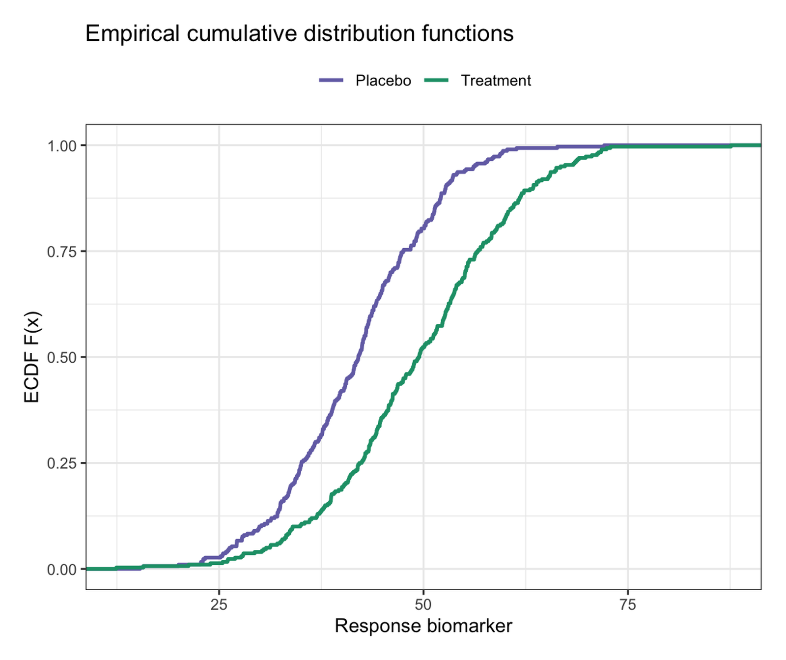
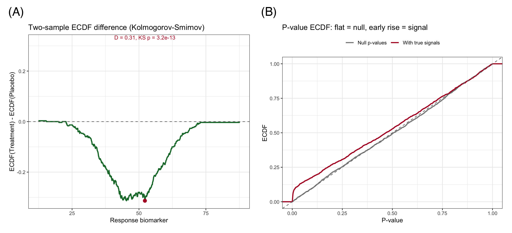

The empirical cumulative distribution function (ECDF), $F_n(x) = \frac{1}{n}\sum_i \mathbf{1}(x_i \le x)$, plots every observation as a step that climbs from 0 to 1 — a complete, assumption-free portrait of a distribution. Compared with histograms it needs no bin-width tuning, shows *every* data point's position, and makes quantiles directly readable: the group median is simply where its curve crosses 0.5 \[1\]. Two ECDF curves on one axes are also the geometric basis of the two-sample Kolmogorov–Smirnov test — the vertical gap between them is the KS statistic \[2\].

This tutorial covers four workflows:

1. Two-group ECDFs with `stat_ecdf()`;
2. Multi-group ECDFs with annotated medians;
3. The two-sample ECDF *difference* plot — visualizing the KS statistic;
4. The p-value ECDF, a standard omics quality-control view.

## Example

{fig-alt="ECDFPlot DEMO" fig-align="center" width="60%"}

## Setup

-   System Requirements: Cross-platform (Linux/MacOS/Windows)

-   Programming language: R

-   Dependent packages: `ggplot2`; `dplyr`

```{r packages setup, message=FALSE, warning=FALSE, output=FALSE}
# Load packages
library(ggplot2)
library(dplyr)
```

```{r}
sessioninfo::session_info("attached")
```

## Data Preparation

Two seeded datasets: a two-arm biomarker study (Placebo vs Treatment, n = 300 each) and a three-gene expression comparison; plus 2,000 simulated p-values under the null and under a mixture with true signals, for the QC view.

```{r load data, message=FALSE, warning=FALSE}
set.seed(251)

resp <- data.frame(
  value = c(rnorm(300, 42, 9), rnorm(300, 49, 11)),
  group = rep(c("Placebo", "Treatment"), each = 300))

set.seed(42)
expr3 <- data.frame(
  expr = c(rnorm(200, 6, 1.4), rnorm(200, 5.4, 1.6), rnorm(200, 4.6, 1.2)),
  gene = rep(c("HER2", "EGFR", "KRAS"), each = 200))

pv_null <- runif(2000)
pv_mix  <- c(runif(1800), 10^(-rnorm(200, 2.4, 0.5)))
pvdf <- data.frame(p = c(pv_null, pv_mix),
                   what = rep(c("Null p-values", "With true signals"), each = 2000))
```

## Visualization

### 1. Two-Group ECDFs

```{r}
#| label: fig-1.1TwoGroups
#| fig-cap: "ECDFs of the two arms: the Treatment curve lies to the right of Placebo at every quantile — higher values throughout the distribution, not only on average."
#| out.width: "65%"
#| fig-width: 6
#| fig-height: 5
#| warning: false
#| message: false

ggplot(resp, aes(value, colour = group)) +
  stat_ecdf(geom = "step", linewidth = 1) +
  scale_color_manual(values = c(Placebo = "#7570B3", Treatment = "#1B9E77"),
                     name = NULL) +
  labs(x = "Response biomarker", y = "ECDF F(x)",
       title = "Empirical cumulative distribution functions") +
  theme_bw(base_size = 11) +
  theme(legend.position = "top")
```

A left-shifted curve means *smaller values everywhere*: the whole distribution moves, which a difference in means alone cannot establish.

### 2. Multi-Group ECDFs with Medians

```{r}
#| label: fig-2.1Medians
#| fig-cap: "Three-gene expression ECDFs; stars mark each group's median (where F(x) = 0.5)."
#| out.width: "65%"
#| fig-width: 6
#| fig-height: 5
#| warning: false
#| message: false

med <- expr3 |>
  group_by(gene) |>
  summarise(med = median(expr))

ggplot(expr3, aes(expr, colour = gene)) +
  stat_ecdf(geom = "step", linewidth = 0.9) +
  geom_point(data = med, aes(med, 0.5), shape = 8, size = 2.6,
             inherit.aes = FALSE, colour = "black") +
  scale_color_brewer(palette = "Dark2", name = NULL) +
  labs(x = "Expression (log2 TPM)", y = "ECDF",
       title = "Stars mark group medians (F(x) = 0.5)") +
  theme_bw(base_size = 11) +
  theme(legend.position = "top")
```

### 3. The ECDF Difference Plot (KS Statistic)

```{r}
#| label: fig-3.1KSDiff
#| fig-cap: "ECDF(Treatment) minus ECDF(Placebo): the largest absolute vertical gap is the Kolmogorov-Smirnov statistic (D = 0.31, p = 3.2e-13)."
#| out.width: "65%"
#| fig-width: 6
#| fig-height: 5
#| warning: false
#| message: false

ks <- ks.test(resp$value[resp$group == "Treatment"],
              resp$value[resp$group == "Placebo"])
e1 <- ecdf(resp$value[resp$group == "Treatment"])
e2 <- ecdf(resp$value[resp$group == "Placebo"])
grid <- seq(min(resp$value), max(resp$value), length.out = 600)
dd <- data.frame(x = grid, d = e1(grid) - e2(grid))
imax <- which.max(abs(dd$d))

ggplot(dd, aes(x, d)) +
  geom_line(color = "#1B7837", linewidth = 1) +
  geom_hline(yintercept = 0, linetype = "dashed", color = "grey45") +
  geom_point(data = dd[imax, ], aes(x, d), color = "#B2182B", size = 2.6) +
  annotate("text", x = dd$x[imax], y = max(abs(dd$d)), vjust = -0.8,
           size = 3.4, color = "#B2182B",
           label = sprintf("D = %.2f, KS p = %.2g", max(abs(dd$d)), ks$p.value)) +
  labs(x = "Response biomarker", y = "ECDF(Treatment) - ECDF(Placebo)",
       title = "Two-sample ECDF difference (Kolmogorov-Smirnov)") +
  theme_bw(base_size = 11)
```

This figure shows *where* the distributions differ, not just that they differ — here the gap peaks near the middle of the range and shrinks in the tails.

### 4. The P-Value ECDF (Omics QC View)

Under a true null, p-values are Uniform(0,1) and their ECDF hugs the diagonal. True signals push small p-values into the population, and the ECDF rises early — making this a one-glance calibration check for any large-scale testing pipeline.

```{r}
#| label: fig-4.1PvalueECDF
#| fig-cap: "ECDF of p-values: null p-values track the diagonal, while the mixture with true signals rises early (enrichment of small p-values)."
#| out.width: "65%"
#| fig-width: 6
#| fig-height: 5
#| warning: false
#| message: false

ggplot(pvdf, aes(p, colour = what)) +
  stat_ecdf(geom = "step", linewidth = 0.9) +
  geom_abline(intercept = 0, slope = 1, linetype = "dashed", color = "grey45") +
  scale_color_manual(values = c("Null p-values" = "grey55",
                                "With true signals" = "#B2182B"), name = NULL) +
  labs(x = "P-value", y = "ECDF",
       title = "P-value ECDF: flat = null, early rise = signal") +
  theme_bw(base_size = 11) +
  theme(legend.position = "top")
```

::: callout-tip
## Practice tips

-   ECDFs reveal sample size: the number of steps *is* n — do not publish them if revealing n is a problem.
-   Read quantiles off the y-axis: F(x) = 0.25 / 0.5 / 0.75 crossings are the quartiles — annotate them when the audience is clinical.
-   For right-skewed data, plot the ECDF on a log x-axis (`scale_x_log10()`) — the monotone shape survives the transform, the readability does not.
-   Heavy-tailed "complementary" view: plot 1 − F(x) on a log y scale to expose upper-tail behavior (survival-style).
:::

## Application

ECDF plots serve distribution comparison wherever medians and tails matter more than means: drug-response screening (per-plate EC50 shifts), flow cytometry marker shifts, differential-expression p-value QC, and wait-time/service data in health-services research. The panel below mirrors a typical publication layout: (A) two-group ECDFs with medians and (B) the KS difference plot.

{fig-alt="ECDFPlot Application" fig-align="center" width="60%"}

## Reference

\[1\] Chambers JM, Cleveland WS, Kleiner B, Tukey PA. Graphical Methods for Data Analysis. Belmont: Wadsworth; 1983.

\[2\] Hodges JL. The significance probability of the Smirnov two-sample test. Ark Mat. 1957;3(5):469-486. doi:10.1007/BF02589501
