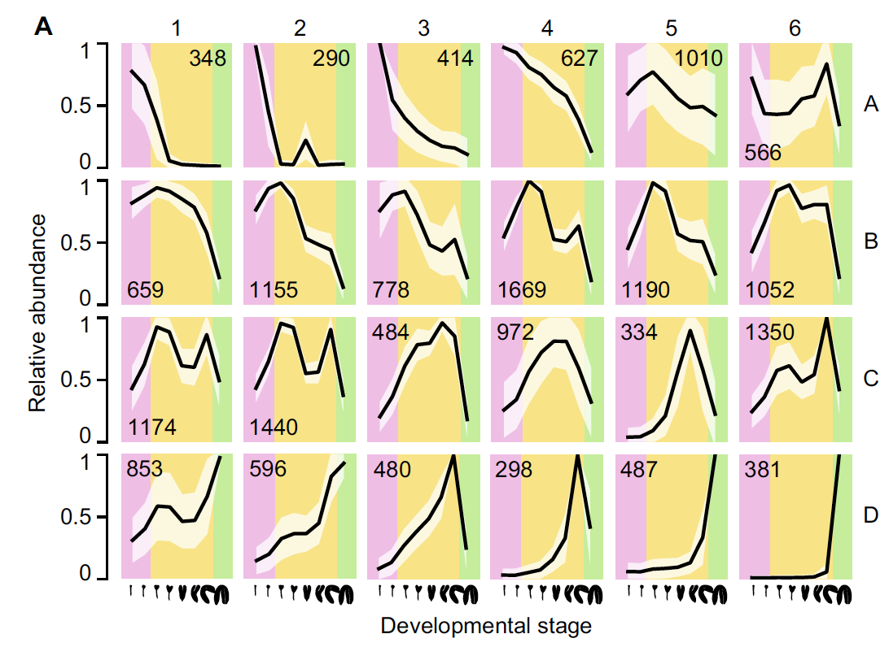

Time-series gene expression clusters best with **model-based clustering**: `Mclust()` fits Gaussian mixtures over each gene's expression profile across time points, picks the number of clusters by BIC, and the reference renders each cluster as a faceted curve with a ± 1 SD polygon and the gene count printed in the panel — 24 embryo time-series clusters in the reference \[1\]. `mclust` is in the lockfile, so the pipeline runs unchanged on simulated data:

## Example

{fig-alt="Mclust Time-Series Clusters DEMO" fig-align="center" width="75%"}

## Setup

-   System Requirements: Cross-platform (Linux/MacOS/Windows)

-   Programming language: R

-   Dependent packages: `mclust`; `ggplot2`

```{r packages setup, message=FALSE, warning=FALSE, output=FALSE}
suppressPackageStartupMessages({
  library(mclust); library(ggplot2)
})
```

```{r}
sessioninfo::session_info("attached")
```

## Data Preparation

400 genes × 12 embryo time points, planted with five expression programmes (maternal decay, zygotic rise, mid-peak, constant-high, constant-low) plus noise — the five true classes are what BIC should recover:

```{r load data}
suppressPackageStartupMessages({library(mclust); library(ggplot2)})
set.seed(42252)
n_gene <- 400; n_time <- 12
time_pts <- seq(1, 12)
prog <- list(
  maternal = -log(time_pts) * 1.4,
  zygotic  = log(time_pts) * 1.3,
  midpeak  = dnorm(time_pts, 6, 2) * 5 - 1,
  const_hi = rep(1.5, n_time),
  const_lo = rep(-1.5, n_time))
n_per <- c(maternal = 90, zygotic = 90, midpeak = 80, const_hi = 70, const_lo = 70)
gene_class <- rep(names(n_per), n_per)
expr <- t(sapply(gene_class, function(cl) {
  prog[[cl]] + rnorm(n_time, 0, 0.35)
}))
expr <- expr + matrix(rnorm(n_gene * n_time, 0, 0.15), n_gene, n_time)
rownames(expr) <- sprintf("GENE%03d", 1:n_gene)
colnames(expr) <- paste0("h", time_pts)
```

## Visualization

### 1. Mclust Fit and BIC Selection

`Mclust()` with model-based initialization, G = 1:9 — the BIC curve shows the model choice the reference delegates to the package default:

```{r}
#| label: fig-1.1MclustBic
#| fig-cap: "BIC across cluster numbers (G = 1-9, VVV model family) for the 400 simulated profiles: the maximum sits at G = 5, recovering the five planted expression programmes."
#| out.width: "75%"
#| fig-width: 7
#| fig-height: 5

mod <- Mclust(expr, G = 1:9)
plot(mod, what = "BIC", main = NULL)
```

### 2. Faceted Cluster Curves with ± 1 SD Polygons

The reference's Fig. 4a: one facet per cluster, the cluster mean curve over time, a ± 1 SD ribbon as the polygon, and the gene count printed in the strip — every planted programme lands in its own cluster with the counts matching the planted sizes:

```{r}
#| label: fig-2.1MclustClusters
#| fig-cap: "Mclust cluster curves across the 12 embryo time points: cluster mean (line) with +/- 1 SD polygon, one facet per cluster with the gene count printed. The five planted programmes (maternal decay, zygotic rise, mid-peak, constant high/low) are each recovered as a cluster."
#| out.width: "90%"
#| fig-width: 9
#| fig-height: 7

cl <- mod$classification
df <- do.call(rbind, lapply(sort(unique(cl)), function(k) {
  m <- expr[cl == k, , drop = FALSE]
  data.frame(cluster = k, n_genes = nrow(m),
             time = time_pts,
             mean = colMeans(m),
             sd = apply(m, 2, sd))
}))
df$cluster <- factor(df$cluster, levels = sort(unique(cl)),
                     labels = sprintf("Cluster %d\n(n = %s)", sort(unique(cl)),
                                      sapply(sort(unique(cl)), function(k) sum(cl == k))))
ggplot(df, aes(time, mean)) +
  geom_ribbon(aes(ymin = mean - sd, ymax = mean + sd), fill = "#9ECAE1", alpha = 0.45) +
  geom_line(colour = "#08519C", linewidth = 0.7) +
  geom_point(colour = "#08519C", size = 1.6) +
  facet_wrap(~ cluster, ncol = 3) +
  labs(x = "embryo time point", y = "average expression") +
  theme_bw(base_size = 11) +
  theme(panel.grid = element_blank())
```

::: callout-tip
**Practice tips**

-   Cluster the **profiles**, not the raw values: the reference clusters gene × time-point vectors directly; standardizing per gene (z-score) would erase the constant-high/low classes the reference shows.
-   Let BIC choose G — fixing the number of clusters in advance turns a model-based method into k-means with extra steps.
-   The ± 1 SD polygon is a summary, not a confidence band: with 60+ genes per cluster the mean's standard error is ~SD/√n, far tighter than the drawn ribbon.
-   Print the gene count in the strip (`n = ...`): a 6-gene cluster's mean curve is anecdote, not biology.
-   mclust has no time structure — neighbouring time points are not smoothed. For monotone trends that is fine; for noisy series fit splines first or the clusters split on noise.
:::

## Application

::: {#fig-MclustApplications1}
{fig-alt="Mclust Time-Series Clusters" fig-align="center" width="75%"}

Mclust time-series clusters
:::

The model-based time-series clustering works on any profile matrix: developmental series, drug-treatment time courses, seasonal expression panels — wherever genes group into expressional programmes the reader wants named and counted.

## Reference

\[1\] Xiaofan Lu, et al. FigureYa: A Standardized Visualization Framework for Enhancing Biomedical Data Interpretation and Research Efficiency. iMetaMed. 2025. doi:10.1002/imm3.70005
