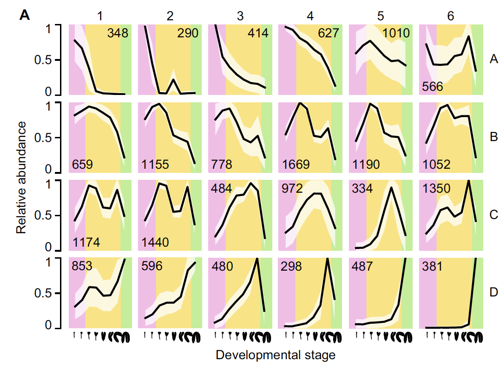

时间序列基因表达用**基于模型的聚类**最合适：`Mclust()` 对每个基因跨时间点的表达轮廓拟合高斯混合、按 BIC 选取簇数、参考将每个簇渲染为带 ± 1 SD 多边形与基因计数印刷在面板里的分面曲线——参考中是 24 个胚胎时间序列簇 \[1\]。`mclust` 已在 lockfile，管线原样运行于模拟数据：

## Example

{fig-alt="Mclust 时间序列聚类 DEMO" fig-align="center" width="60%"}

## Setup

-   系统要求：跨平台（Linux/MacOS/Windows）

-   编程语言：R

-   依赖包：`mclust`; `ggplot2`

```{r packages setup, message=FALSE, warning=FALSE, output=FALSE}
suppressPackageStartupMessages({
  library(mclust); library(ggplot2)
})
```

```{r}
sessioninfo::session_info("attached")
```

## 数据准备

400 基因 × 12 个胚胎时间点，植入五种表达程序（母源衰减、合子型上升、中期峰值、恒定高、恒定低）加噪声——BIC 应该恢复的五个真实类：

```{r load data}
suppressPackageStartupMessages({library(mclust); library(ggplot2)})
set.seed(42252)
n_gene <- 400; n_time <- 12
time_pts <- seq(1, 12)
prog <- list(
  maternal = -log(time_pts) * 1.4,
  zygotic  = log(time_pts) * 1.3,
  midpeak  = dnorm(time_pts, 6, 2) * 5 - 1,
  const_hi = rep(1.5, n_time),
  const_lo = rep(-1.5, n_time))
n_per <- c(maternal = 90, zygotic = 90, midpeak = 80, const_hi = 70, const_lo = 70)
gene_class <- rep(names(n_per), n_per)
expr <- t(sapply(gene_class, function(cl) {
  prog[[cl]] + rnorm(n_time, 0, 0.35)
}))
expr <- expr + matrix(rnorm(n_gene * n_time, 0, 0.15), n_gene, n_time)
rownames(expr) <- sprintf("GENE%03d", 1:n_gene)
colnames(expr) <- paste0("h", time_pts)
```

## Visualization

### Mclust 拟合与 BIC 选择

模型法初始化的 `Mclust()`、G = 1:9——BIC 曲线展示参考委托给包默认的模型选择：

```{r}
#| label: fig-1.1MclustBic
#| fig-cap: "400 个模拟轮廓在 G = 1-9（VVV 模型族）上的 BIC：最大值位于 G = 5，恢复了五个植入的表达程序。"
#| out.width: "75%"
#| fig-width: 7
#| fig-height: 5

mod <- Mclust(expr, G = 1:9)
plot(mod, what = "BIC", main = NULL)
```

### 分面簇曲线带 ± 1 SD 多边形

参考的 Fig. 4a：每簇一个分面、簇均值随时间曲线、± 1 SD 色带作为多边形、基因数印刷在条带——五个植入程序各自落回自己的簇、计数与植入规模一致：

```{r}
#| label: fig-2.1MclustClusters
#| fig-cap: "12 个胚胎时间点上 Mclust 簇曲线：簇均值（线）与 ± 1 SD 多边形、每簇一个分面并印刷基因数。五个植入程序（母源衰减、合子型上升、中期峰值、恒定高/低）各恢复为一个簇。"
#| out.width: "90%"
#| fig-width: 9
#| fig-height: 7

cl <- mod$classification
df <- do.call(rbind, lapply(sort(unique(cl)), function(k) {
  m <- expr[cl == k, , drop = FALSE]
  data.frame(cluster = k, n_genes = nrow(m),
             time = time_pts,
             mean = colMeans(m),
             sd = apply(m, 2, sd))
}))
df$cluster <- factor(df$cluster, levels = sort(unique(cl)),
                     labels = sprintf("Cluster %d\n(n = %s)", sort(unique(cl)),
                                      sapply(sort(unique(cl)), function(k) sum(cl == k))))
ggplot(df, aes(time, mean)) +
  geom_ribbon(aes(ymin = mean - sd, ymax = mean + sd), fill = "#9ECAE1", alpha = 0.45) +
  geom_line(colour = "#08519C", linewidth = 0.7) +
  geom_point(colour = "#08519C", size = 1.6) +
  facet_wrap(~ cluster, ncol = 3) +
  labs(x = "embryo time point", y = "average expression") +
  theme_bw(base_size = 11) +
  theme(panel.grid = element_blank())
```


## 应用场景

::: {{#fig-MclustApplications1}}
{fig-alt="Mclust 时间序列聚类" fig-align="center" width="60%"}

Mclust 时间序列聚类
:::

基于模型的时间序列聚类适用于任何轮廓矩阵：发育系列、用药处理时间过程、季节表达面板——凡基因按表达程序分组、读者需要命名与计数处。

## 参考文献

\[1\] Xiaofan Lu, et al. FigureYa: A Standardized Visualization Framework for Enhancing Biomedical Data Interpretation and Research Efficiency. iMetaMed. 2025. doi:10.1002/imm3.70005
