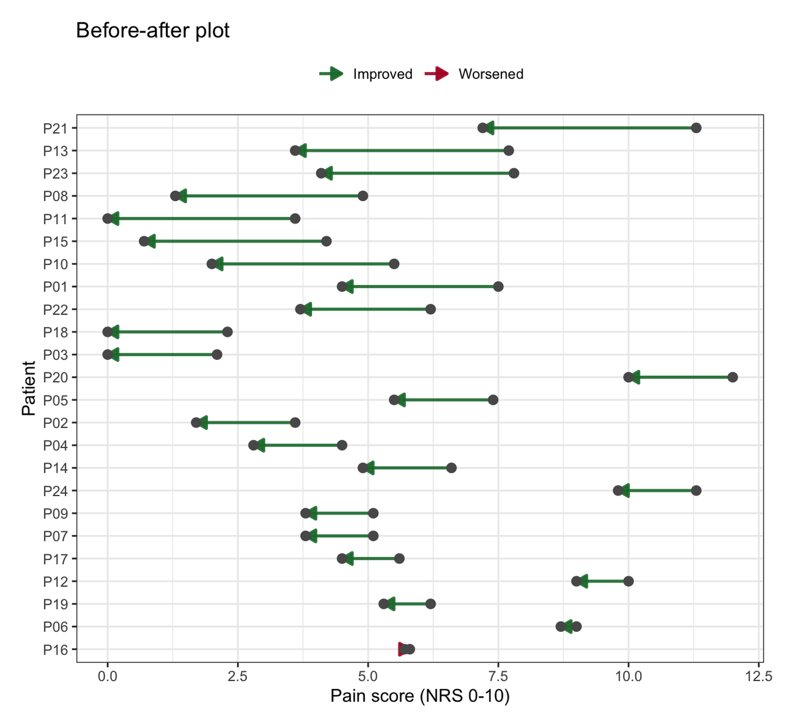
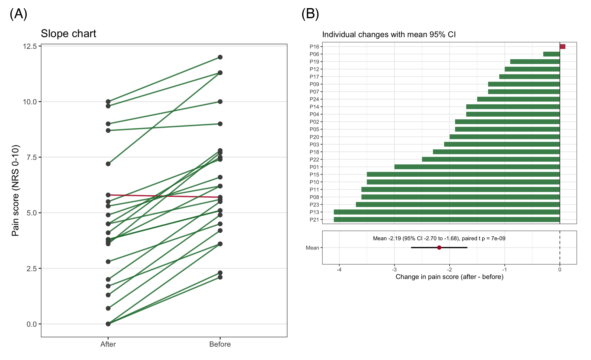

配对数据——同一受试者测量两次（治疗前后、左右眼、两种条件）——必须以能看见*每个个体变化*的方式可视化。分组条形图或并排箱线图会破坏配对信息：它们只展示两个边缘分布，看不出个体是否改善 \[1\]。前后对比图（before-after plot）用连线（或箭头）连接每个受试者的两次测量，直接暴露个体轨迹、轨迹的一致性，以及逆趋势而动的离群者。

本教程展示 ggplot2 中最常用的四种变体：前后箭头图、斜率图、配对哑铃图，以及带配对均数差及其置信区间的个体变化面板。配对设计本身的统计用配对 t 检验（或 Wilcoxon 符号秩检验）——永远用配对版本，绝不用两样本版本。

## Example

{fig-alt="PairedPlot DEMO" fig-align="center" width="60%"}

## Setup

-   系统要求：跨平台（Linux/MacOS/Windows）

-   编程语言：R

-   依赖包：`ggplot2`；`dplyr`；`tidyr`；`ggalt`；`patchwork`

```{r packages setup, message=FALSE, warning=FALSE, output=FALSE}
# 安装必要的包
if (!requireNamespace("ggalt", quietly = TRUE)) {
  install.packages("ggalt")
}
if (!requireNamespace("patchwork", quietly = TRUE)) {
  install.packages("patchwork")
}

# 加载包
library(ggplot2)
library(dplyr)
library(tidyr)
library(ggalt)
library(patchwork)
```

```{r}
sessioninfo::session_info("attached")
```

## Data Preparation

我们模拟一项单臂镇痛试验：24 例患者的疼痛评分（数字评定量表 0–10）在治疗前与治疗后 4 周各测一次，并特意纳入一名无应答者——图必须显示他们，而不是隐藏他们。

```{r load data, message=FALSE, warning=FALSE}
set.seed(2026)

n <- 24
pain <- data.frame(
  patient = paste0("P", sprintf("%02d", 1:n)),
  before  = round(rgamma(n, shape = 6, scale = 1.1), 1)
) |>
  mutate(after    = pmin(10, pmax(0, round(before - 2.2 + rnorm(n, 0, 1.6), 1))),
         change   = after - before,
         direction = ifelse(change <= 0, "Improved", "Worsened"))

pal <- c(Improved = "#1B7837", Worsened = "#B2182B")
head(pain)
```

## Visualization

### 1. 前后箭头图

```{r}
#| label: fig-1.1BeforeAfter
#| fig-cap: "每位患者两次测量以箭头相连（灰点：基线与随访）；唯一的无应答者一目了然。"
#| out.width: "70%"
#| fig-width: 6.5
#| fig-height: 6
#| warning: false
#| message: false

ggplot(pain, aes(x = before, xend = after, y = reorder(patient, -change),
                 color = direction)) +
  geom_segment(arrow = arrow(length = unit(0.1, "inches"), type = "closed"),
               linewidth = 0.9, alpha = 0.9) +
  geom_point(aes(x = before, y = reorder(patient, -change)),
             size = 2.4, color = "grey35") +
  geom_point(aes(x = after, y = reorder(patient, -change)),
             size = 2.4, color = "grey35") +
  scale_color_manual(values = pal, name = NULL) +
  labs(x = "Pain score (NRS 0-10)", y = "Patient", title = "Before-after plot") +
  theme_bw(base_size = 11) +
  theme(legend.position = "top")
```

按变化量对患者排序（按 `change` 重排）使图形成为应答排名；箭头颜色无需额外表格即可区分应答者与无应答者。

### 2. 斜率图

斜率图是平行坐标图在两时间点下的特例：每个时间点一列，每个受试者一条线。它是出版物图中最紧凑的配对展示。

```{r}
#| label: fig-2.1Slope
#| fig-cap: "同一数据的斜率图：线的方向编码应答，斜率编码幅度。"
#| out.width: "60%"
#| fig-width: 5.2
#| fig-height: 6
#| warning: false
#| message: false

long <- pain |>
  select(patient, direction, before, after) |>
  pivot_longer(-c(patient, direction), names_to = "Time", values_to = "score") |>
  mutate(Time = recode(Time, before = "Before", after = "After"))

ggplot(long, aes(Time, score, group = patient)) +
  geom_line(aes(color = direction), linewidth = 0.8, alpha = 0.85) +
  geom_point(size = 2.2, color = "grey30") +
  scale_color_manual(values = pal, guide = "none") +
  labs(x = NULL, y = "Pain score (NRS 0-10)", title = "Slope chart") +
  theme_bw(base_size = 12) +
  theme(panel.grid.minor = element_blank(),
        panel.grid.major.x = element_blank())
```

### 3. 配对哑铃图

哑铃变体把一个受试者放一行——当患者标签有含义（编号、剂量、中心）、读者需要查找个体时最佳。

```{r}
#| label: fig-3.1Dumbbell
#| fig-cap: "配对哑铃图：灰点 = 基线，绿点 = 治疗后。"
#| out.width: "70%"
#| fig-width: 6.5
#| fig-height: 6
#| warning: false
#| message: false

ggplot(pain, aes(y = reorder(patient, change))) +
  geom_dumbbell(aes(x = after, xend = before),
                colour_x = "#1B7837", colour_xend = "grey45",
                size = 1.3, size_x = 2.4, size_xend = 2.4) +
  labs(x = "Pain score (green = after treatment, grey = baseline)", y = NULL,
       title = "Paired dumbbell chart") +
  theme_bw(base_size = 11) +
  theme(panel.grid.major.y = element_blank())
```

### 4. 个体变化与配对均数差

配对设计在统计上诚实的汇总是*差值*的分布：展示每个受试者的变化，加上均数差及其 95% 置信区间与配对检验。

```{r}
#| label: fig-4.1ChangeCI
#| fig-cap: "个体变化（上）与均数变化的 95% CI（下，森林图式汇总行）；配对 t 检验检验均数与 0 的差异。"
#| out.width: "75%"
#| fig-width: 6.5
#| fig-height: 6
#| warning: false
#| message: false

tt <- t.test(pain$after, pain$before, paired = TRUE)
md <- mean(pain$change)
se <- sd(pain$change) / sqrt(nrow(pain))
lo <- md - qt(0.975, nrow(pain) - 1) * se
hi <- md + qt(0.975, nrow(pain) - 1) * se
xlim <- range(c(pain$change, lo, hi))

p4a <- ggplot(pain, aes(x = change, y = reorder(patient, change), fill = direction)) +
  geom_col(width = 0.65, alpha = 0.85) +
  geom_vline(xintercept = 0, color = "grey25") +
  scale_fill_manual(values = pal, guide = "none") +
  scale_x_continuous(limits = xlim) +
  labs(x = NULL, y = NULL, title = "Individual changes with mean 95% CI") +
  theme_bw(base_size = 11) +
  theme(axis.text.x = element_blank(), axis.ticks.x = element_blank())

p4b <- ggplot(data.frame(x = "Mean"), aes(x = md, y = x)) +
  geom_linerange(aes(xmin = lo, xmax = hi), orientation = "y", linewidth = 0.9) +
  geom_point(size = 2.6, color = "#B2182B") +
  geom_vline(xintercept = 0, color = "grey25", linetype = "dashed") +
  scale_x_continuous(limits = xlim) +
  annotate("text", x = md, y = 1.42, vjust = 1.1, size = 3.2,
           label = sprintf("Mean %.2f (95%% CI %.2f to %.2f), paired t p = %.2g",
                           md, lo, hi, tt$p.value)) +
  labs(x = "Change in pain score (after - before)", y = NULL) +
  theme_bw(base_size = 11)

p4a / p4b + plot_layout(heights = c(7, 1.3))
```

::: callout-tip
## 实践要点

-   **永远用配对检验。** `t.test(after, before, paired = TRUE)` 与非配对检验不是同一个检验；对配对数据引用非配对检验会浪费功效，甚至可能翻转结论。
-   保持坐标范围诚实：疼痛评分在 0–10 之间，`scale_x_continuous(limits = c(0, 10))`（或明确刻度）优于放大变化的自由标度。
-   无应答者属于图的一部分。按方向着色（或标注他们）是分析，不是装饰。
-   偏态结局报告中位数变化与 Wilcoxon 符号秩检验，版式相同。
:::

## Application

前后对比图是单臂干预研究（康复、器械训练、心理结局）、实验配对测量（术前/术后生物标志物）以及一切受试者内实验的标准图表。下图模拟典型论文版式：(A) 前后箭头图，(B) 带配对均数 CI 的个体变化面板。

{fig-alt="PairedPlot Application" fig-align="center" width="60%"}

## Reference

\[1\] Krzywinski M, Altman N. Points of significance: visualizing samples with bar graphs. Nat Methods. 2014;11(9):878-879. doi:10.1038/nmeth.3075

\[2\] Attali D. ggalt: supplemental geoms for ggplot2. https://github.com/hrbrmstr/ggalt

\[3\] Pedersen TL. patchwork: the composer of plots. R package version 1.3.2. 2025. https://CRAN.R-project.org/package=patchwork
