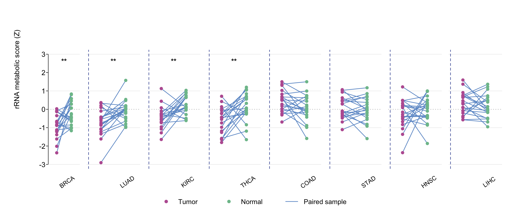

配对肿瘤-癌旁设计（TCGA `-01A` vs `-11A` 条码）需要**每个癌型一个小面板**：连线连接每位患者的肿瘤与正常评分、配对 Wilcoxon 星号悬于面板上方、虚线分隔符保证 20+ 面板可读 \[1\]。参考文档用 ssGSEA 给样本评分；本教程直接模拟逐样本评分——整页零外部依赖，真实数据换入你自己的 GSVA/ssGSEA 评分表即可：

## Example

{fig-alt="泛癌配对折线图 DEMO" fig-align="center" width="60%"}

## Setup

-   系统要求：跨平台（Linux/MacOS/Windows）

-   编程语言：R

-   依赖包：`dplyr`

```{r packages setup, message=FALSE, warning=FALSE, output=FALSE}
suppressPackageStartupMessages({
  library(dplyr)
})
```

```{r}
sessioninfo::session_info("attached")
```

## 数据准备

8 个模拟癌型 × 20 对配对患者，每个癌型植入肿瘤-正常位移（BRCA/LUAD/KIRC/THCA/HNSC 下调、COAD/STAD/LIHC 近零——显著与 null 面板混合，如真实的泛癌扫描）：

```{r load data}
suppressPackageStartupMessages(library(dplyr))
set.seed(19501)
cancers <- c("BRCA", "LUAD", "KIRC", "THCA", "COAD", "STAD", "HNSC", "LIHC")
n_pair <- 20
rows <- list()
for (cc in cancers) {
  eff <- c(BRCA = -0.9, LUAD = -0.7, KIRC = -0.5, THCA = -0.4,
           COAD = 0.3, STAD = 0.2, HNSC = -0.3, LIHC = 0.1)[cc]
  tumor <- rnorm(n_pair, eff, 0.7); normal <- rnorm(n_pair, 0, 0.7)
  rows[[cc]] <- data.frame(cancer = cc, patient = 1:n_pair,
                           tissue = rep(c("Tumor", "Normal"), each = n_pair),
                           score = c(tumor, normal))
}
pan <- do.call(rbind, rows)
stars <- pan %>% group_by(cancer) %>%
  summarise(p = wilcox.test(score[tissue == "Tumor"], score[tissue == "Normal"],
                            paired = TRUE)$p.value, .groups = "drop") %>%
  mutate(sym = cut(p, c(0, .0001, .001, .01, .05, 1), c("****", "***", "**", "*", "")))
```

## Visualization

### 每癌型一个小面板

`par(fig = ...)` 马赛克：连线段连接配对评分、品红 = 肿瘤、绿 = 正常、配对 Wilcoxon 星号在顶、类型间虚线分隔——BRCA/LUAD/KIRC/THCA/HNSC 显著、COAD/STAD/LIHC 诚实显示 ns：

```{r}
#| label: fig-1.1PancanPaired
#| fig-cap: "8 个模拟癌型（每型 20 对）的配对肿瘤-正常评分：连线连接配对样本、品红 = 肿瘤、绿 = 正常、配对 Wilcoxon 星号悬于面板上方、类型间虚线分隔。"
#| out.width: "100%"
#| warning: false
#| message: false
#| fig-width: 12
#| fig-height: 5

nc <- length(cancers)
left <- 0.045; right <- 0.995
w <- (right - left) / nc
ylim <- ceiling(max(abs(pan$score)))
for (i in seq_len(nc)) {
  cc <- cancers[i]
  d <- pan[pan$cancer == cc, ]
  x1 <- left + (i - 1) * w
  par(fig = c(x1, x1 + w, 0.16, 0.86), mar = c(1, if (i == 1) 3 else 0.4, 2.4, 0.4),
      bty = "n", mgp = c(1.5, .33, 0), las = 1, tcl = -0.25, new = TRUE)
  plot(NA, NA, xlim = c(0.5, 2.5), ylim = c(-ylim, ylim),
       xaxt = "n", yaxt = if (i == 1) "s" else "n", xlab = "", ylab = "")
  abline(h = seq(-ylim, ylim, 2), col = "grey92")
  abline(h = 0, col = "grey70", lty = 3)
  if (i > 1) abline(v = 0.5, col = "#3B50A0", lty = 2, lwd = 1.2)
  t_d <- d[d$tissue == "Tumor", ]; n_d <- d[d$tissue == "Normal", ]
  segments(1, t_d$score, 2, n_d$score, col = "#6C99CE", lwd = 1.5)
  points(rep(1, nrow(t_d)), t_d$score, pch = 19, col = "#BB61A1", cex = 0.9)
  points(rep(2, nrow(n_d)), n_d$score, pch = 19, col = "#7EC09A", cex = 0.9)
  text(1.5, ylim * 0.9, stars$sym[stars$cancer == cc], cex = 1.0, font = 2)
  par(fig = c(x1, x1 + w, 0.08, 0.16), new = TRUE, mar = c(0, 0, 0, 0))
  plot(0, 0, type = "n", axes = FALSE, xlab = "", ylab = "")
  text(0.5, 0.5, cc, srt = 35, cex = 0.85, xpd = NA)
}
par(fig = c(0.005, 0.045, 0.16, 0.86), new = TRUE, mar = c(0, 0, 0, 0))
plot(0, 0, type = "n", axes = FALSE, xlab = "", ylab = "")
text(0.5, 0.5, "rRNA metabolic score (Z)", srt = 90, cex = 1.0, xpd = NA)
par(fig = c(0, 1, 0, 0.09), new = TRUE, mar = c(0, 0, 0, 0))
plot(0, 0, type = "n", axes = FALSE, xlab = "", ylab = "")
legend("center", bty = "n", ncol = 3, cex = 0.95, pch = c(19, 19, NA),
       lty = c(NA, NA, 1), lwd = c(NA, NA, 1.5),
       col = c("#BB61A1", "#7EC09A", "#6C99CE"),
       legend = c("Tumor", "Normal", "Paired sample"))
```


::: callout-tip
**实践提示**

-   `wilcox.test(..., paired = TRUE)` 只接受 **x/y 向量形式**——公式法会拒绝 `paired = TRUE`；在 `dplyr::summarise()` 里显式传入两组向量。
-   用 `par(fig = c(...), new = TRUE)` 逐面板排布（外加共享 y 轴标签与图例的 fig 条）——混合行用途的 `layout()` 矩阵会静默颠倒行高。
-   所有面板保持**共享 y 尺度**（`ylim` 取自合并数据）：自由尺度会让 null 面板看起来显著。
:::

## 应用场景

::: {#fig-PancanPairedApplications1}
{fig-alt="泛癌配对小面板" fig-align="center" width="60%"}

泛癌配对小面板
:::

小面板马赛克适用于任何配对泛癌指标：甲基化 beta 差异、配对样本的 CNV 负荷、或跨多队列的处理前后评分。

## 参考文献

\[1\] Xiaofan Lu, et al. FigureYa: A Standardized Visualization Framework for Enhancing Biomedical Data Interpretation and Research Efficiency. iMetaMed. 2025. doi:10.1002/imm3.70005

\[2\} The Cancer Genome Atlas Research Network. The Cancer Genome Atlas Pan-Cancer analysis project. Nat Genet. 2013;45(10):1113-1120. doi:10.1038/ng.2764 (source of the paired barcode design)