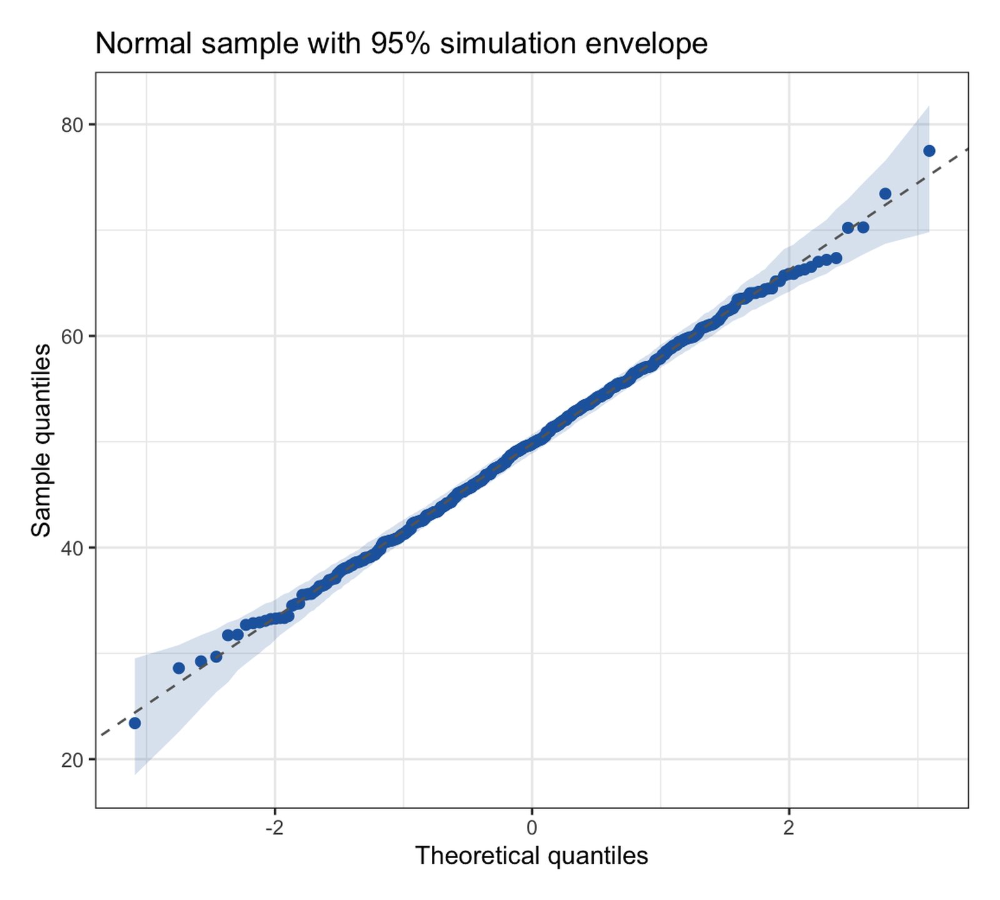
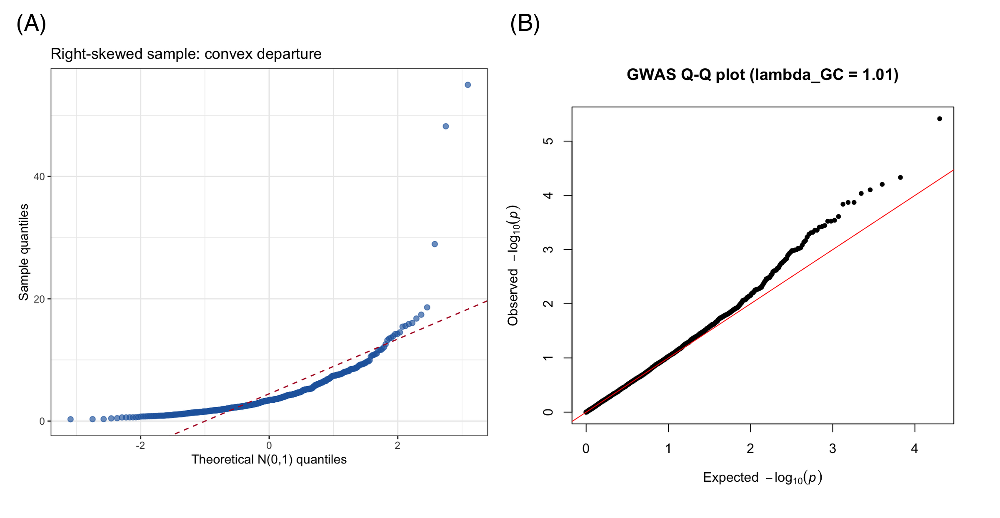

A quantile–quantile (Q-Q) plot compares a sample's quantiles against a theoretical distribution's quantiles (or against a second sample's). If the distributional shapes match, the points fall on a straight line; *how* they depart from the line diagnoses the mismatch — an S-curve means skew, a U-shape means heavy tails, a shifted intercept means different location. It is the single most informative normality diagnostic for model residuals, and the genome-wide-association (GWAS) variant — observed versus expected −log₁₀(p) — is the standard null-calibration check of association studies \[1\].

This tutorial covers four workflows:

1. A basic normal Q-Q plot of a skewed sample (`qqnorm`/`stat_qq`);
2. A Q-Q plot with a 95% simulation envelope (the honest version of "is this a departure?");
3. A two-sample Q-Q plot comparing two empirical distributions;
4. The GWAS p-value Q-Q plot with the genomic inflation factor λ (qqman) \[2\].

## Example

{fig-alt="QQPlot DEMO" fig-align="center" width="60%"}

## Setup

-   System Requirements: Cross-platform (Linux/MacOS/Windows)

-   Programming language: R

-   Dependent packages: `ggplot2`; `dplyr`; `qqman`

```{r packages setup, message=FALSE, warning=FALSE, output=FALSE}
# Installing necessary packages
if (!requireNamespace("qqman", quietly = TRUE)) {
  install.packages("qqman")
}

# Load packages
library(ggplot2)
library(dplyr)
library(qqman)
```

```{r}
sessioninfo::session_info("attached")
```

## Data Preparation

Three seeded samples: a right-skewed biomarker (log-normal, the "diagnose me" sample), a genuinely normal sample (for the simulation envelope), and two treatment-arm biomarker distributions for the two-sample Q-Q plot. The GWAS example draws 10,000 null p-values plus 40 associated loci.

```{r load data, message=FALSE, warning=FALSE}
set.seed(251)

n <- 500
skew_sample  <- rlnorm(n, meanlog = 1.2, sdlog = 0.8)  # right-skewed biomarker
norm_sample  <- rnorm(n, 50, 8)                        # well-behaved control
control_g <- rnorm(400, 42, 9)
case_g    <- rgamma(450, shape = 12, scale = 3.4)

pvals <- runif(10000)
idx <- sample(1:10000, 40)
pvals[idx] <- 10^(-rnorm(40, 3, 0.7))                  # association signals
```

## Visualization

### 1. Normal Q-Q Plot of a Skewed Sample

```{r}
#| label: fig-1.1SkewedQQ
#| fig-cap: "Q-Q plot of a right-skewed sample against the normal distribution: the U/S shape (convex curve) is the signature of positive skew; the reference line uses the sample mean and SD."
#| out.width: "65%"
#| fig-width: 5.8
#| fig-height: 5.2
#| warning: false
#| message: false

qq <- qqnorm(skew_sample, plot.it = FALSE)
# qqnorm returns theoretical quantiles paired with the data IN DATA ORDER;
# sort both by the plotting position for a clean line
ord <- order(qq$x)
df1 <- data.frame(theoretical = qq$x[ord], sample = qq$y[ord])

ggplot(df1, aes(theoretical, sample)) +
  geom_point(color = "#2166AC", alpha = 0.65, size = 1.9) +
  geom_abline(slope = sd(skew_sample), intercept = mean(skew_sample),
              linetype = "dashed", color = "#B2182B") +
  labs(x = "Theoretical N(0,1) quantiles", y = "Sample quantiles",
       title = "Right-skewed sample: convex departure") +
  theme_bw(base_size = 11)
```

Reading guide: tails above the line at the right = heavy right tail; a single smooth bend = skew; points peeling off at *both* ends = heavy tails. Model residuals should show none of these before you trust t-intervals.

### 2. Q-Q Plot with a 95% Simulation Envelope

Every sample wiggles; the question is whether the wiggle is bigger than sampling noise. Simulate many samples *from the fitted normal*, sort each, and band the order statistics — points outside the envelope are genuine departures.

```{r}
#| label: fig-2.1Envelope
#| fig-cap: "Q-Q plot of a normal sample with a 95% simulation envelope from 500 Monte-Carlo replicates; all points inside — no evidence against normality."
#| out.width: "65%"
#| fig-width: 5.8
#| fig-height: 5.2
#| warning: false
#| message: false

M <- 500
srt <- matrix(rnorm(n * M, mean(norm_sample), sd(norm_sample)), nrow = n) |>
  apply(2, sort)
band <- t(apply(srt, 1, quantile, probs = c(0.025, 0.975)))
theory <- qnorm(ppoints(n))                # ascending plotting positions
samp  <- sort(norm_sample)
env <- data.frame(theory, lo = band[, 1], hi = band[, 2], samp)

ggplot(env, aes(theory)) +
  geom_ribbon(aes(ymin = lo, ymax = hi), fill = "#2166AC", alpha = 0.18) +
  geom_point(aes(y = samp), color = "#2166AC", size = 1.8) +
  geom_abline(slope = sd(norm_sample), intercept = mean(norm_sample),
              linetype = "dashed", color = "grey40") +
  labs(x = "Theoretical quantiles", y = "Sample quantiles",
       title = "Normal sample with 95% simulation envelope") +
  theme_bw(base_size = 11)
```

::: callout-note
`qqnorm(x, plot.it = FALSE)` returns quantiles paired with the data **in data order** (y is the *unsorted* sample). Pairing its x with a sorted sample — a common copy-paste slip — produces a meaningless cloud. The safe pattern is `qnorm(ppoints(n))` against `sort(x)`.
:::

### 3. Two-Sample Q-Q Plot

```{r}
#| label: fig-3.1TwoSample
#| fig-cap: "Case versus control biomarker quantiles: the curve above the identity line means cases run higher across the whole distribution, with the gap widening in the upper tail."
#| out.width: "65%"
#| fig-width: 5.8
#| fig-height: 5.2
#| warning: false
#| message: false

probs <- seq(0.01, 0.99, 0.01)
qx <- quantile(control_g, probs = probs, type = 7)
qy <- quantile(case_g, probs = probs, type = 7)

ggplot(data.frame(x = qx, y = qy), aes(x, y)) +
  geom_point(color = "#2166AC", size = 2) +
  geom_abline(slope = 1, intercept = 0, linetype = "dashed", color = "#B2182B") +
  labs(x = "Quantiles: Control biomarker", y = "Quantiles: Case biomarker",
       title = "Two-sample Q-Q plot") +
  theme_bw(base_size = 11)
```

This plot compares entire distributions without assuming either is normal — a parallel offset means a location shift, a changing slope means a scale difference.

### 4. GWAS Q-Q Plot with the Genomic Inflation Factor

The genomic inflation factor λ is the ratio of the observed median test statistic to its null expectation; values near 1.0 indicate a well-calibrated null.

```{r}
chisq <- qchisq(1 - pvals, 1)
lambda <- median(chisq) / qchisq(0.5, 1)
cat(sprintf("Genomic inflation factor lambda_GC = %.3f\n", lambda))
```

```{r}
#| label: fig-4.1GWASQQ
#| fig-cap: "GWAS Q-Q plot of 10,000 simulated p-values: the bulk hugs the diagonal (well-calibrated nulls, lambda = 1.01) while 40 true loci lift the tail."
#| out.width: "70%"
#| fig-width: 6
#| fig-height: 5.8
#| warning: false
#| message: false

qq(pvals, main = sprintf("GWAS Q-Q plot (lambda_GC = %.2f)", lambda))
```

Under a well-calibrated null the points sit on the diagonal; λ close to 1.0 indicates no systematic inflation (λ ≫ 1.1 flags population stratification or batch effects), and a lifted tail with a diagonal bulk is the signature of true associations.

::: callout-tip
## Practice tips

-   Reference line choices: through the quartiles (`stat_qq_line()` default) is more robust than mean/SD when tails are wild.
-   Envelope or it did not happen: eyeballing a Q-Q plot without a reference band over-interprets ordinary sampling noise, especially for n < 100.
-   Q-Q plots need the *raw* sample — plotting z-scores only relabels the axes.
-   In GWAS, λ is computed on the median χ² (1 df); report it next to every Q-Q plot, and investigate λ > 1.1 before claiming loci.
:::

## Application

Q-Q plots appear in every GWAS/omics paper (p-value calibration), in regression diagnostics (residual normality), and in method-comparison studies (distribution-level agreement). The panel below mirrors a typical publication layout: (A) the simulation-envelope Q-Q of a sample and (B) the GWAS p-value Q-Q with λ.

{fig-alt="QQPlot Application" fig-align="center" width="60%"}

## Reference

\[1\] Razali NM, Wah YB. Power comparisons of Shapiro-Wilk, Kolmogorov-Smirnov, Lilliefors and Anderson-Darling tests. J Stat Model Anal. 2011;2(1):21-33.

\[2\] Turner SD. qqman: an R package for visualizing GWAS results using Q-Q and Manhattan plots. J Open Source Softw. 2018;3(25):731. doi:10.21105/joss.00731
