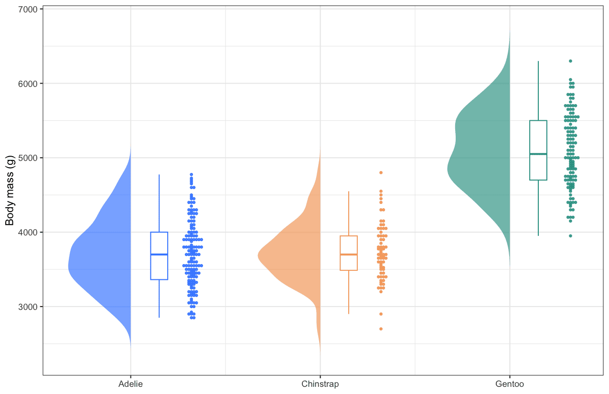

A raincloud plot shows one distribution three ways at once: a **half-violin** (the cloud) renders its kernel density, a narrow **boxplot** marks the median and quartiles, and a **beeswarm** of individual points (the rain) exposes every observation. Unlike a bar-or-box-only summary, outliers, skew and sample size stay visible — which is why the layout has become a recommended alternative to bar charts with error bars when distributions differ in shape, not just in mean. This tutorial reproduces the chart type covered by the *顶刊图社* series (issue 017); see the Reference section below.

## Example

{fig-alt="RaincloudPlot DEMO" fig-align="center" width="70%"}

This raincloud plot compares the body mass of three penguin species (the `palmerpenguins` dataset). For each species the half-violin on the left sketches the density, the slim boxplot marks the median and the two quartiles, and the beeswarm on the right plots every individual bird along the value axis — Gentoo penguins are clearly heavier (median 5,050 g vs 3,700 g), while the two other species overlap heavily below 5,000 g.

## Setup

-   System Requirements: Cross-platform (Linux/MacOS/Windows)

-   Programming Language: R

-   Dependencies: `tidyverse`; `ggbeeswarm`; `palmerpenguins`

```{r packages setup, message=FALSE, warning=FALSE, output=FALSE}
# Installing necessary packages
if (!requireNamespace("tidyverse", quietly = TRUE)) {
  install.packages("tidyverse")
}
if (!requireNamespace("ggbeeswarm", quietly = TRUE)) {
  install.packages("ggbeeswarm")
}
if (!requireNamespace("palmerpenguins", quietly = TRUE)) {
  install.packages("palmerpenguins")
}

# Load packages
library(tidyverse)
library(ggbeeswarm)
library(palmerpenguins)
```

## Data Preparation

The example uses the `penguins` dataset shipped with `palmerpenguins` (344 observations of three penguin species). The raincloud plot needs one row per observation with a grouping column (`species`) and a numeric column (`body_mass_g`).

```{r load data, message=FALSE}
data("penguins")

penguins_clean <- penguins |>
  filter(!is.na(body_mass_g)) |>
  mutate(species = factor(species))

head(penguins_clean, 3)
```

The left half of the violin is not a special geom — we estimate the density of each group and draw it as a polygon that opens to the left of the group's centre. The helper below keeps the rest of the tutorial compact.

```{r helper, message=FALSE}
# Half-violin polygons: for each group, the density curve is mirrored to the
# left of the group centre (x = group position) and closed as a polygon.
half_violin <- function(data, group_col, value_col, width = 0.33) {
  groups <- levels(factor(data[[group_col]]))
  map_dfr(groups, function(g) {
    values <- data[[value_col]][as.character(data[[group_col]]) == g]
    d <- density(values, n = 200)
    tibble(
      group = g,
      x = which(groups == g) - d$y / max(d$y) * width,
      y = d$x)
  })
}
```

## Visualization

### 1. Basic Plot

The three components are stacked at increasing x offsets per group: the half-violin at the group centre, a slim boxplot just right of it, and the beeswarm on the outside.

```{r}
#| label: fig-1.1BasicRaincloud
#| fig-cap: "Basic raincloud plot of penguin body mass"
#| out.width: "95%"
#| warning: false
#| message: false
#| fig-width: 8.5
#| fig-height: 5.5

violin_data <- half_violin(penguins_clean, "species", "body_mass_g")
centres <- set_names(seq_along(levels(penguins_clean$species)),
                     levels(penguins_clean$species))
x_pos <- centres[as.character(penguins_clean$species)]

raincloud_colors <- c(Adelie = "#3a86ff", Chinstrap = "#f4a261", Gentoo = "#2a9d8f")

ggplot(penguins_clean) +
  geom_polygon(data = violin_data, aes(x = x, y = y, fill = group, group = group),
               alpha = .65, colour = NA) +
  geom_boxplot(aes(x = x_pos + .15, y = body_mass_g, group = species, colour = species),
               width = .09, outlier.shape = NA, fill = "white", linewidth = .45) +
  geom_beeswarm(aes(x = x_pos + .32, y = body_mass_g, colour = species),
                cex = .5, size = .85, alpha = .85) +
  scale_fill_manual(values = raincloud_colors) +
  scale_colour_manual(values = raincloud_colors) +
  scale_x_continuous(breaks = centres, labels = levels(penguins_clean$species)) +
  labs(x = NULL, y = "Body mass (g)") +
  theme_bw() +
  theme(legend.position = "none")
```

::: callout-tip
**Key Parameters: **

- `width`: how far the half-violin extends from the group centre (also the visual balance between the three components).
- `+ .15` / `+ .32`: the x offsets that place the boxplot and the beeswarm right of the centre; tune them together with `width`.
- `cex`: beeswarm point spacing; lower values pack the points tighter.
:::

### 2. Annotated Plot

Adding mean markers and group sizes turns the plot into a complete summary: the diamond marks the mean inside each box, and the axis labels carry the sample size.

```{r}
#| label: fig-1.2AnnotatedRaincloud
#| fig-cap: "Raincloud plot with mean markers and sample sizes"
#| out.width: "95%"
#| warning: false
#| message: false
#| fig-width: 8.5
#| fig-height: 5.5

ggplot(penguins_clean) +
  geom_polygon(data = violin_data, aes(x = x, y = y, fill = group, group = group),
               alpha = .65, colour = NA) +
  geom_boxplot(aes(x = x_pos + .15, y = body_mass_g, group = species, colour = species),
               width = .09, outlier.shape = NA, fill = "white", linewidth = .45) +
  geom_beeswarm(aes(x = x_pos + .32, y = body_mass_g, colour = species),
                cex = .5, size = .85, alpha = .85) +
  stat_summary(aes(x = x_pos + .15, y = body_mass_g, group = species),
               fun = mean, geom = "point", shape = 18, size = 3, colour = "grey15") +
  scale_fill_manual(values = raincloud_colors) +
  scale_colour_manual(values = raincloud_colors) +
  scale_x_continuous(
    breaks = centres,
    labels = paste0(levels(penguins_clean$species), "\n(n = ",
                    table(penguins_clean$species)[levels(penguins_clean$species)], ")")) +
  labs(x = NULL, y = "Body mass (g)") +
  theme_bw() +
  theme(legend.position = "none", panel.grid.minor = element_blank())
```

### 3. Horizontal Orientation

When group names are long (clinical cohorts, omics clusters), flipping the axes puts them on the y axis where they read comfortably; `coord_flip()` turns the whole raincloud sideways without touching the layers.

```{r}
#| label: fig-1.3HorizontalRaincloud
#| fig-cap: "Horizontal raincloud plot"
#| out.width: "95%"
#| warning: false
#| message: false
#| fig-width: 8.5
#| fig-height: 5

ggplot(penguins_clean) +
  geom_polygon(data = violin_data, aes(x = x, y = y, fill = group, group = group),
               alpha = .65, colour = NA) +
  geom_boxplot(aes(x = x_pos + .15, y = body_mass_g, group = species, colour = species),
               width = .09, outlier.shape = NA, fill = "white", linewidth = .45) +
  geom_beeswarm(aes(x = x_pos + .32, y = body_mass_g, colour = species),
                cex = .5, size = .85, alpha = .85) +
  scale_fill_manual(values = raincloud_colors) +
  scale_colour_manual(values = raincloud_colors) +
  scale_x_continuous(breaks = centres, labels = levels(penguins_clean$species)) +
  labs(x = NULL, y = "Body mass (g)") +
  theme_bw() +
  theme(legend.position = "none", panel.grid.minor = element_blank()) +
  coord_flip()
```

### 4. Box-and-Density Stacked Pair

A distribution and its summary say different things; stacked, they say it together: the density panel exposes bimodality or long tails the boxes average away, the box panel hands over medians, spreads and the group-comparison test \[3\]. One palette shared by both panels plus matched category axes makes the seam disappear. `aplot::annotation_boxplot()` packages the same composition with statistical brackets when needed.

```{r}
#| label: fig-4.1BoxDensityPair
#| fig-cap: "Cisplatin AUC estimates for three response strata: density curves with rug marks on top, horizontal box plots below, both panels painted from one palette with the Kruskal-Wallis p slung along the seam."
#| out.width: "95%"
#| warning: false
#| message: false
#| fig-width: 6.5
#| fig-height: 7

library(patchwork)
set.seed(6401)
df <- data.frame(
  Drug = rep("Cisplatin", 180),
  Subtype = rep(c("Sensitive", "Intermediate", "Resistant"), each = 60),
  AUC = c(rnorm(60, 0.62, 0.05), rnorm(60, 0.74, 0.05), rnorm(60, 0.86, 0.05)))
# 超过两组 -> Kruskal-Wallis；恰两组时可换 t.test/wilcox.test
p.val <- kruskal.test(AUC ~ Subtype, data = df)
stopifnot(p.val$p.value < 0.001)
p.lab <- paste0("P ", ifelse(p.val$p.value < 0.001, "< 0.001", round(p.val$p.value, 3)))
# 同一套色盘驱动两面板，跨接缝颜色可直读
pal3 <- c(Sensitive = "#C7EAB2", Intermediate = "#5FC1C2", Resistant = "#1B90BE")
p_top <- ggplot(df, aes(AUC, colour = Subtype, fill = Subtype)) +
  geom_density(alpha = 0.65, linewidth = 0.5) +
  geom_rug(alpha = 0.4) +
  scale_colour_manual(values = pal3) + scale_fill_manual(values = pal3) +
  labs(x = paste0("Estimated AUC of ", unique(df$Drug)), y = NULL) +
  theme_classic(base_size = 11) +
  theme(legend.position = "none", axis.text.y = element_blank(),
        axis.ticks.y = element_blank(), axis.line.y = element_blank(),
        panel.grid.major.y = element_blank())
# 下面板：coord_flip 使箱线进入同一水平流向
p_bot <- ggplot(df, aes(Subtype, AUC, fill = Subtype, colour = Subtype)) +
  geom_boxplot(width = 0.55, outlier.size = 1.1) +
  scale_fill_manual(values = pal3) + scale_colour_manual(values = pal3) +
  annotate(geom = "text", x = 1.52, y = max(df$AUC), hjust = 1,
           size = 3.4, fontface = "bold", angle = 270, label = p.lab) +
  coord_flip() + labs(x = NULL, y = "Estimated AUC") +
  theme_void(base_size = 11) +
  theme(legend.position = "none", axis.text.y = element_blank(),
        axis.ticks = element_blank(), panel.grid.major = element_blank())
print(p_top / p_bot + plot_layout(heights = c(2, 3)))
```

::: callout-tip
**Practice tips**

-   The p label rides at `x = 1.52` inside the flipped panel - a coordinate between the first two factor levels, rotated 270 degrees into the empty top strip.
-   Drop the box panel x-axis and the density panel y-axis: the shared category order is the only register the reader has to track.
-   Two-group data: swap the Kruskal-Wallis for `t.test()`/`wilcox.test()` and the layout holds unchanged; with many groups the `angle = 270` label keeps long p strings out of the boxes.
:::

## Applications

-   **Comparing distributions across groups**: the standard upgrade from bar-plus-error-bar figures whenever reviewers ask for the raw data.
-   **Clinical and omics cohorts**: group sizes are unequal and skew is common; the beeswarm keeps every patient visible.
-   **Small samples**: with n < 20 the beeswarm alone almost replaces the violin, and the boxplot still summarises the quartiles.
-   The half-violin polygon recipe (`density()` + `geom_polygon()`) works for any density layer, horizontal or vertical, without extra packages.

## Reference

\[1\] 顶刊图社 | 第017期：箱线图/小提琴图/云雨图. WeChat article. <http://mp.weixin.qq.com/s?__biz=MzU5NjE2ODU0OQ==&mid=2247483936&idx=1&sn=cf22ad37b9afc52a0af1f27daf8a4711>

\[2\] Allen M, Poggiali D, Whitaker K, Marshall TR, Kievit RA. Raincloud plots: a multi-platform tool for robust data visualization. Wellcome Open Res. 2019;4:63. doi:10.12688/wellcomeopenres.15191.1

\[3\] Xiaofan Lu, et al. FigureYa: A Standardized Visualization Framework for Enhancing Biomedical Data Interpretation and Research Efficiency. iMetaMed. 2025. doi:10.1002/imm3.70005
