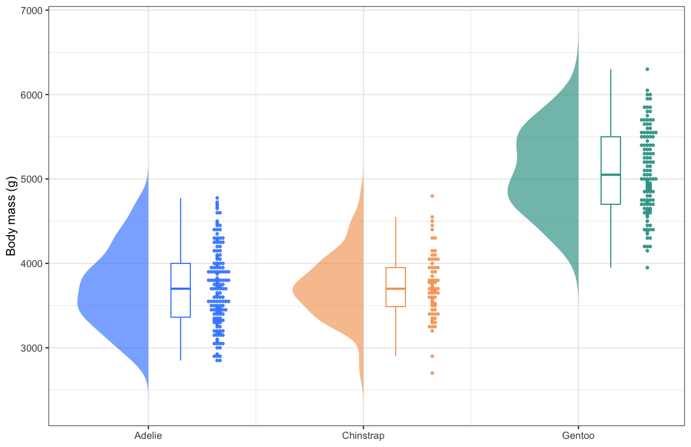

云雨图（raincloud plot）一次展示分布的三个层面：**半小提琴**（云）呈现核密度形状、窄**箱线图**标出中位数与四分位、**蜂群散点**（雨）逐点暴露每一次观测。与只画柱状图加误差棒或只画箱线图不同，离群点、偏态与样本量都保持可见——这正是当各组分布形状（而非仅均值）不同时，推荐用它替代柱状图的原因。本教程复现《顶刊图社》系列（第017期）介绍的图表类型，见文末参考文献。

## 示例

{fig-alt="RaincloudPlot DEMO" fig-align="center" width="70%"}

这张云雨图比较了三种企鹅的体重（`palmerpenguins` 数据集）。每种企鹅左侧的半小提琴勾勒密度形状，中间的窄箱线图标出中位数与两个四分位，右侧的蜂群散点把每一只鸟沿数值轴逐一画出——Gentoo 企鹅明显更重（中位数 5,050 g，对比 3,700 g），另外两种企鹅则在 5,000 g 以下大量重叠。

## 环境配置

-   系统要求：跨平台（Linux/MacOS/Windows）

-   编程语言：R

-   依赖包：`tidyverse`；`ggbeeswarm`；`palmerpenguins`

```{r packages setup, message=FALSE, warning=FALSE, output=FALSE}
# Installing necessary packages
if (!requireNamespace("tidyverse", quietly = TRUE)) {
  install.packages("tidyverse")
}
if (!requireNamespace("ggbeeswarm", quietly = TRUE)) {
  install.packages("ggbeeswarm")
}
if (!requireNamespace("palmerpenguins", quietly = TRUE)) {
  install.packages("palmerpenguins")
}

# Load packages
library(tidyverse)
library(ggbeeswarm)
library(palmerpenguins)
```

## 数据准备

示例使用 `palmerpenguins` 内置的 `penguins` 数据集（344 条观测、三种企鹅）。云雨图需要每行一条观测，并包含一个分组列（`species`）与一个数值列（`body_mass_g`）。

```{r load data, message=FALSE}
data("penguins")

penguins_clean <- penguins |>
  filter(!is.na(body_mass_g)) |>
  mutate(species = factor(species))

head(penguins_clean, 3)
```

小提琴的左半边并不是特殊图层——我们对每组估计核密度，再把它画成从组中心向左展开的多边形。下面的辅助函数让教程其余部分保持简洁。

```{r helper, message=FALSE}
# Half-violin polygons: for each group, the density curve is mirrored to the
# left of the group centre (x = group position) and closed as a polygon.
half_violin <- function(data, group_col, value_col, width = 0.33) {
  groups <- levels(factor(data[[group_col]]))
  map_dfr(groups, function(g) {
    values <- data[[value_col]][as.character(data[[group_col]]) == g]
    d <- density(values, n = 200)
    tibble(
      group = g,
      x = which(groups == g) - d$y / max(d$y) * width,
      y = d$x)
  })
}
```

## 可视化

### 1. 基础绘图

三个组件按每组逐渐增大的 x 偏移堆叠：半小提琴在组中心，窄箱线图紧随其右，蜂群散点在最外侧。

```{r}
#| label: fig-1.1BasicRaincloud
#| fig-cap: "基础云雨图：企鹅体重"
#| out.width: "95%"
#| warning: false
#| message: false
#| fig-width: 8.5
#| fig-height: 5.5

violin_data <- half_violin(penguins_clean, "species", "body_mass_g")
centres <- set_names(seq_along(levels(penguins_clean$species)),
                     levels(penguins_clean$species))
x_pos <- centres[as.character(penguins_clean$species)]

raincloud_colors <- c(Adelie = "#3a86ff", Chinstrap = "#f4a261", Gentoo = "#2a9d8f")

ggplot(penguins_clean) +
  geom_polygon(data = violin_data, aes(x = x, y = y, fill = group, group = group),
               alpha = .65, colour = NA) +
  geom_boxplot(aes(x = x_pos + .15, y = body_mass_g, group = species, colour = species),
               width = .09, outlier.shape = NA, fill = "white", linewidth = .45) +
  geom_beeswarm(aes(x = x_pos + .32, y = body_mass_g, colour = species),
                cex = .5, size = .85, alpha = .85) +
  scale_fill_manual(values = raincloud_colors) +
  scale_colour_manual(values = raincloud_colors) +
  scale_x_continuous(breaks = centres, labels = levels(penguins_clean$species)) +
  labs(x = NULL, y = "Body mass (g)") +
  theme_bw() +
  theme(legend.position = "none")
```

::: callout-tip
**关键参数：**

- `width`：半小提琴从组中心伸出的宽度（也是三个组件的视觉平衡点）。
- `+ .15` / `+ .32`：把箱线图与蜂群散点放到中心右侧的 x 偏移；与 `width` 一起调节。
- `cex`：蜂群散点的间距系数；越小越紧凑。
:::

### 2. 带注释的云雨图

再加上均值标记与样本量，图形就是一份完整摘要：菱形标出每个箱体内部的均值，横轴标签携带样本量。

```{r}
#| label: fig-1.2AnnotatedRaincloud
#| fig-cap: "带均值标记与样本量的云雨图"
#| out.width: "95%"
#| warning: false
#| message: false
#| fig-width: 8.5
#| fig-height: 5.5

ggplot(penguins_clean) +
  geom_polygon(data = violin_data, aes(x = x, y = y, fill = group, group = group),
               alpha = .65, colour = NA) +
  geom_boxplot(aes(x = x_pos + .15, y = body_mass_g, group = species, colour = species),
               width = .09, outlier.shape = NA, fill = "white", linewidth = .45) +
  geom_beeswarm(aes(x = x_pos + .32, y = body_mass_g, colour = species),
                cex = .5, size = .85, alpha = .85) +
  stat_summary(aes(x = x_pos + .15, y = body_mass_g, group = species),
               fun = mean, geom = "point", shape = 18, size = 3, colour = "grey15") +
  scale_fill_manual(values = raincloud_colors) +
  scale_colour_manual(values = raincloud_colors) +
  scale_x_continuous(
    breaks = centres,
    labels = paste0(levels(penguins_clean$species), "\n(n = ",
                    table(penguins_clean$species)[levels(penguins_clean$species)], ")")) +
  labs(x = NULL, y = "Body mass (g)") +
  theme_bw() +
  theme(legend.position = "none", panel.grid.minor = element_blank())
```

### 3. 横向排布

当组名较长（临床队列、组学聚类）时，翻转坐标轴把组名放到 y 轴更易阅读；`coord_flip()` 会让整个云雨图横过来，而无需改动任何图层。

```{r}
#| label: fig-1.3HorizontalRaincloud
#| fig-cap: "横向云雨图"
#| out.width: "95%"
#| warning: false
#| message: false
#| fig-width: 8.5
#| fig-height: 5

ggplot(penguins_clean) +
  geom_polygon(data = violin_data, aes(x = x, y = y, fill = group, group = group),
               alpha = .65, colour = NA) +
  geom_boxplot(aes(x = x_pos + .15, y = body_mass_g, group = species, colour = species),
               width = .09, outlier.shape = NA, fill = "white", linewidth = .45) +
  geom_beeswarm(aes(x = x_pos + .32, y = body_mass_g, colour = species),
                cex = .5, size = .85, alpha = .85) +
  scale_fill_manual(values = raincloud_colors) +
  scale_colour_manual(values = raincloud_colors) +
  scale_x_continuous(breaks = centres, labels = levels(penguins_clean$species)) +
  labs(x = NULL, y = "Body mass (g)") +
  theme_bw() +
  theme(legend.position = "none", panel.grid.minor = element_blank()) +
  coord_flip()
```

## 应用场景

-   **跨组分布比较**：当审稿人要求展示原始数据时，这是柱状图加误差棒的标准升级方案。
-   **临床与组学队列**：组间样本量不齐、偏态常见；蜂群散点让每一位患者保持可见。
-   **小样本**：当 n < 20 时，蜂群散点几乎可以替代小提琴，箱线图仍能概括四分位。
-   半小提琴配方（`density()` + `geom_polygon()`）适用于任何密度图层，纵向或横向皆可，且无需额外依赖包。

## 参考文献

\[1\] 顶刊图社 | 第017期：箱线图/小提琴图/云雨图. 微信公众号文章. <http://mp.weixin.qq.com/s?__biz=MzU5NjE2ODU0OQ==&mid=2247483936&idx=1&sn=cf22ad37b9afc52a0af1f27daf8a4711>

\[2\] Allen M, Poggiali D, Whitaker K, Marshall TR, Kievit RA. Raincloud plots: a multi-platform tool for robust data visualization. Wellcome Open Res. 2019;4:63. doi:10.12688/wellcomeopenres.15191.1
