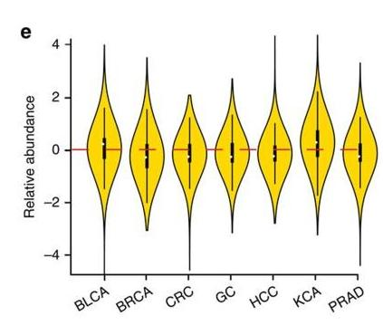
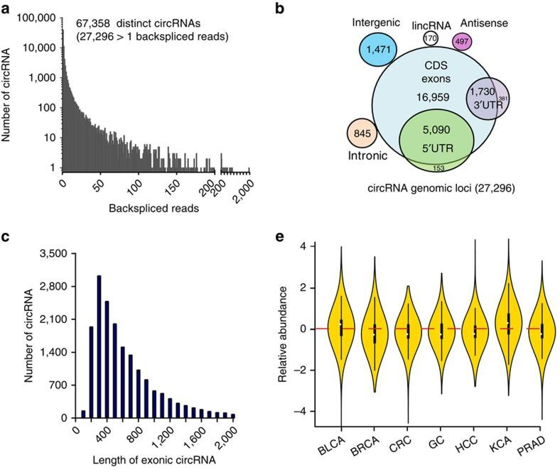
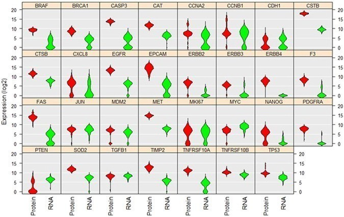
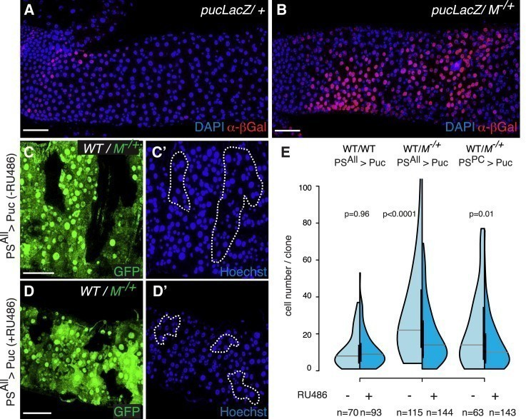
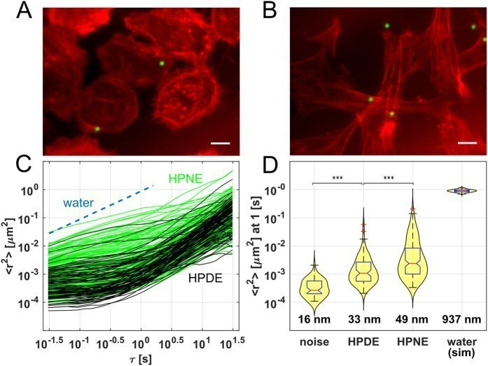

A violin plot combines elements of a density plot and a box plot to visualize data distribution. It displays key statistical information, including the median, quartiles, minimum, and maximum values. Violin plots are particularly useful for comparing distributions across different groups, offering a more intuitive representation than traditional box plots by revealing the shape of the data distribution.

-   Box Component: The white dot/line represents the median, while the black bar indicates the interquartile range (IQR).
-   Kernel Density Component: Shows the density of data points at different positions, providing insights into clustering patterns.

## Example

{fig-alt="ViolinPlot DEMO" fig-align="center" width="60%"}

## Setup

-   System Requirements: Cross-platform (Linux/MacOS/Windows)

-   Programming language: R

-   Dependent packages: `readr`; `tidyr`; `ggplot2`; `dplyr`; `ggdist`; `ggbeeswarm`; `forcats`; `hrbrthemes`; `viridis`; `ggstatsplot`; `palmerpenguins`

```{r packages setup, message=FALSE, warning=FALSE, output=FALSE}
# Installing packages
if (!requireNamespace("readr", quietly = TRUE)) {
  install.packages("readr")
}
if (!requireNamespace("tidyr", quietly = TRUE)) {
  install.packages("tidyr")
}
if (!requireNamespace("ggdist", quietly = TRUE)) {
  install.packages("ggdist")
}
if (!requireNamespace("ggbeeswarm", quietly = TRUE)) {
  install.packages("ggbeeswarm")
}
if (!requireNamespace("dplyr", quietly = TRUE)) {
  install.packages("dplyr")
}
if (!requireNamespace("ggplot2", quietly = TRUE)) {
  install.packages("ggplot2")
}
if (!requireNamespace("ggpubr", quietly = TRUE)) {
  install.packages("ggpubr")
}
if (!requireNamespace("forcats", quietly = TRUE)) {
  install.packages("forcats")
}
if (!requireNamespace("hrbrthemes", quietly = TRUE)) {
  remotes::install_github("hrbrmstr/hrbrthemes")
}
if (!requireNamespace("viridis", quietly = TRUE)) {
  install.packages("viridis")
}
if (!requireNamespace("ggstatsplot", quietly = TRUE)) {
  install.packages("ggstatsplot")
}
if (!requireNamespace("palmerpenguins", quietly = TRUE)) {
  install.packages("palmerpenguins")
}

# Load packages
library(readr)
library(tidyr)
library(ggplot2)
library(ggpubr)
library(dplyr)
library(ggdist)
library(ggbeeswarm)
library(forcats)
library(hrbrthemes)
library(viridis)
library(ggstatsplot)
library(palmerpenguins)
```

```{r}
sessioninfo::session_info("attached")
```

## Data Preparation

We used the built-in R datasets (`iris`, `penguins`) and the `TCGA-BRCA.htseq_counts.tsv` dataset from [UCSC Xena DATASETS](https://xenabrowser.net/datapages/?hub=https://gdcv18.xenahubs.net:443). Selected genes were chosen for demonstration purposes.

```{r load data, message=FALSE}
# Load the TCGA-BRCA gene expression dataset from a processed CSV file  
data_counts <- readr::read_csv("https://bizard-1301043367.cos.ap-guangzhou.myqcloud.com/TCGA-BRCA.htseq_counts_processed.csv")

# Load built-in R dataset iris
data_wide <- iris[ , 1:4] # Take the data in columns 1-4 of the iris database as an example

# Load built-in R dataset penguins
data("penguins", package = "palmerpenguins")
data_penguins <- drop_na(penguins) # Remove missing values

# Manually create a demonstration dataset with grouped values 
data <- data.frame(
  name=c( rep("A",500), rep("B",500), rep("B",500), rep("C",20), rep('D', 100)  ),
  value=c( rnorm(500, 10, 5), rnorm(500, 13, 1), rnorm(500, 18, 1), rnorm(20, 25, 4), rnorm(100, 12, 1) )
  )
sample_size <- data %>% 
  group_by(name) %>% 
  summarize(num=n()) # Compute the sample size for each group  
```

## Visualization

### 1. Basic Violin Plot

Example 1: Basic Violin Plot with Manually Created Data

```{r}
#| label: fig-1.1BasicViolin
#| fig-cap: "Basic Violin Plot"
#| out.width: "95%"
#| warning: false

# Basic Violin Plot
p <- ggplot(data, aes(x=name, y=value, fill=name)) + 
  geom_violin()

p
```

Example 2: Basic Violin Plot with the iris Dataset

```{r}
#| label: fig-1.2BasicViolin
#| fig-cap: "Basic Violin Plot Using the `iris` Dataset"
#| out.width: "95%"
#| warning: false

# Transform the `iris` dataset from wide format to long format. Use the gather function to collect the data in each column into two new columns named "MesureType" and "Val", so that one row represents one observation.
data_long_iris <- data_wide %>%  
  gather(key = "MeasureType", value = "Value")  

ggplot(data_long_iris, aes(x = MeasureType, y = Value, fill = MeasureType)) +  
  geom_violin()  
```

Example 3: Violin Plot with TCGA-BRCA Gene Expression Data

```{r}
#| label: fig-1.3BasicViolin
#| fig-cap: "Basic Violin Plot Using the `TCGA-BRCA` dataset"
#| out.width: "95%"
#| warning: false

example_counts1 <- data_counts[1:5,] %>%
  gather(key = "sample",value = "gene_expression",3:1219) # Select five example genes for visualization: A1BG, A1BG-AS1, A1CF, A2M, and A2M-AS1.

ggplot(example_counts1, aes(x=gene_name, y=gene_expression, fill=gene_name)) +
  geom_violin()
```

Example 4: Basic violin plot with significance annotation of differences between groups

```{r}
#| label: fig-1.4BasicViolinSignificance
#| fig-cap: "Basic violin plot with significance annotation of differences between groups"
#| out.width: "95%"
#| warning: false

# Organize and group the data
data_long_iris <- data_wide %>%
  gather(key = "MeasureType",
         value = "Value")

# Draw a basic violin plot
p <- ggplot(data_long_iris,
       aes(x = MeasureType,
           y = Value,
           fill = MeasureType)) +
  geom_violin()

# Extract and deduplicate groups
groups <- length(unique(data_long_iris$MeasureType))
if (groups == 2) {
	p <- p +
		stat_compare_means(
			method = "wilcox.test", # c("t.test", "wilcox.test")
			paired = FALSE,
			method.args = list(),
			ref.group = NULL,
			comparisons = NULL,
			hide.ns = FALSE,
			label.sep = ", ",
			label = "p.format", # c("p.signif", "p.format")
			label.x.npc = "left",
			label.y.npc = "top",
			label.x = NULL,
			label.y = NULL,
			vjust = 0,
			tip.length = 0.03,
			bracket.size = 0.3,
			step.increase = 0.1,
			symnum.args = list(),
			geom = "text",
			position = "identity",
			na.rm = FALSE,
			show.legend = NA,
			inherit.aes = TRUE
		)
} else if (groups > 2) {
	p <- p +
		stat_compare_means(
			method = "wilcox.test", # c("t.test", "wilcox.test")
			paired = FALSE,
			method.args = list(),
			ref.group = NULL,
			# Perform pairwise comparisons for multiple group comparisons
			comparisons = combn(unique(as.character(data_long_iris$MeasureType)), 2, simplify = FALSE),
			hide.ns = FALSE,
			label.sep = ", ",
			label = "p.format", # c("p.signif", "p.format")
			label.x.npc = "left",
			label.y.npc = "top",
			label.x = NULL,
			label.y = NULL,
			vjust = 0,
			tip.length = 0.03,
			bracket.size = 0.3,
			step.increase = 0.1,
			symnum.args = list(),
			geom = "text",
			position = "identity",
			na.rm = FALSE,
			show.legend = NA,
			inherit.aes = TRUE
		)
}

p
```

### 2. Horizontal Violin Plot

The x and y axes can be flipped using `coord_flip()`.

```{r}
#| label: fig-2HorizontalViolin
#| fig-cap: "Horizontal Violin Plot Using the `TCGA-BRCA` dataset"
#| out.width: "95%"
#| warning: false

example_counts2 <- data_counts[1:6,] %>% 
  gather(key = "sample",value = "gene_expression",3:1219) %>% 
  mutate(gene_name= fct_reorder(gene_name,gene_expression ))

ggplot(example_counts2, aes(x=gene_name, y=gene_expression, fill=gene_name, color=gene_name)) +
  geom_violin() +
  scale_fill_viridis(discrete=TRUE) +
  scale_color_viridis(discrete=TRUE) +
  theme_ipsum() + # Improve plot appearance
  theme(legend.position="none" ) +
  coord_flip() + # flip the x and y axes
  xlab("") +
  ylab("Assigned Probability (%)")
```

### 3. Violin Plot with Boxplot

In practical visualization applications, a box plot can be added to a violin plot using `geom_boxplot()`, which helps in visually comparing the distribution of the data.

```{r, message=FALSE}
#| label: fig-3.1Violinwizbox
#| fig-cap: "Violin Plot with Boxplot"
#| out.width: "95%"
#| warning: false

example_data <- data %>% 
  left_join(sample_size) %>%
  mutate(myaxis = paste0(name, "\n", "n=", num)) # The `myaxis` variable is created to display sample size on the x-axis.  

ggplot(example_data, aes(x=myaxis, y=value, fill=name)) +
  geom_violin(width=1.4) +
geom_boxplot( width=0.1,color="grey", alpha=0.2) + # Draw a box plot. A small width value makes the box plot inside the violin plot.
scale_fill_viridis(discrete = TRUE) +
  theme_ipsum() + # Beautify the graph
  theme(
   legend.position="none",
   plot.title = element_text(size=11)
  ) +
  ggtitle("A Violin plot wrapping a boxplot") +  # Set the title
  xlab("")
```

Another Violin Plot with Box Plot using the TCGA-BRCA Gene Expression Data

```{r, message=FALSE}
#| label: fig-3.2Violinwizbox
#| fig-cap: "Violin Plot with Boxplot Using the `TCGA-BRCA` dataset"
#| out.width: "95%"
#| warning: false

example_counts3 <- data_counts[1:5,] %>%
  gather(key = "sample", value = "gene_expression",3:1219) %>%
  mutate(gene_name= fct_reorder(gene_name,gene_expression ))

ggplot(example_counts3, aes(x=gene_name, y=gene_expression, fill=gene_name, color=gene_name)) +
  geom_violin() +
  geom_boxplot( width=0.1,color="grey", alpha=0.2)+
  scale_fill_viridis(discrete=TRUE) +
  scale_color_viridis(discrete=TRUE) +
  theme_ipsum() + # Beautify the graph
  theme(legend.position="none" ) 
```

### 4. Grouped Violin Plot

On the basis of the basic violin plot, we can achieve intra-group comparison by setting the fill value.

The example below demonstrates intra-group comparison using the `fill` aesthetic. In this case, the `penguins` dataset is used. The x variable represents the species, and `fill=sex` creates an intra-group classification to visualize the comparison of flipper lengths within each species, grouped by gender.

```{r, message=FALSE}
#| label: fig-4GroupedViolin
#| fig-cap: "Grouped Violin Plot Using the `penguins` dataset"
#| out.width: "95%"
#| warning: false

ggplot(data_penguins, aes(fill=sex, y=flipper_length_mm, x=species)) + # Use X as the major classification and fill as the intra-group classification
  geom_violin(position="dodge", alpha=0.5, outlier.colour="transparent") +
  scale_fill_viridis(discrete=T, name="") +
  theme_ipsum()  
```

### 5. Half-Violin Plot

A half-violin plot is useful for visualizing a large amount of data in a compact form. We can use `ggdist::stat_halfeye()` (with `ggbeeswarm::geom_beeswarm()`) to display two groups separately — the gghalves package used here originally was archived from CRAN.

In the following example, we visualize the flipper lengths of penguins for both species and genders, by plotting female and male penguins on opposite sides of the plot.

```{r, message=FALSE}
#| label: fig-5Half-ViolinPlot
#| fig-cap: "Half-Violin Plot Using the `penguins` dataset"
#| out.width: "95%"
#| warning: false

# Separate the data for female and male penguins
data_female <- data_penguins %>% filter(sex == "female")
data_male <- data_penguins %>% filter(sex == "male")

# Plot the half-violin plot for both groups (females on the right and males on the left)
ggplot() +
  ggdist::stat_halfeye(
    data = data_female,
    aes(y = flipper_length_mm, x = species),
    colour = NA,
    fill = "#9370DB",
    alpha = 0.8,  ## Set transparency
    side = "right", justification = 0, width = 0.8
  ) +
  ggdist::stat_halfeye(
    data = data_male,
    aes(y = flipper_length_mm, x = species),
    colour = NA,
    fill = "#FFFF00",
    alpha = 0.6,
    side = "left", justification = 0, width = 0.8
  )
```

### 6. Violin Plot Using the `ggstatsplot` Package

The `ggstatsplot` package extends `ggplot2` by adding powerful statistical visualizations. The `ggbetweenstats()` function allows the creation of combined violin plots, box plots, and scatter plots.

In the following example, we visualize the distribution of bill lengths across different penguin species using the `penguins` dataset. We further enhance the plot's aesthetics using the `theme()` function.

```{r, message=FALSE}
#| label: fig-6ViolinPlot-ggstatsplot
#| fig-cap: "Violin Plot Using the `ggstatsplot` Package"
#| out.width: "95%"
#| warning: false

plt <- ggbetweenstats(
  data = data_penguins,
  x = species,
  y = bill_length_mm
) +
# Beautification
  labs(  ## Add labels and title
    x = "Penguins Species",
    y = "Bill Length",
    title = "Distribution of bill length across penguins species"
  ) +
  theme(
    axis.ticks = element_blank(),
    axis.line = element_line(colour = "grey50"),
    panel.grid = element_line(color = "#b4aea9"),
    panel.grid.minor = element_blank(),
    panel.grid.major.x = element_blank(),
    panel.grid.major.y = element_line(linetype = "dashed"),
    panel.background = element_rect(fill = "#fbf9f4", color = "#fbf9f4"),
    plot.background = element_rect(fill = "#fbf9f4", color = "#fbf9f4")
  )

plt
```

### 7. Split Violin + Raw Points (Two Groups)

The reference layout puts, for each group, a **half violin + box on the left and the raw points on the right** \[14\] — statistics and individual observations share one x slot without overlapping. `ggdist::stat_halfeye()` and `ggbeeswarm::geom_beeswarm()` (both loaded above) provide the half-density and the one-sided swarm:

```{r}
#| label: fig-7.1SplitViolin
#| fig-cap: "Split violin per group: half violin + box on the left half, raw points on the right half; Mann-Whitney p annotated."
#| out.width: "70%"
#| warning: false
#| message: false
#| fig-width: 6.5
#| fig-height: 4.5

set.seed(1201)
dat_v <- data.frame(
  group = rep(c("DNAmAge-ACC", "DNAmAge-DCC"), each = 40),
  value = c(rnorm(40, 68, 6), rnorm(40, 58, 7)))

p_w <- wilcox.test(value ~ group, data = dat_v)$p.value

ggplot(dat_v, aes(group, value, fill = group)) +
  ggdist::stat_halfeye(side = "left", justification = 0,
                       position = position_nudge(x = -0.02),
                       width = 0.6, alpha = 0.8, colour = NA) +
  geom_boxplot(width = 0.12, outlier.shape = NA, alpha = 0.9) +
  ggbeeswarm::geom_beeswarm(side = 1L, cex = 1.1,
                            size = 0.8, alpha = 0.5, colour = "grey30") +
  scale_fill_manual(values = c("DNAmAge-ACC" = "#B31E22", "DNAmAge-DCC" = "#2874C5")) +
  labs(title = sprintf("Mann-Whitney %s",
       ifelse(p_w < 0.001, "p < 0.001", sprintf("p = %.3f", p_w))),
       x = NULL, y = "DNAm age") +
  theme_classic(base_size = 11) +
  theme(legend.position = "none")
```

::: callout-tip
**Practice tips**

-   `position_nudge()` separates the three layers; without it the half violin, box and points stack on the same slot and the "split" reading is lost.
-   Keep the violin on the same side for every group — alternating sides per group reads as two different encodings.
-   For paired data, connect the raw points across groups with `geom_line(aes(group = id))` on the points half instead of the jitter.
:::

### 8. Split-Facet Violin Matrix with Adjusted p Annotations

Single-cell marker surveys ask a three-way comparison at once: cell type across the columns, marker gene down the rows, condition (here young vs. old) as the two violins inside each facet \[14\]. `ggpubr::ggviolin()` arranges the two-factor grid; the per-facet Mann-Whitney tests run through `rstatix::wilcox_test()`, get Bonferroni-corrected, and land back on their facet via `stat_pvalue_manual()` - and with `hide.ns = TRUE` only the real moves speak.

```{r}
#| label: fig-8.1ScSplitFacetViolin
#| fig-cap: "Marker x cell-type facet matrix of split violins: young vs. old in every facet, Bonferroni-adjusted Mann-Whitney p with stars printed only where the shift is real (DDX4 in oocytes, p.adj < 1e-4)."
#| out.width: "90%"
#| warning: false
#| message: false
#| fig-width: 9
#| fig-height: 7.5

library(rstatix)
set.seed(7301)
clust <- c("OO", "GC", "SC", "EC")
genes7 <- c("DDX4", "AMH", "COL1A2", "CDH5")
rows <- list()
for (cl in seq_along(clust)) {
  for (gn in seq_along(genes7)) {
    for (ag in seq_along(c("Y", "O"))) {
      base <- rnorm(24, mean = 2.2 + 0.4 * cl + 0.3 * gn, sd = 0.9)
      # marker gene: one cluster expresses high; old shifts up on the top marker
      if (gn == cl) base <- base + 2.3
      if (gn == 1 && cl == 1 && ag == 2) base <- base + 1.9
      rows[[length(rows) + 1]] <- data.frame(
        aging = c("Y", "O")[ag], cluster_short = clust[cl], gene = genes7[gn],
        expression = base, stringsAsFactors = FALSE)
    }
  }
}
dfc <- do.call(rbind, rows)
dfc$aging <- factor(dfc$aging, levels = c("Y", "O"))
dfc$cluster_short <- factor(dfc$cluster_short, levels = clust)
dfc$gene <- factor(dfc$gene, levels = genes7)
# gate: the DDX4/OO facet is significantly higher in Old (the designed effect)
sub <- dfc[dfc$gene == "DDX4" & dfc$cluster_short == "OO", ]
wt <- wilcox.test(expression ~ aging, data = sub)
stopifnot(wt$p.value < 0.01 &&
          mean(sub$expression[sub$aging == "O"]) > mean(sub$expression[sub$aging == "Y"]))
stat_test <- dfc %>% group_by(cluster_short, gene) %>%
  wilcox_test(formula = expression ~ aging) %>%
  adjust_pvalue(method = "bonferroni") %>%
  add_significance(p.col = "p.adj", cutpoints = c(0, 1e-4, 0.001, 0.01, 0.05, 1),
                   symbols = c("****", "***", "**", "*", "ns")) %>%
  add_xy_position(x = "aging")
p_c <- ggviolin(dfc, x = "aging", y = "expression", fill = "aging", color = "aging",
                facet.by = c("gene", "cluster_short"), trim = FALSE) +
  scale_fill_manual(values = c("#2874C5", "#EABF00"), guide = "none") +
  scale_colour_manual(values = c("#2874C5", "#EABF00"), guide = "none") +
  stat_pvalue_manual(stat_test, hide.ns = TRUE, tip.length = 0,
                     label = "{p.adj} {p.adj.signif}", label.size = 2.6, vjust = -0.4) +
  scale_y_continuous(expand = expansion(mult = c(0, 0.14))) +
  theme_bw(base_size = 10) +
  theme(panel.grid = element_blank(),
        strip.text.y = element_text(angle = 0, size = 8),
        strip.text.x = element_text(size = 8),
        strip.background.x = element_rect(fill = "grey94", linewidth = 0, colour = NA),
        strip.background.y = element_rect(fill = "grey88", linewidth = 0, colour = NA),
        axis.title.x = element_blank(), legend.position = "none") +
  labs(y = "Expression (log TPM)")
print(p_c)
```

::: callout-tip
**Practice tips**

-   Keep the factor levels explicit (`levels = c("Y", "O")`): facet order and colour mapping both follow the factor, not the data.
-   The p values printed on facets are already multiple-testing corrected - do not re-read single-facet raw p values from such a panel.
-   `trim = FALSE` keeps the full KDE tails; trimming looks tidier but clips the tails that carry the rare-cell signal.
:::

## Application

### 1. Basic Violin Plot

::: {#fig-ViolinPlotApplications}
{fig-alt="ViolinPlotApp1" fig-align="center" width="60%"}

Applications of Basic Violin Plot
:::

@fig-ViolinPlotApplications e is a violin plot of the relative abundances of circRNAs in seven types of cancer tissues and their corresponding normal tissues \[1\].

### 2. Grouped Violin Plot

::: {#fig-ViolinPlotApplications2}
{fig-alt="ViolinPlotApp2" fig-align="center" width="60%"}

Applications of Grouped Violin Plot
:::

The above violin plot analyzes and compares the levels and distributions of 31 proteins and mRNAs in single A549 cells \[2\].

### 3. Half-Violin Plot

::: {#fig-ViolinPlotApplications3}
{fig-alt="ViolinPlotApp3" fig-align="center" width="60%"}

Applications of Half-Violin Plot
:::

@fig-ViolinPlotApplications3 E uses a half-violin plot to analyze the clone size distribution of WT clones in WT intestines (left) or M−/+ intestines (middle and right figures) \[3\].

### 4. Violin Plot with Boxplot

::: {#fig-ViolinPlotApplications4}
{fig-alt="ViolinPlotApp4" fig-align="center" width="60%"}

Applications of Violin Plot with Boxplot
:::

@fig-ViolinPlotApplications4 D shows the expected median MSD and distribution of droplets attached to the substrate (noise) and in water (stimulation), as well as the nanoscale RMS displacement \[4\].

### 5. Pan-Cancer Split Violin with Quartile Marks (FigureYa55panCancer_violinV2)

The TOIL-harmonised TCGA + GTEx comparison (FigureYa55panCancer_violinV2 \[15\]) puts every cancer type on the x axis and **splits each violin in half**: tumour (right, red) against matched normal (left, yellow, GTEx or TCGA solid-normal), with quartile lines inside each half and per-tissue significance stars. `ggdist::stat_halfeye(side = ...)` gives the split halves without the archived `GeomSplitViolin` helper; quartile dashes and Wilcoxon stars are drawn from the data:

```{r}
#| label: fig-5.1PanCancerSplit
#| fig-cap: "Pan-cancer split violin of a simulated TP53-like TPM matrix across 10 tissues: tumour (right, red) vs matched normal (left, yellow); dashes = quartiles per half; stars = per-tissue Wilcoxon tests (***: p < 0.001)."
#| out.width: "100%"
#| warning: false
#| message: false
#| fig-width: 10
#| fig-height: 5

set.seed(5501)
tissues <- c("BRCA", "COAD", "HNSC", "KIRC", "LUAD", "LUSC", "PRAD", "STAD", "THCA", "UCEC")
n_per <- 120
tp53_base <- c(BRCA = 2.6, COAD = 2.2, HNSC = 2.8, KIRC = 2.4, LUAD = 2.5,
               LUSC = 2.9, PRAD = 2.3, STAD = 2.7, THCA = 2.2, UCEC = 2.5)
pan <- do.call(rbind, lapply(tissues, function(t) {
  tumor <- rnorm(n_per, tp53_base[t] + 0.9, 0.75)
  normal <- rnorm(n_per, tp53_base[t] - 0.4, 0.6)
  rbind(data.frame(tissue = t, type2 = "tumor", tpm = tumor),
        data.frame(tissue = t, type2 = "normal", tpm = normal))
}))
pan$type2 <- factor(pan$type2, levels = c("tumor", "normal"))
pan$tissue <- factor(pan$tissue, levels = tissues)
pan$side <- ifelse(pan$type2 == "tumor", "right", "left")
wt <- do.call(rbind, lapply(tissues, function(t) {
  d1 <- pan$tpm[pan$tissue == t & pan$type2 == "tumor"]
  d0 <- pan$tpm[pan$tissue == t & pan$type2 == "normal"]
  data.frame(tissue = t, p = wilcox.test(d1, d0)$p.value)
}))
star_df <- data.frame(tissue = factor(wt$tissue, levels = tissues),
                      y = max(pan$tpm) + 0.55,
                      lab = ifelse(wt$p < 0.001, "***",
                                   ifelse(wt$p < 0.01, "**",
                                          ifelse(wt$p < 0.05, "*", ""))))
## quartile marks: tiny horizontal dashes offset into each half
qd106 <- do.call(rbind, lapply(tissues, function(t) do.call(rbind, lapply(c("tumor", "normal"), function(g) {
  x <- pan$tpm[pan$tissue == t & pan$type2 == g]
  data.frame(tissue = t, type2 = g, q = quantile(x, c(0.25, 0.5, 0.75)))
}))))
qd106$tissue <- factor(qd106$tissue, levels = tissues)
qd106$type2 <- factor(qd106$type2, levels = c("tumor", "normal"))
qd106$xc <- as.numeric(qd106$tissue) + ifelse(qd106$type2 == "tumor", 0.13, -0.13)

ggplot(pan, aes(tissue, tpm, fill = type2)) +
  ggdist::stat_halfeye(aes(side = side), density = "bounded",
                       point_interval = NULL,
                       linewidth = 0.3, colour = "black", alpha = 0.95) +
  geom_segment(data = qd106,
               aes(x = xc - 0.025, xend = xc + 0.025, y = q, yend = q,
                   colour = type2),
               inherit.aes = FALSE, linewidth = 0.55) +
  geom_text(data = star_df, aes(tissue, y, label = lab),
            inherit.aes = FALSE, size = 4.2, colour = "grey10") +
  scale_fill_manual(values = c(tumor = "#DF2020", normal = "#DDDF21"), name = NULL) +
  scale_colour_manual(values = c(tumor = "#7a1010", normal = "#8a8a20"), guide = "none") +
  scale_y_continuous(limits = c(-2, max(pan$tpm) + 1.1)) +
  labs(x = NULL, y = "TP53 expression (log2 TPM, simulated)",
       title = "Pan-cancer split violin: tumour vs matched normal (GTEx-like)") +
  theme_classic(base_size = 12) +
  theme(axis.text.x = element_text(angle = 45, hjust = 0.5, vjust = 0.5),
        legend.position = "top")
```

::: callout-tip
**Practice tips**

-   `stat_halfeye(side = ...)` needs one row per observation with the side computed from the group — never two overlapping full violins, which double-count the density.
-   `point_interval = NULL` removes the median-CI whisker ggdist draws by default (and its cryptic `-.width` legend); the quartile dashes above replace it with the reference figure's marks.
-   Real analysis: fetch TOIL TPM from UCSC Xena (`tcga_RSEM_gene_tpm.gz` + `gtex_RSEM_gene_tpm.gz`), map tissues with the GEPIA TCGA-GTEx pair table — the reference documents the whole pipeline.
:::

## Reference

\[1\] Zheng Q, Bao C, Guo W, Li S, Chen J, Chen B, Luo Y, Lyu D, Li Y, Shi G, Liang L, Gu J, He X, Huang S. Circular RNA profiling reveals an abundant circHIPK3 that regulates cell growth by sponging multiple miRNAs. Nat Commun. 2016 Apr 6;7:11215. doi: 10.1038/ncomms11215. PMID: 27050392; PMCID: PMC4823868.

\[2\] Gong H, Wang X, Liu B, Boutet S, Holcomb I, Dakshinamoorthy G, Ooi A, Sanada C, Sun G, Ramakrishnan R. Single-cell protein-mRNA correlation analysis enabled by multiplexed dual-analyte co-detection. Sci Rep. 2017 Jun 5;7(1):2776. doi: 10.1038/s41598-017-03057-5. PMID: 28584233; PMCID: PMC5459813.

\[3\] Kolahgar G, Suijkerbuijk SJ, Kucinski I, Poirier EZ, Mansour S, Simons BD, Piddini E. Cell Competition Modifies Adult Stem Cell and Tissue Population Dynamics in a JAK-STAT-Dependent Manner. Dev Cell. 2015 Aug 10;34(3):297-309. doi: 10.1016/j.devcel.2015.06.010. Epub 2015 Jul 23. PMID: 26212135; PMCID: PMC4537514.

\[4\] Cribb JA, Osborne LD, Beicker K, Psioda M, Chen J, O'Brien ET, Taylor Ii RM, Vicci L, Hsiao JP, Shao C, Falvo M, Ibrahim JG, Wood KC, Blobe GC, Superfine R. An Automated High-throughput Array Microscope for Cancer Cell Mechanics. Sci Rep. 2016 Jun 6;6:27371. doi: 10.1038/srep27371. PMID: 27265611; PMCID: PMC4893602.

\[5\] Wickham H, Vaughan D, Girlich M (2024). *tidyr: Tidy Messy Data*. R package version 1.3.1, <https://CRAN.R-project.org/package=tidyr>.

\[6\] H. Wickham. ggplot2: Elegant Graphics for Data Analysis. Springer-Verlag New York, 2016.

\[7\] Wickham H, François R, Henry L, Müller K, Vaughan D (2023). *dplyr: A Grammar of Data Manipulation*. R package version 1.1.4, <https://CRAN.R-project.org/package=dplyr>.

\[8\] Kay M. ggdist: Visualizations of Distributions and Uncertainty in the Grammar of Graphics. https://mjskay.github.io/ggdist/

\[9\] Wickham H (2023). *forcats: Tools for Working with Categorical Variables (Factors)*. R package version 1.0.0, <https://CRAN.R-project.org/package=forcats>.

\[10\] Rudis B (2024). *hrbrthemes: Additional Themes, Theme Components and Utilities for 'ggplot2'*. R package version 0.8.7, <https://CRAN.R-project.org/package=hrbrthemes>.

\[11\] Simon Garnier, Noam Ross, Robert Rudis, Antônio P. Camargo, Marco Sciaini, and Cédric Scherer (2024). viridis(Lite) - Colorblind-Friendly Color Maps for R. viridis package version 0.6.5.

\[12\] Patil, I. (2021). Visualizations with statistical details: The 'ggstatsplot' approach. Journal of Open Source Software, 6(61), 3167, doi:10.21105/joss.03167

\[13\] Horst AM, Hill AP, Gorman KB (2020). palmerpenguins: Palmer Archipelago (Antarctica) penguin data. R package version 0.1.0. https://allisonhorst.github.io/palmerpenguins/. doi: 10.5281/zenodo.3960218.

\[14\] Xiaofan Lu, et al. FigureYa: A Standardized Visualization Framework for Enhancing Biomedical Data Interpretation and Research Efficiency. iMetaMed. 2025. doi:10.1002/imm3.70005

\[15\] Xiaofan Lu, et al. FigureYa: A Standardized Visualization Framework for Enhancing Biomedical Data Interpretation and Research Efficiency. iMetaMed. 2025. doi:10.1002/imm3.70005