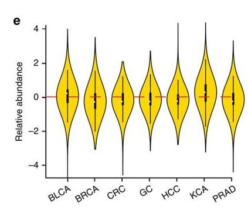
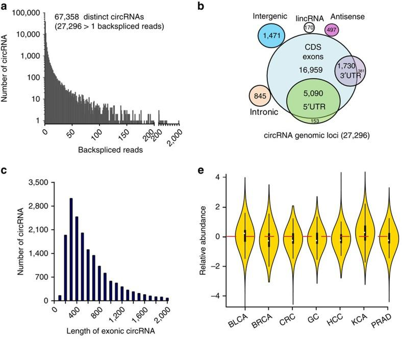
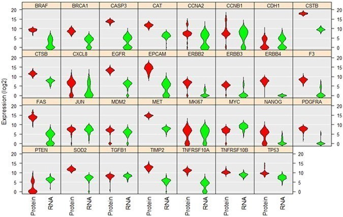
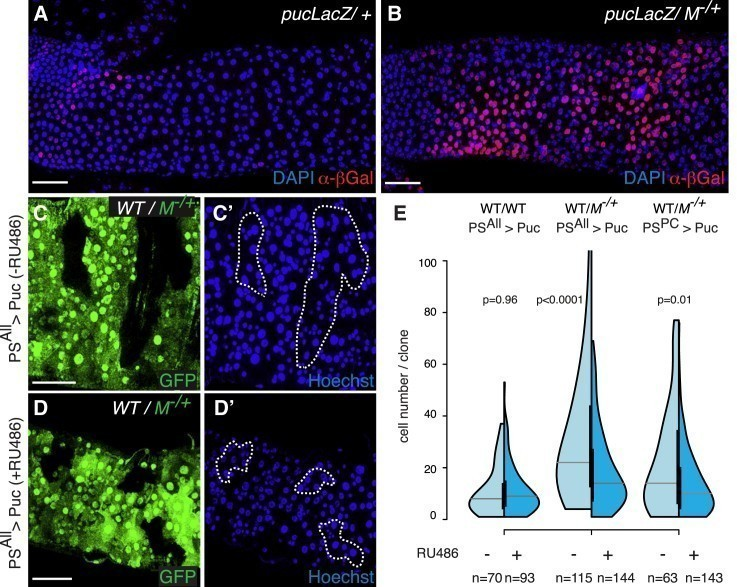
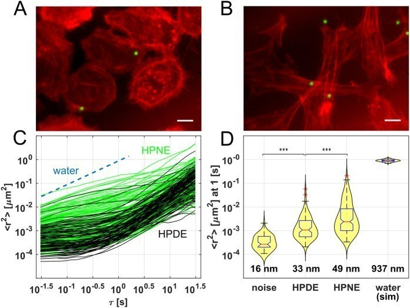

小提琴图是一种基于密度图和箱线图的可视化方式，它能够展示数据的分布情况，包括中位数、四分位数、最大值、最小值等信息。常用于比较不同组之间的数据分布情况，它的可视化效果比箱线图更加直观，能够更好地展示数据的特点。

-   箱型组件：白点/线代表中位数，黑条显示四分位距。
-   核密度组件：展现不同位置的数据点密度，揭示数据聚类模式。

## 示例

{fig-alt="ViolinPlot DEMO" fig-align="center" width="60%"}

## 环境配置

-   系统要求： 跨平台（Linux/MacOS/Windows）

-   编程语言：R

-   依赖包：`readr`; `tidyr`; `ggplot2`; `dplyr`; `ggdist`; `ggbeeswarm`; `forcats`; `hrbrthemes`; `viridis`; `ggstatsplot`; `palmerpenguins`

```{r packages setup, message=FALSE, warning=FALSE, output=FALSE}
# 安装包
if (!requireNamespace("readr", quietly = TRUE)) {
  install.packages("readr")
}
if (!requireNamespace("tidyr", quietly = TRUE)) {
  install.packages("tidyr")
}
if (!requireNamespace("ggdist", quietly = TRUE)) {
  install.packages("ggdist")
}
if (!requireNamespace("ggbeeswarm", quietly = TRUE)) {
  install.packages("ggbeeswarm")
}
if (!requireNamespace("dplyr", quietly = TRUE)) {
  install.packages("dplyr")
}
if (!requireNamespace("ggplot2", quietly = TRUE)) {
  install.packages("ggplot2")
}
if (!requireNamespace("ggpubr", quietly = TRUE)) {
  install.packages("ggpubr")
}
if (!requireNamespace("forcats", quietly = TRUE)) {
  install.packages("forcats")
}
if (!requireNamespace("hrbrthemes", quietly = TRUE)) {
  install.packages("hrbrthemes")
}
if (!requireNamespace("viridis", quietly = TRUE)) {
  install.packages("viridis")
}
if (!requireNamespace("ggstatsplot", quietly = TRUE)) {
  install.packages("ggstatsplot")
}
if (!requireNamespace("palmerpenguins", quietly = TRUE)) {
  install.packages("palmerpenguins")
}

# 加载包
library(readr)
library(tidyr)
library(ggplot2)
library(ggpubr)
library(dplyr)
library(ggdist)
library(ggbeeswarm)
library(forcats)
library(hrbrthemes)
library(viridis)
library(ggstatsplot)
library(palmerpenguins)
```

```{r}
sessioninfo::session_info("attached")
```

## 数据准备

我们使用内置的 R 数据集（`iris`、`penguins`）以及来自[UCSC Xena DATASETS](https://xenabrowser.net/datapages/?hub=https://gdcv18.xenahubs.net:443)的`TCGA-BRCA.htseq_counts.tsv`数据集。所选基因仅用于演示目的。

```{r load data, message=FALSE}
# 从处理过的CSV文件加载TCGA-BRCA基因表达数据集
data_counts <- readr::read_csv("https://bizard-1301043367.cos.ap-guangzhou.myqcloud.com/TCGA-BRCA.htseq_counts_processed.csv")

# 加载内置R数据集iris
data_wide <- iris[ , 1:4] # 以iris数据前四列数据为例

# 加载内置R数据集penguins
data("penguins", package = "palmerpenguins")
data_penguins <- drop_na(penguins) # 去除缺失值

# 手动创建含分组值的演示数据集
data <- data.frame(
  name=c( rep("A",500), rep("B",500), rep("B",500), rep("C",20), rep('D', 100)  ),
  value=c( rnorm(500, 10, 5), rnorm(500, 13, 1), rnorm(500, 18, 1), rnorm(20, 25, 4), rnorm(100, 12, 1) )
  )
sample_size <- data %>% 
  group_by(name) %>% 
  summarize(num=n()) # 计算每组的样本量
```

## 可视化

### 1. 基础小提琴图

示例 1: 基础小提琴图使用手动创建的数据集

```{r}
#| label: fig-1.1BasicViolin
#| fig-cap: "基础小提琴图"
#| out.width: "95%"
#| warning: false

# 基础小提琴图
p <- ggplot(data, aes(x=name, y=value, fill=name)) + 
  geom_violin()

p
```

示例 2: 基础小提琴图使用 iris 数据集

```{r}
#| label: fig-1.2BasicViolin
#| fig-cap: "基础小提琴图使用 `iris` 数据集"
#| out.width: "95%"
#| warning: false

# 将 `iris` 数据集从宽格式转换为长格式。使用 gather 函数将每列中的数据收集到名为"MesureType"和"Val"的两个新列中，以便一行代表一个观测值。
data_long_iris <- data_wide %>%  
  gather(key = "MeasureType", value = "Value")  

ggplot(data_long_iris, aes(x = MeasureType, y = Value, fill = MeasureType)) +  
  geom_violin()  
```

示例 3: 基础小提琴图使用 TCGA-BRCA 基因表达数据集

```{r}
#| label: fig-1.3BasicViolin
#| fig-cap: "基础小提琴图使用 `TCGA-BRCA` 基因表达数据集"
#| out.width: "95%"
#| warning: false

example_counts1 <- data_counts[1:5,] %>%
  gather(key = "sample",value = "gene_expression",3:1219) # 选择五个示例基因进行可视化：A1BG、A1BG-AS1、A1CF、A2M 和 A2M-AS1。

ggplot(example_counts1, aes(x=gene_name, y=gene_expression, fill=gene_name)) +
  geom_violin()
```

示例 4： 基础小提琴图组间差异显著性并标注

```{r}
#| label: fig-1.4BasicViolinSignificance
#| fig-cap: "基础小提琴图组间差异显著性并标注"
#| out.width: "95%"
#| warning: false

# 将数据进行整理和分组
data_long_iris <- data_wide %>%
  gather(key = "MeasureType",
         value = "Value")

# 绘制基础小提琴图
p <- ggplot(data_long_iris,
       aes(x = MeasureType,
           y = Value,
           fill = MeasureType)) +
  geom_violin()

# 将分组提取和去重
groups <- length(unique(data_long_iris$MeasureType))
if (groups == 2) {
	p <- p +
		stat_compare_means(
			method = "wilcox.test", # c("t.test", "wilcox.test")
			paired = FALSE,
			method.args = list(),
			ref.group = NULL,
			comparisons = NULL,
			hide.ns = FALSE,
			label.sep = ", ",
			label = "p.format", # c("p.signif", "p.format")
			label.x.npc = "left",
			label.y.npc = "top",
			label.x = NULL,
			label.y = NULL,
			vjust = 0,
			tip.length = 0.03,
			bracket.size = 0.3,
			step.increase = 0.1,
			symnum.args = list(),
			geom = "text",
			position = "identity",
			na.rm = FALSE,
			show.legend = NA,
			inherit.aes = TRUE
		)
} else if (groups > 2) {
	p <- p +
		stat_compare_means(
			method = "wilcox.test", # c("t.test", "wilcox.test")
			paired = FALSE,
			method.args = list(),
			ref.group = NULL,
			# 对于多个分组比较进行两两比较
			comparisons = combn(unique(as.character(data_long_iris$MeasureType)), 2, simplify = FALSE),
			hide.ns = FALSE,
			label.sep = ", ",
			label = "p.format", # c("p.signif", "p.format")
			label.x.npc = "left",
			label.y.npc = "top",
			label.x = NULL,
			label.y = NULL,
			vjust = 0,
			tip.length = 0.03,
			bracket.size = 0.3,
			step.increase = 0.1,
			symnum.args = list(),
			geom = "text",
			position = "identity",
			na.rm = FALSE,
			show.legend = NA,
			inherit.aes = TRUE
		)
}

p
```

### 2. 反转小提琴图

我们可以通过 `coord_flip()` 实现x、y轴的翻转。

```{r}
#| label: fig-2HorizontalViolin
#| fig-cap: "反转小提琴图使用 `TCGA-BRCA` 数据集"
#| out.width: "95%"
#| warning: false

example_counts2 <- data_counts[1:6,] %>% 
  gather(key = "sample",value = "gene_expression",3:1219) %>% 
  mutate(gene_name= fct_reorder(gene_name,gene_expression ))

ggplot(example_counts2, aes(x=gene_name, y=gene_expression, fill=gene_name, color=gene_name)) +
  geom_violin() +
  scale_fill_viridis(discrete=TRUE) +
  scale_color_viridis(discrete=TRUE) +
  theme_ipsum() + # 改善主题外观
  theme(legend.position="none" ) +
  coord_flip() + # 翻转 x 轴和 y 轴
  xlab("") +
  ylab("Assigned Probability (%)")
```

### 3. 箱线小提琴图

在实际可视化应用中，我们可以通过`geom_boxplot()`在小提琴图中添加箱线图，便于更加直观的比较数据。

```{r, message=FALSE}
#| label: fig-3.1Violinwizbox
#| fig-cap: "箱线小提琴图"
#| out.width: "95%"
#| warning: false

example_data <- data %>% 
  left_join(sample_size) %>%
  mutate(myaxis = paste0(name, "\n", "n=", num)) # 创建`myaxis`变量以在 x 轴上显示样本大小。

ggplot(example_data, aes(x=myaxis, y=value, fill=name)) +
  geom_violin(width=1.4) +
geom_boxplot( width=0.1,color="grey", alpha=0.2) + # 绘制箱线图。较小的宽度值会使箱线图位于小提琴图内。
scale_fill_viridis(discrete = TRUE) +
  theme_ipsum() + # 美化绘图
  theme(
   legend.position="none",
   plot.title = element_text(size=11)
  ) +
  ggtitle("A Violin plot wrapping a boxplot") +  # 设置标题
  xlab("")
```

使用 TCGA-BRCA 基因表达数据绘制的带有箱线图的小提琴图

```{r, message=FALSE}
#| label: fig-3.2Violinwizbox
#| fig-cap: "使用 `TCGA-BRCA` 基因表达数据绘制的带有箱线图的小提琴图"
#| out.width: "95%"
#| warning: false

example_counts3 <- data_counts[1:5,] %>%
  gather(key = "sample", value = "gene_expression",3:1219) %>%
  mutate(gene_name= fct_reorder(gene_name,gene_expression ))

ggplot(example_counts3, aes(x=gene_name, y=gene_expression, fill=gene_name, color=gene_name)) +
  geom_violin() +
  geom_boxplot( width=0.1,color="grey", alpha=0.2)+
  scale_fill_viridis(discrete=TRUE) +
  scale_color_viridis(discrete=TRUE) +
  theme_ipsum() + # 美化绘图
  theme(legend.position="none" ) 
```

### 4. 分组小提琴图

在基础小提琴图的基础上，我们可以通过设置`fill`值来实现组内比较。

下面的示例演示了如何使用`fill`属性进行组内比较。本例中使用了`penguins`数据集。x 变量代表物种，`fill=sex`创建了组内分类，以可视化每个物种内按性别分组的鳍状肢长度比较。

```{r, message=FALSE}
#| label: fig-4GroupedViolin
#| fig-cap: "分组小提琴图使用 `penguins` 数据集"
#| out.width: "95%"
#| warning: false

ggplot(data_penguins, aes(fill=sex, y=flipper_length_mm, x=species)) + # 使用X作为主分类，fill为组内分类
  geom_violin(position="dodge", alpha=0.5, outlier.colour="transparent") +
  scale_fill_viridis(discrete=T, name="") +
  theme_ipsum()  
```

### 5. 半分小提琴图

半分小提琴图可以用简便的方式展现大量信息，我们可以用`ggdist::stat_halfeye`分别绘制两个 group.

在下面的例子中，我们通过在图的两侧绘制雌性和雄性企鹅来可视化不同物种和性别的企鹅的鳍状肢长度。

```{r, message=FALSE}
#| label: fig-5Half-ViolinPlot
#| fig-cap: "半分小提琴图使用 `penguins` 数据集"
#| out.width: "95%"
#| warning: false

# 分离雌性企鹅和雄性企鹅的数据
data_female <- data_penguins %>% filter(sex == "female")
data_male <- data_penguins %>% filter(sex == "male")

# 绘制半分小提琴图（右侧为雌性，左侧为雄性）
ggplot() +
  ggdist::stat_halfeye(
    data = data_female,
    aes(y = flipper_length_mm, x = species),
    colour = NA,
    fill = "#9370DB",
    alpha = 0.8,
    side = "right", justification = 0, width = 0.8
  ) +
  ggdist::stat_halfeye(
    data = data_male,
    aes(y = flipper_length_mm, x = species),
    colour = NA,
    fill = "#FFFF00",
    alpha = 0.6,
    side = "left", justification = 0, width = 0.8
  )
```

### 6. 使用`ggstatsplot`包绘制小提琴图

`ggstatsplot`包扩展了`ggplot2`，添加了强大的统计可视化功能。`ggbetweenstats()`函数允许创建组合小提琴图、箱线图和散点图。

在以下示例中，我们使用`penguins`数据集可视化了不同企鹅物种喙长的分布。我们使用`theme()`函数进一步增强了绘图的美观性。

```{r, message=FALSE}
#| label: fig-6ViolinPlot-ggstatsplot
#| fig-cap: "使用`ggstatsplot`包绘制小提琴图"
#| out.width: "95%"
#| warning: false

plt <- ggbetweenstats(
  data = data_penguins,
  x = species,
  y = bill_length_mm
) +
# 美化
  labs(  ## 添加标签和标题
    x = "Penguins Species",
    y = "Bill Length",
    title = "Distribution of bill length across penguins species"
  ) +
  theme(
    axis.ticks = element_blank(),
    axis.line = element_line(colour = "grey50"),
    panel.grid = element_line(color = "#b4aea9"),
    panel.grid.minor = element_blank(),
    panel.grid.major.x = element_blank(),
    panel.grid.major.y = element_line(linetype = "dashed"),
    panel.background = element_rect(fill = "#fbf9f4", color = "#fbf9f4"),
    plot.background = element_rect(fill = "#fbf9f4", color = "#fbf9f4")
  )

plt
```

### 7. 分半小提琴 + 原始点（两组）

参考版式为每个组画：**左半小提琴 + 箱线，右半原始点** \[14\]——统计量与个体观测共用一个 x 槽位而不互相遮挡。`ggdist::stat_halfeye()` 与 `ggbeeswarm::geom_beeswarm()`（上文已加载）提供半密度与单侧蜂群：

```{r}
#| label: fig-7.1SplitViolin
#| fig-cap: "每组分半小提琴：左半小提琴 + 箱线，右半原始点；标注 Mann-Whitney p。"
#| out.width: "70%"
#| warning: false
#| message: false
#| fig-width: 6.5
#| fig-height: 4.5

set.seed(1201)
dat_v <- data.frame(
  group = rep(c("DNAmAge-ACC", "DNAmAge-DCC"), each = 40),
  value = c(rnorm(40, 68, 6), rnorm(40, 58, 7)))

p_w <- wilcox.test(value ~ group, data = dat_v)$p.value

ggplot(dat_v, aes(group, value, fill = group)) +
  ggdist::stat_halfeye(side = "left", justification = 0,
                       position = position_nudge(x = -0.02),
                       width = 0.6, alpha = 0.8, colour = NA) +
  geom_boxplot(width = 0.12, outlier.shape = NA, alpha = 0.9) +
  ggbeeswarm::geom_beeswarm(side = 1L, cex = 1.1,
                            size = 0.8, alpha = 0.5, colour = "grey30") +
  scale_fill_manual(values = c("DNAmAge-ACC" = "#B31E22", "DNAmAge-DCC" = "#2874C5")) +
  labs(title = sprintf("Mann-Whitney %s",
       ifelse(p_w < 0.001, "p < 0.001", sprintf("p = %.3f", p_w))),
       x = NULL, y = "DNAm age") +
  theme_classic(base_size = 11) +
  theme(legend.position = "none")
```

::: callout-tip
**实践要点**

-   `position_nudge()` 把三层分开；不加 nudged 位移，半小提琴、箱线与点会叠在同一槽位，丢失"分半"读法。
-   每组的小提琴保持同一侧——逐组交替侧会被读成两种编码。
-   配对数据在点半侧用 `geom_line(aes(group = id))` 跨组连线替代抖动。
:::

### 8. 分面小提琴矩阵与校正 p 标注

单细胞标志物普查同时要作三路比较：列是细胞类型，行是标记基因，条件（此处为年轻 vs. 年老）作为每格内的小提琴对 \[14\]。`ggpubr::ggviolin()` 铺排双因子网格；逐格 Mann-Whitney 检验经 `rstatix::wilcox_test()` 完成并做 Bonferroni 校正，再由 `stat_pvalue_manual()` 落回各自分面——配上 `hide.ns = TRUE`，只有真实的位移才开口说话。

```{r}
#| label: fig-8.1ScSplitFacetViolin
#| fig-cap: "标记基因 × 细胞类型的分面小提琴矩阵：每格为年轻 vs. 年老，Bonferroni 校正的 Mann-Whitney p 与星标只落在真实位移处（卵母细胞中的 DDX4，p.adj < 1e-4）。"
#| out.width: "90%"
#| warning: false
#| message: false
#| fig-width: 9
#| fig-height: 7.5

library(rstatix)
set.seed(7301)
clust <- c("OO", "GC", "SC", "EC")
genes7 <- c("DDX4", "AMH", "COL1A2", "CDH5")
rows <- list()
for (cl in seq_along(clust)) {
  for (gn in seq_along(genes7)) {
    for (ag in seq_along(c("Y", "O"))) {
      base <- rnorm(24, mean = 2.2 + 0.4 * cl + 0.3 * gn, sd = 0.9)
      # marker gene: one cluster expresses high; old shifts up on the top marker
      if (gn == cl) base <- base + 2.3
      if (gn == 1 && cl == 1 && ag == 2) base <- base + 1.9
      rows[[length(rows) + 1]] <- data.frame(
        aging = c("Y", "O")[ag], cluster_short = clust[cl], gene = genes7[gn],
        expression = base, stringsAsFactors = FALSE)
    }
  }
}
dfc <- do.call(rbind, rows)
dfc$aging <- factor(dfc$aging, levels = c("Y", "O"))
dfc$cluster_short <- factor(dfc$cluster_short, levels = clust)
dfc$gene <- factor(dfc$gene, levels = genes7)
# gate: the DDX4/OO facet is significantly higher in Old (the designed effect)
sub <- dfc[dfc$gene == "DDX4" & dfc$cluster_short == "OO", ]
wt <- wilcox.test(expression ~ aging, data = sub)
stopifnot(wt$p.value < 0.01 &&
          mean(sub$expression[sub$aging == "O"]) > mean(sub$expression[sub$aging == "Y"]))
stat_test <- dfc %>% group_by(cluster_short, gene) %>%
  wilcox_test(formula = expression ~ aging) %>%
  adjust_pvalue(method = "bonferroni") %>%
  add_significance(p.col = "p.adj", cutpoints = c(0, 1e-4, 0.001, 0.01, 0.05, 1),
                   symbols = c("****", "***", "**", "*", "ns")) %>%
  add_xy_position(x = "aging")
p_c <- ggviolin(dfc, x = "aging", y = "expression", fill = "aging", color = "aging",
                facet.by = c("gene", "cluster_short"), trim = FALSE) +
  scale_fill_manual(values = c("#2874C5", "#EABF00"), guide = "none") +
  scale_colour_manual(values = c("#2874C5", "#EABF00"), guide = "none") +
  stat_pvalue_manual(stat_test, hide.ns = TRUE, tip.length = 0,
                     label = "{p.adj} {p.adj.signif}", label.size = 2.6, vjust = -0.4) +
  scale_y_continuous(expand = expansion(mult = c(0, 0.14))) +
  theme_bw(base_size = 10) +
  theme(panel.grid = element_blank(),
        strip.text.y = element_text(angle = 0, size = 8),
        strip.text.x = element_text(size = 8),
        strip.background.x = element_rect(fill = "grey94", linewidth = 0, colour = NA),
        strip.background.y = element_rect(fill = "grey88", linewidth = 0, colour = NA),
        axis.title.x = element_blank(), legend.position = "none") +
  labs(y = "Expression (log TPM)")
print(p_c)
```

::: callout-tip
**实践要点**

-   因子水平要显式声明（`levels = c("Y", "O")`）：分面顺序与颜色映射都跟着因子走，不跟数据走。
-   分面上打印的 p 值已作多重检验校正——不要再从这类面板上单读某格的原始 p 值。
-   `trim = FALSE` 保留完整 KDE 尾部；裁剪看似更整洁，却剪掉了携带稀有细胞信号的尾巴。
:::

## 应用场景

### 1. 基础小提琴图

::: {#fig-ViolinPlotApplications}
{fig-alt="ViolinPlotApp1" fig-align="center" width="60%"}

基础小提琴图应用
:::

@fig-ViolinPlotApplications e 图为七种癌症组织与对应正常组织中 circRNA 相对丰度的小提琴图 \[1\]。

### 2. 分组小提琴图

::: {#fig-ViolinPlotApplications2}
{fig-alt="ViolinPlotApp2" fig-align="center" width="60%"}

分组小提琴图应用
:::

上示小提琴图分析比较了 A549 单细胞中 31 种蛋白质和 mRNA 的水平和分布 \[2\]。

### 3. 半分小提琴图

::: {#fig-ViolinPlotApplications3}
{fig-alt="ViolinPlotApp3" fig-align="center" width="60%"}

半分小提琴图应用
:::

@fig-ViolinPlotApplications3 E 图利用半分小提琴图分析 WT 克隆在 WT 肠道（左）或 M−/+ 肠道（中图和右图）中的克隆大小分布 \[3\]。

### 4. 箱线小提琴图

::: {#fig-ViolinPlotApplications4}
{fig-alt="ViolinPlotApp4" fig-align="center" width="60%"}

箱线小提琴图应用
:::

@fig-ViolinPlotApplications4 D 图展示附着在基质上 (noise) 和水中 (stimulation ) 的液滴的预期中值 MSD 和分布，以及纳米级的 RMS 位移 \[4\].

### 5. 泛癌分半小提琴 + 四分位标记（FigureYa55panCancer_violinV2）

TOIL 统一处理的 TCGA + GTEx 对比（FigureYa55panCancer_violinV2 \[15\]）把每个癌种放到 x 轴上、**每把小提琴从中剖开**：肿瘤（右半、红色）对匹配正常（左半、黄色，GTEx 或 TCGA 实体正常组织），半区内画四分位线，各组织上方标注显著性星号。`ggdist::stat_halfeye(side = ...)` 无需已归档的 `GeomSplitViolin` 辅助文件即可得到分半效果；四分位杠与 Wilcoxon 星号由数据直接计算绘制：

```{r}
#| label: fig-5.1PanCancerSplit
#| fig-cap: "模拟 TP53 样 TPM 矩阵在 10 个组织上的泛癌分半小提琴：肿瘤（右、红）vs 匹配正常（左、黄）；横杠 = 各半区四分位数；星号 = 逐组织 Wilcoxon 检验（***: p < 0.001）。"
#| out.width: "100%"
#| warning: false
#| message: false
#| fig-width: 10
#| fig-height: 5

set.seed(5501)
tissues <- c("BRCA", "COAD", "HNSC", "KIRC", "LUAD", "LUSC", "PRAD", "STAD", "THCA", "UCEC")
n_per <- 120
tp53_base <- c(BRCA = 2.6, COAD = 2.2, HNSC = 2.8, KIRC = 2.4, LUAD = 2.5,
               LUSC = 2.9, PRAD = 2.3, STAD = 2.7, THCA = 2.2, UCEC = 2.5)
pan <- do.call(rbind, lapply(tissues, function(t) {
  tumor <- rnorm(n_per, tp53_base[t] + 0.9, 0.75)
  normal <- rnorm(n_per, tp53_base[t] - 0.4, 0.6)
  rbind(data.frame(tissue = t, type2 = "tumor", tpm = tumor),
        data.frame(tissue = t, type2 = "normal", tpm = normal))
}))
pan$type2 <- factor(pan$type2, levels = c("tumor", "normal"))
pan$tissue <- factor(pan$tissue, levels = tissues)
pan$side <- ifelse(pan$type2 == "tumor", "right", "left")
wt <- do.call(rbind, lapply(tissues, function(t) {
  d1 <- pan$tpm[pan$tissue == t & pan$type2 == "tumor"]
  d0 <- pan$tpm[pan$tissue == t & pan$type2 == "normal"]
  data.frame(tissue = t, p = wilcox.test(d1, d0)$p.value)
}))
star_df <- data.frame(tissue = factor(wt$tissue, levels = tissues),
                      y = max(pan$tpm) + 0.55,
                      lab = ifelse(wt$p < 0.001, "***",
                                   ifelse(wt$p < 0.01, "**",
                                          ifelse(wt$p < 0.05, "*", ""))))
## 四分位标记：偏入各半区的小横杠
qd106 <- do.call(rbind, lapply(tissues, function(t) do.call(rbind, lapply(c("tumor", "normal"), function(g) {
  x <- pan$tpm[pan$tissue == t & pan$type2 == g]
  data.frame(tissue = t, type2 = g, q = quantile(x, c(0.25, 0.5, 0.75)))
}))))
qd106$tissue <- factor(qd106$tissue, levels = tissues)
qd106$type2 <- factor(qd106$type2, levels = c("tumor", "normal"))
qd106$xc <- as.numeric(qd106$tissue) + ifelse(qd106$type2 == "tumor", 0.13, -0.13)

ggplot(pan, aes(tissue, tpm, fill = type2)) +
  ggdist::stat_halfeye(aes(side = side), density = "bounded",
                       point_interval = NULL,
                       linewidth = 0.3, colour = "black", alpha = 0.95) +
  geom_segment(data = qd106,
               aes(x = xc - 0.025, xend = xc + 0.025, y = q, yend = q,
                   colour = type2),
               inherit.aes = FALSE, linewidth = 0.55) +
  geom_text(data = star_df, aes(tissue, y, label = lab),
            inherit.aes = FALSE, size = 4.2, colour = "grey10") +
  scale_fill_manual(values = c(tumor = "#DF2020", normal = "#DDDF21"), name = NULL) +
  scale_colour_manual(values = c(tumor = "#7a1010", normal = "#8a8a20"), guide = "none") +
  scale_y_continuous(limits = c(-2, max(pan$tpm) + 1.1)) +
  labs(x = NULL, y = "TP53 expression (log2 TPM, simulated)",
       title = "Pan-cancer split violin: tumour vs matched normal (GTEx-like)") +
  theme_classic(base_size = 12) +
  theme(axis.text.x = element_text(angle = 45, hjust = 0.5, vjust = 0.5),
        legend.position = "top")
```

::: callout-tip
**实践要点**

-   `stat_halfeye(side = ...)` 需要逐观测数据并按组算出 side——绝不要叠两个完整小提琴，那会重复计算密度。
-   `point_interval = NULL` 去掉 ggdist 默认的中位数-CI 须（及其神秘的 `-.width` 图例）；上面的四分位杠取代之，与参考图一致。
-   真实分析：从 UCSC Xena 取 TOIL TPM（`tcga_RSEM_gene_tpm.gz` + `gtex_RSEM_gene_tpm.gz`），用 GEPIA 的 TCGA-GTEx 配对表映射组织——参考文档记录了完整流程。
:::

## 参考文献## 参考文献

\[1\] Zheng Q, Bao C, Guo W, Li S, Chen J, Chen B, Luo Y, Lyu D, Li Y, Shi G, Liang L, Gu J, He X, Huang S. Circular RNA profiling reveals an abundant circHIPK3 that regulates cell growth by sponging multiple miRNAs. Nat Commun. 2016 Apr 6;7:11215. doi: 10.1038/ncomms11215. PMID: 27050392; PMCID: PMC4823868.

\[2\] Gong H, Wang X, Liu B, Boutet S, Holcomb I, Dakshinamoorthy G, Ooi A, Sanada C, Sun G, Ramakrishnan R. Single-cell protein-mRNA correlation analysis enabled by multiplexed dual-analyte co-detection. Sci Rep. 2017 Jun 5;7(1):2776. doi: 10.1038/s41598-017-03057-5. PMID: 28584233; PMCID: PMC5459813.

\[3\] Kolahgar G, Suijkerbuijk SJ, Kucinski I, Poirier EZ, Mansour S, Simons BD, Piddini E. Cell Competition Modifies Adult Stem Cell and Tissue Population Dynamics in a JAK-STAT-Dependent Manner. Dev Cell. 2015 Aug 10;34(3):297-309. doi: 10.1016/j.devcel.2015.06.010. Epub 2015 Jul 23. PMID: 26212135; PMCID: PMC4537514.

\[4\] Cribb JA, Osborne LD, Beicker K, Psioda M, Chen J, O'Brien ET, Taylor Ii RM, Vicci L, Hsiao JP, Shao C, Falvo M, Ibrahim JG, Wood KC, Blobe GC, Superfine R. An Automated High-throughput Array Microscope for Cancer Cell Mechanics. Sci Rep. 2016 Jun 6;6:27371. doi: 10.1038/srep27371. PMID: 27265611; PMCID: PMC4893602.

\[5\] Wickham H, Vaughan D, Girlich M (2024). *tidyr: Tidy Messy Data*. R package version 1.3.1, <https://CRAN.R-project.org/package=tidyr>.

\[6\] H. Wickham. ggplot2: Elegant Graphics for Data Analysis. Springer-Verlag New York, 2016.

\[7\] Wickham H, François R, Henry L, Müller K, Vaughan D (2023). *dplyr: A Grammar of Data Manipulation*. R package version 1.1.4, <https://CRAN.R-project.org/package=dplyr>.

\[8\] Kay M. ggdist: Visualizations of Distributions and Uncertainty in the Grammar of Graphics. https://mjskay.github.io/ggdist/

\[9\] Wickham H (2023). *forcats: Tools for Working with Categorical Variables (Factors)*. R package version 1.0.0, <https://CRAN.R-project.org/package=forcats>.

\[10\] Rudis B (2024). *hrbrthemes: Additional Themes, Theme Components and Utilities for 'ggplot2'*. R package version 0.8.7, <https://CRAN.R-project.org/package=hrbrthemes>.

\[11\] Simon Garnier, Noam Ross, Robert Rudis, Antônio P. Camargo, Marco Sciaini, and Cédric Scherer (2024). viridis(Lite) - Colorblind-Friendly Color Maps for R. viridis package version 0.6.5.

\[12\] Patil, I. (2021). Visualizations with statistical details: The 'ggstatsplot' approach. Journal of Open Source Software, 6(61), 3167, doi:10.21105/joss.03167

\[13\] Horst AM, Hill AP, Gorman KB (2020). palmerpenguins: Palmer Archipelago (Antarctica) penguin data. R package version 0.1.0. https://allisonhorst.github.io/palmerpenguins/. doi: 10.5281/zenodo.3960218.

\[14\] Xiaofan Lu, et al. FigureYa: A Standardized Visualization Framework for Enhancing Biomedical Data Interpretation and Research Efficiency. iMetaMed. 2025. doi:10.1002/imm3.70005

\[15\] Xiaofan Lu, et al. FigureYa: A Standardized Visualization Framework for Enhancing Biomedical Data Interpretation and Research Efficiency. iMetaMed. 2025. doi:10.1002/imm3.70005