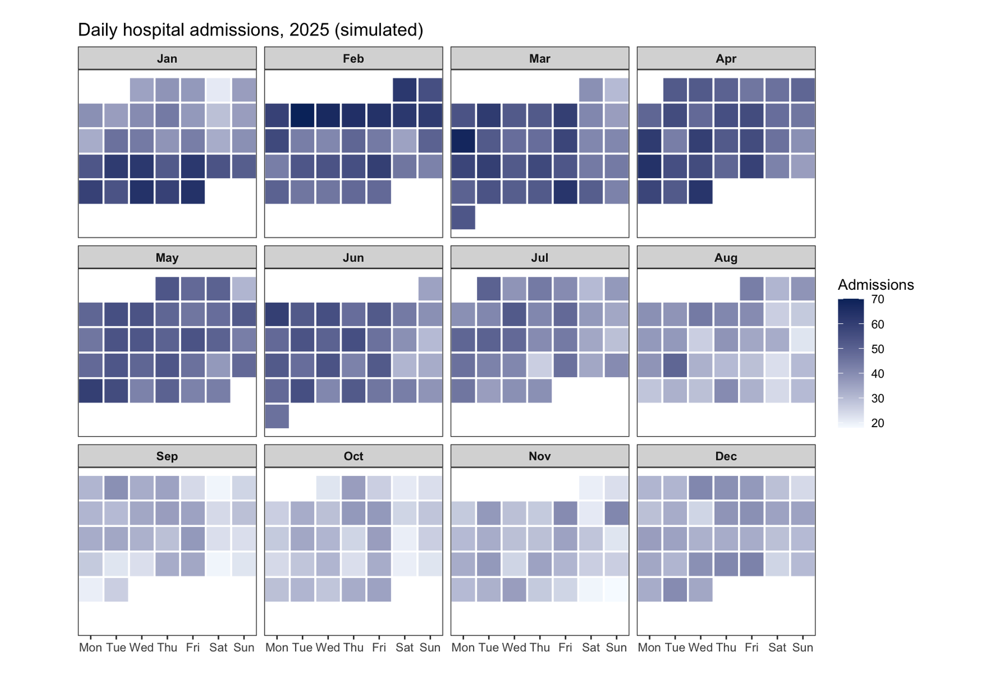
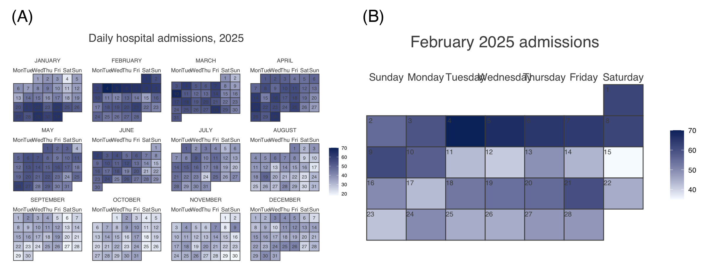

A calendar heatmap tiles a calendar — columns = weekdays, rows = weeks, one facet per month (or one big grid for the year) — and maps a daily value to tile color \[1\]. It is the natural display for data with strong weekly and seasonal rhythms: hospital admissions, emergency-department visits, lab throughput, or any counter you would sketch on a wall calendar. The layout makes weekday effects (the vertical stripes) and seasonal drift (across facets) visible simultaneously — both invisible in a plain line plot of the same series.

This tutorial builds the layout manually with ggplot2 (`geom_tile` + month facets), then shows the one-liner alternative with the `calendR` package \[2\]. A thin demo of `calendR` highlighting also exists in Bizard (see [Calend Highlight](../DataOverTime/CalendHighlight.html)); this tutorial focuses on the *data-driven* heatmap version.

This tutorial covers three workflows:

1. A manual month-by-month calendar heatmap (the version you control fully);
2. A one-line full-year heatmap with `calendR`;
3. A single-month `calendR` detail view.

## Example

{fig-alt="CalendarHeatmap DEMO" fig-align="center" width="60%"}

## Setup

-   System Requirements: Cross-platform (Linux/MacOS/Windows)

-   Programming language: R

-   Dependent packages: `ggplot2`; `dplyr`; `lubridate`; `calendR`

```{r packages setup, message=FALSE, warning=FALSE, output=FALSE}
# Installing necessary packages
if (!requireNamespace("calendR", quietly = TRUE)) {
  install.packages("calendR")
}

# Load packages
library(ggplot2)
library(dplyr)
library(lubridate)
library(calendR)
```

```{r}
sessioninfo::session_info("attached")
```

## Data Preparation

We simulate one year of daily hospital admissions: a winter peak (seasonal sine), a weekend dip, a 3-week influenza surge in late January/February, and day-to-day noise. The manual layout needs three derived columns: weekday number (columns), the day's row *within its month grid* (weekday of the 1st + day-of-month, divided by 7), and the month label (facet).

```{r load data, message=FALSE, warning=FALSE}
set.seed(251)

dates <- seq(as.Date("2025-01-01"), as.Date("2025-12-31"), by = "day")
base_adm <- 42 + 12 * sin(2 * pi * (yday(dates) - 15) / 365)  # winter peak
weekend  <- ifelse(wday(dates) %in% c(1, 7), -8, 0)           # weekend dip
flu      <- ifelse(dates >= as.Date("2025-01-20") &
                   dates <= as.Date("2025-02-10"), 18, 0)     # flu surge

adm <- data.frame(date = dates,
                  admissions = pmax(5, round(base_adm + weekend + flu +
                                               rnorm(length(dates), 0, 5)))) |>
  mutate(wday_n    = wday(date, week_start = 1),
         dom       = day(date),
         month_n   = month(date),
         month_lab = month(date, label = TRUE, abbr = TRUE))

# weekday of each month's 1st (Mon-based), shifted so day 1 sits in its true column
offsets <- sapply(1:12, function(m) wday(as.Date(sprintf("2025-%02d-01", m)),
                                         week_start = 1) - 1)
adm <- adm |>
  mutate(week_row = ceiling((dom + offsets[month_n]) / 7))

cat("Days:", nrow(adm), "| range:", min(adm$admissions), "-", max(adm$admissions), "\n")
```

## Visualization

### 1. Manual Month-by-Month Heatmap

```{r}
#| label: fig-1.1GgplotCalendar
#| fig-cap: "Daily hospital admissions, 2025: weekend columns run visibly lighter in every facet, the winter months run darker, and the February flu surge stands out as a dark block in weeks 1-3."
#| out.width: "95%"
#| fig-width: 9
#| fig-height: 6
#| warning: false
#| message: false

wd_lab <- c("Mon", "Tue", "Wed", "Thu", "Fri", "Sat", "Sun")

ggplot(adm, aes(wday_n, week_row, fill = admissions)) +
  geom_tile(color = "white", linewidth = 0.6) +
  scale_x_continuous(breaks = 1:7, labels = wd_lab, expand = c(0, 0)) +
  scale_y_reverse(breaks = NULL, name = NULL) +
  scale_fill_gradient(low = "#F7FBFF", high = "#08306B", name = "Admissions") +
  facet_wrap(~month_lab, ncol = 4) +
  coord_fixed(ratio = 1) +
  labs(x = NULL, y = NULL,
       title = "Daily hospital admissions, 2025 (simulated)") +
  theme_bw(base_size = 10) +
  theme(strip.text = element_text(face = "bold"),
        panel.grid = element_blank(),
        axis.text.y = element_blank(), axis.ticks.y = element_blank())
```

All months share one row grid (a month with 5 weeks simply leaves row 6 empty), which keeps the facets comparable. `coord_fixed(ratio = 1)` squares the tiles; drop it if labels need more room.

### 2. One-Line Full-Year Heatmap with calendR

```{r}
#| label: fig-2.1CalendRYear
#| fig-cap: "The same year via calendR: pass the daily values to special.days with gradient = TRUE (one value per day of the year) and the calendar is drawn for you."
#| out.width: "90%"
#| fig-width: 9
#| fig-height: 6.5
#| warning: false
#| message: false

calendR(year = 2025,
        special.days = adm$admissions,   # one value per day of the year
        gradient = TRUE,
        low.col = "#F7FBFF", special.col = "#08306B",
        legend.pos = "right",
        title = "Daily hospital admissions, 2025",
        start = "M")
```

### 3. Single-Month Detail View

```{r}
#| label: fig-3.1CalendRMonth
#| fig-cap: "February detail: day numbers stay readable while the gradient encodes admissions."
#| out.width: "70%"
#| fig-width: 6.5
#| fig-height: 4.5
#| warning: false
#| message: false

calendR(year = 2025, month = 2,
        special.days = adm$admissions[adm$month_n == 2],
        gradient = TRUE,
        low.col = "#F7FBFF", special.col = "#08306B",
        legend.pos = "right",
        title = "February 2025 admissions")
```

::: callout-tip
## Practice tips

-   Choose a sequential scale with a meaningful anchor (light = typical, dark = busy); diverging scales are for anomalies against a target, not raw counts.
-   The manual layout's `week_row = ceiling((dom + offset)/7)` is what keeps day 1 in its true weekday column — computing rows with `isoweek()` instead lets months bleed into each other's weeks.
-   `calendR`'s `gradient = TRUE` expects **one value per day of the year** in calendar order; verify with `length(special.days) == ifelse(leap_year(year), 366, 365)`.
-   Annotate known events (outbreaks, strikes, holidays) rather than leaving readers to guess dark blocks.
:::

## Application

Calendar heatmaps are standard in health-services and operations dashboards (ED visits, elective-surgery scheduling, bed occupancy), digital-health engagement panels, and environmental-exposure time series. The panel below mirrors a typical report layout: (A) the manual twelve-month grid and (B) the calendR year view.

{fig-alt="CalendarHeatmap Application" fig-align="center" width="60%"}

## Reference

\[1\] Data-to-Viz. Calendar. https://www.data-to-viz.com/graph/calendar.html

\[2\] Soage González JC. calendR: create ready to print monthly and yearly calendars built with ggplot2. R package version 1.2. 2021. https://CRAN.R-project.org/package=calendR

\[3\] Grolemund G, Wickham H. Dates and times made easy with lubridate. J Stat Softw. 2011;40(3):1-25. doi:10.18637/jss.v040.i03
