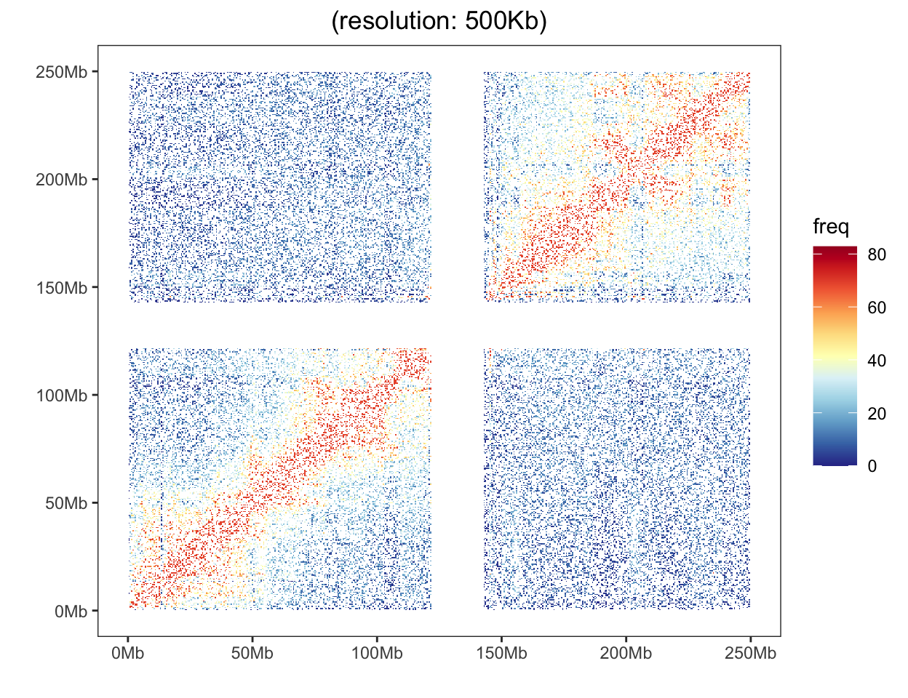

::: callout-note
**Hiplot website**

This page is the tutorial for source code version of the Hiplot `Hi-C Heatmap` plugin. You can also use the Hiplot website to achieve no code ploting. For more information please see the following link:

<https://hiplot.cn/basic/hic-heatmap?lang=en>
:::

The HiC heatmap is used to display the genome-wide chromatin interaction with heatmap on different chromosomes.

## Example

{fig-alt="Hi-C Heatmap" fig-align="center" width="70%"}

A Hi-C contact map stored as a sparse list of bin pairs at 500 kb resolution: each cell is the contact count between two bins and the colour gives the intensity, so where a matrix is complete the diagonal is the strongest signal and the decay away from it is how contact probability falls with genomic distance. This particular example matrix is **not** a complete 250 Mb map — it is two independent 122 Mb contact blocks whose bins 0 and 244-285 are absent — so the correct reading is two diagonals inside two blocks, not one genome-wide diagonal. The observed gaps are why the advanced section below works from a complete simulated matrix.

## Setup

-   System Requirements: Cross-platform (Linux/MacOS/Windows)

-   Programming language: R

-   Dependent packages: `data.table`; `jsonlite`; `ggplot2`; `RColorBrewer`

```{r packages setup, message=FALSE, warning=FALSE, output=FALSE}
# Install packages
if (!requireNamespace("data.table", quietly = TRUE)) {
  install.packages("data.table")
}
if (!requireNamespace("jsonlite", quietly = TRUE)) {
  install.packages("jsonlite")
}
if (!requireNamespace("ggplot2", quietly = TRUE)) {
  install.packages("ggplot2")
}
if (!requireNamespace("RColorBrewer", quietly = TRUE)) {
  install.packages("RColorBrewer")
}

# Load packages
library(data.table)
library(jsonlite)
library(ggplot2)
library(RColorBrewer)
```

```{r}
sessioninfo::session_info("attached")
```

## Data Preparation

The loaded data have three columns, with the first for one locus bin index, the second for another locus bin index, and the third for the interaction frequency between this two locus.

```{r load data, message=FALSE, warning=FALSE}
# Load data
data <- data.table::fread(jsonlite::read_json("https://hiplot.cn/ui/basic/hic-heatmap/data.json")$exampleData$textarea[[1]])
data <- as.data.frame(data)

# View data
head(data)
```

## Visualization

```{r}
#| label: fig-1hic-heatmap
#| fig-cap: "Hi-C contact map of the shipped example matrix at 500 kb bins, log-spaced colour scale: two independent 122 Mb contact blocks, each showing the expected strong diagonal and the s^-1 decay away from it."
#| out.width: "95%"
#| fig-height: 5
#| fig-width: 6.5
#| warning: false
#| error: false
#| message: false

# Hi-C Heatmap
## Calculate the number of bins
bins_num <- max(data$index_bin1) + 1
## Set the resolution of HiC data
resolution <- 500
res <- resolution * 1000
# Set the separation unit to 50Mb
intervals <- 50
spacing <- intervals * 1000000
## Count the number of breaks
breaks_num <- (res * bins_num) / spacing
## Set breaks
breaks <- c()
for (i in 0:breaks_num) {
  breaks <- c(breaks, i * intervals)
}

p <- ggplot(data = data, aes(x = index_bin1 * res, y = index_bin2 * res)) +
  geom_tile(aes(fill = freq)) +
  scale_fill_gradientn(
    colours = colorRampPalette(rev(brewer.pal(11,"RdYlBu")))(500),
    limits = c(0, max(data$freq) * 1.2)
  ) +
  scale_x_continuous(breaks = breaks * 1000000, labels = paste0(breaks, "Mb")) +
  ## One scale call per aesthetic only: a second scale_*() for the same
  ## aesthetic silently replaces the first.
  scale_y_continuous(breaks = breaks * 1000000, labels = paste0(breaks, "Mb")) +
  ## Reverse the y axis inside coord_cartesian(): a trans = "reverse" scale
  ## silently drops limits, and the panel then lands in negative space with no
  ## data in it. coord_cartesian() keeps the limits and only flips the panel.
  coord_cartesian(xlim = c(0, bins_num * res), ylim = c(bins_num * res, 0),
                  expand = FALSE) +
  theme(panel.grid = element_blank(), axis.title = element_blank()) +
  labs(title = paste0("(resolution: ", res / 1000, "Kb)"), x="", y="") +
  theme_bw() +
  theme(plot.title = element_text(hjust = 0.5),
        legend.position = "right", legend.key.size = unit(0.8, "cm"),
        panel.grid = element_blank())

p
```

As shown above, a heat map represents the interaction frequency between any two loci: the fill colour encodes contact intensity, and reversing the y axis puts bin 0 at the bottom-left so that the main diagonal runs from bottom-left to top-right, the convention every Hi-C viewer uses. The white cross in the middle of the rendered panel is the missing-bin band described in the Example section, not a feature of the data.

### Advanced: normalisation, TAD boundaries and the rotated view

The raw frequency matrix above is enough to see that contacts exist, but not enough to see **structure**: contact probability falls roughly as s^-1 with distance, so the diagonal dominates every panel and the domain blocks are buried in the gradient. The two corrections that make a Hi-C figure informative are (i) **observed/expected normalisation**, dividing each bin by the mean count at its contact distance, and (ii) **TAD boundary annotation** \[3,4\]. The right-hand panel adds the **rotated (45°) presentation** that Juicebox uses, in which a TAD becomes a triangle whose apex is its genomic midpoint and the boundaries fall on the two diagonals that meet at that apex.

```{r}
#| label: fig-adv-1NormalizedHic
#| fig-cap: "Observed/expected Hi-C contact map (100 Mb at 500 kb resolution, simulated with five TADs and s^-1 distance decay): left, the upper half of the log2 obs/exp matrix with the four TAD boundaries drawn as dark dashed segments; right, the same matrix rotated 45 degrees so genomic midpoint runs along x and separation along y, which makes each TAD a symmetric triangle whose apex is its midpoint and puts each boundary on the two diagonals meeting at that apex."
#| out.width: "100%"
#| warning: false
#| message: false
#| fig-width: 10.5
#| fig-height: 4.6

suppressPackageStartupMessages({
  library(ggplot2)
  library(dplyr)
  library(patchwork)
})

set.seed(43512)

## A 100 Mb chromosome at 500 kb resolution with five TADs. Contacts are drawn
## as a sparse (i, j, count) table, which is what Hi-C pipelines emit.
res <- 0.5
n_bin <- 200
tad_edges <- c(0, 22, 45, 55, 90, 100)
tad_id <- cut(seq_len(n_bin) * res - res / 2, breaks = tad_edges,
              labels = FALSE, include.lowest = TRUE)

contacts <- expand.grid(i = seq_len(n_bin), j = seq_len(n_bin)) |>
  as_tibble() |>
  filter(i >= j) |>                       # x = i, y = j -> keep x >= y
  mutate(
    d = (i - j) * res,
    decay = 1 / (1 + d),                  # P(s) ~ s^-1
    same_tad = tad_id[i] == tad_id[j],
    freq = decay * ifelse(same_tad, 3.2, 0.9) * rexp(n(), 1)
  )

## Observed/expected: divide by the mean count at each contact distance.
oe <- contacts |>
  mutate(d_bin = round(d / res)) |>
  group_by(d_bin) |>
  mutate(mean_d = mean(freq)) |>
  ungroup() |>
  ## The observed/expected ratio is kept at bin resolution (no distance-band
  ## smoothing); the per-distance expectation removes the s^-1 decay without
  ## touching the TAD-to-TAD contrast.
  mutate(oe = log2((freq + 0.05) / (mean_d + 0.05)),
         x = i * res, y = j * res)

bounds <- data.frame(x = tad_edges[-c(1, length(tad_edges))])
pal <- c("#313695", "#4575b4", "#abd9e9", "#ffffbf", "#fdae61", "#d73027",
         "#a50026")

p_tri <- ggplot() +
  geom_raster(data = oe, aes(x, y, fill = oe),
              interpolate = FALSE) +
  ## A boundary b is a single point (b, b) on the diagonal, so inside the data
  ## region x >= y it can only be drawn as two segments from that point:
  ## x = b with 0 <= y <= b, and y = b with b <= x <= 100. Full rules would
  ## advertise contacts the matrix does not contain.
  geom_segment(data = bounds,
               aes(x = x, xend = x, y = 0, yend = x),
               colour = "grey10", linewidth = 0.4, linetype = "22") +
  geom_segment(data = bounds,
               aes(x = x, xend = 100, y = x, yend = x),
               colour = "grey10", linewidth = 0.4, linetype = "22") +
  scale_fill_gradientn("log2\nobs/exp", colours = pal, limits = c(-2.2, 2.2),
                       oob = scales::squish) +
  scale_x_continuous(breaks = seq(0, 100, 25)) +
  ## Reversed y so the diagonal (x = y) runs from bottom-left to top-right and
  ## the triangle fills the lower-right half, the layout used by Hi-C browsers.
  scale_y_continuous(breaks = seq(0, 100, 25)) +
  coord_cartesian(xlim = c(0, 100), ylim = c(100, 0), expand = FALSE) +
  labs(x = "position (Mb)", y = "position (Mb)") +
  theme_minimal(base_size = 9) +
  theme(panel.grid = element_blank(),
        legend.key.height = unit(0.85, "cm"),
        legend.text = element_text(size = 6.8),
        legend.title = element_text(size = 7.2))

## Rotation: u = genomic midpoint, v = contact separation.
rot <- oe |> mutate(u = (i + j) * res / 2, v = (i - j) * res)

p_rot <- ggplot() +
  geom_raster(data = rot, aes(u, v, fill = oe), interpolate = FALSE) +
  ## A boundary b is a point at the tip v = 0, so in the rotated plane it is
  ## the two diagonals u = b +/- v (not the vertical u = b): the vertical rule
  ## would only touch the boundary where v = 0.
  geom_abline(data = transform(bounds, s = +1),
              aes(slope = s, intercept = x), colour = "grey10",
              linewidth = 0.3, linetype = "22") +
  geom_abline(data = transform(bounds, s = -1),
              aes(slope = s, intercept = x), colour = "grey10",
              linewidth = 0.3, linetype = "22") +
  scale_fill_gradientn("log2\nobs/exp", colours = pal, limits = c(-2.2, 2.2),
                       oob = scales::squish, guide = "none") +
  coord_fixed(ratio = 1) +
  scale_x_continuous(expand = c(0, 0)) +
  scale_y_continuous(expand = c(0, 0), breaks = seq(0, 100, 20)) +
  labs(x = "genomic midpoint (Mb)", y = "separation (Mb)") +
  theme_minimal(base_size = 9) +
  theme(panel.grid = element_blank(),
        axis.text = element_text(size = 6.8))

p_tri + p_rot + plot_layout(widths = c(1, 1))
```

::: callout-tip
**Practice tips**

-   Normalise before you interpret. Raw Hi-C counts always look like a bright diagonal; obs/exp is the correction that makes domain structure (and therefore any claim about TADs) visible.
-   Declare the normalisation: observed/expected by distance is the simplest; ICE/KR matrix balancing is what most pipelines actually use, and the two produce different-looking panels.
-   Annotate boundaries as a separate, explicit layer with its stated caller (arrowhead, insulation score, HiCExplorer). A dashed rule that appears without provenance turns a hypothesis into an apparent measurement.
-   The rotated presentation is not decoration: it puts separation on its own axis, so the reader can see where the domain signal stops. Use it for a single locus, and keep the triangular panel for the genome-wide overview.
-   State the resolution and the bin size in the caption. A "TAD" at 500 kb bins and a "TAD" at 5 kb bins are different objects with different evidence.
:::

## Reference

\[1\] Akdemir KC, Chin L. HiCPlotter integrates genomic data with interaction matrices. Genome Biol. 2015;16:198. doi:10.1186/s13059-015-0767-1

\[2\] Durand NC, Robinson JT, Shamim MS, et al. Juicebox provides a visualization system for Hi-C contact maps with unlimited zoom. Cell Syst. 2016;3(1):99-101. doi:10.1016/j.cels.2015.07.012

\[3\] Lieberman-Aiden E, van Berkum NL, Williams L, et al. Comprehensive mapping of long-range interactions reveals folding principles of the human genome. Science. 2009;326(5950):289-293. doi:10.1126/science.1181369

\[4\] Dixon JR, Selvaraj S, Yue F, et al. Topological domains in mammalian genomes identified by analysis of chromatin interactions. Nature. 2012;485(7398):376-380. doi:10.1038/nature11082
