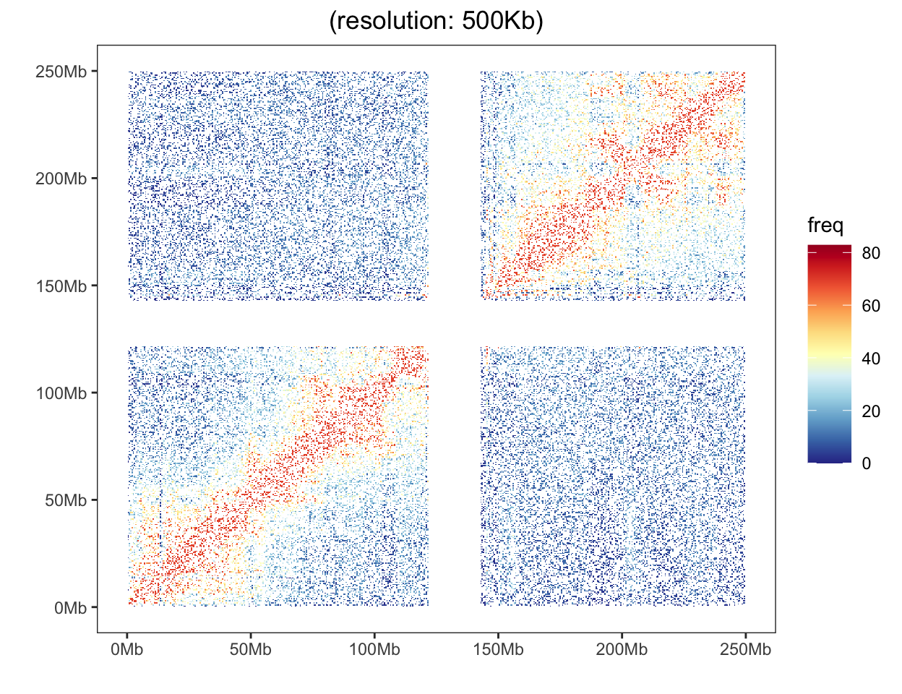

::: callout-note
**Hiplot 网站**

本页面为 Hiplot `Hi-C Heatmap` 插件的源码版本教程，您也可以使用 Hiplot 网站实现无代码绘图，更多信息请查看以下链接:

<https://hiplot.cn/basic/hic-heatmap?lang=zh_cn>
:::

Hi-C 热图用于显示不同染色体上的全基因组染色质与热图的相互作用。

## 示例

{fig-alt="Hi-C 热图" fig-align="center" width="70%"}

以 500 kb 分辨率稀疏存储的 Hi-C 接触图，每个格子是两个箱之间的接触计数，颜色表示强度：在矩阵完整处，对角线信号最强，离开对角线的衰减就是接触概率随基因组距离下降的表现。但这份示例矩阵**并不是**完整的 250 Mb 接触图——它是两块彼此独立的 122 Mb 接触块，且第 0 号与 244–285 号箱缺失——所以正确的读法是两个块内部的两条对角线，而不是一条全基因组对角线。正因为存在这些空缺，下文进阶部分改用一份完整的模拟矩阵。

## 环境配置

-   系统: Cross-platform (Linux/MacOS/Windows)

-   编程语言: R

-   依赖包: `data.table`; `jsonlite`; `ggplot2`; `RColorBrewer`

```{r packages setup, message=FALSE, warning=FALSE, output=FALSE}
# 安装包
if (!requireNamespace("data.table", quietly = TRUE)) {
  install.packages("data.table")
}
if (!requireNamespace("jsonlite", quietly = TRUE)) {
  install.packages("jsonlite")
}
if (!requireNamespace("ggplot2", quietly = TRUE)) {
  install.packages("ggplot2")
}
if (!requireNamespace("RColorBrewer", quietly = TRUE)) {
  install.packages("RColorBrewer")
}

# 加载包
library(data.table)
library(jsonlite)
library(ggplot2)
library(RColorBrewer)
```

```{r}
sessioninfo::session_info("attached")
```

## 数据准备

加载的数据具有三个列，其中第一个用于一个基因座箱索引，第二个是另一个基因座箱索引的第二列，而这两个基因座之间的相互作用频率是第三个。

```{r load data, message=FALSE, warning=FALSE}
# 加载数据
data <- data.table::fread(jsonlite::read_json("https://hiplot.cn/ui/basic/hic-heatmap/data.json")$exampleData$textarea[[1]])
data <- as.data.frame(data)

# 查看数据
head(data)
```

## 可视化

```{r}
#| label: fig-1hic-heatmap
#| fig-cap: "随教程提供的示例矩阵在 500 kb 分箱下的 Hi-C 接触图，颜色为取对数的强度标度：两个彼此独立的 122 Mb 接触块，各块内部呈现预期的强对角线与 s^-1 衰减。"
#| out.width: "95%"
#| fig-height: 5
#| fig-width: 6.5
#| warning: false
#| error: false
#| message: false

# Hi-C 热图
## 计算bins的个数
bins_num <- max(data$index_bin1) + 1
## 设置HiC数据的resolution
resolution <- 500
res <- resolution * 1000
# 设置分隔单位,以50Mb为单位进行分隔
intervals <- 50
spacing <- intervals * 1000000
## 计算breaks的数目
breaks_num <- (res * bins_num) / spacing
## 设置breaks
breaks <- c()
for (i in 0:breaks_num) {
  breaks <- c(breaks, i * intervals)
}

p <- ggplot(data = data, aes(x = index_bin1 * res, y = index_bin2 * res)) +
  geom_tile(aes(fill = freq)) +
  scale_fill_gradientn(
    colours = colorRampPalette(rev(brewer.pal(11,"RdYlBu")))(500),
    limits = c(0, max(data$freq) * 1.2)
  ) +
  scale_x_continuous(breaks = breaks * 1000000, labels = paste0(breaks, "Mb")) +
  ## One scale call per aesthetic only: a second scale_*() for the same
  ## aesthetic silently replaces the first.
  scale_y_continuous(breaks = breaks * 1000000, labels = paste0(breaks, "Mb")) +
  ## Reverse the y axis inside coord_cartesian(): a trans = "reverse" scale
  ## silently drops limits, and the panel then lands in negative space with no
  ## data in it. coord_cartesian() keeps the limits and only flips the panel.
  coord_cartesian(xlim = c(0, bins_num * res), ylim = c(bins_num * res, 0),
                  expand = FALSE) +
  theme(panel.grid = element_blank(), axis.title = element_blank()) +
  labs(title = paste0("(resolution: ", res / 1000, "Kb)"), x="", y="") +
  theme_bw() +
  theme(plot.title = element_text(hjust = 0.5),
        legend.position = "right", legend.key.size = unit(0.8, "cm"),
        panel.grid = element_blank())

p
```

示例图每个小格表示两个基因组区间之间的接触计数，颜色表示强度：在矩阵完整处，对角线信号最强，离开对角线的衰减即接触概率随基因组距离下降的表现。颜色由蓝（低）经白到红（高）。

### 进阶：归一化、TAD 边界与旋转视图

上面的原始频率矩阵足以显示"存在接触"，却不足以显示**结构**：接触概率大致按 s^-1 随距离衰减，因此对角线主导整个面板，结构域块被淹没在梯度里。让 Hi-C 图真正有信息量的两种处理是：(i) **observed/expected 归一化**——把每个格子除以该接触距离上的平均计数；(ii) **TAD 边界标注** \[3,4\]。右侧面板补充 Juicebox 使用的**旋转（45°）呈现**：一个 TAD 变成一个以其基因组中点为顶点的三角形，各条边界落在这顶点相交的两条对角线上。

```{r}
#| label: fig-adv-1NormalizedHic
#| fig-cap: "observed/expected 归一化后的 Hi-C 接触图（100 Mb、500 kb 分辨率，按 5 个 TAD 与 s^-1 距离衰减模拟）：左为 log2 obs/exp 矩阵的上半部分，四条 TAD 边界以深色虚线段画出；右为同一矩阵旋转 45° 后的呈现，基因组中点沿 x 轴、接触间隔沿 y 轴，于是每个 TAD 是一个以中点为顶点的对称三角形，每条边界落在顶点相交的两条对角线上。"
#| out.width: "100%"
#| warning: false
#| message: false
#| fig-width: 10.5
#| fig-height: 4.6

suppressPackageStartupMessages({
  library(ggplot2)
  library(dplyr)
  library(patchwork)
})

set.seed(43512)

## 一条 100 Mb 染色体、500 kb 分辨率、5 个 TAD。接触以稀疏的
## (i, j, count) 表给出，这正是 Hi-C 流程的输出形式。
res <- 0.5
n_bin <- 200
tad_edges <- c(0, 22, 45, 55, 90, 100)
tad_id <- cut(seq_len(n_bin) * res - res / 2, breaks = tad_edges,
              labels = FALSE, include.lowest = TRUE)

contacts <- expand.grid(i = seq_len(n_bin), j = seq_len(n_bin)) |>
  as_tibble() |>
  filter(i >= j) |>                       # x = i, y = j -> keep x >= y
  mutate(
    d = (i - j) * res,
    decay = 1 / (1 + d),                  # P(s) ~ s^-1
    same_tad = tad_id[i] == tad_id[j],
    freq = decay * ifelse(same_tad, 3.2, 0.9) * rexp(n(), 1)
  )

## observed/expected：按每个接触距离上的平均计数做除法。
oe <- contacts |>
  mutate(d_bin = round(d / res)) |>
  group_by(d_bin) |>
  mutate(mean_d = mean(freq)) |>
  ungroup() |>
  ## obs/exp 保持在分箱分辨率上（不做距离带平滑）；按距离的期望值只去掉
  ## s^-1 衰减，不改变 TAD 之间与 TAD 内部的对比。
  mutate(oe = log2((freq + 0.05) / (mean_d + 0.05)),
         x = i * res, y = j * res)

bounds <- data.frame(x = tad_edges[-c(1, length(tad_edges))])
pal <- c("#313695", "#4575b4", "#abd9e9", "#ffffbf", "#fdae61", "#d73027",
         "#a50026")

p_tri <- ggplot() +
  geom_raster(data = oe, aes(x, y, fill = oe),
              interpolate = FALSE) +
  ## 边界 b 只是对角线上的一个点 (b, b)。在数据区 x >= y 内，它只能从该点
  ## 引出两条线段：x = b 且 0 <= y <= b，以及 y = b 且 b <= x <= 100。
  ## 画成贯通整幅的直线会暗示矩阵里并不存在的接触。
  geom_segment(data = bounds,
               aes(x = x, xend = x, y = 0, yend = x),
               colour = "grey10", linewidth = 0.4, linetype = "22") +
  geom_segment(data = bounds,
               aes(x = x, xend = 100, y = x, yend = x),
               colour = "grey10", linewidth = 0.4, linetype = "22") +
  scale_fill_gradientn("log2\nobs/exp", colours = pal, limits = c(-2.2, 2.2),
                       oob = scales::squish) +
  scale_x_continuous(breaks = seq(0, 100, 25)) +
  ## y 轴反转，使对角线 x = y 自左下指向右上、三角形占据右下半个面板，
  ## 与 Hi-C 浏览器的习惯一致。
  scale_y_continuous(breaks = seq(0, 100, 25)) +
  coord_cartesian(xlim = c(0, 100), ylim = c(100, 0), expand = FALSE) +
  labs(x = "position (Mb)", y = "position (Mb)") +
  theme_minimal(base_size = 9) +
  theme(panel.grid = element_blank(),
        legend.key.height = unit(0.85, "cm"),
        legend.text = element_text(size = 6.8),
        legend.title = element_text(size = 7.2))

## 旋转：u = 基因组中点，v = 接触间隔。
rot <- oe |> mutate(u = (i + j) * res / 2, v = (i - j) * res)

p_rot <- ggplot() +
  geom_raster(data = rot, aes(u, v, fill = oe), interpolate = FALSE) +
  ## A boundary b is a point at the tip v = 0, so in the rotated plane it is
  ## the two diagonals u = b +/- v (not the vertical u = b): the vertical rule
  ## would only touch the boundary where v = 0.
  geom_abline(data = transform(bounds, s = +1),
              aes(slope = s, intercept = x), colour = "grey10",
              linewidth = 0.3, linetype = "22") +
  geom_abline(data = transform(bounds, s = -1),
              aes(slope = s, intercept = x), colour = "grey10",
              linewidth = 0.3, linetype = "22") +
  scale_fill_gradientn("log2\nobs/exp", colours = pal, limits = c(-2.2, 2.2),
                       oob = scales::squish, guide = "none") +
  coord_fixed(ratio = 1) +
  scale_x_continuous(expand = c(0, 0)) +
  scale_y_continuous(expand = c(0, 0), breaks = seq(0, 100, 20)) +
  labs(x = "genomic midpoint (Mb)", y = "separation (Mb)") +
  theme_minimal(base_size = 9) +
  theme(panel.grid = element_blank(),
        axis.text = element_text(size = 6.8))

p_tri + p_rot + plot_layout(widths = c(1, 1))
```

::: callout-tip
**实践要点**

-   先归一化再解读。原始 Hi-C 计数永远是一条明亮的对角线；obs/exp 才是让结构域结构（进而让任何关于 TAD 的结论）可见的校正。
-   声明归一化方法：按距离的 observed/expected 最简单；ICE/KR 矩阵平衡才是多数流程实际使用的做法，两者产出的面板并不相同。
-   把边界画成独立的、显式的图层，并注明调用方法（arrowhead、insulation score、HiCExplorer）。不带来源的虚线会把一个假设变成看似测量的结论。
-   旋转呈现不是装饰：它把间隔放到自己的轴上，读者才能看清结构域信号在哪里终止。单个位点用旋转视图，全基因组概览保留三角面板。
-   在标题中写明分辨率与分箱大小。500 kb 分箱下的 "TAD" 与 5 kb 分箱下的 "TAD" 是证据强度完全不同的对象。
:::

## 关于本页跳过的实现

本页刻意只用基础图形自行绘制。在 issue-435 清单中归到 Hiplot/087-hic-heatmap 的工具里，有 2 条被标记为**跳过**，仅作为版式参考、不作为依赖：其中 1 条超过 5 年无运维更新（截止日 2021-11-07），1 条依赖闭包过重，不值得为一张静态图引入。本页先把这些工具的图形约定读懂，再自行重画，以便逐行核验每个面板。

| 工具 | 最近提交 | 状态 | 跳过原因 |
| --- | --- | --- | --- |
| Juicebox | 2026-10-15 | 依赖过重 | 框架级依赖闭包过重，不值得为一张静态图引入 |
| HiCPlotter | 2020-07-13 | 陈旧 | 超过 5 年无运维更新 |

## 参考文献

\[1\] Akdemir KC, Chin L. HiCPlotter integrates genomic data with interaction matrices. Genome Biol. 2015;16:198. doi:10.1186/s13059-015-0767-1

\[2\] Durand NC, Robinson JT, Shamim MS, et al. Juicebox provides a visualization system for Hi-C contact maps with unlimited zoom. Cell Syst. 2016;3(1):99-101. doi:10.1016/j.cels.2015.07.012

\[3\] Lieberman-Aiden E, van Berkum NL, Williams L, et al. Comprehensive mapping of long-range interactions reveals folding principles of the human genome. Science. 2009;326(5950):289-293. doi:10.1126/science.1181369

\[4\] Dixon JR, Selvaraj S, Yue F, et al. Topological domains in mammalian genomes identified by analysis of chromatin interactions. Nature. 2012;485(7398):376-380. doi:10.1038/nature11082
