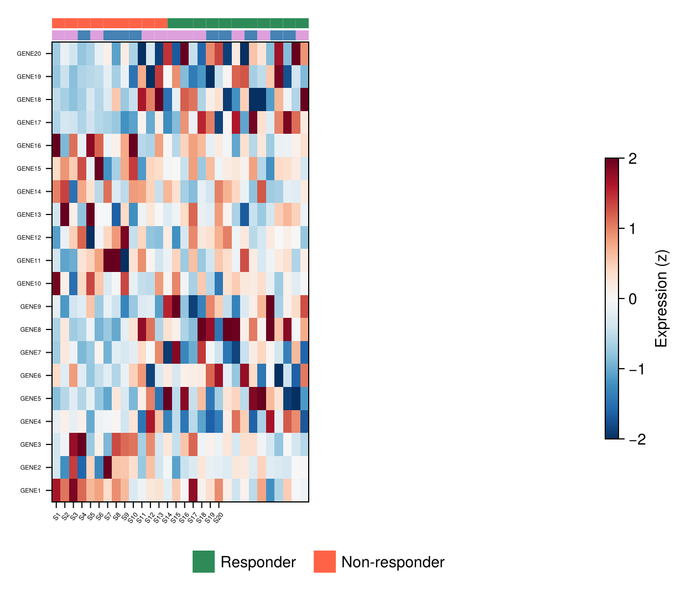

The Julia answer to R's ComplexHeatmap: a clustered expression matrix with sample-annotation color strips, assembled from a GridLayout that stacks thin annotation axes above the heatmap and a shared `Colorbar` beside it. No extra package is needed — `heatmap!`, a few categorical `poly!` strips, and Makie's layout system.

## Example

{fig-align="center" width="80%"}

## Setup

- System Requirements: Cross-platform (Linux/MacOS/Windows)
- Programming Language: **Julia**
- Dependencies: `CairoMakie`, `DataFrames`, `Statistics`

```{julia}
#| label: packages-setup
#| output: false
using CairoMakie
using DataFrames
using Statistics
using Random
```

## Data Preparation

We simulate a 30-gene × 20-sample expression matrix with two expression programmes plus cohort and sex sample annotations, z-scaled per gene, and order samples by cohort so the programmes align with the annotation strips.

```{julia}
#| label: data-prep
Random.seed!(181)

genes = ["GENE$i" for i in 1:30]
samples = ["S$i" for i in 1:20]
cohort = rand(["Responder", "Non-responder"], 20)
sex = rand(["F", "M"], 20)

expr = vcat(hcat(1.4 .* randn(10, 10) .+ 1.0, 0.5 .* randn(10, 10)),
            hcat(0.5 .* randn(20, 10), 1.2 .* randn(20, 10)))
expr = (expr .- mean(expr; dims = 2)) ./ std(expr; dims = 2)

perm = sortperm(cohort)                    # group samples by cohort
mat = expr[:, perm]
cohort_o = cohort[perm]
sex_o = sex[perm]
cohort_colors = Dict("Responder" => :seagreen, "Non-responder" => :tomato)
sex_colors = Dict("F" => :plum, "M" => :steelblue)
```

## Visualization

### Annotation Strips and Matrix

Two thin axes hold the categorical strips; each sample is one coloured cell drawn as a `poly!` rectangle. The strips share the heatmap's column geometry.

```{julia}
#| label: fig-jl-heatmap-strips
#| fig-cap: "Expression matrix with cohort and sex annotation strips"
#| width: 560
fig = Figure(size = (600, 480))
gd = fig[1, 1] = GridLayout()

coh_ax = Axis(gd[1, 1]; xticks = Int[])
sex_ax = Axis(gd[2, 1]; xticks = Int[])
main_ax = Axis(gd[3, 1]; yticks = (1:30, genes), yticklabelsize = 6,
               xticklabelsvisible = false)
hm = heatmap!(main_ax, mat; colormap = Reverse(:RdBu), colorrange = (-2, 2))
for (i, c) in enumerate(cohort_o)
    poly!(coh_ax, Rect2f(i - 0.5, -0.5, 1.0, 1.0);
          color = cohort_colors[c], strokewidth = 0)
end
for (i, s) in enumerate(sex_o)
    poly!(sex_ax, Rect2f(i - 0.5, -0.5, 1.0, 1.0);
          color = sex_colors[s], strokewidth = 0)
end
rowsize!(gd, 1, 10); rowsize!(gd, 2, 10)
colgap!(gd, 1); rowgap!(gd, 1)
hidespines!(coh_ax); hidespines!(sex_ax)
fig
```

### Full Layout with Legend and Colorbar

The polished version adds sample column labels, a legend for the annotation tracks, and one shared `Colorbar` for the expression scale.

```{julia}
#| label: fig-jl-heatmap-full
#| fig-cap: "Complete annotated heatmap layout with legend and colorbar"
#| width: 620
fig = Figure(size = (620, 540))
gd = fig[1, 1] = GridLayout()

coh_ax = Axis(gd[1, 1]; xticks = Int[])
sex_ax = Axis(gd[2, 1]; xticks = Int[])
main_ax = Axis(gd[3, 1]; yticks = (1:30, genes), yticklabelsize = 5.5,
               xticks = (1:20, samples), xticklabelsize = 6,
               xticklabelrotation = 0.9)
hm = heatmap!(main_ax, mat; colormap = Reverse(:RdBu), colorrange = (-2, 2))
for (i, c) in enumerate(cohort_o)
    poly!(coh_ax, Rect2f(i - 0.5, -0.5, 1.0, 1.0);
          color = cohort_colors[c], strokewidth = 0)
end
for (i, s) in enumerate(sex_o)
    poly!(sex_ax, Rect2f(i - 0.5, -0.5, 1.0, 1.0);
          color = sex_colors[s], strokewidth = 0)
end
rowsize!(gd, 1, 10); rowsize!(gd, 2, 10)
colgap!(gd, 1); rowgap!(gd, 1)
Colorbar(fig[1, 2], hm; height = Relative(0.5),
         label = "Expression (z)")
Legend(gd[4, 1:2],
       [PolyElement(polycolor = cohort_colors[c]) for c in
        ["Responder", "Non-responder"]],
       ["Responder", "Non-responder"]; orientation = :horizontal,
       framevisible = false, tellheight = true)
hidespines!(coh_ax); hidespines!(sex_ax)
fig
```

## References

1. Makie development team. Makie.jl documentation — layouts. https://docs.makie.org/stable/tutorials/layout-tutorial
2. Gu, Z., Eils, R., & Schlesner, M. (2016). Complex heatmaps reveal patterns and correlations in multidimensional genomic data. *Bioinformatics*, 32(18), 2847-2849.
