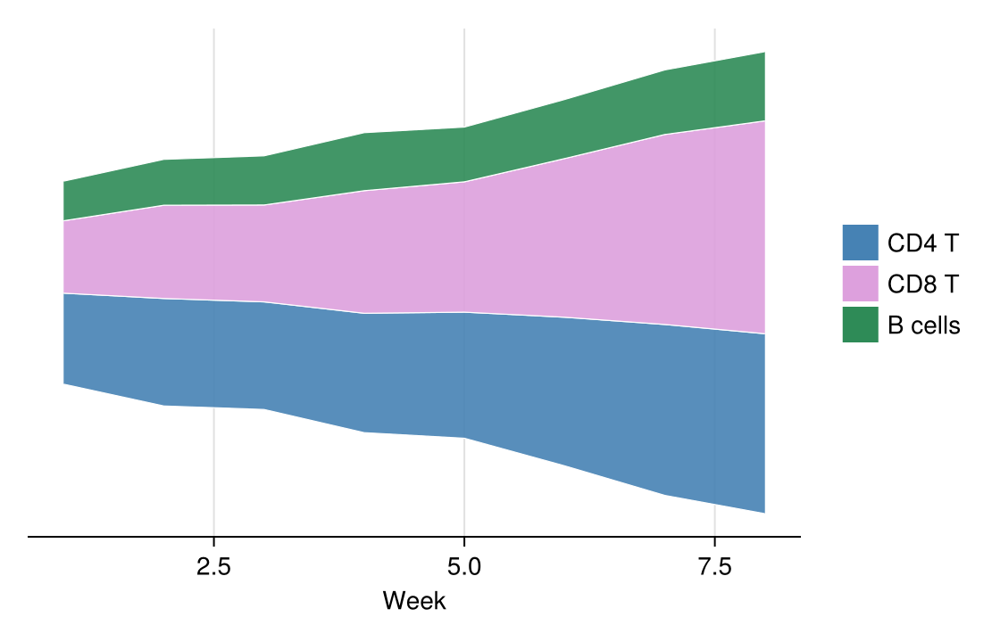

面积图通过填充折线下的区域，强调一个或多个量随有序轴变化的规模；堆叠变体把总量分解为多层，河流图（streamgraph）则将各层围绕波动基线堆叠。在生物医学研究中，适用于免疫细胞群动态与队列累积。`CairoMakie` 通过 `band!` 图层组合而成。

## 示例

{fig-align="center" width="80%"}

## 环境配置

- 系统要求：跨平台（Linux/MacOS/Windows）
- 编程语言：**Julia**
- 依赖包：`CairoMakie`、`DataFrames`、`Statistics`

```{julia}
#| label: packages-setup
#| output: false
using CairoMakie
using DataFrames
using Statistics
using Random
```

## 数据准备

我们模拟一项 8 周疫苗接种研究中三种淋巴细胞群的每周流式计数。

```{julia}
#| label: data-prep
Random.seed!(71)

weeks = collect(1.0:8)
n_weeks = length(weeks)
counts = DataFrame(
    Week = weeks,
    CD4 = 400 .* exp.(0.10 .* weeks) .+ 25 .* randn(n_weeks),
    CD8 = 300 .* exp.(0.16 .* weeks) .+ 22 .* randn(n_weeks),
    B = 200 .* exp.(0.06 .* weeks) .+ 15 .* randn(n_weeks))
series = [counts.CD4, counts.CD8, counts.B]
series_names = ["CD4 T", "CD8 T", "B cells"]
band_colors = [:steelblue, :plum, :seagreen]
```

## 可视化

### 单序列面积图

`band!` 填充上下界之间的区域——单个序列的最简强调形式。

```{julia}
#| label: fig-jl-area-single
#| fig-cap: "整个接种周期的 CD8 T 细胞计数"
#| width: 480
fig = Figure(size = (460, 340))
ax = Axis(fig[1, 1], xlabel = "Week", ylabel = "Cell count (×10\$^3\$)")
band!(ax, counts.Week, zero(weeks), counts.CD8; color = (:plum, 0.45))
lines!(ax, counts.Week, counts.CD8; color = :magenta3, linewidth = 1.8)
hidespines!(ax, :t, :r)
fig
```

### 堆叠面积图

累加和定义各层边界；自下而上绘制并以白色描边保持层间分隔。

```{julia}
#| label: fig-jl-area-stacked
#| fig-cap: "各研究周次的淋巴细胞堆叠计数"
#| width: 520
upper = reduce(hcat, series) |> x -> cumsum(x, dims = 2)   # n_weeks × 3
lower = hcat(zeros(n_weeks), upper[:, 1:end-1])

fig = Figure(size = (500, 360))
ax = Axis(fig[1, 1], xlabel = "Week", ylabel = "Cell count (×10\$^3\$)")
for k in 1:3
    band!(ax, counts.Week, lower[:, k], upper[:, k];
          color = (band_colors[k], 0.85), strokecolor = :white, strokewidth = 0.6)
end
hidespines!(ax, :t, :r)
elements = [PolyElement(polycolor = band_colors[k]) for k in 1:3]
Legend(fig[1, 2], elements, series_names, framevisible = false)
fig
```

### 河流图

河流图把整个堆叠围绕对称基线偏移，让视线追随各色带的形状而非零线。

```{julia}
#| label: fig-jl-area-stream
#| fig-cap: "淋巴细胞构成的河流图（对称基线）"
#| width: 560
total = vec(sum(reduce(hcat, series), dims = 2))
baseline = .-total ./ 2            # 对称基线使堆叠居中

fig = Figure(size = (560, 360))
ax = Axis(fig[1, 1], xlabel = "Week",
          ylabel = "Cell count (×10\$^3\$, offset baseline)")
for k in 1:3
    band!(ax, counts.Week, baseline .+ (k == 1 ? 0.0 : sum(series[1:k-1]; dims = 1)[1]),
          baseline .+ sum(series[1:k]; dims = 1)[1];
          color = (band_colors[k], 0.9), strokecolor = :white, strokewidth = 0.6)
end
hidespines!(ax, :t, :r, :l)
hideydecorations!(ax)
elements = [PolyElement(polycolor = band_colors[k]) for k in 1:3]
Legend(fig[1, 2], elements, series_names, framevisible = false)
fig
```

## 参考文献

1. Makie development team. Makie.jl documentation — band. https://docs.makie.org/stable/reference/plots/band
2. Danisch, S., & Krumbiegel, J. (2021). Makie.jl: Flexible high-performance data visualization for Julia. *Journal of Open Source Software*, 6(65), 3349.
