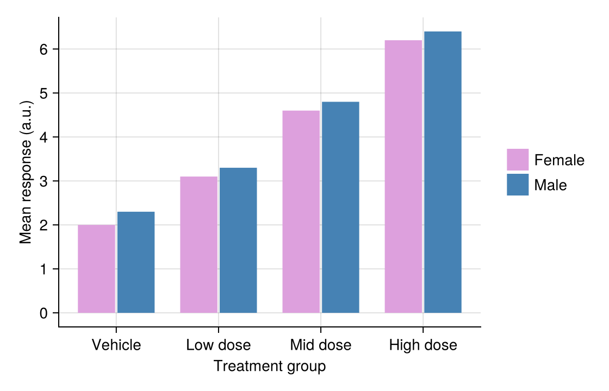

A bar plot compares quantities across discrete categories by their height. In biomedical research, bar plots are ubiquitous for reporting mean responses across treatment groups, cell-type composition per sample, and cohort summaries. Julia's `CairoMakie` provides grouped (`dodge`) and stacked (`stack`) bar variants with publication-quality vector output.

## Example

{fig-align="center" width="80%"}

## Setup

- System Requirements: Cross-platform (Linux/MacOS/Windows)
- Programming Language: **Julia**
- Dependencies: `CairoMakie`, `DataFrames`, `Statistics`

```{julia}
#| label: packages-setup
#| output: false
using CairoMakie
using DataFrames
using Statistics
using Random
```

## Data Preparation

We simulate a drug-dose response experiment (four groups, replicate measurements) and a cell-type composition matrix (six samples).

```{julia}
#| label: data-prep
Random.seed!(42)

groups = ["Vehicle", "Low dose", "Mid dose", "High dose"]
n_per_group = 40
raw = DataFrame(
    Group = repeat(groups, inner = n_per_group),
    Response = vcat(
        2.0 .+ 0.9 .* randn(n_per_group),
        3.1 .+ 0.9 .* randn(n_per_group),
        4.6 .+ 0.9 .* randn(n_per_group),
        6.2 .+ 0.9 .* randn(n_per_group),
    ),
)

agg = combine(groupby(raw, :Group),
              :Response => mean => :Mean, :Response => std => :SD,
              :Response => (x -> std(x) / sqrt(length(x))) => :SEM)

# Cell-type composition per sample (columns sum to 1)
comp = rand(4, 6)
comp ./= sum(comp, dims = 1)
cell_types = ["T cells", "B cells", "Macrophages", "NK cells"]
samples = ["S$i" for i in 1:6]
```

## Visualization

### Basic Bar Plot with Error Bars

When bar heights summarize grouped measurements, always attach an error bar (SEM or 95% CI) with `errorbars!`.

```{julia}
#| label: fig-jl-bar-basic
#| fig-cap: "Bar plot of mean response by dose group with SEM error bars"
#| width: 520
fig = Figure(size = (480, 340))
ax = Axis(fig[1, 1], xlabel = "Treatment group", ylabel = "Mean response (a.u.)")
barplot!(ax, 1:4, agg.Mean; color = :slateblue, gap = 0.35)
errorbars!(ax, 1:4, agg.Mean, agg.SEM; linewidth = 1.2, whiskerwidth = 8)
ax.xticks = (1:4, groups)
hidespines!(ax, :t, :r)
fig
```

### Grouped Bar Plot

A second factor is mapped to the `dodge` keyword, producing side-by-side bars within each category.

```{julia}
#| label: fig-jl-bar-grouped
#| fig-cap: "Grouped bar plot with a second experimental factor"
#| width: 560
Random.seed!(43)
heights = vec([2.0, 2.3, 3.1, 3.3, 4.6, 4.8, 6.2, 6.4])
grp = repeat(1:4, inner = 2)          # category id per bar
sex_ids = repeat(1:2, 4)              # sub-group id per bar
sex_colors = [:plum, :steelblue]

fig = Figure(size = (540, 340))
ax = Axis(fig[1, 1], xlabel = "Treatment group", ylabel = "Mean response (a.u.)")
barplot!(ax, grp, heights; dodge = sex_ids, color = sex_colors[sex_ids], gap = 0.25)
ax.xticks = (1:4, groups)
labels = ["Female", "Male"]
elements = [PolyElement(polycolor = sex_colors[i]) for i in 1:2]
Legend(fig[1, 2], elements, labels, framevisible = false)
hidespines!(ax, :t, :r)
fig
```

### Stacked Bar Plot

The `stack` keyword piles sub-group values on one bar — the standard display for per-sample composition.

```{julia}
#| label: fig-jl-bar-stacked
#| fig-cap: "Stacked bar plot of cell-type composition per sample"
#| width: 560
n_types, n_samples = size(comp)
heights = vec(comp)                    # bar-major order
stack_ids = repeat(1:n_types, n_samples)
cat_ids = repeat(1:n_samples, inner = n_types)
type_colors = [:teal, :steelblue, :salmon, :olivedrab]

fig = Figure(size = (560, 340))
ax = Axis(fig[1, 1], xlabel = "Sample", ylabel = "Cell fraction")
barplot!(ax, cat_ids, heights; stack = stack_ids,
         color = type_colors[stack_ids], gap = 0.15)
ax.xticks = (1:6, samples)
elements = [PolyElement(polycolor = type_colors[i]) for i in 1:n_types]
Legend(fig[1, 2], elements, cell_types, framevisible = false)
hidespines!(ax, :t, :r)
fig
```

## References

1. Makie development team. Makie.jl documentation — barplot. https://docs.makie.org/stable/reference/plots/barplot
2. Danisch, S., & Krumbiegel, J. (2021). Makie.jl: Flexible high-performance data visualization for Julia. *Journal of Open Source Software*, 6(65), 3349.
