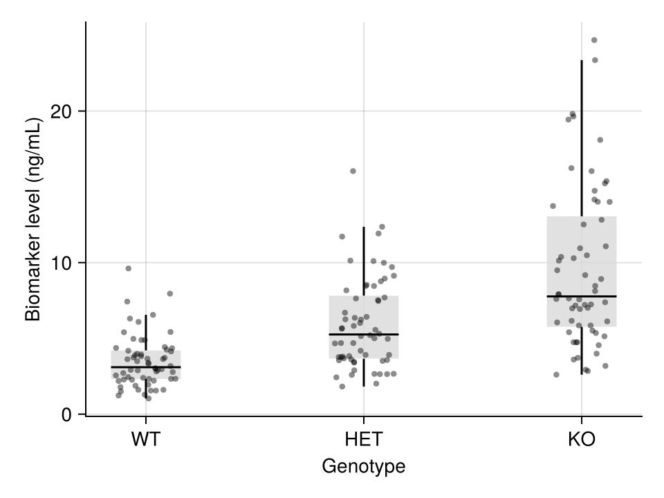

A box plot summarizes the distribution of a numeric variable through its median, quartiles, and outliers. In biomedical research, box plots are the standard compact display for comparing biomarker levels across genotypes, batches, or treatment arms. `CairoMakie` provides box plots with jittered-point overlays for the publication-recommended "show the data" style.

## Example

{fig-align="center" width="80%"}

## Setup

- System Requirements: Cross-platform (Linux/MacOS/Windows)
- Programming Language: **Julia**
- Dependencies: `CairoMakie`, `DataFrames`, `Statistics`

```{julia}
#| label: packages-setup
#| output: false
using CairoMakie
using DataFrames
using Statistics
using Random
```

## Data Preparation

We simulate a serum biomarker assay across three genotypes (WT, HET, KO) with 60 replicates each, including a few extreme values in KO to demonstrate outlier display.

```{julia}
#| label: data-prep
Random.seed!(7)

genotypes = ["WT", "HET", "KO"]
n_per_genotype = 60
values = vcat(
    exp.(1.2 .+ 0.45 .* randn(n_per_genotype)),
    exp.(1.55 .+ 0.45 .* randn(n_per_genotype)),
    exp.(1.95 .+ 0.55 .* randn(n_per_genotype)),
)
values[end-2:end] .*= 3.5            # extreme values in KO
df = DataFrame(Genotype = repeat(genotypes, inner = n_per_genotype),
               Biomarker = values)
```

## Visualization

### Basic Box Plot

The box spans the interquartile range (IQR), the line marks the median, and whiskers extend to 1.5 × IQR; points beyond are drawn as outliers.

```{julia}
#| label: fig-jl-box-basic
#| fig-cap: "Box plot of serum biomarker across genotypes"
#| width: 480
fig = Figure(size = (440, 340))
ax = Axis(fig[1, 1], xlabel = "Genotype", ylabel = "Biomarker level (ng/mL)")
boxplot!(ax, fill(1, n_per_genotype), df.Biomarker[df.Genotype .== "WT"]; width = 0.5, color = :slateblue)
boxplot!(ax, fill(2, n_per_genotype), df.Biomarker[df.Genotype .== "HET"]; width = 0.5, color = :slateblue)
boxplot!(ax, fill(3, n_per_genotype), df.Biomarker[df.Genotype .== "KO"]; width = 0.5, color = :slateblue)
ax.xticks = (1:3, genotypes)
hidespines!(ax, :t, :r)
fig
```

### Box Plot with Jittered Points

Because a box hides the raw data, overlaying the individual observations is the publication-recommended style: a light box plus a `scatter!` layer with random x jitter.

```{julia}
#| label: fig-jl-box-points
#| fig-cap: "Box plots overlaid with individual data points"
#| width: 480
fig = Figure(size = (440, 340))
ax = Axis(fig[1, 1], xlabel = "Genotype", ylabel = "Biomarker level (ng/mL)")
for (i, g) in enumerate(genotypes)
    v = df.Biomarker[df.Genotype .== g]
    boxplot!(ax, fill(i, length(v)), v; width = 0.4,
             color = (:gray85, 0.8), show_outliers = false)
    jitter = i .+ 0.28 .* (rand(length(v)) .- 0.5)
    scatter!(ax, jitter, v; color = (:black, 0.45), markersize = 6)
end
ax.xticks = (1:3, genotypes)
hidespines!(ax, :t, :r)
fig
```

### Horizontal Box Plot

Long category labels read better in the horizontal orientation (`orientation = :horizontal`).

```{julia}
#| label: fig-jl-box-horizontal
#| fig-cap: "Horizontal box plot with long category labels"
#| width: 520
fig = Figure(size = (500, 300))
ax = Axis(fig[1, 1], xlabel = "Biomarker level (ng/mL)", ylabel = "Genotype")
for (i, g) in enumerate(genotypes)
    v = df.Biomarker[df.Genotype .== g]
    boxplot!(ax, fill(i, length(v)), v; orientation = :horizontal,
             width = 0.5, color = :olivedrab)
end
ax.yticks = (1:3, genotypes)
hidespines!(ax, :t, :r)
fig
```

## References

1. Makie development team. Makie.jl documentation — boxplot. https://docs.makie.org/stable/reference/plots/boxplot
2. Danisch, S., & Krumbiegel, J. (2021). Makie.jl: Flexible high-performance data visualization for Julia. *Journal of Open Source Software*, 6(65), 3349.
3. Spitzer, M., Wildenhain, J., Rappsilber, J., & Tyers, M. (2014). BoxPlotR: a web tool for generation of box plots. *Nature Methods*, 11(2), 121-122.
