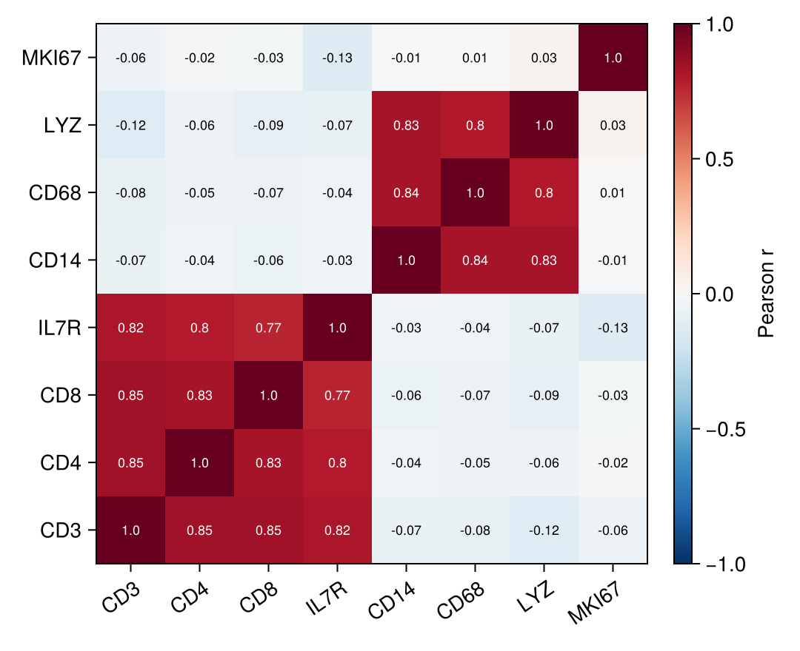

A correlogram (correlation matrix heatmap) encodes every pairwise correlation of a feature panel as a colored matrix cell, giving an instant read on co-expression blocks and redundant biomarkers. In biomedical research it is routine QC for marker panels. Julia's `Statistics.cor` computes the matrix and `CairoMakie.heatmap!` renders it, with cell values annotated via `text!`.

## Example

{fig-align="center" width="80%"}

## Setup

- System Requirements: Cross-platform (Linux/MacOS/Windows)
- Programming Language: **Julia**
- Dependencies: `CairoMakie`, `DataFrames`, `Statistics`

```{julia}
#| label: packages-setup
#| output: false
using CairoMakie
using DataFrames
using Statistics
using Random
```

## Data Preparation

We simulate an 8-marker immune panel with two correlated blocks (T-cell markers and myeloid markers) plus a weakly related proliferation score, then compute the Pearson matrix.

```{julia}
#| label: data-prep
Random.seed!(101)

n = 250
latent_t = randn(n)
latent_m = randn(n)
panel = DataFrame(
    CD3   = latent_t .+ 0.4 .* randn(n),
    CD4   = latent_t .+ 0.5 .* randn(n),
    CD8   = latent_t .+ 0.5 .* randn(n),
    IL7R  = latent_t .+ 0.6 .* randn(n),
    CD14  = latent_m .+ 0.4 .* randn(n),
    CD68  = latent_m .+ 0.5 .* randn(n),
    LYZ   = latent_m .+ 0.5 .* randn(n),
    MKI67 = randn(n))
markers = names(panel)
corr = Matrix(cor(Matrix(panel)))
```

## Visualization

### Annotated Correlation Heatmap

A diverging colormap reversed so red means positive, a fixed `colorrange` of ±1 for cross-study comparability, and one `text!` per cell keep the numbers readable.

```{julia}
#| label: fig-jl-corr-heatmap
#| fig-cap: "Marker-panel correlogram with annotated coefficients"
#| width: 560
fig = Figure(size = (540, 440))
ax = Axis(fig[1, 1]; xticks = (1:8, markers), yticks = (1:8, markers),
          xticklabelrotation = 0.6)
hm = heatmap!(ax, corr; colormap = Reverse(:RdBu), colorrange = (-1, 1))
for i in 1:8, j in 1:8
    text!(ax, j, i; text = string(round(corr[i, j]; digits = 2)),
          align = (:center, :center), fontsize = 9,
          color = abs(corr[i, j]) > 0.55 ? :white : :black)
end
Colorbar(fig[1, 2], hm; label = "Pearson r")
fig
```

### Lower-Triangle Correlogram

Masking the mirrored upper triangle with `NaN` removes the redundancy; `nan_color` keeps the empty cells invisible.

```{julia}
#| label: fig-jl-corr-masked
#| fig-cap: "Lower-triangle correlogram (upper triangle masked)"
#| width: 500
corr_masked = [i < j ? NaN : corr[i, j] for i in 1:8, j in 1:8]

fig = Figure(size = (460, 420))
ax = Axis(fig[1, 1]; xticks = (1:8, markers), yticks = (1:8, markers),
          xticklabelrotation = 0.6)
heatmap!(ax, corr_masked; colormap = Reverse(:RdBu), colorrange = (-1, 1),
         nan_color = :white)
for i in 1:8, j in 1:i
    text!(ax, j, i; text = string(round(corr[i, j]; digits = 2)),
          align = (:center, :center), fontsize = 9,
          color = abs(corr[i, j]) > 0.55 ? :white : :black)
end
hidespines!(ax)
fig
```

## References

1. Makie development team. Makie.jl documentation — heatmap. https://docs.makie.org/stable/reference/plots/heatmap
2. Danisch, S., & Krumbiegel, J. (2021). Makie.jl: Flexible high-performance data visualization for Julia. *Journal of Open Source Software*, 6(65), 3349.
