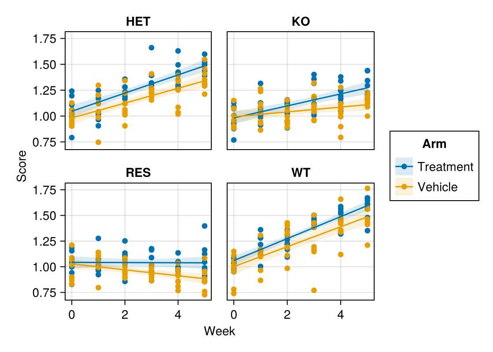

分面图把一个数据集按类别变量切分为面板网格，并让所有面板共享相同坐标轴——组间差异因此表现为形状差异而非刻度差异。Julia 中的语法图形层 **AlgebraOfGraphics** 用一个 `mapping` 组合分面规格，是最接近 ggplot 分面/seaborn `relplot` 的方案。

## 示例

{fig-align="center" width="80%"}

## 环境配置

- 系统要求：跨平台（Linux/MacOS/Windows）
- 编程语言：**Julia**
- 依赖包：`CairoMakie`、`AlgebraOfGraphics`、`DataFrames`、`Statistics`

```{julia}
#| label: packages-setup
#| output: false
using CairoMakie
using AlgebraOfGraphics
using DataFrames
using Statistics
using Random
```

## 数据准备

我们模拟一项纵向治疗研究的长格式数据——4 基因型 × 2 处理臂 × 6 周测量，每行一个观测。

```{julia}
#| label: data-prep
Random.seed!(201)

genotypes = ["WT", "HET", "KO", "RES"]
rates = Dict(g => 0.10 + 0.08 * (3 - i) for (i, g) in enumerate(genotypes))
rows = []
for geno in genotypes
    for arm in ["Vehicle", "Treatment"]
        rate = rates[geno] + (arm == "Treatment" ? 0.0 : -0.05)
        for mouse in 1:8, week in 0:5
            push!(rows, (Genotype = geno, Arm = arm, Week = week,
                         Score = 1 + 2.4 * rate * week / 5 + 0.12 * randn()))
        end
    end
end
long = DataFrame(rows)
```

## 可视化

### 分面轨迹

`mapping` 承载美学映射（`layout` 切分网格）；与平滑 `visual` 线层组合即可用一条流水线构建面板。

```{julia}
#| label: fig-jl-facet-line
#| fig-cap: "按基因型分面、按处理臂着色的响应轨迹"
#| width: 560
spec = data(long) * mapping(:Week, :Score, color = :Arm,
                            layout = :Genotype) *
       visual(Scatter) +
       data(long) * mapping(:Week, :Score, color = :Arm,
                            layout = :Genotype) * linear()

fg = draw(spec; figure = (size = (560, 400),))
fg
```

### 分布分面

同一语法更换图层即可得到直方图 + 密度分析；`mapping` 决定「用什么」，分析层决定「怎么画」。注意 `density` 需以限定名 `AlgebraOfGraphics.density()` 调用。

```{julia}
#| label: fig-jl-facet-hist
#| fig-cap: "末周评分分布按基因型分面"
#| width: 560
final = long[long.Week .== 5, :]

hist_spec = data(final) * mapping(:Score, layout = :Genotype, color = :Genotype) *
            histogram(bins = 14) +
            data(final) * mapping(:Score, layout = :Genotype, color = :Genotype) *
            AlgebraOfGraphics.density()

fg = draw(hist_spec; figure = (size = (560, 380),))
fg
```

## 参考文献

1. AlgebraOfGraphics development team. AlgebraOfGraphics.jl documentation. https://aog.makie.org/
2. Danisch, S., & Krumbiegel, J. (2021). Makie.jl: Flexible high-performance data visualization for Julia. *Journal of Open Source Software*, 6(65), 3349.
