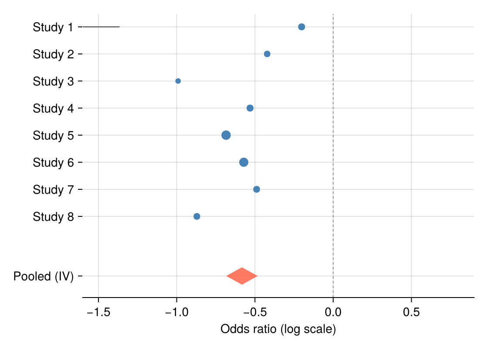

森林图把每项研究的效应估计画成带置信区间的标记，底部合并估计用菱形表达——meta 分析的标准展示。Julia 没有维护良好的森林图包，本教程用 `hlines!`、`scatter!` 与四点 `poly!` 菱形组装；合并估计用三行逆方差加权计算。

## 示例

{fig-align="center" width="80%"}

## 环境配置

- 系统要求：跨平台（Linux/MacOS/Windows）
- 编程语言：**Julia**
- 依赖包：`CairoMakie`、`DataFrames`、`Statistics`

```{julia}
#| label: packages-setup
#| output: false
using CairoMakie
using DataFrames
using Statistics
using Random
```

## 数据准备

我们模拟一项二分类终点 meta 分析的八项研究：log 优势比围绕 −0.5 波动、研究特异标准误不同，并用逆方差法计算合并估计。

```{julia}
#| label: data-prep
Random.seed!(151)

studies = DataFrame(Study = ["Study $i" for i in 1:8],
                    logOR = -0.5 .+ 0.22 .* randn(8),
                    SE = 0.08 .+ 0.12 .* rand(8))
studies.CI_low = studies.logOR .- 1.96 .* studies.SE
studies.CI_high = studies.logOR .+ 1.96 .* studies.SE
studies.Weight = 1 ./ studies.SE .^ 2
pooled_logOR = sum(studies.logOR .* studies.Weight) / sum(studies.Weight)
pooled_SE = sqrt(1 / sum(studies.Weight))
pooled = (logOR = pooled_logOR,
          low = pooled_logOR - 1.96 * pooled_SE,
          high = pooled_logOR + 1.96 * pooled_SE)
```

## 可视化

### 带合并菱形的森林图

标记面积随逆方差权重缩放；无效线（OR = 1）参考线与合并菱形构成完整布局。

```{julia}
#| label: fig-jl-forest-basic
#| fig-cap: "含逆方差合并菱形的 meta 分析森林图"
#| width: 560
y = collect(float.(range(nrow(studies), 1; step = -1)))
diamond_y = -1.2

fig = Figure(size = (560, 400))
ax = Axis(fig[1, 1], xlabel = "Odds ratio (log scale)")
hlines!(ax, y; xmin = studies.CI_low, xmax = studies.CI_high,
        color = :gray30, linewidth = 1.1)
scatter!(ax, studies.logOR, y;
         markersize = 6 .+ 10 .* studies.Weight ./ maximum(studies.Weight),
         color = :steelblue, strokewidth = 0.5, strokecolor = :white)
poly!(ax, Point2f[(pooled.low, diamond_y), (pooled.logOR, diamond_y + 0.32),
                  (pooled.high, diamond_y), (pooled.logOR, diamond_y - 0.32)];
      color = (:tomato, 0.85))
vlines!(ax, [0]; color = :gray55, linewidth = 0.9, linestyle = :dash)
ax.yticks = (vcat(y, [diamond_y]), vcat(studies.Study, ["Pooled (IV)"]))
xlims!(ax, -1.6, 0.9)
hidespines!(ax, :t, :r, :l)
fig
```

### 分亚组森林图

逐亚组标题加缩进研究可组织异质性证据；合并菱形移到布局底部。

```{julia}
#| label: fig-jl-forest-subgroup
#| fig-cap: "带亚组标题的森林图"
#| width: 560
studies.Subgroup = repeat(["Retrospective", "Prospective"]; inner = 4)

fig = Figure(size = (560, 440))
ax = Axis(fig[1, 1], xlabel = "Odds ratio (log scale)")
row = 0.0
yticks = Float64[]; ylabels = String[]
for subgroup in ["Retrospective", "Prospective"]
    text!(ax, 0, row; text = subgroup, fontsize = 12, font = :bold,
          align = (:left, :center))
    push!(yticks, row); push!(ylabels, "")
    row -= 1
    for s in eachrow(studies[studies.Subgroup .== subgroup, :])
        hlines!(ax, [row]; xmin = s.CI_low, xmax = s.CI_high,
                color = :gray30, linewidth = 1.1)
        scatter!(ax, [s.logOR], [row]; markersize = 9, color = :steelblue,
                 strokewidth = 0.5, strokecolor = :white)
        push!(yticks, row); push!(ylabels, s.Study)
        row -= 1
    end
    row -= 0.6
end
poly!(ax, Point2f[(pooled.low, row), (pooled.logOR, row + 0.3),
                  (pooled.high, row), (pooled.logOR, row - 0.3)];
      color = (:tomato, 0.85))
text!(ax, 0, row; text = "Pooled (IV)", fontsize = 12, font = :bold,
      align = (:left, :center))
push!(yticks, row); push!(ylabels, "")
vlines!(ax, [0]; color = :gray55, linewidth = 0.9, linestyle = :dash)
ax.yticks = (yticks, ylabels)
xlims!(ax, -1.6, 0.9)
hidespines!(ax, :t, :r, :l)
fig
```

## 参考文献

1. Bax, L., Yu, L. M., Ikeda, N., Tsuruta, H., & Moons, K. G. (2006). Development and validation of MIX: comprehensive free software for meta-analysis of causal research data. *BMC Medical Research Methodology*, 6, 50.
2. Danisch, S., & Krumbiegel, J. (2021). Makie.jl: Flexible high-performance data visualization for Julia. *Journal of Open Source Software*, 6(65), 3349.
