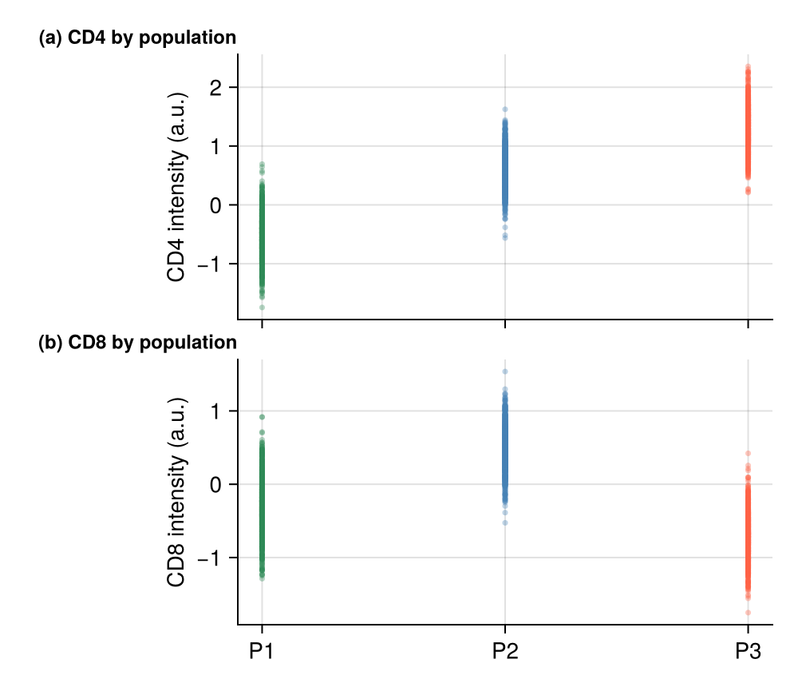

Journal figures are composites: lettered panels a–b–c assembled into one exported file, with aligned axes and shared legends. `CairoMakie`'s Figure + GridLayout system is its strongest feature — panels snap to grid cells, axes link with one call, and section labels are plain `Label` blocks placed in figure coordinates.

## Example

{fig-align="center" width="80%"}

## Setup

- System Requirements: Cross-platform (Linux/MacOS/Windows)
- Programming Language: **Julia**
- Dependencies: `CairoMakie`, `DataFrames`, `Statistics`

```{julia}
#| label: packages-setup
#| output: false
using CairoMakie
using DataFrames
using Statistics
using Random
using LinearAlgebra
```

## Data Preparation

We simulate a two-marker cytometry measurement with three populations, reused across the panel layouts.

```{julia}
#| label: data-prep
Random.seed!(211)

n = 3000
pop = rand(1:3, n)
centers = [(-0.5, -0.3), (0.6, 0.5), (1.3, -0.7)]
covs = [Float64[0.14 0.03; 0.03 0.12], Float64[0.10 -0.02; -0.02 0.09],
        Float64[0.12 0.01; 0.01 0.10]]
xy = zeros(n, 2)
for i in 1:n
    L = cholesky(Symmetric(covs[pop[i]])).L
    xy[i, :] = centers[pop[i]] .+ L * randn(2)
end
pop_names = ["P1", "P2", "P3"]
colors = [:seagreen, :steelblue, :tomato]
```

## Visualization

### Linked Two-Panel Composite

Row panels share the x-axis through `linkxaxes!`; panel letters are Makie `Label`s pinned to the figure grid — the journal convention.

```{julia}
#| label: fig-jl-grid-linked
#| fig-cap: "Two linked panels sharing the population ordering"
#| width: 520
fig = Figure(size = (500, 430))
ax_a = Axis(fig[1, 1]; ylabel = "CD4 intensity (a.u.)", xticklabelsvisible = false)
ax_b = Axis(fig[2, 1]; ylabel = "CD8 intensity (a.u.)")
for i in 1:3
    scatter!(ax_a, fill(i, count(==(i), pop)), view(xy, pop .== i, 1);
             markersize = 5, color = (colors[i], 0.35), strokewidth = 0)
    scatter!(ax_b, fill(i, count(==(i), pop)), view(xy, pop .== i, 2);
             markersize = 5, color = (colors[i], 0.35), strokewidth = 0)
end
linkxaxes!(ax_a, ax_b)
ax_a.xticks = 1:3; ax_b.xticks = (1:3, pop_names)
Label(fig[1, 1, TopLeft()], "(a) CD4 by population"; fontsize = 12, font = :bold,
      padding = (8, 0, 4, 0))
Label(fig[2, 1, TopLeft()], "(b) CD8 by population"; fontsize = 12, font = :bold,
      padding = (8, 0, 4, 0))
rowgap!(fig.layout, 2)
hidespines!(ax_a, :t, :r)
hidespines!(ax_b, :t, :r)
fig
```

### 2×2 Composite with a Spanning Title

Panels can span cells (`GridSpec`-style) and a column `Label` serves as the shared legend strip.

```{julia}
#| label: fig-jl-grid-spanning
#| fig-cap: "Four-panel composite with a spanning legend strip"
#| width: 560
fig = Figure(size = (560, 420))
fig[1, 1:2] = Label(fig, "Cytometry summary — 3 populations",
                    fontsize = 14, font = :bold, tellwidth = false)
for (i, marker) in enumerate(["CD4", "CD8"])
    ax = Axis(fig[2, i], title = marker, titlesize = 11)
    for p in 1:3
        subset = view(xy, pop .== p, i)
        hist!(ax, subset; bins = 25, normalization = :pdf,
              color = (colors[p], 0.5), strokewidth = 0)
    end
    hidespines!(ax, :t, :r)
end
elements = [PolyElement(polycolor = colors[p]) for p in 1:3]
Legend(fig[3, 1:2], elements, pop_names; orientation = :horizontal,
       framevisible = false, tellheight = true)
fig
```

## References

1. Makie development team. Makie.jl documentation — layouts. https://docs.makie.org/stable/tutorials/layout-tutorial
2. Danisch, S., & Krumbiegel, J. (2021). Makie.jl: Flexible high-performance data visualization for Julia. *Journal of Open Source Software*, 6(65), 3349.
