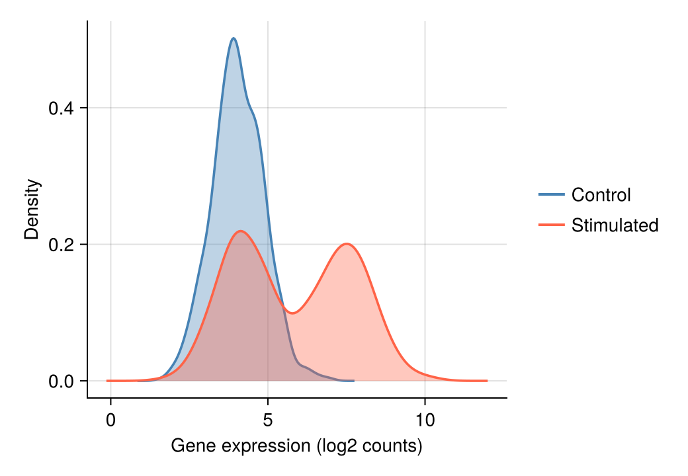

直方图与核密度估计（KDE）揭示分布的形状——众数、偏度和离散程度，这些是汇总统计量无法呈现的。在生物医学研究中，它们常用于在统计建模之前检查基因表达分布、荧光强度轮廓和质量控制指标。`CairoMakie` 以统一的风格提供 `hist`、`density` 与 `ecdfplot`。

## 示例

{fig-align="center" width="80%"}

## 环境配置

- 系统要求：跨平台（Linux/MacOS/Windows）
- 编程语言：**Julia**
- 依赖包：`CairoMakie`、`DataFrames`、`Statistics`

```{julia}
#| label: packages-setup
#| output: false
using CairoMakie
using DataFrames
using Statistics
using Random
```

## 数据准备

我们模拟一个基因在对照与刺激两种条件下的表达测量。刺激条件是两个细胞亚群的混合，产生直方图与 KDE 旨在揭示的双峰结构。

```{julia}
#| label: data-prep
Random.seed!(11)

n = 800
control = 4.0 .+ 0.8 .* randn(n)
stimulated = vcat(4.2 .+ 0.8 .* randn(n ÷ 2),     # 亚群 A
                  7.5 .+ 0.9 .* randn(n ÷ 2))     # 亚群 B
```

## 可视化

### 直方图

分箱宽度控制偏差–方差的权衡：分箱太少会隐藏结构，太多则放大噪声。拿不准时，可比较 `bins = 15` 与更细的分箱设置。

```{julia}
#| label: fig-jl-hist-basic
#| fig-cap: "模拟表达值的直方图"
#| width: 480
fig = Figure(size = (460, 340))
ax = Axis(fig[1, 1], xlabel = "Gene expression (log2 counts)", ylabel = "Count")
hist!(ax, control; bins = 30, color = :skyblue,
      strokecolor = :white, strokewidth = 0.6)
hidespines!(ax, :t, :r)
fig
```

### 直方图叠加核密度

在计数轴上叠加核密度曲线，既能勾勒分布轮廓，又保留了原始计数信息。

```{julia}
#| label: fig-jl-hist-kde
#| fig-cap: "直方图叠加核密度曲线"
#| width: 480
fig = Figure(size = (460, 340))
ax = Axis(fig[1, 1], xlabel = "Gene expression (log2 counts)", ylabel = "Count")
hist!(ax, control; bins = 30, color = :seagreen,
      strokecolor = :white, strokewidth = 0.6)
density!(ax, control; color = (:seagreen, 0.0), strokecolor = :darkgreen,
         strokewidth = 2, offset = 0)
hidespines!(ax, :t, :r)
fig
```

### 分组密度曲线比较

对于两组或多组数据，叠加半透明密度曲线可直接看出刺激样本的双峰特征。

```{julia}
#| label: fig-jl-kde-groups
#| fig-cap: "对照与刺激条件的密度曲线叠加"
#| width: 480
fig = Figure(size = (460, 340))
ax = Axis(fig[1, 1], xlabel = "Gene expression (log2 counts)", ylabel = "Density")
density!(ax, control; color = (:steelblue, 0.35), strokecolor = :steelblue, strokewidth = 1.8)
density!(ax, stimulated; color = (:tomato, 0.35), strokecolor = :tomato, strokewidth = 1.8)
hidespines!(ax, :t, :r)
Legend(fig[1, 2], [LineElement(color = :steelblue, linewidth = 2),
                   LineElement(color = :tomato, linewidth = 2)],
       ["Control", "Stimulated"], framevisible = false)
fig
```

### 经验累积分布函数

ECDF 无需分箱或平滑即可展示每个观测值，是审查队列间分布漂移的理想工具。

```{julia}
#| label: fig-jl-ecdf
#| fig-cap: "按条件分组经验累积分布函数"
#| width: 480
fig = Figure(size = (460, 340))
ax = Axis(fig[1, 1], xlabel = "Gene expression (log2 counts)", ylabel = "Proportion")
ecdfplot!(ax, control; color = :steelblue, linewidth = 2)
ecdfplot!(ax, stimulated; color = :tomato, linewidth = 2)
hidespines!(ax, :t, :r)
Legend(fig[1, 2], [LineElement(color = :steelblue, linewidth = 2),
                   LineElement(color = :tomato, linewidth = 2)],
       ["Control", "Stimulated"], framevisible = false)
fig
```

## 参考文献

1. Makie development team. Makie.jl documentation — hist, density, ecdfplot. https://docs.makie.org/stable/reference/plots/hist
2. Danisch, S., & Krumbiegel, J. (2021). Makie.jl: Flexible high-performance data visualization for Julia. *Journal of Open Source Software*, 6(65), 3349.
