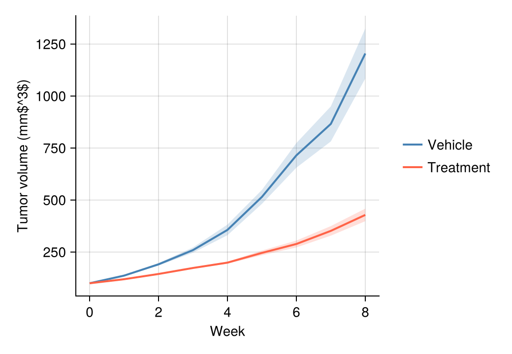

折线图展示连续变量沿有序轴（通常是时间）的趋势。在生物医学研究中，折线图是生长曲线、药代动力学轮廓和纵向组学时间序列的标准图形，通常在组均值周围附上不确定性带。`CairoMakie` 通过 `lines!`、`band!` 与 `scatter!` 原语组合折线图，并可精确控制图层顺序。

## 示例

{fig-align="center" width="80%"}

## 环境配置

- 系统要求：跨平台（Linux/MacOS/Windows）
- 编程语言：**Julia**
- 依赖包：`CairoMakie`、`DataFrames`、`Statistics`

```{julia}
#| label: packages-setup
#| output: false
using CairoMakie
using DataFrames
using Statistics
using Random
```

## 数据准备

我们模拟一项临床前肿瘤生长实验：两个处理臂（Vehicle 与 Treatment）各 12 只小鼠，连续 8 周每周测量一次，采用带小鼠间变异的两相指数生长模型。

```{julia}
#| label: data-prep
Random.seed!(21)

weeks = 0.0:8
n_mice = 12
arms = Dict("Vehicle" => 0.32, "Treatment" => 0.18)
curves = Dict{String, Matrix{Float64}}()
for (arm, rate) in arms
    curves[arm] = [100 * exp(rate * (1 + 0.08 * randn()) * w) for m in 1:n_mice, w in weeks]
end
arm_colors = Dict("Vehicle" => :steelblue, "Treatment" => :tomato)
```

## 可视化

### 基础折线图

先聚合再绘图：每组一条线并配以不同 marker，使小型汇总图保持易读。

```{julia}
#| label: fig-jl-line-basic
#| fig-cap: "两个处理臂每周的平均肿瘤体积"
#| width: 480
fig = Figure(size = (460, 340))
ax = Axis(fig[1, 1], xlabel = "Week", ylabel = "Tumor volume (mm\$^3\$)")
for (arm, mat) in curves
    lines!(ax, weeks, vec(mean(mat, dims = 1)); color = arm_colors[arm],
           linewidth = 2)
    scatter!(ax, weeks, vec(mean(mat, dims = 1)); color = arm_colors[arm],
             markersize = 10, marker = arm == "Vehicle" ? :circle : :rect)
end
hidespines!(ax, :t, :r)
Legend(fig[1, 2], [LineElement(color = :steelblue, linewidth = 2),
                   LineElement(color = :tomato, linewidth = 2)],
       ["Vehicle", "Treatment"], framevisible = false)
fig
```

### 带置信带的折线图

均值 ± 1.96 × SEM 的色带传达抽样不确定性；用 `band!` 绘制在均值线之下。

```{julia}
#| label: fig-jl-line-ci
#| fig-cap: "组均值及 ± 1.96 SEM 色带"
#| width: 480
fig = Figure(size = (460, 340))
ax = Axis(fig[1, 1], xlabel = "Week", ylabel = "Tumor volume (mm\$^3\$)")
for (arm, mat) in curves
    m = vec(mean(mat, dims = 1))
    sem = vec(std(mat, dims = 1)) ./ sqrt(n_mice)
    band!(ax, weeks, m .- 1.96 .* sem, m .+ 1.96 .* sem;
          color = (arm_colors[arm], 0.2))
    lines!(ax, weeks, m; color = arm_colors[arm], linewidth = 2)
end
hidespines!(ax, :t, :r)
Legend(fig[1, 2], [LineElement(color = :steelblue, linewidth = 2),
                   LineElement(color = :tomato, linewidth = 2)],
       ["Vehicle", "Treatment"], framevisible = false)
fig
```

### 意大利面条图叠加群体均值

将每个受试对象画为细线并置于加粗组均值之后，同时传达趋势与个体间变异。

```{julia}
#| label: fig-jl-line-spaghetti
#| fig-cap: "个体生长曲线（细线）与组均值（粗线）"
#| width: 480
fig = Figure(size = (460, 340))
ax = Axis(fig[1, 1], xlabel = "Week", ylabel = "Tumor volume (mm\$^3\$)")
for (arm, mat) in curves
    for m in 1:n_mice
        lines!(ax, weeks, mat[m, :]; color = (arm_colors[arm], 0.25), linewidth = 1)
    end
    lines!(ax, weeks, vec(mean(mat, dims = 1)); color = arm_colors[arm], linewidth = 2.6)
end
hidespines!(ax, :t, :r)
Legend(fig[1, 2], [LineElement(color = :steelblue, linewidth = 2.6),
                   LineElement(color = :tomato, linewidth = 2.6)],
       ["Vehicle", "Treatment"], framevisible = false)
fig
```

## 参考文献

1. Makie development team. Makie.jl documentation — lines, band. https://docs.makie.org/stable/reference/plots/lines
2. Danisch, S., & Krumbiegel, J. (2021). Makie.jl: Flexible high-performance data visualization for Julia. *Journal of Open Source Software*, 6(65), 3349.
