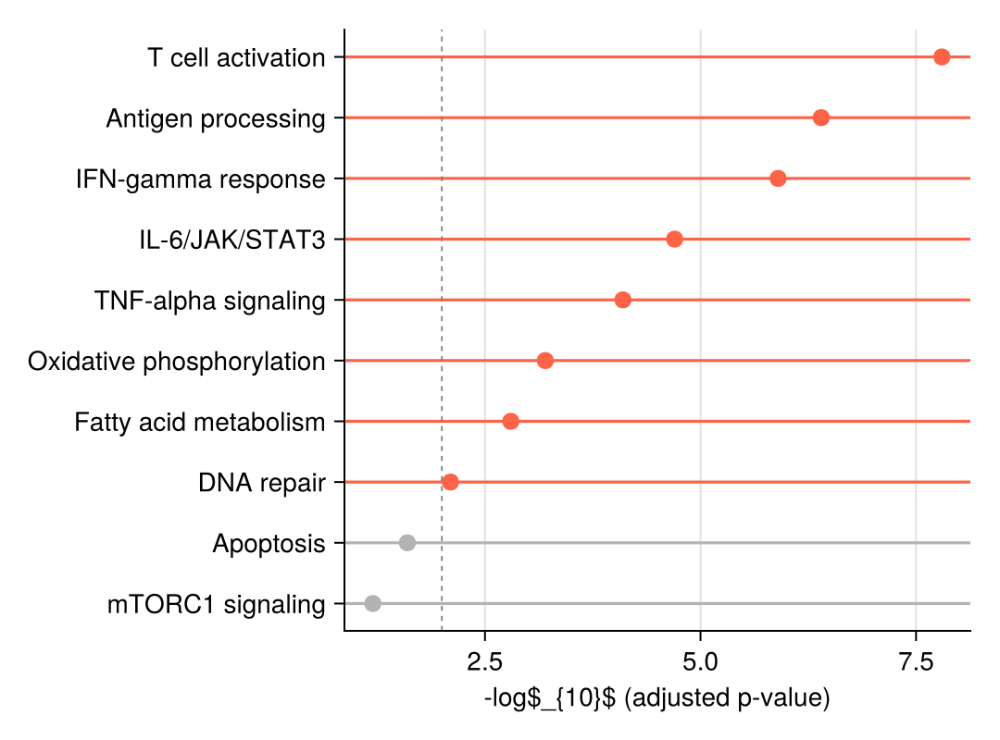

A lollipop plot replaces each bar of a bar chart with a thin line ending in a dot, cutting chart ink while keeping the ranking readable; a dumbbell plot connects two dots per row to expose the change between two conditions. In biomedical research, lollipops rank enrichment terms or effect sizes, and dumbbells compare two cohorts or treatment arms per feature. Both are assembled in `CairoMakie` from `lines!`/`line_segments!` and `scatter!`.

## Example

{fig-align="center" width="80%"}

## Setup

- System Requirements: Cross-platform (Linux/MacOS/Windows)
- Programming Language: **Julia**
- Dependencies: `CairoMakie`, `DataFrames`, `Statistics`

```{julia}
#| label: packages-setup
#| output: false
using CairoMakie
using DataFrames
using Statistics
using Random
```

## Data Preparation

We simulate a pathway-enrichment result (gene sets with −log10 adjusted p-values) and a two-condition differential-expression table used for the dumbbell.

```{julia}
#| label: data-prep
pathways = ["T cell activation", "Antigen processing", "IFN-gamma response",
            "IL-6/JAK/STAT3", "TNF-alpha signaling", "Oxidative phosphorylation",
            "Fatty acid metabolism", "DNA repair", "Apoptosis", "mTORC1 signaling"]
enrichment = DataFrame(Pathway = pathways,
                       NegLogFDR = [7.8, 6.4, 5.9, 4.7, 4.1, 3.2, 2.8, 2.1, 1.6, 1.2])
sort!(enrichment, :NegLogFDR)

dumbbell = DataFrame(Gene = ["CD274", "IFIT1", "CXCL10", "MKI67", "STAT1"],
                     Sham = [-0.3, 2.1, 2.8, 0.5, 1.9],
                     Treat = [1.4, 3.9, 4.6, -1.2, 3.3])
sort!(dumbbell, :Treat)
```

## Visualization

### Horizontal Lollipop Plot

Each row is one line segment (`linesegments!`) plus a marker (`scatter!`); significant terms are highlighted by colour with a threshold guide.

```{julia}
#| label: fig-jl-lollipop-basic
#| fig-cap: "Pathway enrichment ranked as a horizontal lollipop plot"
#| width: 560
y_pos = 1:nrow(enrichment)
sig = enrichment.NegLogFDR .>= 2
dot_colors = ifelse.(sig, :tomato, :gray70)

fig = Figure(size = (540, 400))
ax = Axis(fig[1, 1], xlabel = "-log\$_{10}\$ (adjusted p-value)")
hlines!(ax, y_pos; xmin = 0.0, xmax = enrichment.NegLogFDR,
        color = dot_colors, linewidth = 1.6)
scatter!(ax, enrichment.NegLogFDR, y_pos; color = dot_colors, markersize = 13)
vlines!(ax, [2]; color = :gray50, linestyle = :dash, linewidth = 0.9)
ax.yticks = (y_pos, enrichment.Pathway)
hidespines!(ax, :t, :r)
fig
```

### Vertical Lollipop Plot

The same construction rotated with `vlines!` suits short labels and slide-friendly figures.

```{julia}
#| label: fig-jl-lollipop-vertical
#| fig-cap: "Vertical lollipop plot of the top enrichment scores"
#| width: 560
top8 = enrichment[end-7:end, :]

fig = Figure(size = (540, 380))
ax = Axis(fig[1, 1], ylabel = "-log\$_{10}\$ (adjusted p-value)")
x_pos = 1:nrow(top8)
vlines!(ax, x_pos; ymin = 0.0, ymax = top8.NegLogFDR,
        color = :steelblue, linewidth = 1.6)
scatter!(ax, x_pos, top8.NegLogFDR; color = :steelblue, markersize = 13)
ax.xticks = (x_pos, top8.Pathway)
ax.xticklabelrotation = 0.7
hidespines!(ax, :t, :r)
fig
```

### Dumbbell Plot

For each feature, a connecting line spans the two condition values; dots at both ends and a colour per condition make direction and magnitude of change legible.

```{julia}
#| label: fig-jl-dumbbell
#| fig-cap: "Dumbbell plot comparing log2 fold changes between two conditions"
#| width: 560
y = 1:nrow(dumbbell)

fig = Figure(size = (540, 380))
ax = Axis(fig[1, 1], xlabel = "log\$_{2}\$ fold change")
hlines!(ax, y; xmin = min.(dumbbell.Sham, dumbbell.Treat),
        xmax = max.(dumbbell.Sham, dumbbell.Treat),
        color = :gray70, linewidth = 2)
scatter!(ax, dumbbell.Sham, y; color = :steelblue, markersize = 13, label = "Sham")
scatter!(ax, dumbbell.Treat, y; color = :tomato, markersize = 13, label = "Treatment")
vlines!(ax, [0]; color = :gray40, linewidth = 0.9)
axislegend(ax; framevisible = false, position = :rb)
ax.yticks = (y, dumbbell.Gene)
hidespines!(ax, :t, :r)
fig
```

## References

1. Makie development team. Makie.jl documentation — linesegments, scatter. https://docs.makie.org/stable/reference/plots/linesegments
2. From Data to Viz. Lollipop plot. https://www.data-to-viz.com/graph/lollipop.html
