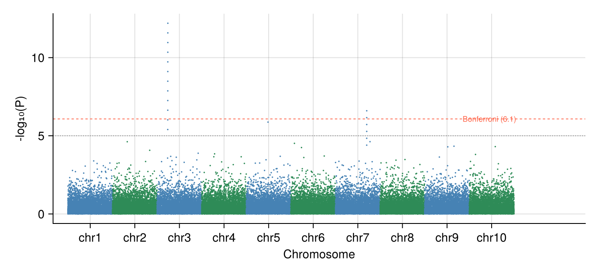

A Manhattan plot lines up variants along the genome (x = chromosome position, y = −log10 p) so association peaks rise above the null skyline; the QQ plot compares the observed p distribution with uniform expectation. Julia has no maintained Manhattan helper, so the plot is assembled from two `scatter!` layers with per-chromosome cumulative offsets.

## Example

{fig-align="center" width="80%"}

## Setup

- System Requirements: Cross-platform (Linux/MacOS/Windows)
- Programming Language: **Julia**
- Dependencies: `CairoMakie`, `DataFrames`, `Statistics`

```{julia}
#| label: packages-setup
#| output: false
using CairoMakie
using DataFrames
using Statistics
using Random
```

## Data Preparation

We simulate 60,000 SNPs over 10 chromosomes under the null (uniform p) and inject one association peak on chromosome 3 plus a smaller one on chromosome 7.

```{julia}
#| label: data-prep
Random.seed!(131)

snps_per_chr = 6_000
chr_n = 10
rows = []
for chr in 1:chr_n
    p = rand(snps_per_chr)                      # uniform under the null
    if chr == 3
        p[1500:1511] .= 10.0 .^ (-range(5.4, 12.2; length = 12))
    elseif chr == 7
        p[4200:4205] .= 10.0 .^ (-range(4.4, 6.6; length = 6))
    end
    push!(rows, DataFrame(CHR = chr,
                          POS = sort(rand(snps_per_chr) .* 6_000),
                          P = p))
end
gwas = vcat(rows...)
gwas.MinusLogP = .-log10.(gwas.P)

offsets = DataFrame(CHR = 1:chr_n, Off = (0:chr_n-1) .* 6_000)
pos_range = combine(groupby(gwas, :CHR),
                    :POS => minimum => :Min, :POS => maximum => :Max)
pos_range.PosMid = (pos_range.Min .+ pos_range.Max) ./ 2 .+ offsets.Off
gwas.PosCum = gwas.POS + [offsets.Off[c] for c in gwas.CHR]
BONF = -log10(0.05 / nrow(gwas))
SUGG = -log10(1e-5)
```

## Visualization

### Classic Manhattan Plot

Alternating per-chromosome colours keep neighbours separable; Bonferroni and suggestive thresholds run as horizontal guides.

```{julia}
#| label: fig-jl-manhattan
#| fig-cap: "Manhattan plot of the simulated GWAS with significance guides"
#| width: 700
chr_colors = [c % 2 == 1 ? :steelblue : :seagreen for c in gwas.CHR]

fig = Figure(size = (700, 320))
ax = Axis(fig[1, 1], xlabel = "Chromosome", ylabel = "-log₁₀(P)")
scatter!(ax, gwas.PosCum, gwas.MinusLogP; markersize = 2.4,
         color = chr_colors, strokewidth = 0)
hlines!(ax, [BONF]; color = :tomato, linestyle = :dash, linewidth = 0.9)
hlines!(ax, [SUGG]; color = :gray50, linestyle = :dot, linewidth = 0.9)
text!(ax, nrow(gwas) * 1.005, BONF; text = "Bonferroni ($(round(BONF; digits = 1)))",
      fontsize = 9, color = :tomato, align = (:right, :center))
ax.xticks = (pos_range.PosMid, ["chr$c" for c in pos_range.CHR])
xlims!(ax, -2_000, nrow(gwas) * 1.16)
hidespines!(ax, :t, :r)
fig
```

### QQ Plot with Inflation Factor

Ordered observed −log10 p against expected uniform quantiles; the median χ²-style ratio summarizes inflation (here ~1.0 by construction).

```{julia}
#| label: fig-jl-qq
#| fig-cap: "QQ plot of GWAS p-values"
#| width: 420
obs = sort(gwas.MinusLogP; rev = true)
m = length(obs)
expected = -log10.((1:m) ./ (m + 1))
inflation = median(-log.(10, gwas.P)) / median(-log.(10, rand(m))) # ≈ 1 under uniform p

fig = Figure(size = (430, 430))
ax = Axis(fig[1, 1], xlabel = "Expected -log₁₀(P)",
          ylabel = "Observed -log₁₀(P)")
scatter!(ax, expected, obs; markersize = 2.6, color = (:steelblue, 0.6),
         strokewidth = 0)
lim = maximum(expected) * 1.05
lines!(ax, [0, lim], [0, lim]; color = :gray40, linewidth = 0.9)
text!(ax, 0.08, lim * 0.93; text = "λ ≈ $(round(inflation; digits = 2))",
      fontsize = 11)
xlims!(ax, 0, lim); ylims!(ax, 0, lim)
hidespines!(ax, :t, :r)
fig
```

## References

1. Turner, S., et al. (2011). Quality Control for Population Association Studies. *PLoS Currents*, 3, RRN1222.
2. Danisch, S., & Krumbiegel, J. (2021). Makie.jl: Flexible high-performance data visualization for Julia. *Journal of Open Source Software*, 6(65), 3349.
