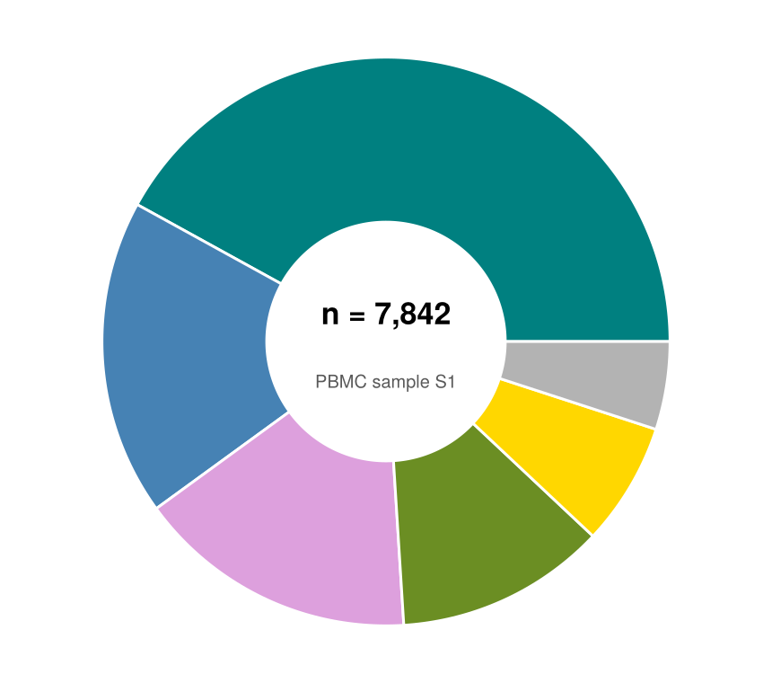

A pie chart shows part-of-whole composition as angular slices; a donut chart replaces the center with an annotation slot. In biomedical research they appear for sample/cohort composition summaries — with the standing caveat that readers judge angles poorly, so pies should stay under ~5 categories. `CairoMakie`'s native `pie` recipe supports both via `inner_radius`.

## Example

{fig-align="center" width="80%"}

## Setup

- System Requirements: Cross-platform (Linux/MacOS/Windows)
- Programming Language: **Julia**
- Dependencies: `CairoMakie`, `DataFrames`, `Statistics`

```{julia}
#| label: packages-setup
#| output: false
using CairoMakie
using DataFrames
using Statistics
using Random
```

## Data Preparation

We summarize the cell-type composition of one PBMC sample, ordered by abundance — always sort slices before drawing so the chart reads by rank.

```{julia}
#| label: data-prep
composition = DataFrame(
    CellType = ["T cells", "B cells", "Monocytes", "NK cells", "DC", "Other"],
    Fraction = [0.42, 0.18, 0.16, 0.12, 0.07, 0.05])
slice_colors = [:teal, :steelblue, :plum, :olivedrab, :gold, :gray70]
```

## Visualization

### Basic Pie Chart

The `pie` recipe normalizes the values; `strokecolor`/`strokewidth` separate adjacent slices.

```{julia}
#| label: fig-jl-pie-basic
#| fig-cap: "Cell-type composition of a PBMC sample as a pie chart"
#| width: 440
fig = Figure(size = (430, 380))
ax = Axis(fig[1, 1]; aspect = DataAspect())
pie!(ax, composition.Fraction; color = slice_colors,
     strokecolor = :white, strokewidth = 1.5)
hidespines!(ax)
hidedecorations!(ax)
fig
```

### Donut Chart with Center Annotation

`inner_radius` cuts the hole; the freed center is the natural place for the total (n cells or n patients) via `text!`.

```{julia}
#| label: fig-jl-donut-center
#| fig-cap: "Donut chart with the sample total annotated in the center"
#| width: 440
fig = Figure(size = (430, 380))
ax = Axis(fig[1, 1]; aspect = DataAspect())
pie!(ax, composition.Fraction; color = slice_colors, inner_radius = 0.42,
     strokecolor = :white, strokewidth = 1.5)
text!(ax, 0, 0.10; text = "n = 7,842", align = (:center, :center),
      fontsize = 17, font = :bold)
text!(ax, 0, -0.14; text = "PBMC sample S1", align = (:center, :center),
      fontsize = 10, color = :gray35)
hidespines!(ax)
hidedecorations!(ax)
fig
```

### Highlighted Slice with Legend

Colour emphasis (one saturated slice, the rest muted) and an outside legend keep the message on a single category without exploding wedges.

```{julia}
#| label: fig-jl-donut-highlight
#| fig-cap: "Donut chart highlighting one expanded cell type"
#| width: 520
emph = ifelse.(composition.CellType .== "DC", :skyblue3, :gray80)

fig = Figure(size = (520, 360))
ax = Axis(fig[1, 1]; aspect = DataAspect())
pie!(ax, composition.Fraction; color = emph, inner_radius = 0.42,
     strokecolor = :white, strokewidth = 1.5)
elements = [PolyElement(polycolor = slice_colors[i]) for i in 1:nrow(composition)]
Legend(fig[1, 2], elements, composition.CellType, framevisible = false)
hidespines!(ax)
hidedecorations!(ax)
fig
```

## References

1. Makie development team. Makie.jl documentation — pie. https://docs.makie.org/stable/reference/plots/pie
2. Danisch, S., & Krumbiegel, J. (2021). Makie.jl: Flexible high-performance data visualization for Julia. *Journal of Open Source Software*, 6(65), 3349.
