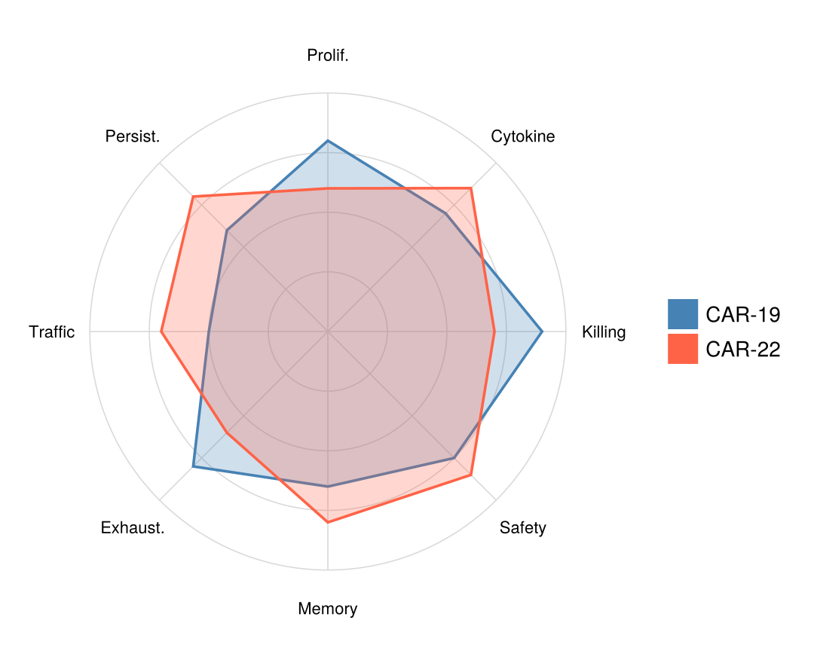

A radar (spider) plot profiles one or few samples across many comparable axes on polar coordinates — useful when each spoke is a score on the same 0–1 scale (immune signatures, facility QC panels), and misleading when scales differ. `CairoMakie` ships a `PolarAxis` block, but hand-projecting the spokes onto a cartesian axis keeps the outside labels fully under your control; the trigonometry is two lines.

## Example

{fig-align="center" width="80%"}

## Setup

- System Requirements: Cross-platform (Linux/MacOS/Windows)
- Programming Language: **Julia**
- Dependencies: `CairoMakie`, `DataFrames`, `Statistics`

```{julia}
#| label: packages-setup
#| output: false
using CairoMakie
using DataFrames
using Statistics
using Random
```

## Data Preparation

We score two CAR-T products on eight normalized (0–1) immune-function axes and convert them to spoke angles, closing the polygon by repeating the first point.

```{julia}
#| label: data-prep
axes_names = ["Killing", "Cytokine", "Prolif.", "Persist.",
              "Traffic", "Exhaust.", "Memory", "Safety"]
scores = DataFrame(
    Product = ["CAR-19", "CAR-22"],
    Values = [[0.9, 0.7, 0.8, 0.6, 0.5, 0.8, 0.65, 0.75],
              [0.7, 0.85, 0.6, 0.8, 0.7, 0.6, 0.8, 0.85]])
K = length(axes_names)
angles = [2π * k / K for k in 0:K]                 # first angle repeated
profile(v) = [v; v[1]]
xy(r, θ) = Point2f(r * cos(θ), r * sin(θ))
```

## Visualization

### Grid, Spokes, and a Single-Product Profile

Concentric guide rings, radial spokes, and axis labels are three small loops; the profile itself is one closed polygon.

```{julia}
#| label: fig-jl-radar-single
#| fig-cap: "Immune-function profile of the CAR-19 product"
#| width: 480
θ_grid = range(0, 2π; length = 181)
fig = Figure(size = (480, 440))
ax = Axis(fig[1, 1]; aspect = DataAspect())
for r in 0.25:0.25:1.0                                   # guide rings
    lines!(ax, [xy(r, θ) for θ in θ_grid]; color = :gray85, linewidth = 0.8)
end
for k in 1:K                                             # spokes + labels
    lines!(ax, [xy(0.0, angles[k]), xy(1.0, angles[k])];
           color = :gray85, linewidth = 0.8)
    text!(ax, xy(1.16, angles[k]); text = axes_names[k],
          align = (:center, :center), fontsize = 11)
end
poly!(ax, [xy(v, θ) for (v, θ) in zip(profile(scores.Values[1]), angles)];
      color = (:steelblue, 0.30), strokecolor = :steelblue, strokewidth = 1.8)
ax.xticks = []; ax.yticks = []
hidespines!(ax)
fig
```

### Two-Product Overlay

Two semi-transparent fills on the same spokes make trade-offs (killing vs persistence) immediately visible.

```{julia}
#| label: fig-jl-radar-overlay
#| fig-cap: "Immune-function profiles of two CAR-T products overlaid"
#| width: 540
θ_grid = range(0, 2π; length = 181)
fig = Figure(size = (540, 440))
ax = Axis(fig[1, 1]; aspect = DataAspect())
for r in 0.25:0.25:1.0
    lines!(ax, [xy(r, θ) for θ in θ_grid]; color = :gray85, linewidth = 0.8)
end
for k in 1:K
    lines!(ax, [xy(0.0, angles[k]), xy(1.0, angles[k])];
           color = :gray85, linewidth = 0.8)
    text!(ax, xy(1.16, angles[k]); text = axes_names[k],
          align = (:center, :center), fontsize = 11)
end
product_colors = [:steelblue, :tomato]
for (i, row) in enumerate(eachrow(scores))
    poly!(ax, [xy(v, θ) for (v, θ) in zip(profile(row.Values), angles)];
          color = (product_colors[i], 0.25),
          strokecolor = product_colors[i], strokewidth = 1.8)
end
elements = [PolyElement(polycolor = c) for c in product_colors]
Legend(fig[1, 2], elements, scores.Product, framevisible = false)
ax.xticks = []; ax.yticks = []
hidespines!(ax)
fig
```

## References

1. Makie development team. Makie.jl documentation — PolarAxis. https://docs.makie.org/stable/reference/blocks/polaraxis
2. Danisch, S., & Krumbiegel, J. (2021). Makie.jl: Flexible high-performance data visualization for Julia. *Journal of Open Source Software*, 6(65), 3349.
