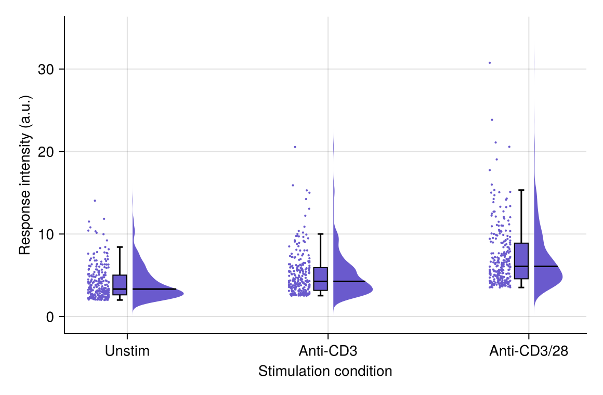

雨云图将半小提琴（「云」）、箱线图与抖动散点（「雨」）组合在一张图中，同时呈现完整分布、汇总统计量与单个观测值。在生物医学研究中，它已成为分组连续型数据条形图的首选替代方案——而 `CairoMakie` 将其作为单个原生 recipe 提供：`rainclouds`。

## 示例

{fig-align="center" width="80%"}

## 环境配置

- 系统要求：跨平台（Linux/MacOS/Windows）
- 编程语言：**Julia**
- 依赖包：`CairoMakie`、`DataFrames`、`Statistics`

```{julia}
#| label: packages-setup
#| output: false
using CairoMakie
using DataFrames
using Statistics
using Random
```

## 数据准备

我们模拟三种刺激条件下流式检测的响应强度，每个条件足够的细胞数使半小提琴轮廓具有信息量。

```{julia}
#| label: data-prep
Random.seed!(41)

conditions = ["Unstim", "Anti-CD3", "Anti-CD3/28"]
n_cells = 250
# 缩放指数分布样本模拟正值荧光强度
response = vcat(
    2.0 .- 2.0 .* log.(rand(n_cells)),
    2.5 .- 2.5 .* log.(rand(n_cells)),
    3.5 .- 3.5 .* log.(rand(n_cells)),
)
df = DataFrame(Condition = repeat(conditions, inner = n_cells),
               Response = response)
```

## 可视化

### 基础雨云图

一次 `rainclouds` 调用即可绘制云、箱与雨；`side` 控制小提琴相对散点的位置。

```{julia}
#| label: fig-jl-rain-basic
#| fig-cap: "各刺激条件响应强度的雨云图"
#| width: 560
fig = Figure(size = (540, 360))
ax = Axis(fig[1, 1], xlabel = "Stimulation condition",
          ylabel = "Response intensity (a.u.)")
rainclouds!(ax, df.Condition, df.Response; orientation = :vertical,
            side = :right, cloud_width = 0.6, gap = 0.15,
            jitter_width = 0.12, markersize = 3, color = :slateblue)
ax.xticks = (1:3, conditions)
hidespines!(ax, :t, :r)
fig
```

### 横向雨云图

类别标签较长时，横向布局（`orientation = :horizontal`）更易读，云朵悬挂在箱体一侧。

```{julia}
#| label: fig-jl-rain-horizontal
#| fig-cap: "长类别标签的横向雨云图"
#| width: 560
fig = Figure(size = (540, 320))
ax = Axis(fig[1, 1], xlabel = "Response intensity (a.u.)",
          ylabel = "Stimulation condition")
rainclouds!(ax, df.Condition, df.Response; orientation = :horizontal,
            side = :left, cloud_width = 0.6, gap = 0.15,
            jitter_width = 0.12, markersize = 3, color = :salmon)
ax.yticks = (1:3, conditions)
hidespines!(ax, :t, :r)
fig
```

### 直方图云

设置 `clouds = hist`（绘图函数对象）将平滑小提琴替换为堆叠的分箱计数，在较小样本量下能保留离散抽样的信息。

```{julia}
#| label: fig-jl-rain-hist
#| fig-cap: "直方图云的雨云图"
#| width: 560
fig = Figure(size = (540, 360))
ax = Axis(fig[1, 1], xlabel = "Stimulation condition",
          ylabel = "Response intensity (a.u.)")
rainclouds!(ax, df.Condition, df.Response; orientation = :vertical,
            side = :right, clouds = hist, hist_bins = 20,
            cloud_width = 0.6, gap = 0.15,
            jitter_width = 0.12, markersize = 3, color = :seagreen)
ax.xticks = (1:3, conditions)
hidespines!(ax, :t, :r)
fig
```

## 参考文献

1. Allen, M., Poggiali, D., Whitaker, K., et al. (2019). Raincloud plots: a multi-platform tool for robust data visualization. *Wellcome Open Research*, 4, 63.
2. Makie development team. Makie.jl documentation — rainclouds. https://docs.makie.org/stable/reference/plots/rainclouds
3. Danisch, S., & Krumbiegel, J. (2021). Makie.jl: Flexible high-performance data visualization for Julia. *Journal of Open Source Software*, 6(65), 3349.
