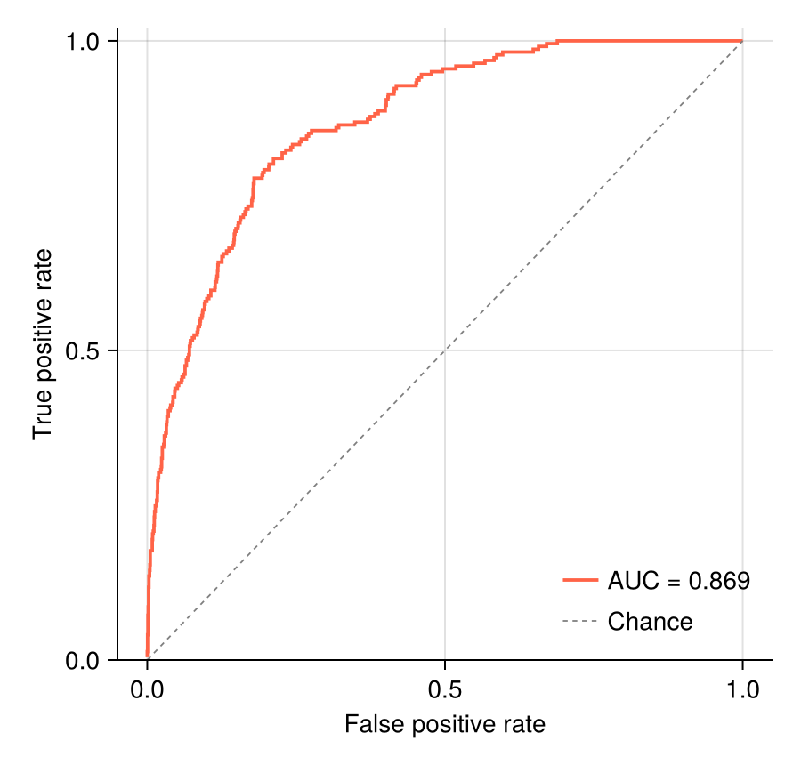

ROC 曲线在所有评分阈值上权衡灵敏度与（1 − 特异度），以 AUC 概括；PR 曲线从阳性类视角审视同一排序，在类别不平衡下是更诚实的展示。曲线本身就是一个阈值扫描——十五行基础 Julia 加 `CairoMakie` 即可完成。

## 示例

{fig-align="center" width="80%"}

## 环境配置

- 系统要求：跨平台（Linux/MacOS/Windows）
- 编程语言：**Julia**
- 依赖包：`CairoMakie`、`DataFrames`、`Statistics`

```{julia}
#| label: packages-setup
#| output: false
using CairoMakie
using DataFrames
using Statistics
using Random
```

## 数据准备

我们模拟 2,000 名患者（10% 患病率）的诊断评分：健康人评分以 0 为中心、患者评分整体上移。

```{julia}
#| label: data-prep
Random.seed!(161)

n = 2000; prevalence = 0.10
label = rand(n) .< prevalence
scores = ifelse.(label, 0.9 .+ 0.55 .* randn(n), 0.65 .* randn(n))

function roc_pr_curve(label, scores)
    order = sortperm(scores; rev = true)
    y = label[order]
    tp = cumsum(y); fp = cumsum(.!y)
    P = sum(y); N = length(y) - P
    tpr = tp ./ P
    fpr = fp ./ N
    recall = tpr
    precision = tp ./ (tp .+ fp)
    auc = sum(diff(fpr) .* (tpr[1:end-1] .+ tpr[2:end]) ./ 2)
    ap = sum(precision[i] * (recall[i-1] - recall[i]) for i in 2:length(recall))
    (tpr, fpr, auc, precision, recall, ap)
end
tpr, fpr, auc_value, precision, recall, ap = roc_pr_curve(label, scores)
```

## 可视化

### 带 AUC 的 ROC 曲线

AUC 用梯形法则沿扫描出的 (FPR, TPR) 路径计算；对角线是随机分类器。

```{julia}
#| label: fig-jl-roc
#| fig-cap: "含机会对角线与梯形 AUC 的 ROC 曲线"
#| width: 460
fig = Figure(size = (450, 430))
ax = Axis(fig[1, 1], xlabel = "False positive rate",
          ylabel = "True positive rate")
lines!(ax, fpr, tpr; color = :tomato, linewidth = 1.9,
       label = "AUC = $(round(auc_value; digits = 3))")
lines!(ax, [0, 1], [0, 1]; color = :gray50, linewidth = 0.9,
       linestyle = :dash, label = "Chance")
axislegend(ax; framevisible = false, position = :rb)
ylims!(ax, 0, 1.02)
hidespines!(ax, :t, :r)
fig
```

### 精确率–召回率曲线

10% 患病率下，机会精确率位于 0.10（虚线）——ROC 上亮眼的结果在这里可能黯然失色，这正是它的价值。

```{julia}
#| label: fig-jl-pr
#| fig-cap: "含平均精确率与患病率基线的 PR 曲线"
#| width: 460
fig = Figure(size = (450, 430))
ax = Axis(fig[1, 1], xlabel = "Recall", ylabel = "Precision")
lines!(ax, recall, precision; color = :steelblue, linewidth = 1.9,
       label = "AP = $(round(ap; digits = 3))")
hlines!(ax, [prevalence]; color = :gray50, linewidth = 0.9,
        linestyle = :dash, label = "Prevalence = 0.10")
axislegend(ax; framevisible = false, position = :rt)
ylims!(ax, 0, 1.02)
hidespines!(ax, :t, :r)
fig
```

## 参考文献

1. Fawcett, T. (2006). An introduction to ROC analysis. *Pattern Recognition Letters*, 27(8), 861-874.
2. Saito, T., & Rehmsmeier, M. (2015). The Precision-Recall Plot Is More Informative than the ROC Plot When Evaluating Binary Classifiers on Imbalanced Datasets. *PLoS ONE*, 10(3), e0118432.
