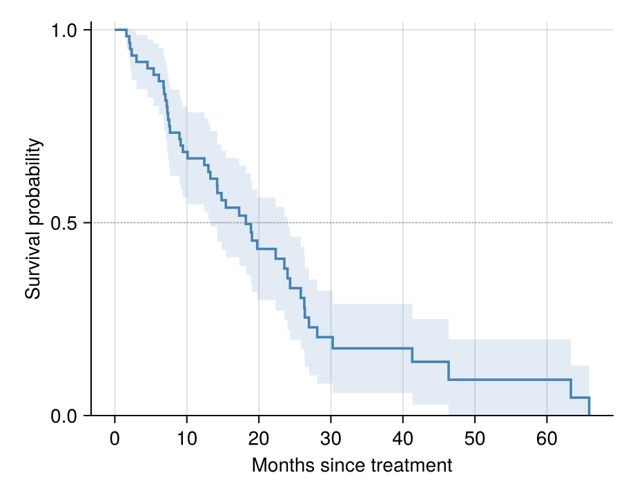

Kaplan–Meier 估计从右删失随访数据中读出生存概率随时间的变化。Julia 生态中尚无维护良好的 Kaplan–Meier 包（2026-10 经 registry 核查），因此本教程直接用二十行基础 Julia 实现估计器与 Greenwood 置信带，并用 `stairs!` 绘制阶梯曲线——机制本身就是教程。

## 示例

{fig-align="center" width="80%"}

## 环境配置

- 系统要求：跨平台（Linux/MacOS/Windows）
- 编程语言：**Julia**
- 依赖包：`CairoMakie`、`DataFrames`、`Statistics`

```{julia}
#| label: packages-setup
#| output: false
using CairoMakie
using DataFrames
using Statistics
using Random
```

## 数据准备

我们模拟每臂 60 名患者（Control、Treatment）的指数生存——中位 12 对 24 个月——管理删失在 10 到 72 个月之间均匀分布。

```{julia}
#| label: data-prep
function simulate_arm(rng, median; n = 60)
    true_time = -median / log(2) .* log.(rand(rng, n))
    censor = 10 .+ 62 .* rand(rng, n)
    DataFrame(Months = min.(true_time, censor),
              Event = true_time .<= censor)
end
rng = Xoshiro(141)
control = simulate_arm(rng, 12)
treat = simulate_arm(rng, 24)
control.Arm = fill("Control", nrow(control))
treat.Arm = fill("Treatment", nrow(treat))
surv = vcat(control, treat)
```

## 可视化

### 逐步实现 Kaplan–Meier 估计

在每个事件时间点，生存概率乘以风险集调整后的生存分数；`stairs!` 绘制标志性阶梯曲线。

```{julia}
#| label: fig-jl-km-basic
#| fig-cap: "两臂的 Kaplan–Meier 总生存曲线"
#| width: 480
function km_fit(times, events)
    order = sortperm(times)
    t = times[order]; e = events[order]
    n = length(t)
    s = 1.0
    ts = Float64[0.0]; ss = Float64[1.0]
    for tt in sort(unique(t))
        d = count(j -> t[j] == tt && e[j], 1:n)
        atrisk = count(j -> t[j] >= tt, 1:n)
        if d > 0
            s *= 1 - d / atrisk
            push!(ts, tt); push!(ss, s)
        end
    end
    (ts, ss)
end

arm_styles = Dict("Control" => :steelblue, "Treatment" => :tomato)
fig = Figure(size = (460, 360))
ax = Axis(fig[1, 1], xlabel = "Months since treatment",
          ylabel = "Survival probability")
for arm in ["Control", "Treatment"]
    sub = surv[surv.Arm .== arm, :]
    ts, ss = km_fit(sub.Months, sub.Event)
    stairs!(ax, ts, ss; step = :post, color = arm_styles[arm],
            linewidth = 1.8, label = "$arm (n=$(nrow(sub)))")
end
hlines!(ax, [0.5]; color = :gray60, linestyle = :dot, linewidth = 0.8)
axislegend(ax; framevisible = false, position = :lb)
ylims!(ax, 0, 1.02)
hidespines!(ax, :t, :r)
fig
```

### Greenwood 置信带

Greenwood 方差 `S² Σ dᵢ / (nᵢ(nᵢ − dᵢ))` 给出逐点 95% 带；把带画在阶梯曲线之后即完成出版级排版。注意 `band!` 没有阶梯属性，需手工重复坐标构造阶梯轮廓。

```{julia}
#| label: fig-jl-km-ci
#| fig-cap: "带 Greenwood 95% 置信带的 Kaplan–Meier 曲线"
#| width: 480
function km_fit_ci(times, events)
    order = sortperm(times)
    t = times[order]; e = events[order]
    n = length(t)
    s = 1.0; cum = 0.0
    ts = Float64[0.0]; ss = Float64[1.0]; lo = Float64[1.0]; hi = Float64[1.0]
    for tt in sort(unique(t))
        d = count(j -> t[j] == tt && e[j], 1:n)
        atrisk = count(j -> t[j] >= tt, 1:n)
        if d > 0
            s *= 1 - d / atrisk
            cum += d / (atrisk * (atrisk - d))
            se = s * sqrt(cum)
            push!(ts, tt); push!(ss, s)
            push!(lo, max(s - 1.96 * se, 0.0)); push!(hi, min(s + 1.96 * se, 1.0))
        end
    end
    (ts, ss, lo, hi)
end

sub = surv[surv.Arm .== "Control", :]
ts, ss, lo, hi = km_fit_ci(sub.Months, sub.Event)
xs_step = Float64[]; lo_step = Float64[]; hi_step = Float64[]
for i in eachindex(ts)
    if i > 1
        push!(xs_step, ts[i]); push!(lo_step, lo[i-1]); push!(hi_step, hi[i-1])
    end
    push!(xs_step, ts[i]); push!(lo_step, lo[i]); push!(hi_step, hi[i])
end
fig = Figure(size = (460, 360))
ax = Axis(fig[1, 1], xlabel = "Months since treatment",
          ylabel = "Survival probability")
band!(ax, xs_step, lo_step, hi_step; color = (:steelblue, 0.15))
stairs!(ax, ts, ss; step = :post, color = :steelblue, linewidth = 1.8)
hlines!(ax, [0.5]; color = :gray60, linestyle = :dot, linewidth = 0.8)
ylims!(ax, 0, 1.02)
hidespines!(ax, :t, :r)
fig
```

## 参考文献

1. Kaplan, E. L., & Meier, P. (1958). Nonparametric Estimation from Incomplete Observations. *Journal of the American Statistical Association*, 53(282), 457-481.
2. Borgan, Ø., & Liestøl, K. (1990). A Note on Confidence Intervals and Bands for the Kaplan-Meier Estimator. *Scandinavian Journal of Statistics*, 17(1), 35-41.
