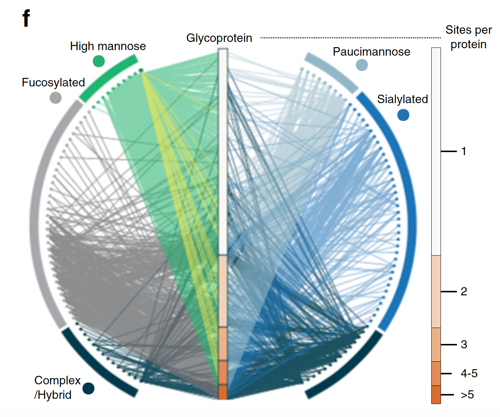

An arc diagram places two levels of entities on concentric rings and connects correspondences with straight or curved chords — here the reference reproduces a Nature Communications glycoprotein figure: **category arcs** on the outer ring (glycan classes), one point per mid-level entity on the middle ring (glycosides), one rectangle per target on the inner ring (glycoproteins), and category-coloured connectors between the levels \[1\]. No `arcdiagram` package exists in this repository's lockfile; the whole layout — angular slots grouped by category, radial edge ordering, ring radii — is computed by hand and drawn with plain ggplot2 geoms, which is also what makes the layout adjustable:

## Example

{fig-alt="Arc diagram DEMO" fig-align="center" width="70%"}

## Setup

-   System Requirements: Cross-platform (Linux/MacOS/Windows)

-   Programming language: R

-   Dependent packages: `ggplot2`

```{r packages setup, message=FALSE, warning=FALSE, output=FALSE}
suppressPackageStartupMessages({
  library(ggplot2)
})
```

```{r}
sessioninfo::session_info("attached")
```

## Data Preparation

A three-level correspondence table: 6 glycan classes → 60 glycosides → ~35 glycoproteins, each glycoprotein carrying 1-3 glycosides. The input of the reference is two tables (node table + group table); the simulation plants the same structure:

```{r load data}
set.seed(52352)
cats <- c("High-mannose", "Hybrid", "Complex tri-antennary",
          "Complex bi-antennary", "Sialylated", "Fucosylated")
n_mid <- 60
mid_cat <- factor(sample(cats, n_mid, TRUE, c(.18, .12, .2, .22, .16, .12)))
mids <- sprintf("G%02d", seq_len(n_mid))
tgts <- sprintf("P%02d", seq_len(40))
## each glycoprotein takes 1-3 glycosides (first-come, glycosides run out)
edges <- data.frame()
used <- logical(n_mid)
for (t in seq_along(tgts)) {
  k <- sample(1:3, 1, TRUE, c(.4, .4, .2))
  cand <- which(!used)
  if (!length(cand)) break
  k <- min(k, length(cand))
  pick <- sample(cand, k)
  used[pick] <- TRUE
  edges <- rbind(edges, data.frame(mid = mids[pick], tgt = tgts[t]))
}
edges$cat <- mid_cat[match(edges$mid, mids)]
cat("glycosides:", n_mid, " glycoproteins with edges:", length(unique(edges$tgt)), "\n")
```

## Visualization

### Ring Layout with Category Arcs

Three layout rules produce the reference's readability. (1) Middle-ring points are **grouped by category** so each class occupies one contiguous angular block — its outer arc is simply that block's span. (2) Inner-ring targets are **ordered by the mean angle of their glycosides**, so connectors stay radial instead of criss-crossing the centre. (3) Ring radii separate the encodings: arcs at r = 1.02, points at r = 1, rectangles at r = 0.6:

```{r}
#| label: fig-1.1ArcDiagram
#| fig-cap: "Bipartite arc diagram: outer arcs = glycan categories spanning their members, middle points = glycosides, inner rectangles = glycoproteins, connectors coloured by category. Targets are angle-ordered so connections read radially."
#| out.width: "85%"
#| fig-width: 9
#| fig-height: 6.2

n_used <- length(unique(edges$tgt))
## (1) mid ring: category-grouped angular slots
o <- order(mid_cat)
pos_mid <- data.frame(mid = mids[o], cat = mid_cat[o],
                      th = seq(0, 2 * pi, length.out = n_mid + 1)[-(n_mid + 1)])
## (2) target ring: sorted by mean glycoside angle, spaced evenly
tgt_mean <- tapply(pos_mid$th[match(edges$mid, pos_mid$mid)], edges$tgt, mean)
tgt_order <- names(sort(tgt_mean))
pos_tgt <- data.frame(tgt = tgt_order,
                      th = seq(0, 2 * pi, length.out = n_used + 1)[-(n_used + 1)])
## outer arcs: each category's block span, padded
arcs <- do.call(rbind, lapply(cats, function(cc) {
  th <- pos_mid$th[pos_mid$cat == cc]
  if (!length(th)) return(NULL)
  pad <- 2 * pi / (n_mid + n_used) * 0.4
  data.frame(cat = cc, from = min(th) - pad, to = max(th) + pad)
}))
pal <- setNames(c("#E69F00", "#56B4E9", "#009E73", "#F0E442",
                  "#0072B2", "#CC79A7"), cats)

arc_df <- do.call(rbind, lapply(seq_len(nrow(arcs)), function(i) {
  th <- seq(arcs$from[i], arcs$to[i], length.out = 80)
  data.frame(x = 1.02 * cos(th), y = 1.02 * sin(th), grp = i, cat = arcs$cat[i])
}))
mid_xy <- data.frame(x = cos(pos_mid$th), y = sin(pos_mid$th),
                     mid = pos_mid$mid, cat = pos_mid$cat)
tgt_xy <- data.frame(x = 0.6 * cos(pos_tgt$th), y = 0.6 * sin(pos_tgt$th),
                     tgt = pos_tgt$tgt,
                     w = 2 * pi / n_used * 0.55)
tgt_xy$cat <- edges$cat[match(tgt_xy$tgt, edges$tgt)]
edges2 <- merge(edges, mid_xy[, c("mid", "x", "y")], by = "mid")
names(edges2)[names(edges2) %in% c("x", "y")] <- c("x_m", "y_m")
edges2 <- merge(edges2, tgt_xy[, c("tgt", "x", "y")], by = "tgt")
names(edges2)[names(edges2) %in% c("x", "y")] <- c("x_t", "y_t")

ggplot() +
  geom_path(data = arc_df, aes(x, y, group = grp, colour = cat),
            linewidth = 2.2, lineend = "round") +
  geom_point(data = mid_xy, aes(x, y, colour = cat), size = 1.6) +
  geom_tile(data = tgt_xy, aes(x, y, width = w * 0.62, height = 0.05, fill = cat),
            colour = "grey25", linewidth = 0.2) +
  geom_segment(data = edges2,
               aes(x = x_m, y = y_m, xend = x_t, yend = y_t, colour = cat),
               linewidth = 0.3, alpha = 0.6) +
  annotate("text", x = 1.2 * cos((arcs$from + arcs$to) / 2),
           y = 1.2 * sin((arcs$from + arcs$to) / 2),
           label = arcs$cat, size = 2.7) +
  scale_colour_manual(values = pal, name = NULL) +
  scale_fill_manual(values = pal, name = NULL) +
  coord_fixed(clip = "off") +
  xlim(-1.35, 1.35) + ylim(-1.35, 1.35) +
  theme_void(base_size = 10) +
  theme(legend.position = "right",
        legend.text = element_text(size = 8))
```

::: callout-tip
**Practice tips**

-   The two ordering rules are the whole figure: category-grouped middle ring (arcs become contiguous blocks) and mean-angle-ordered targets (connectors stay radial). Break either one and the diagram degrades into a hairball.
-   Encode levels by **shape, not only position**: arcs for categories, points for mid entities, tiles for targets — a reader can then identify each ring without labels on 95 entities.
-   `theme_void()` removes legend text as well as axes — re-add `legend.text` explicitly or the colour key will carry no names.
-   The reference's real input is a node table + group table (`easy_input_node.txt`, `easy_input_group.txt`); any bipartite correspondence with a shared category column drops into the same layout — pathway→gene→drug, module→protein→complex.
-   With many-to-many edges (>500), straight segments saturate: switch `geom_segment` to `geom_bezier`-style curves or lower alpha before increasing line width.
:::

## Application

::: {#fig-ArcApplications1}
{fig-alt="Arc diagram" fig-align="center" width="70%"}

Bipartite arc diagram linking glycan categories to glycoproteins through glycosides
:::

Bipartite arc diagrams apply wherever two entity sets are bridged by a shared classification: glycan class → glycoside → glycoprotein, regulator → target gene → pathway, drug → target protein → disease module — the outer arcs summarize the classification and the chords carry the correspondences.

## Reference

\[1\] Xiaofan Lu, et al. FigureYa: A Standardized Visualization Framework for Enhancing Biomedical Data Interpretation and Research Efficiency. iMetaMed. 2025. doi:10.1002/imm3.70005. FigureYa source: [FigureYa145target](https://github.com/ying-ge/FigureYa/tree/main/FigureYa145target).
